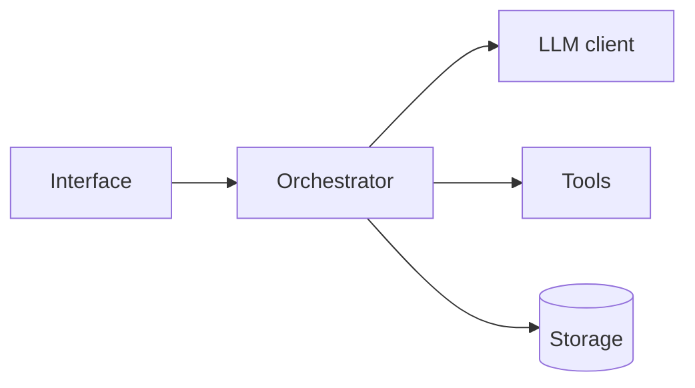
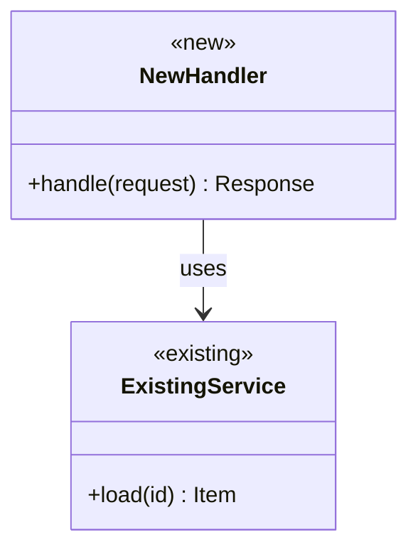

# Architecture First

Before making deep edits, make sure the architecture and the use-case are understood. Don't jump straight into changing code.

The project keeps two living references in `docs/`. They're for both the user and the AI to read, so the overall flow stays clear and nothing gets duplicated or bloated:

```
docs/
├── architecture/
│   ├── README.md          # Conceptual architecture: the whole project in one diagram
│   └── <area>.md          # In-depth architecture for an area: actual classes & functions
└── api/
    ├── README.md          # API index: groups -> classes/functions, one line each
    └── <group>.md         # Full reference for one group
```

## When this applies

- Any change touching more than one function, class, or file
- New features, refactors, or changes to data flow or public interfaces
- Any time you are about to write a new helper or utility function

Small, local fixes (a typo, a one-line bug fix, renaming a variable) can skip the full plan, but still check that the fix fits the surrounding design.

## Step 1: Confirm the use-case

Before touching code, state:

- **Who or what calls this?** The user, another module, a CLI command, an external service.
- **What problem does it solve?** One or two sentences.
- **Inputs and outputs:** what goes in, what comes out, and what side effects happen.
- **Edge cases and constraints:** errors, empty input, concurrency, performance.

If any of these are unclear, ask the user before editing. Don't guess at intent for structural changes.

## Step 2: Read the docs, then the code

1. Read `docs/architecture/README.md` to see where the change sits in the overall system, and check the change against its **Principles** section. If the change conflicts with a principle (e.g. putting module-specific logic in the core, or one module importing another's internals), raise it with the user before planning further.
2. Read `docs/api/README.md` and the relevant group pages to find what already exists. **Do not write a new function if one already does the job, or nearly does.** Extend or generalize it instead.
3. Confirm against the code with Grep/Glob, since docs can lag. If they disagree, trust the code and fix the docs.
4. Note the patterns the codebase already uses (naming, layering, error handling, config) so the change fits them.

## Step 3: Write the plan

Use Mermaid for all diagrams so they render in markdown. The plan covers both levels of architecture plus the API.

### 3a. Conceptual architecture (whole project)

Show where the change fits in the full-project diagram from `docs/architecture/README.md`: which components it touches, and any new component or connection. This level is about components and how data and control flow between them (e.g. UI, orchestrator, LLM client, tools, storage), not individual classes.



If the change alters this picture, the plan must say how.

### 3b. In-depth architecture (judgement call)

Decide whether the change needs a detailed diagram of actual classes and functions. Make one when the change:

- adds or restructures classes, or changes how components talk to each other
- has non-obvious control flow (async, callbacks, retries, state machines)
- touches an area that already has an `docs/architecture/<area>.md` page

Skip it for changes that stay inside one existing function or follow an obvious existing pattern, and say in the plan that you skipped it and why.

When included, mark each class/function as **existing**, **modified**, or **new**, and add a flowchart of the runtime flow if it isn't obvious:



### 3c. API changes

List each new or modified public class, function, or endpoint in the API reference format below, and say which group it belongs to. If it doesn't fit an existing group, propose a new group and justify it, since new groups are a common source of bloat.

## Step 4: Get agreement, then edit

- Present the use-case summary, the reuse findings, the diagrams, and the API changes to the user.
- Wait for confirmation before making deep edits.
- While implementing, stick to the plan. If you find you need a function that wasn't in the plan, check the API reference again for an existing one, then update the plan instead of quietly adding it.

## Step 5: Update the docs

After the change is made, update in the same change set:

- `docs/architecture/README.md` if any component or connection changed
- `docs/architecture/<area>.md` for areas that got an in-depth diagram (create the page if it's new)
- `docs/api/README.md` and the affected `docs/api/<group>.md` pages for every added, changed, or removed public item

Remove entries for deleted code. A stale reference is worse than none.

## Doc formats

### Conceptual architecture (`docs/architecture/README.md`)

- One-paragraph summary of what the project does
- The full-project Mermaid diagram
- A short table of components: name, responsibility, where it lives in the repo, link to its in-depth page if any

### In-depth architecture (`docs/architecture/<area>.md`)

- What the area is responsible for and what it is not
- Class/function diagram of the real code
- Runtime flowchart for the main path(s)
- Link to the matching API group page(s)

### API index (`docs/api/README.md`)

Like the landing page of a commercial API reference: grouped, scannable, one line per item.

```markdown
## Groups

### [Conversation](conversation.md)
Managing chat sessions and message history.

| Item | Kind | Summary |
|------|------|---------|
| [`Session`](conversation.md#session) | class | A single conversation with its message history |
| [`load_session`](conversation.md#load_session) | function | Load a saved session by id |
```

### API group page (`docs/api/<group>.md`)

One section per class or function, in this shape:

```markdown
## `load_session`

`load_session(session_id: str) -> Session`

Load a saved session by id.

**Parameters**
| Name | Type | Required | Description |
|------|------|----------|-------------|
| `session_id` | `str` | yes | Id returned by `Session.save()` |

**Returns:** `Session`, the restored session.

**Raises:** `SessionNotFound` if no session has that id.

**Example**
    session = load_session("abc123")

**Defined in:** `src/conversation/store.py`
**See also:** [`Session.save`](#sessionsave)
```

For a class, list its constructor first, then public methods and attributes as subsections in the same shape. Private helpers (leading underscore, internal-only) stay out of the API reference.
