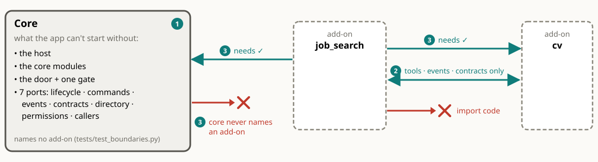
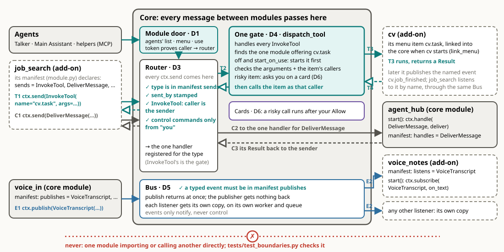
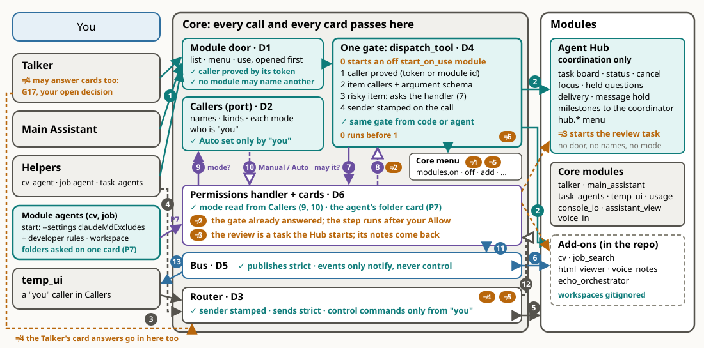
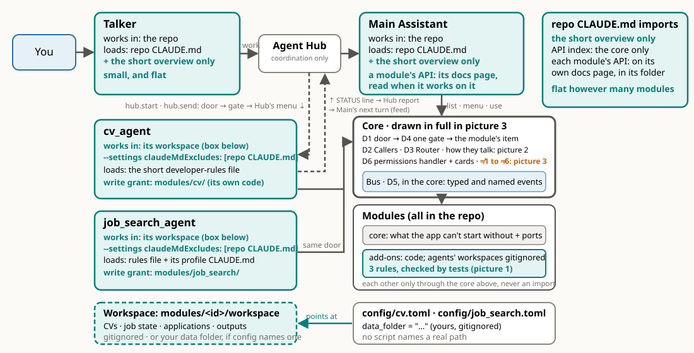

# AI Assistant

A modular personal AI assistant, built as a long-term experimental platform. A small, stable **core** hosts a changing set of independent **modules**: inputs, outputs, views, tools, background workers, and the AI agents themselves. Modules can be added, replaced, turned on or off, or reloaded while the app runs, with little change elsewhere.

## The idea: a core and add-ons

[](docs/architecture/img/core-line-rules.svg)

The three rules of the core line:

1. **The core** is what the app can't start without: the host, the core modules, the one module door with its gate, and seven ports (lifecycle, commands, events, contracts, directory, permissions, callers). It names no add-on.
2. **Add-ons talk only through tools, events and contracts**, never by importing each other's code.
3. **Arrows point one way:** an add-on may need the core or another add-on; the core never names an add-on.

The style is a modular monolith with ports and adapters: the modules run in one process. Detail: [architecture overview](docs/architecture/README.md).

## How modules talk through the core

[](docs/architecture/img/modules-talk.svg)

One module reaches another in three ways, all through the core: a **tool call** ("do this and tell me the result"), a **command** (one message to the one module that handles it) and an **event** ("this happened", to whoever listens). Detail: [core: how modules talk](docs/architecture/core.md#how-modules-talk-through-the-core).

## The pipeline: inside the core

[](docs/architecture/img/core-inside.svg)

Who calls in (left), the core's parts (middle), the modules (right). Every tool call goes door → gate → the module's item, and an item that asks shows you a card. Detail: [core: inside the core](docs/architecture/core.md#inside-the-core).

## Module doors: one door, three tools

Every module has a **menu**: named items, each with a description and its inputs. The agents reach every menu through **one MCP door** that the core hosts, with three fixed tools:

1. **list modules**: one line per module,
2. **show a menu**: one module's items,
3. **use an item**: the core checks who may call it, asks you if the item asks, and runs it.

So an agent loads one line per module until it needs a menu. Agents, other modules and UI buttons all reach a module the same way, through the core. Detail: [modules: one door](docs/architecture/modules.md#how-the-agents-reach-the-menus-one-door).

## Why not just MCP servers?

Plain MCP here would mean one MCP server per module, each offering its tools to the agents directly. We chose one door, for control:

- **Per-module servers would go around the core.** They would skip the permission check, the module directory, the links between modules (what a module needs, events), and hot swap in one process (handing over state, waiting while a module is busy).
- **Callers that aren't agents need the same checks.** The mic button, the viewer and other modules reach a module through commands, events and contracts. An MCP server serves only agents, so they would need a second path.
- **The agent's context stays small.** The door's three tools don't grow with every module that's on, and they never change when a module is swapped, so the agent's tool list stays the same.
- **MCP is still used where it fits.** The door itself is an MCP server. An outside tool that already speaks MCP gets a module that is an MCP client of it and puts the tool on its own menu (cv does this for Rezi). A module never serves MCP itself.

Detail: [modules: why not plain MCP](docs/architecture/modules.md#why-not-plain-mcp), [decisions](docs/architecture/decisions.md).

## The agents

[](docs/architecture/img/agents-sessions.svg)

The **Talker** talks with you and the **Main Assistant** does the work and coordinates; both work in the repo and load only the short overview. Module agents (cv_agent, job_search_agent) work in their module's workspace and load the short developer rules. Work goes through the **Agent Hub** (coordination only); tools go through the core's one module door and gate. Detail: [agents](docs/architecture/agents.md).

## Docs

- [Architecture overview](docs/architecture/README.md)
- [Core](docs/architecture/core.md), [Modules](docs/architecture/modules.md), [Agents](docs/architecture/agents.md), [Decisions](docs/architecture/decisions.md), [Principles](docs/architecture/principles.md)
- [Module library](docs/architecture/module-library.md)
- [API reference](docs/api/README.md)

The browsable HTML is built with `python scripts/build_docs.py` into `docs/html/`.

## Running

```powershell
.\.venv\Scripts\python -m assistant
```

Configuration is in `config/default.toml`, with personal overrides in `config/local.toml` (not committed).
