# Agent runtime

How the two agents are spawned, how each behaves on its own, and how they talk to each other, down to the classes. Back to [Agents](README.md). The contracts are on the [architecture page](../architecture/agents.md#task-agents) and the [Agents API page](../api/agents.md).

> **Status: built (2026-10-25).** Run it with `.\.venv\Scripts\python -m assistant`. Code: `src/assistant/modules/{talker,main_assistant,agent_hub,assistant_view}/` and `src/assistant/infra/{claude_session,session_agent}.py`. The [HTML viewer](../architecture/html-viewer.md) (built 2026-10-27) is its own app (`src/html_viewer`) that the app starts through the thin `html_viewer` module; see [HTML viewer](#html-viewer) below. The Main Assistant's [permission mode](#permission-mode) (Manual or Auto, built 2026-11-02) is switched from the temp UI.

## What runs

Four OS processes. The app is the only one that knows about the others; the two `claude` processes never talk to each other directly.

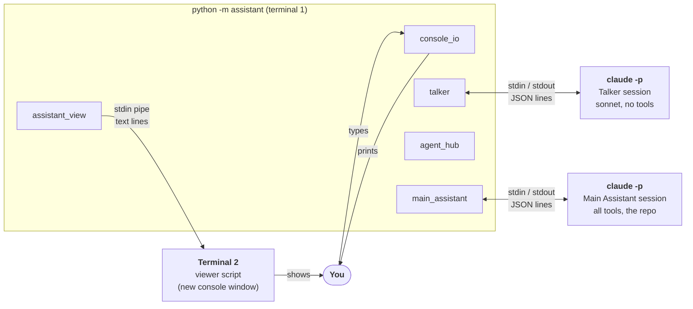

| Process | Started by | Command |
|---------|------------|---------|
| The launcher | You | `python -m assistant`: runs the app as a child process in the same console and starts it again whenever it exits with the restart code (`core.restart_exit_code`, 75) |
| The app | The launcher | `python -m assistant` with `ASSISTANT_APP_CHILD=1`; exits with 75 after `ShutdownRequested(restart=True)` |
| Talker session | `talker` module, in `start` | `claude -p --input-format stream-json --output-format stream-json --verbose --strict-mcp-config --model sonnet --tools "" --append-system-prompt <talker prompt>` |
| Main Assistant session | `main_assistant` module, in `start`; a fresh one for each task and each handoff ([below](#fresh-sessions-and-handoffs)) | **Manual** (the default): `claude -p … --strict-mcp-config --tools default --permission-mode acceptEdits --allowedTools <read/write rules, allowed commands> --permission-prompt-tool stdio --append-system-prompt <worker prompt + its access>`, working directory the repo. Allowed: every file in the repo ([permissions](README.md#permissions)) and the `allowed_commands` (the tests, `ruff`, the docs build), as `PowerShell(<command>)` and `PowerShell(<command> *)` rules; any other shell command is asked of you. **Auto:** the same, but `--permission-mode bypassPermissions`, plus `--disallowedTools "PowerShell(git push)" "PowerShell(git push *)" "Bash(git push)" "Bash(git push *)"` (separate arguments), and the risky-step rule in the prompt ([Permission mode](#permission-mode)). The command is built by `build_command(config, workspace, mode)` and read again at every session start. Its `debugger` subagent (`.claude/agents/debugger.md`, sonnet) runs inside this process under the same rules: its permission requests reach you the same way |
| HTML viewer (not drawn above) | `html_viewer` module, on the first file shown, not in `start`. One you started yourself is used and left running | `python -m html_viewer --port 8766 --window app --profile <its Edge profile> --generated docs/html …`: the standalone viewer app, an HTTP server plus its own Edge app window (with a DevTools port on 127.0.0.1, for snip). Stopped (`POST /api/quit`, then killed) when the app stops |
| Voice service (not drawn above) | `voice_in` module, on the first `StartListening`, not in `start`, through `CompanionApp`. One you started yourself is used (after a quick `/health` check) and left running | `python -m voice_service --host 127.0.0.1 --port 8767 [--config <file>]`, with no console: the mic and the speech engine, an HTTP and WebSocket server ([Voice](../architecture/voice.md#the-voice_in-module)). Stopped (`POST /quit`, wait 5 s, then killed) when the module stops, only if it launched it |
| Terminal 2 (off by default; the [temp UI](#temp-ui) replaces it) | `assistant_view` module, in `start` | `python -m assistant.modules.assistant_view.viewer` in a new console window, its stdin a pipe from the app. It writes to its own window (`CONOUT$`), because its inherited stdout is terminal 1. Windows only for now |

Each command line is built by [`claude_command`](../api/infra.md#claude_command); the model, tools, permission mode, and workspace come from `[modules.talker]` and `[modules.main_assistant]` in `config/default.toml`. Each session also writes a **transcript** of every line in and out: `talker.jsonl` and `main_assistant.jsonl` in the launch's log folder, `logs/<start time>_<theme>/`, next to `assistant.log` ([Logging](../architecture/core.md#logging)). The Talker supplies the theme from your first question (`<<THEME: ...>>` in its first reply, published as `SessionTheme`).

## Temp UI

> **Temporary.** A throwaway stand-in until a real **UI handler** and its UI configurations are designed, in a conversation of their own (an [open decision](../architecture/decisions.md#open-decisions)). Kept small so it's easy to throw away; don't build on it.

The `temp_ui` module serves a local web page at `http://127.0.0.1:8765/`: the **Main Assistant's** activity on the left (its text, tool calls, task updates, and an idle / working / waiting badge), the **Talker** conversation on the right (with an input box). Terminal 1 still works alongside it; type `exit` there to quit.

It opens in its own window using Edge's app mode (`msedge --app=URL`: no tabs or address bar). Set `[modules.temp_ui] window` to `"browser"` for a normal tab, or `"none"` to open nothing. Without Edge it falls back to a tab. Closing the window doesn't stop the app. The window runs on its own Edge profile (`window_profile`, default `%LOCALAPPDATA%\AI_Assistant\temp_ui_window`), so it's separate from your normal Edge and the app can close it.

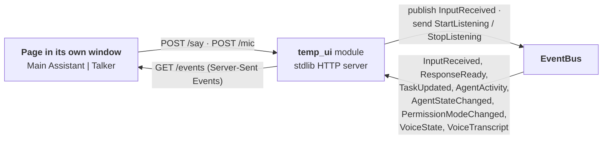

- It's an ordinary module: it publishes `InputReceived`, sends `AnswerPermission` and `SetPermissionMode`, and listens to events, so nothing else knows it exists.
- **Permission requests** show in the Talker pane, in line with the conversation, as a card with **Allow** / **Deny** (`POST /permission`). Answering the Talker in words instead settles the card too. The Main Assistant pane only logs the request and its answer, with no buttons.
- **Permission mode toggle (a stand-in):** `Main Assistant: Manual | Auto` in the Talker pane's header sets what the Main Assistant may do (`POST /permission-mode` → `SetPermissionMode`). Its tooltip and code comment mark it as a stand-in until the control panel or chat window. Switching to Auto first shows a confirm dialog: full permissions except `git push`, the Main Assistant pauses before risky steps on its own judgment only, and this is not a guarantee. Switching back to Manual is one click. While Auto is on, the Talker pane's header turns amber and reads "Main Assistant: AUTO, no permission prompts", and the worker pane shows an `AUTO` tag; a switch that waits says "(from the next task)". Each `PermissionModeChanged` is logged as a `note` line in both panes. The current mode is a "current state" item, so a reconnect shows it like the usage meters.
- **Risky-step card:** in Auto, a `need` whose text starts with `Risky:` shows in the Talker pane as an amber card, "⚠ Risky step, paused: …", with **Go ahead** / **Don't**. The buttons send "Go ahead" or "Don't do it" through `/say`, the same as typing it. The worker pane logs "paused: risky step".
- **Logs** button in the header opens the current session's log folder in Explorer, or `logs/` before your first message, when the folder doesn't exist yet (`POST /open-logs`; `__main__` sets `logs_dir` to `LogSession.folder`).
- **Relaunch, one window:** `/events` starts with a `hello` carrying the launch's id. On reconnect, the same id means a network drop (the page clears and the history replays); a new id means the app was relaunched. In app mode the new app has already closed the old window at startup (any Edge process on the window's profile), then opens a fresh one. Otherwise the old page tries `window.close()`; if the browser refuses (a normal tab), it says the session ended instead. The app also closes its window when it stops.
- On (re)connect the page gets the last 500 items replayed, so a refresh loses nothing recent.
- **Open in viewer:** an HTML file path in a Talker message gets an **Open in viewer** button under it. Clicking it sends `InvokeTool viewer.open` with `front: true` (`POST /open-in-viewer`): the viewer window comes to the front, or opens again if you closed it. Without the `html_viewer` module the button says it couldn't open. A bare file name resolves against the app's folder, which is why the Talker always writes full paths.
- **Mic button** (voice in): next to Send. A click sends `StartListening` (`POST /mic {"on": true}`), the next click `StopListening`; `voice_in` handles both. The button shows `VoiceState`: pulsing while *starting*, red while *listening*, an amber crossed-out mic when *dropped*. A grey line above the input shows the live text (`VoiceTranscript` partials); with [two passes](../architecture/voice.md#two-passes-live-text-cleaned-piece-by-piece) its first `settled_chars` (whisper's cleaned text) are in normal text and the rough rest dimmed, and after you stop the button pulses (*finishing*, clicks ignored, the ✕ still there) with "cleaning up…" after the line until the text is sent; with an engine that gives no live text (whisper) or `live_text = false`, it says "Listening… text appears when you stop" (the state's `detail`) and the text arrives on send; when the mic drops, "⦸ Mic dropped, waiting 12 s for it to come back · 8 words so far", counting down (the wait is read from the state's `detail`); on *failed*, "Mic: " and the reason, until the next click. Your spoken message appears in the chat as your own, marked "spoken". While the mic is *listening* or *dropped*, a small ✕ before it clears: `POST /mic {"clear": true}` sends `StopListening(discard=True)`, then `StartListening`, so what was heard is thrown away (nothing reaches the Talker), the grey line empties, and the mic carries on in a new session. Updates from any session but the one that last sent *starting* are ignored. With `voice_in` not running, the line says "voice input is off". When `voice_in` is off, starting, reloading or failed (from its `ModuleStateChanged`), the mic is crossed out and not clickable, with the reason as its title and in the grey line. When the voice app isn't running, it's crossed out but clickable, to try starting it again. The voice state is a current-state item, like the usage meters.
- **Snips:** a snip from the HTML viewer (`ViewerClip`) shows as a thumbnail above the input until your next message, which takes it to the Talker. Up to 3; × drops one (`ViewerClipDropped`).
- **Usage and Reset:** the header shows the worker's and the Talker's usage side by side, live ([`SessionUsage`](../api/agents.md#sessionusage)): `Worker context 145k · used 2.3M · ~$5.10`, the same for the Talker. Context turns amber from 100k; hovering shows the split of used tokens. Each pane's **Reset** button (`POST /reset`) publishes [`ResetRequested`](../api/agents.md#resetrequested): the Talker starts fresh but keeps its last few exchanges; the worker resets at once when idle, or writes a handoff and carries on fresh mid-task.
- The window code (Edge app mode on its own profile): [`app_kit.window`](../api/app_kit.md#window), shared with the HTML viewer. SHOW tags, the Talker's tags, and `NEED:` / `HANDOFF:` lines are read with the shared [`agent_tags`](../api/infra.md#agent_tags). Both prompts point the agents at the [reusable parts index](../api/reusable.md).
- Code: `src/assistant/modules/temp_ui/` (`module.py`, `page.html`). Config: `[modules.temp_ui]` (`port`, `window`).

## HTML viewer

HTML files opened through the chat open in the [HTML viewer](../architecture/html-viewer.md), never in your default browser.

| Who | How |
|-----|-----|
| You, in the chat | Click **Open in viewer** under an HTML path in a Talker message; the viewer comes to the front |
| The Talker | Writes the **full absolute path** (never a bare file name), so the button shows and works; when you ask it to open a file now, `<<SHOW: path>>` → `InvokeTool viewer.open`; to point at a part, `<<SHOW: path \| "quoted text" \| heading>>` → `viewer.highlight`. The tag is stripped from the reply, so the Talker adds its path back if the reply doesn't have it, and the button still shows |
| The Main Assistant | Can't call app tools: writes the same `<<SHOW: ...>>` forms on their own line. The `html_viewer` module reads them in `AgentActivity` and calls `viewer.open` or `viewer.highlight` |

**Focus:** pages an agent opens on its own (SHOW tags: quick checks, debugging) open in the viewer but stay in the background. Only your click on an Open in viewer button brings the viewer to the front.

The `html_viewer` module starts the viewer app on the first request, follows its event stream, and publishes `ViewerTabsChanged` (tabs and highlights) and `ViewerClip` (snips). The Talker doesn't take a turn for either: it hears `[Viewer] open: <paths>; highlighted: ...` before your next message, and gets waiting snips as images with that message, each with a `[Viewer] snip from <file>, near "<heading>"` line, so "what is this?" is enough.

## Launched from the main app

Everything below runs in one Python process, on one `asyncio` event loop (plus `console_io`'s stdin thread). The agents' `claude` processes are children of it.

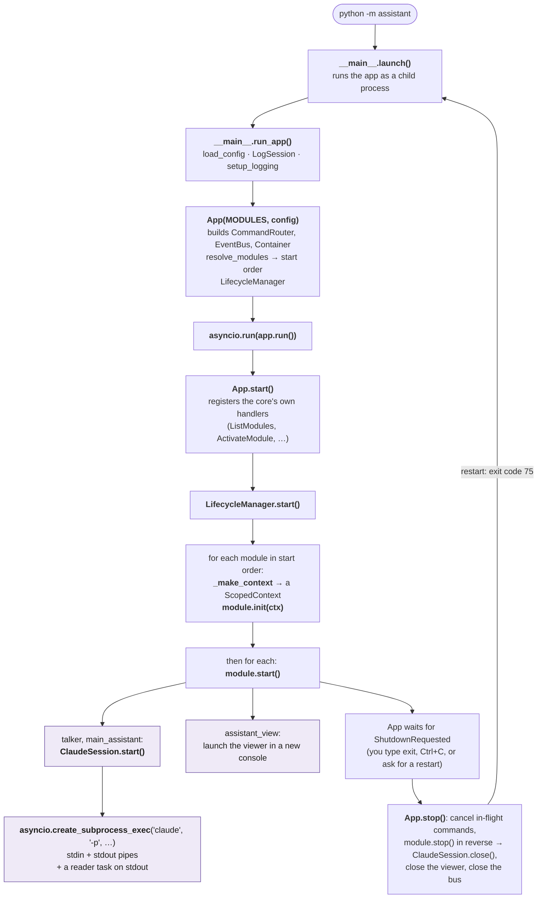

Purple: added for the agents. Outside the new modules, the only edits were two lists (`MODULES` in `__main__.py` gained the four module classes, and `modules.enabled` in `config/default.toml` switches them on and the echo module off) and `console_io` now also prints uncorrelated replies, so the Talker can speak first.

## Messaging to and from the main app

Modules never hold references to each other. Each gets a `ScopedContext`, and everything goes through the core's three parts. Only the pipes leave the process.

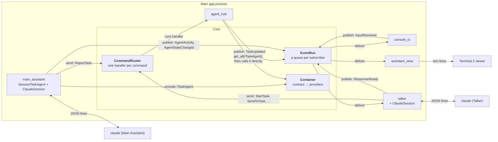

| Path | How it works | Waits? | Can be lost? | Used for |
|------|--------------|--------|--------------|----------|
| **Command** | `ctx.send(cmd)` → `CommandRouter.send` runs the one handler as its own task and returns its `Result`. Timeout from config (default 30 s) | The sender waits for the `Result` | No: always a `Result` (`ok`, `timed_out`, …) | Talker → Hub, agent → Hub (`ReportTask`) |
| **Event** | `ctx.publish(ev)` → `EventBus` puts it on each subscriber's queue; each subscriber has a worker running its handler, in order, 10 s limit | No, returns at once | Yes, if a subscriber's queue (100) is full | You → Talker, Talker → you, Hub → Talker, agent → terminal 2 |
| **Contract call** | `ctx.get_all(ITaskAgent)` → `Container` → a plain Python method call on the provider (`SessionTaskAgent`) | The Hub awaits the method, which returns at once | No | Hub → agent |
| **Session pipe** | `ClaudeSession` writes one JSON line to the child's stdin; its reader task reads stdout lines and calls `on_event` for each | Writing doesn't wait for a reply | Only if the process dies | Module ↔ its `claude` |
| **Viewer pipe** | `assistant_view` writes text lines to the viewer's stdin | No | If the window was closed | Terminal 2 |

Since each command handler runs as its own task, the Hub can handle a `ReportTask` while it's still inside a `SendToTask`. That's why the agent may report while the Hub is calling it.

### A message there and back, through the core

You ask for work; the Main Assistant finishes; the Talker tells you. Every hop shown:

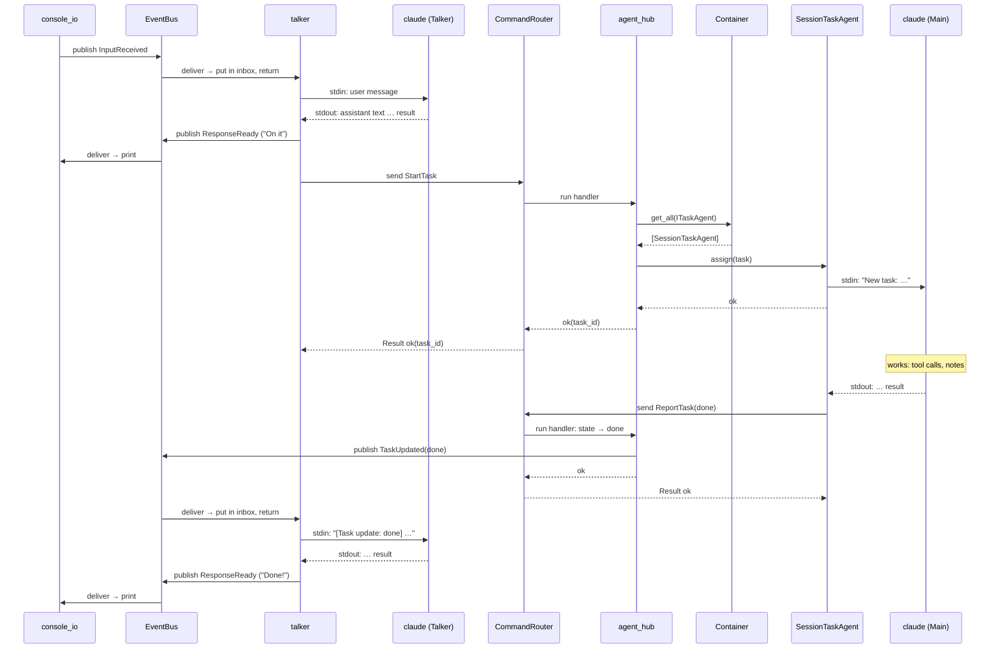

## Spawning

The core's lifecycle manager starts the modules in dependency order. Nothing else launches anything: each module starts its own process in `start` and ends it in `stop`.

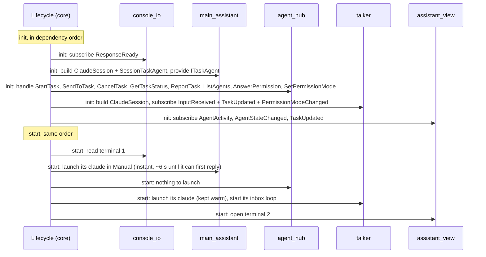

- **Order:** `main_assistant` provides `ITaskAgent` and the Hub lists it as optional, so the agent starts before the Hub. `talker` and `assistant_view` depend on nothing; they only send commands and listen to events. The diagram shows one valid order; the actual one is `console_io, main_assistant, talker, assistant_view, agent_hub`.
- **Stop** runs in reverse, so the Hub stops first: reports an agent sends while shutting down are refused (logged as warnings, harmless). Each session closes its `claude` process: stdin closed, then killed if it hasn't exited within the stop timeout. Terminal 2 is closed.
- **Runtime control:** deactivating `main_assistant` ends its process; the Hub sees no agents and `StartTask` returns `not_available`. Activating it again starts a fresh session (no memory of before), back in Manual.

## Classes

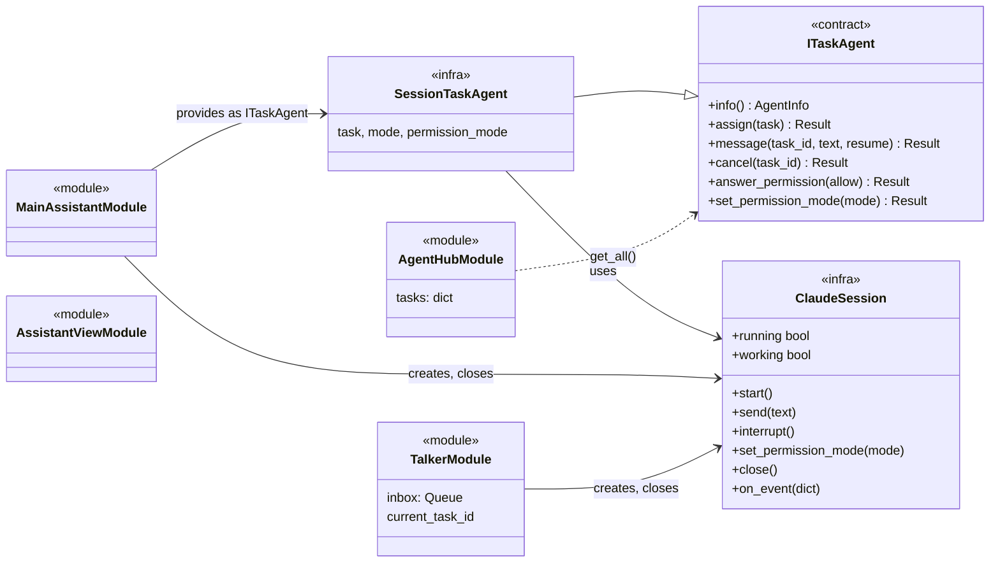

The core's lifecycle manager starts all of these modules, and none of them launches another. In the diagram, the arrow with a hollow head means "implements", a plain arrow means "holds and uses", and the dotted arrow means "looks up through the Container".

`ClaudeSession` runs one `claude` process. It knows nothing about tasks or the Talker: it writes messages and interrupts, calls `on_event` for every JSON line, and sets `working` from "message sent" until `result`. Its command can be a callable, read on every `start`, so each new session gets the current permission mode's flags. `SessionTaskAgent` lives in `infra` too, not in the `main_assistant` module, so a later subagent module can reuse it without importing another module's internals ([principle 3](../architecture/principles.md)).

The Talker and the Main Assistant are both LLM agents. Each has its own `ClaudeSession`, so each runs its own `claude` process with its own model, prompt, and tools. What differs is their role, and the diagram shows it by which one implements `ITaskAgent`:

- `MainAssistantModule` is the worker. In `init` it builds a `ClaudeSession` and a `SessionTaskAgent`, and registers the agent with the Container as an `ITaskAgent`. `SessionTaskAgent` turns the Hub's calls (`assign`, `message`, `cancel`, `set_permission_mode`) into messages for its session, and the session's results into reports.
- `TalkerModule` talks with you and takes no tasks, so it doesn't implement `ITaskAgent`. When something needs doing, it hands the task to the Hub with a command (`StartTask`, `SendToTask`, …) and hears back through `TaskUpdated` events. Commands and events travel through the core, so they aren't drawn here; they're in [Messaging to and from the main app](#messaging-to-and-from-the-main-app).
- `AgentHubModule` holds no reference to any agent module. It asks the Container for every `ITaskAgent` and calls the ones it gets back. A future subagent is one more module that provides `ITaskAgent`, and the Hub finds it without any change.
- `AssistantViewModule` only listens to events, so it has no arrows.

## The Talker on its own

The Talker is a conversation loop with one **inbox**. Everything that should make it speak goes into the inbox, and it handles one item at a time, one `claude` turn each. So it never talks over itself, and the event handlers return at once (no 10 s handler timeout).

| Inbox item | Comes from | Sent to its session as |
|------------|------------|------------------------|
| You said something | `InputReceived` | your text, as is |
| Task update: `done`, `need`, `reply`, `failed` | `TaskUpdated` | `[Task update: done] <text>` |
| Command result worth telling | its own tags (e.g. `StartTask` refused, `GetTaskStatus`) | `[Status] <text>` |

`ViewerTabsChanged` isn't an inbox item: the Talker keeps the latest and puts `[Viewer] open: <paths>` before your next message. `PermissionModeChanged` for the worker works the same way: `[Mode] worker: auto (from the next task)` goes before your next message, once. Its prompt says the worker starts in Manual at every launch, so it knows the mode, can tell you, and mentions Auto when it hands over a task. A `need` starting with `Risky:` means the worker, in Auto, paused before a risky step: the Talker says so plainly and passes your answer on with `ASK`.

**Usage, always in view.** The Talker is the real interface (voice, glasses later), so it knows both sessions' usage without asking anyone. It keeps the worker's latest [`SessionUsage`](../api/agents.md#sessionusage), reads its own from its session, and puts both, kept apart, before each of your messages:

    [Usage] worker: context 145k, used 2.3M (~$5.10) · you: context 24k, used 0.4M (~$0.30)

"How full are you?" or "what has this cost?" is answered from that line, about either session or both. When either context passes `context_warning` (150k), a `[Status]` tells it once (checked with the shared [`ContextWatch`](../api/infra.md#contextwatch)); it warns about that session again only after its context has come back under (a reset or a fresh session) and passed the threshold again. For its own context it tells you in a sentence and offers a reset. For the worker's, the `[Status]` says the worker has already been reminded to find a reset point and hands off by itself ([context reminder](#fresh-sessions-and-handoffs)), so it just tells you.

`progress` updates don't go to the inbox: they'd make it chatter. The Hub keeps them and they come back when you ask "how's it going?".

**Peek, don't interrupt.** Every message to the running task interrupts it and costs it a full step at its whole context, plus the automatic "continue". So questions about what it's doing ("what's going on?", "why is it editing that?") are a `LOOK`: the `[Status]` carries the task's last 15 activity lines (its text, and tool calls with their file or command, from [`TaskInfo.activity`](../api/agents.md#taskinfo)). `ASK` is only for answering its question or changing what it does, and never just to say "continue".

**One change per task.** A new request gets its own `WORK` once the running task is done; it isn't folded into the running task with `ASK`, which is what let one task grow to four features and 273k tokens of context (the 2026-10-27 logs). If you ask for new work while a task runs, the Talker says what's running and what pausing or cancelling it would leave unfinished, and you choose: wait, pause it, or cancel it.

**Reset.** `ResetRequested("talker")` (the temp UI's Reset button, or `<<RESET: talker>>`) goes into the inbox, so it happens between turns: the session restarts, and the next message to it starts with `[Context] Your session was just reset…` and the last few exchanges.

**Restart.** When you ask for a restart, the Talker's `<<RESTART>>` asks the worker for **reset instructions**: what was being worked on, what is done, what is left, and which notes to read. If a task is running, this goes as `SendToTask(resume=false)`; with no task, as a small `StartTask`. If the task is waiting on you (a `need` or a permission), a `[Status]` says so first, and only `<<RESTART: anyway>>`, after you say yes, goes ahead. The worker updates the task's change note, then replies with the instructions and a last line `RESTART_READY` (read with `agent_tags.last_line`). The Talker saves the reply to `restart_note` (`.claude/state/reset-instructions.md`) and publishes `ShutdownRequested(restart=True)`. If the worker can't be reached, its task fails, or it doesn't answer within `restart_timeout` (120 s), the Talker saves its own last few exchanges instead and restarts anyway. At the next start the note is the Talker's first input (`[Restart] The app was just restarted…`). The Talker tells you where things stand and waits for your go, then deletes the note. Any stop that isn't a restart also deletes a leftover note. This builds on the `HANDOFF:` lines and the worker reset (both stay within one launch). A restart carries the same kind of note across launches.

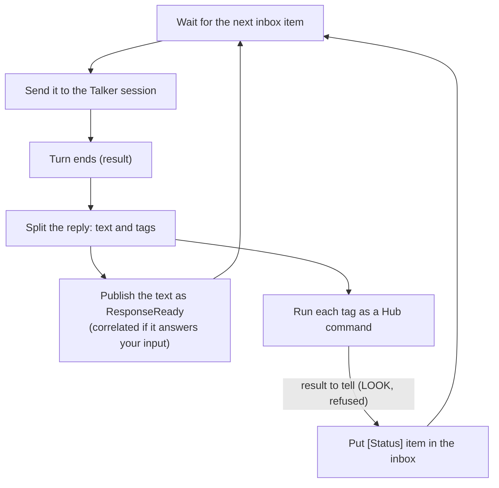

**Tags** (v1: one task at a time, so no task ids; the Talker module remembers the current task):

| Tag | Hub command |
|-----|-------------|
| `<<WORK: task>>` | `StartTask(task, context)`, context = the last few exchanges |
| `<<LOOK>>` | `GetTaskStatus()`; the result, with recent activity, comes back as a `[Status]` item |
| `<<RESET: talker \| worker>>` | Not a Hub command: publishes `ResetRequested` for itself or the worker, only when you ask |
| `<<RESTART>>` / `<<RESTART: anyway>>` | `SendToTask` or `StartTask` asking for reset instructions, then `ShutdownRequested(restart=True)` ([Restart](#the-talker-on-its-own) above), only when you ask for a restart |
| `<<ASK: text>>` | `SendToTask(text, resume=true)`: a question, extra instruction, or your answer to a NEED |
| `<<PAUSE: text>>` | `SendToTask(text, resume=false)` |
| `<<CANCEL>>` | `CancelTask()` |
| `<<ALLOW>>` / `<<DENY>>` | `AnswerPermission(allow=…)`, only after you've said yes or no to a `permission` update |
| `<<MODE: manual>>` | `SetPermissionMode(worker, manual)`, when you ask to switch the Main Assistant back to Manual. Manual only: any other mode is refused with a `[Status]` saying only you switch to Auto, with the button |
| `<<SHOW: path>>` | Not a Hub command: `InvokeTool viewer.open(path)`, opening an HTML file in the [HTML viewer](#html-viewer), only when you ask it to open one |
| `<<SHOW: path \| "quote" \| heading>>` | Not a Hub command: `InvokeTool viewer.highlight(path, text, heading)`, opening the file and highlighting the quoted part, when it's talking about one part of a page. If the quote isn't on the page, a `[Status]` says so |
| `<<THEME: words>>` | Not a Hub command: in the reply to your first message, up to five words about it, published once as `SessionTheme` for the [log folder](../architecture/core.md#logging) name. Without it, the first words of your message are used |

**Talker prompt, in short:** you're the voice of a personal assistant; keep replies short and conversational; you can't do work yourself, so hand anything substantial over with `WORK`; never claim work is done until a `[Task update: done]` arrives; infer from context whether the user means continue, pause, or cancel, and never ask them for keywords. You and the Main Assistant are one assistant to the user. It also gets the facts about the system: what the Main Assistant can read and write, that nobody can grant permissions by chat, the worker's permission mode (Manual at launch; only the user switches to Auto), and where the logs are. It must not state anything about the system beyond those facts. HTML files always open in the HTML viewer: it writes the path (the chat shows an Open in viewer button) and never offers or asks for the default browser. A `[Viewer] snip` line means an image of part of a page is attached; it answers about the image, and hands real work on it to the Main Assistant with the snip's path.

## The Main Assistant on its own

`SessionTaskAgent` turns `ITaskAgent` calls into session messages and session events into reports. It keeps an internal **mode**; the Hub's `TaskState` is the outside view of the same thing.

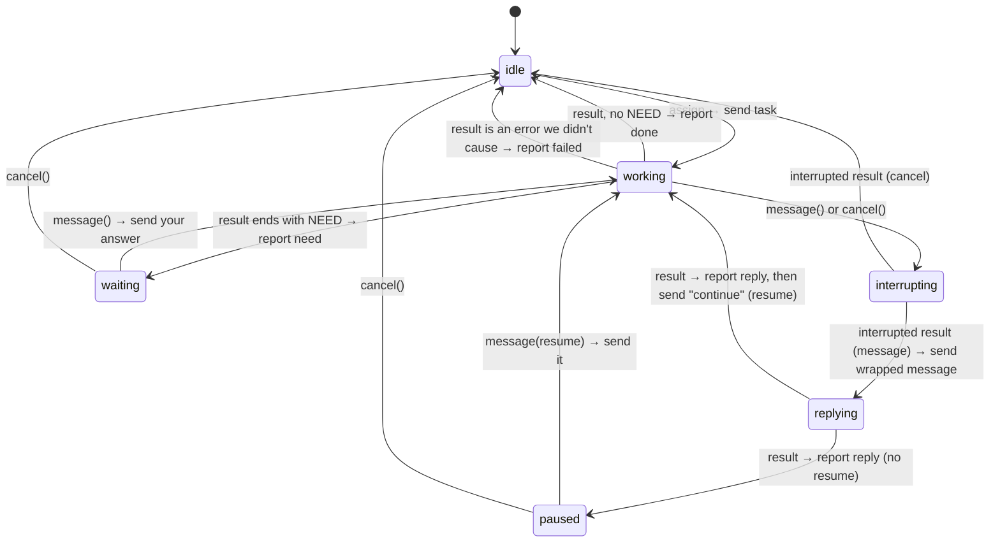

- **Interrupt isn't failure:** in `interrupting` the agent knows it caused the `error_during_execution` result ([spike finding](spike.md#findings)) and doesn't report `failed`.
- **`message` and `cancel` return as soon as the interrupt is sent**; the rest happens as events arrive. So the Hub never waits on the agent while the agent is reporting to the Hub.
- **Cancel fallback:** if no `result` arrives within a few seconds of the interrupt, close the process; the next task starts a fresh session.
- **Reports and events while working:**
  - every `assistant` text or tool call → `AgentActivity` (terminal 2)
  - a text note mid-turn → `ReportTask(progress)`
  - `working` / `busy` changes → `AgentStateChanged`
  - every call (and each turn's result) → [`SessionUsage`](../api/agents.md#sessionusage), when the numbers changed

### Fresh sessions and handoffs

Every call resends the session's whole conversation, so the cost of a step grows with everything before it. On 2026-10-27 one task carried four features and grew from 39k to 273k tokens a call. Its code edits were also poorly batched: the same file edited again and again, each edit a full step at that size. So ([decision](../architecture/decisions.md#decided)):

- **A fresh session per task** (`fresh_sessions = true`): `assign` closes a used session and starts a new one, back at the fixed ~31k (system prompt and tools). The task text and its change note in `docs/next-steps/` carry what it needs; decisions live in the docs, not in an old conversation.
- **Handoffs inside a task:** the prompt asks it to judge whether a task holds separate, big parts. If so, after each part it updates the docs, writes what's done and next into the change note, and ends with `HANDOFF: <note>`. The agent closes the session, starts a fresh one, and sends `Task, continued in a fresh session: <text> … read the handoff in <note> first`. Same task id, so the Hub and Talker see a `progress` report, not a new task. After `max_handoffs` (3) in one task it asks you (`need`) instead.
- **Reset** ([`SessionTaskAgent.reset`](../api/infra.md#sessiontaskagent), from `ResetRequested`): idle, the session closes now; mid-task, it gets a message asking for a handoff note, and its `HANDOFF:` reply hands off as above.
- **Context reminder** (`[modules.main_assistant] context_reminder = 150000`, 0 = off): the first time the worker's context passes it during a task, `SessionTaskAgent` sends a `[Context check]` message the same way as a mid-task message (it interrupts the current step, then carries on): find a safe point, write what's done and next into the change note, and end with `HANDOFF:`, which hands off as above. Once per crossing (the shared [`ContextWatch`](../api/infra.md#contextwatch)); a fresh session re-arms it. While the task waits on you (a `NEED` or a permission request) it's held and sent once the task works again. You hear about it through the Talker's own warning and the `progress` "Handed off…" report.
- **Batching**, with no interrupts and no extra steps: an interrupt costs a full step and balloons the context, which is what batching is meant to prevent. (1) The worker's prompt always says to read each file once and make all its changes in one pass, and that this never means skipping the architecture-check, tests or ruff. (2) The edit hook (`scripts/hooks/edit_tracker.py`, `.claude/settings.json` matcher `Edit|Write|MultiEdit|NotebookEdit`) adds a note to the edit itself on the second edit to a file in a task, once per file. The worker's process carries `ASSISTANT_AGENT`, `ASSISTANT_TASK_FILE` and `ASSISTANT_EDIT_NOTE` (from `hook_env`); `SessionTaskAgent` writes the task id to that file at each `assign` (`.claude/state/main_assistant-task.txt`), so the count survives handoffs. `SessionTaskAgent` logs the same moment (main log, and `batching note: a.md` in the worker's pane). Off switch: `[modules.main_assistant] edit_note = false` (the prompt line stays). Your own Claude Code sessions keep the hook as before: `Edit` and `Write` only, a note on every repeat.
- **Debugging and broad searches** go to the `debugger` subagent (Claude Code's own subagents, `.claude/agents/debugger.md`, sonnet): it loops in its own small context and returns only the cause, the fix, and the proof. It runs inside the Main Assistant's process, so the Hub doesn't see it as a task; stopping the Main Assistant stops it too.

### Loading new code

After changing a main-app module and passing its tests, the Main Assistant ends its turn with a last line `RELOAD: <module id>` (add `now` to cut in on a busy module) or `ADD_MODULE: <package>` for a brand-new one ([reloading](../architecture/core.md#reloading-a-modules-code)). `SessionTaskAgent` reads it with `agent_tags.last_line`:

- **Auto:** it sends `ReloadModule` / `AddModule` at once.
- **Manual:** it opens a permission request (`{"app_command", "action"}`), shown as an Allow / Deny card; your answer through `AnswerPermission` sends the command or not.
- **Then:** the outcome goes back to its session (`[App] Reloaded voice_in: done.` or `failed: …`, then "Continue the task…").
- **Refused:** reloading `main_assistant` itself, with a message. Core, contracts, `infra` and `app_kit` changes still need a restart, which its prompt says.
- **Known waits:** reloading the Agent Hub from inside a task waits out its timeout (its own task is open), unless `now`; and the Main Assistant stays "working" while a Manual request waits for your answer.

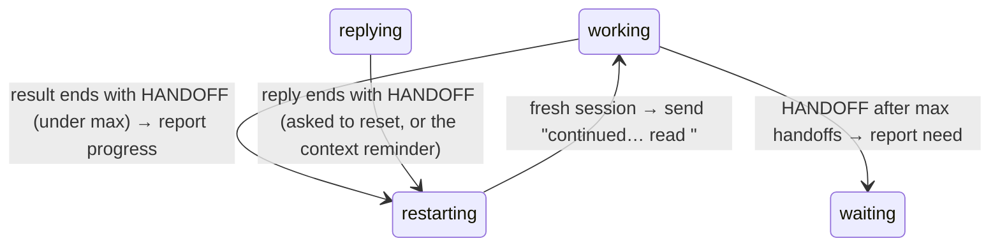

### Permission mode

The Main Assistant runs in one of two [`PermissionMode`](../api/agents.md#permissionmode)s. The mode lives in memory in `SessionTaskAgent`, and every launch starts in **Manual**: it isn't saved.

| Mode | What it does | `claude` flags |
|------|--------------|----------------|
| **Manual** (default) | Edits in the repo and the allowed commands run without asking; everything else shows an Allow / Deny card | `--permission-mode acceptEdits`, the `--allowedTools` standing rules, `--permission-prompt-tool stdio` |
| **Auto** | Full permissions, no cards, except `git push`, which is refused. It pauses on its own before very risky steps | `--permission-mode bypassPermissions`, `--disallowedTools` with `git push` and `git push *` for PowerShell and Bash, the same standing rules and prompt tool, plus the risky-step rule in its prompt |

- **Who switches:** `SetPermissionMode(agent_id, mode)` goes to the Agent Hub, which calls the agent's `set_permission_mode` and publishes `PermissionModeChanged(agent_id, mode, applies)`. Only you switch to Auto, with the temp UI's toggle. The Talker can only switch back to Manual (`<<MODE: manual>>`), and the Main Assistant has no route to the command.
- **When it takes effect** (`applies`):
  - **idle:** `now`. The next session's command is built for the new mode, since `ClaudeSession` reads its command on every start.
  - **to Auto while a task runs:** `next_task`, the next task or the next handoff session, because the risky-step rule lives in the session's prompt, which is fixed at start.
  - **to Manual while a task runs:** `now` if the running session is in Auto, through the `set_permission_mode` control request (`acceptEdits`). If Auto was still waiting for the next task, the session is already in Manual and nothing is sent. If the request fails, it's `next_task`.
- **Risky steps in Auto:** the prompt tells it to end its turn with `NEED: Risky: <what and why>` before deleting data beyond the task, rewriting git history, changing secrets or settings, installing or removing packages, spending money or calling a paid service, sending anything outside the machine, or anything else hard to undo, and to ask when unsure. It reuses the normal `need` path; your answer continues the task through `SendToTask`. This rests on the model's judgment, not a hard stop.
- **The one hard limit:** the `git push` block holds under `bypassPermissions` with no prompt (checked against the real `claude`, 2026-11-02). It only catches a direct `git push`, not `git -C x push` or a script that pushes.

**Worker prompt, in short:** you're the Main Assistant doing tasks handed to you; you and the Talker are one assistant to the user; your exact access is listed (built from config: folders and the allowed commands, by mode: in Manual, if a task needs more, just use the tool and you're asked; in Auto, full permissions except `git push`, plus the risky-step rule above); before each major step write one short progress line; if you need a decision from the user, stop and end your turn with a last line `NEED: <question>`; when finished, end with a short summary of what you did; every step resends the whole conversation, so batch reads and edits (read each file once, all its changes in one pass; this never means skipping the architecture-check, tests or ruff), split separate big parts across handoffs (`HANDOFF: <note>`), and keep decisions in the docs; hand debugging loops and broad searches to the `debugger` subagent; to show the user an HTML file, write `<<SHOW: full path>>` on its own line, never open it in the default browser; to load changed module code, end with `RELOAD: <id>` or `ADD_MODULE: <package>` ([above](#loading-new-code)).

**Messages it sends to its session:**

| When | Text |
|------|------|
| New task (in a fresh session) | `New task: <text>` plus `Context: <context>` |
| Mid-task message | `[The user interrupted your task with a message. Answer it briefly; you'll be told when to continue.] <text>` |
| Continue | `Continue the task from where you left off.` |
| After a handoff (in a fresh session) | `Task, continued in a fresh session: <text>` … `wrote a handoff in <note>. Read it first…` plus `Context: <context>` |
| Reset mid-task (as a mid-task message) | `The user asked to reset your session. … end with the line HANDOFF: <that note's path>.` |
| Context reminder (as a mid-task message) | `[Context check] Your context is at <n>k, past <limit>k: … Find a good reset point … end with HANDOFF: <that note's path>.` |
| Answer to NEED, or resume from pause | the text as is |

## Talking to each other: a whole conversation

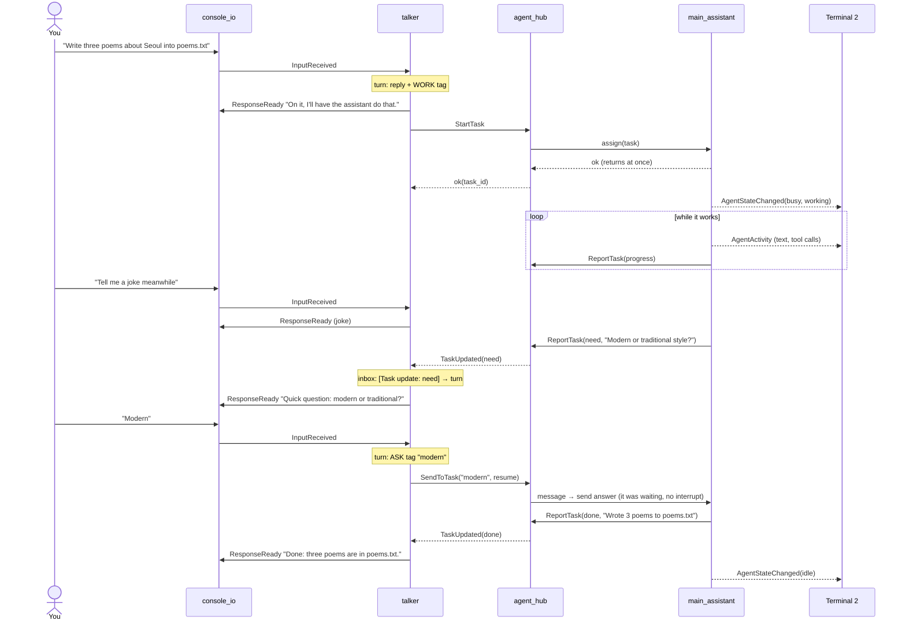

The mid-task question flow (interrupt → reply → continue) is on the [architecture page](../architecture/agents.md#messages-and-cancel).

## Rules that keep it from locking up

- **Nobody waits on a `claude` turn inside a handler.** Event handlers queue; `assign`, `message` and `cancel` return once their message or interrupt is written.
- **The Hub is the only one that changes task state**, and only from commands (`StartTask`, `SendToTask`, `CancelTask`, `ReportTask`), so dropped events never corrupt it.
- **One turn at a time per session.** The Talker's inbox and the agent's mode guarantee nothing is written to a session mid-turn except an interrupt.
- **The Talker waits on nobody:** while the Main Assistant works, waits for you, or is paused, the Talker keeps chatting.
