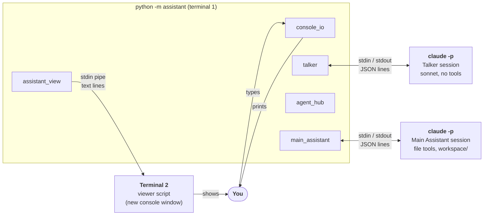
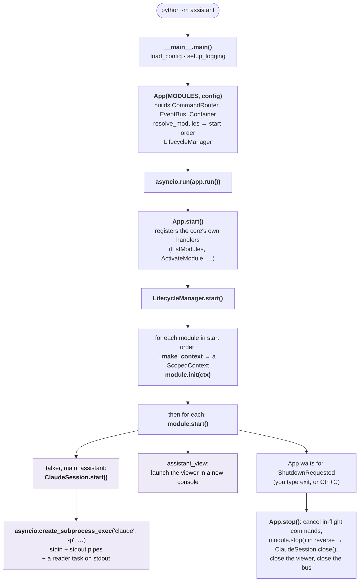
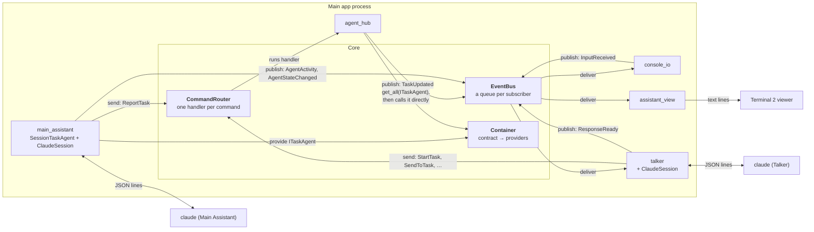
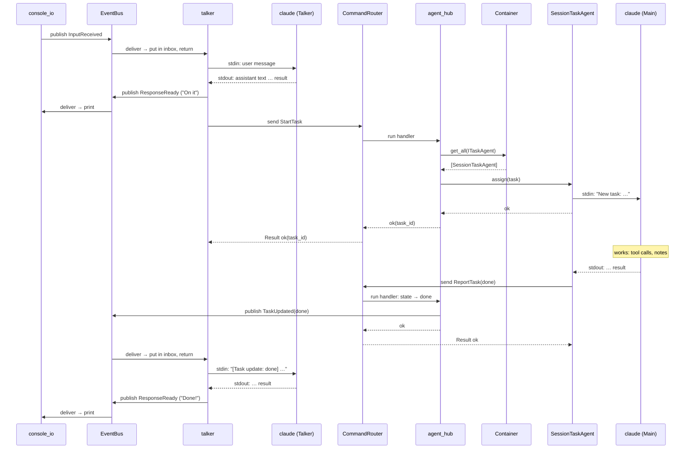
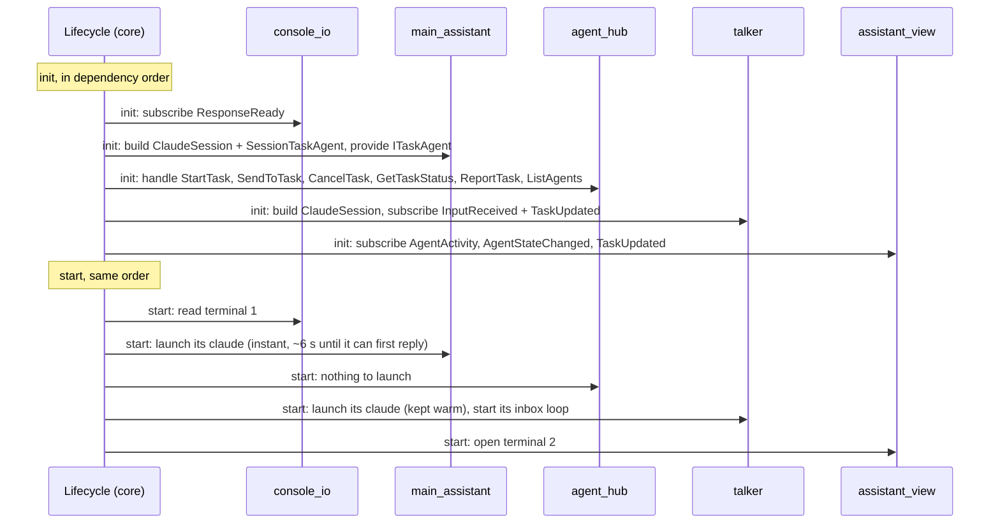
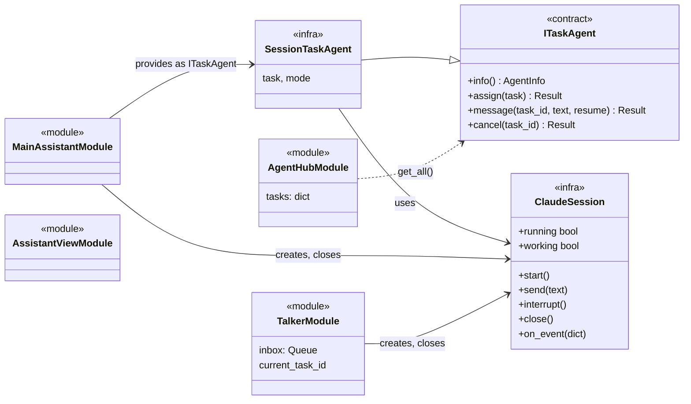
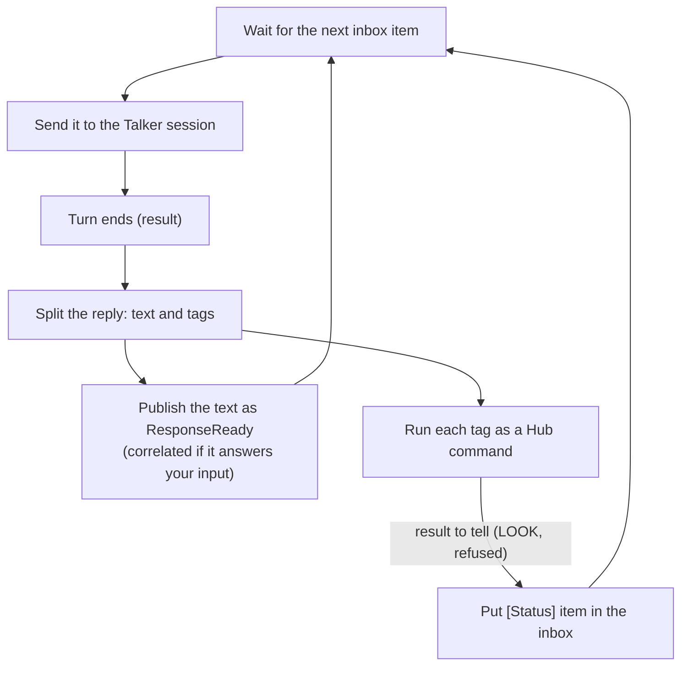
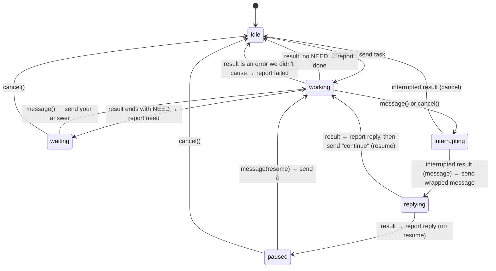
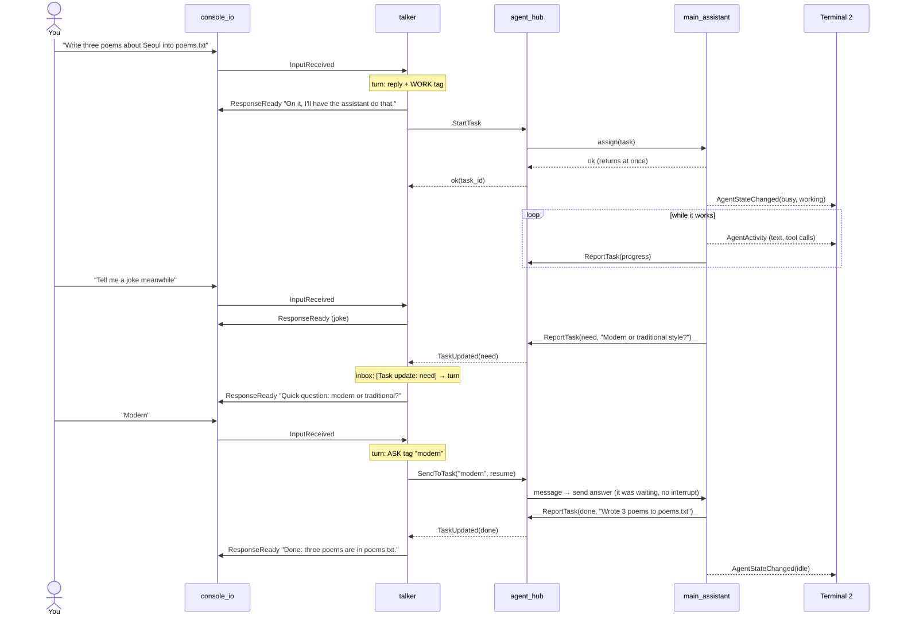

# Agent runtime

How the two agents are spawned, how each behaves on its own, and how they talk to each other, down to the classes. Back to [Agents](README.md). The contracts are on the [architecture page](../architecture/agents.md#task-agents) and the [Agents API page](../api/agents.md).

> **Status: built (2026-10-25).** Run it with `.\.venv\Scripts\python -m assistant`. Code: `src/assistant/modules/{talker,main_assistant,agent_hub,assistant_view}/` and `src/assistant/infra/{claude_session,session_agent}.py`.

## What runs

Four OS processes. The app is the only one that knows about the others; the two `claude` processes never talk to each other directly.

| Process | Started by | Command |
|---------|------------|---------|
| The app | You | `python -m assistant` |
| Talker session | `talker` module, in `start` | `claude -p --input-format stream-json --output-format stream-json --verbose --strict-mcp-config --model sonnet --tools "" --append-system-prompt <talker prompt>` |
| Main Assistant session | `main_assistant` module, in `start` | `claude -p … --strict-mcp-config --tools Read,Write,Edit,Glob,Grep --permission-mode acceptEdits --append-system-prompt <worker prompt>`, working directory `workspace/`. `acceptEdits` approves writes inside the working directory only; others are refused, since nobody can approve them |
| Terminal 2 | `assistant_view` module, in `start` | `python -m assistant.modules.assistant_view.viewer` in a new console window, its stdin a pipe from the app. It writes to its own window (`CONOUT$`), because its inherited stdout is terminal 1. Windows only for now |

Each command line is built by [`claude_command`](../api/infra.md#claude_command); the model, tools, permission mode, and workspace come from `[modules.talker]` and `[modules.main_assistant]` in `config/default.toml`.

## Launched from the main app

Everything below runs in one Python process, on one `asyncio` event loop (plus `console_io`'s stdin thread). The agents' `claude` processes are children of it.

Purple: added for the agents. Outside the new modules, the only edits were two lists (`MODULES` in `__main__.py` gained the four module classes, and `modules.enabled` in `config/default.toml` switches them on and the echo module off) and `console_io` now also prints uncorrelated replies, so the Talker can speak first.

## Messaging to and from the main app

Modules never hold references to each other. Each gets a `ScopedContext`, and everything goes through the core's three parts. Only the pipes leave the process.

| Path | How it works | Waits? | Can be lost? | Used for |
|------|--------------|--------|--------------|----------|
| **Command** | `ctx.send(cmd)` → `CommandRouter.send` runs the one handler as its own task and returns its `Result`. Timeout from config (default 30 s) | The sender waits for the `Result` | No: always a `Result` (`ok`, `timed_out`, …) | Talker → Hub, agent → Hub (`ReportTask`) |
| **Event** | `ctx.publish(ev)` → `EventBus` puts it on each subscriber's queue; each subscriber has a worker running its handler, in order, 10 s limit | No, returns at once | Yes, if a subscriber's queue (100) is full | You → Talker, Talker → you, Hub → Talker, agent → terminal 2 |
| **Contract call** | `ctx.get_all(ITaskAgent)` → `Container` → a plain Python method call on the provider (`SessionTaskAgent`) | The Hub awaits the method, which returns at once | No | Hub → agent |
| **Session pipe** | `ClaudeSession` writes one JSON line to the child's stdin; its reader task reads stdout lines and calls `on_event` for each | Writing doesn't wait for a reply | Only if the process dies | Module ↔ its `claude` |
| **Viewer pipe** | `assistant_view` writes text lines to the viewer's stdin | No | If the window was closed | Terminal 2 |

Since each command handler runs as its own task, the Hub can handle a `ReportTask` while it's still inside a `SendToTask`. That's why the agent may report while the Hub is calling it.

### A message there and back, through the core

You ask for work; the Main Assistant finishes; the Talker tells you. Every hop shown:

## Spawning

The core's lifecycle manager starts the modules in dependency order. Nothing else launches anything: each module starts its own process in `start` and ends it in `stop`.

- **Order:** `main_assistant` provides `ITaskAgent` and the Hub lists it as optional, so the agent starts before the Hub. `talker` and `assistant_view` depend on nothing; they only send commands and listen to events. The diagram shows one valid order; the actual one is `console_io, main_assistant, talker, assistant_view, agent_hub`.
- **Stop** runs in reverse, so the Hub stops first: reports an agent sends while shutting down are refused (logged as warnings, harmless). Each session closes its `claude` process: stdin closed, then killed if it hasn't exited within the stop timeout. Terminal 2 is closed.
- **Runtime control:** deactivating `main_assistant` ends its process; the Hub sees no agents and `StartTask` returns `not_available`. Activating it again starts a fresh session (no memory of before).

## Classes

The core's lifecycle manager starts all of these modules, and none of them launches another. In the diagram, the arrow with a hollow head means "implements", a plain arrow means "holds and uses", and the dotted arrow means "looks up through the Container".

`ClaudeSession` runs one `claude` process. It knows nothing about tasks or the Talker: it writes messages and interrupts, calls `on_event` for every JSON line, and sets `working` from "message sent" until `result`. `SessionTaskAgent` lives in `infra` too, not in the `main_assistant` module, so a later subagent module can reuse it without importing another module's internals ([principle 3](../architecture/principles.md)).

The Talker and the Main Assistant are both LLM agents. Each has its own `ClaudeSession`, so each runs its own `claude` process with its own model, prompt, and tools. What differs is their role, and the diagram shows it by which one implements `ITaskAgent`:

- `MainAssistantModule` is the worker. In `init` it builds a `ClaudeSession` and a `SessionTaskAgent`, and registers the agent with the Container as an `ITaskAgent`. `SessionTaskAgent` turns the Hub's calls (`assign`, `message`, `cancel`) into messages for its session, and the session's results into reports.
- `TalkerModule` talks with you and takes no tasks, so it doesn't implement `ITaskAgent`. When something needs doing, it hands the task to the Hub with a command (`StartTask`, `SendToTask`, …) and hears back through `TaskUpdated` events. Commands and events travel through the core, so they aren't drawn here; they're in [Messaging to and from the main app](#messaging-to-and-from-the-main-app).
- `AgentHubModule` holds no reference to any agent module. It asks the Container for every `ITaskAgent` and calls the ones it gets back. A future subagent is one more module that provides `ITaskAgent`, and the Hub finds it without any change.
- `AssistantViewModule` only listens to events, so it has no arrows.

## The Talker on its own

The Talker is a conversation loop with one **inbox**. Everything that should make it speak goes into the inbox, and it handles one item at a time, one `claude` turn each. So it never talks over itself, and the event handlers return at once (no 10 s handler timeout).

| Inbox item | Comes from | Sent to its session as |
|------------|------------|------------------------|
| You said something | `InputReceived` | your text, as is |
| Task update: `done`, `need`, `reply`, `failed` | `TaskUpdated` | `[Task update: done] <text>` |
| Command result worth telling | its own tags (e.g. `StartTask` refused, `GetTaskStatus`) | `[Status] <text>` |

`progress` updates don't go to the inbox: they'd make it chatter. The Hub keeps them and they come back when you ask "how's it going?".

**Tags** (v1: one task at a time, so no task ids; the Talker module remembers the current task):

| Tag | Hub command |
|-----|-------------|
| `<<WORK: task>>` | `StartTask(task, context)`, context = the last few exchanges |
| `<<LOOK>>` | `GetTaskStatus()`; the result comes back as a `[Status]` item |
| `<<ASK: text>>` | `SendToTask(text, resume=true)`: a question, extra instruction, or your answer to a NEED |
| `<<PAUSE: text>>` | `SendToTask(text, resume=false)` |
| `<<CANCEL>>` | `CancelTask()` |

**Talker prompt, in short:** you're the voice of a personal assistant; keep replies short and conversational; you can't do work yourself, so hand anything substantial over with `WORK`; never claim work is done until a `[Task update: done]` arrives; infer from context whether the user means continue, pause, or cancel, and never ask them for keywords.

## The Main Assistant on its own

`SessionTaskAgent` turns `ITaskAgent` calls into session messages and session events into reports. It keeps an internal **mode**; the Hub's `TaskState` is the outside view of the same thing.

- **Interrupt isn't failure:** in `interrupting` the agent knows it caused the `error_during_execution` result ([spike finding](spike.md#findings)) and doesn't report `failed`.
- **`message` and `cancel` return as soon as the interrupt is sent**; the rest happens as events arrive. So the Hub never waits on the agent while the agent is reporting to the Hub.
- **Cancel fallback:** if no `result` arrives within a few seconds of the interrupt, close the process; the next task starts a fresh session.
- **Reports and events while working:**
  - every `assistant` text or tool call → `AgentActivity` (terminal 2)
  - a text note mid-turn → `ReportTask(progress)`
  - `working` / `busy` changes → `AgentStateChanged`

**Worker prompt, in short:** you're the Main Assistant doing tasks handed to you; work only in your folder; before each major step write one short progress line; if you need a decision from the user, stop and end your turn with a last line `NEED: <question>`; when finished, end with a short summary of what you did.

**Messages it sends to its session:**

| When | Text |
|------|------|
| New task | `New task: <text>` plus `Context: <context>` |
| Mid-task message | `[The user interrupted your task with a message. Answer it briefly; you'll be told when to continue.] <text>` |
| Continue | `Continue the task from where you left off.` |
| Answer to NEED, or resume from pause | the text as is |

## Talking to each other: a whole conversation

The mid-task question flow (interrupt → reply → continue) is on the [architecture page](../architecture/agents.md#messages-and-cancel).

## Rules that keep it from locking up

- **Nobody waits on a `claude` turn inside a handler.** Event handlers queue; `assign`, `message` and `cancel` return once their message or interrupt is written.
- **The Hub is the only one that changes task state**, and only from commands (`StartTask`, `SendToTask`, `CancelTask`, `ReportTask`), so dropped events never corrupt it.
- **One turn at a time per session.** The Talker's inbox and the agent's mode guarantee nothing is written to a session mid-turn except an interrupt.
- **The Talker waits on nobody:** while the Main Assistant works, waits for you, or is paused, the Talker keeps chatting.
