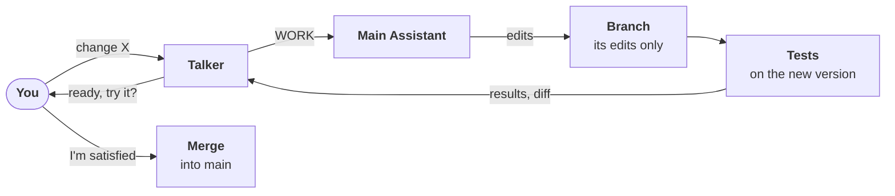

# Self-improvement

The plan for the assistant to read and change its own source and docs, so it keeps improving itself. Back to [Agents](README.md).

> **Status: steps 1–3 done (2026-10-26).** For now the Main Assistant has the same access as Claude Code: it reads and edits the whole repo and asks you for shell commands ([permissions](README.md#permissions)). The branch workflow and CI/CD are planned.

## Goal

You ask for a change by talking; the Main Assistant makes it on a branch, the tests run on the new version, and it lands only when you say you're satisfied. Later, CI/CD makes that loop fast: change, test, try it, merge.

## Guardrails

- **Every change is on its own branch.** The Main Assistant never edits `main`.
- **Tests run on the new version** before you're asked to approve: `pytest`, `ruff`, and the docs check, the same as CI.
- **You approve each merge.** Nothing lands until you say so.
- **Reload to run new code.** Reload the changed module, or add a new one ([core](../architecture/core.md#reloading-a-modules-code)): the Main Assistant ends its turn with `RELOAD: <id>` or `ADD_MODULE: <package>`, sent at once in Auto, asked as an Allow / Deny card in Manual ([runtime](runtime.md#loading-new-code)). Restart only for changes to the core, contracts or shared helpers, including a new contract or port type.
- **Later:** CI/CD on the branch, and trying the new version side by side before merging.

## Permissions

Two layers. Standing rules cover most asks; asks in the moment cover the rest.

| Layer | How | For |
|-------|-----|-----|
| **Standing rules** (built) | `read_dirs` and `write_dirs` in `[modules.main_assistant]` become `--allowedTools` rules like `Read(//c/repo/**)` and `Edit(//c/repo/docs/**)` ([`path_rule`](../api/infra.md#path_rule)). Later also `Bash(git *)`. Applied by deactivating and activating the module, no app restart | Read the repo, edit docs and skills, later git on its branch |
| **Asks in the moment** (built) | `claude -p --permission-prompt-tool stdio` sends a `can_use_tool` request → `SessionTaskAgent` reports `permission` → Hub → you answer with the Allow / Deny buttons or by telling the Talker (`<<ALLOW>>` / `<<DENY>>`) → `AnswerPermission` → the answer goes back and the tool runs (or not) in the same turn. Allow-once; "always" (saving a standing rule) is later | Anything the rules don't cover |

Which paths are core, modules, or protected (never writable by an agent): [repo zones](../architecture/permissions.md#repo-zones).

## Steps

| # | Step | Result |
|---|------|--------|
| 1 | Standing rules: read the whole repo, write `docs/` (**done**) | It can read its source and edit the docs |
| 2 | Spike: permission prompts over the pipe (**done**) | Know the message shapes |
| 3 | Asks in the moment, through the Talker and the UI (**done**) | You grant permissions by talking or clicking |
| 4 | Branch workflow: its own branch per change, tests, your approval to merge | It can edit `src/` safely |
| 5 | CI/CD on its branches | The fast change → test → merge loop |
