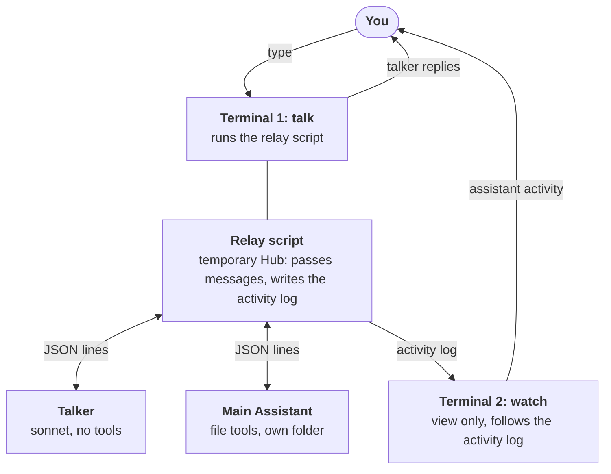

# Two-Claude spike

A disposable terminal experiment: does a Talker and a Main Assistant work in tandem as two `claude -p` sessions? Back to [Agents](README.md).

> **Status: done, cut short (2026-10-22).** Steps 0–2 ran as single-session scripts; the relay below was **never built**. Once the [task-agent design](../architecture/agents.md#task-agents) was decided, only the interrupt needed checking, and we build the real modules instead. The setup and scenarios below are kept for reference; the results are under [Findings](#findings).

## Setup

One script, `spikes/two_claude.py` (standard library, `asyncio`), outside `src/`. It starts both sessions and plays a temporary Hub, passing messages between them.

Two terminals: you talk to the Talker in one, and watch the Main Assistant in the other.

- **Terminal 1:** `.\.venv\Scripts\python spikes\two_claude.py`. You chat with the Talker here; only its replies and short status lines show.
- **Terminal 2:** `Get-Content spikes\logs\assistant.log -Wait`. Shows live what the Main Assistant does: its text, tool calls, files touched, TELL and NEED messages. Never type here.

- **Both:** `claude -p --input-format stream-json --output-format stream-json --verbose --strict-mcp-config`, started once and kept alive. `--strict-mcp-config` is needed because `--tools` alone still loads your claude.ai MCP connectors.
- **Talker:** `--model sonnet --tools ""`, plus a system prompt teaching it the tags below.
- **Main Assistant:** working folder `spikes/workspace/`, with `--restricted` (file tools confined there, no shell), `--tools Read,Edit,Write,Glob,Grep`, `--permission-mode dontAsk`.
- Raw JSON lines are also saved to `spikes/logs/` so we see the real event shapes.
- Commands: plain text goes to the Talker; `/status`, `/stop` (interrupt the Main Assistant), `/quit`.

## Communication paths

Tags in the agents' text stand in for the Hub's future tools; the relay spots them and acts.

| Tag | From → to | Stands in for | Relay does |
|-----|-----------|---------------|------------|
| `<<WORK: task>>` | Talker → Main | request work | Starts the task, or answers "busy" |
| `<<LOOK>>` | Talker → log | get task status | Gives the Talker recent activity and status; the Main Assistant isn't disturbed |
| `<<ASK: …>>` | Talker → Main | question or extra instructions | Sends it to the busy Main Assistant; relays the answer back. Talker LOOKs first |
| `<<TELL: …>>` | Main → Talker | progress or findings | Gives it to the Talker as context, without interrupting you |
| `<<NEED: …>>` | Main → Talker → you | clarification | Talker asks you; your answer goes back to the waiting Main Assistant |
| finish | Main → Talker | task completed | Talker gets "[finished: summary]" and tells you |

## What it should answer

1. Both sessions stay alive across turns, on subscription auth.
2. The Talker stays responsive while the Main Assistant works.
3. The agents use the tags reliably (LOOK before ASK; TELL vs NEED).
4. **ASK:** can the busy Main Assistant take a question or new instructions mid-turn, or only after its turn ends?
5. **NEED:** the Main Assistant waits for your answer and continues, and **the Talker stays responsive while it waits**.
6. The event stream is easy to parse, for the chat window later.
7. Interruption and resumption work, for both agents.
8. The Talker's time to first reply feels OK for voice later.

If the Main Assistant can't take messages mid-turn, the Hub must hold pending messages until it's free, or interrupt it.

## Test scenarios

| Scenario | Try | Expect |
|----------|-----|--------|
| Delegation + parallel | "Have the assistant write three short poems about Seoul into poems.txt, and meanwhile tell me a joke" | Joke arrives in terminal 1 while activity streams in terminal 2; then a finish notice; `spikes/workspace/poems.txt` exists |
| Progress | During a task: "what's it doing?" | Answered from the log; no ASK sent |
| ASK | "Make the third poem about the Han river instead" mid-task | Note when it's picked up, and the delay |
| NEED | A task with a built-in choice ("…ask me which style first") | You're asked; your answer goes back; work continues; the Talker still chats while waiting |
| Interrupt | `/stop` during a longer task | It stops cleanly; can be resumed |
| Limits | Ask it to write outside its folder | Refused |

## Findings

Scripts and raw events: `spikes/01_session.py`, `spikes/02_interrupt.py`, `spikes/logs/`.

| # | Question | Finding |
|---|----------|---------|
| 1 | Sessions stay alive, on subscription | **Yes.** One process keeps its session id and memory across turns; replies in ~1–2.5 s (cold start ~6.6 s). `apiKeySource=none` |
| 4 | Messages while busy | **Not needed.** We always interrupt first (design decision); not tested |
| 6 | Event stream easy to parse | **Yes.** Each turn: `system/init` → `assistant` / `user` (tool results) → `rate_limit_event` → `result`. `system/init` repeats every turn |
| 7 | Interrupt and resume | **Works.** Details below |
| 2, 3, 5, 8 | Talker responsiveness, tag use, NEED, voice latency | Not tested; we see them in the real modules |

**Interrupt** (`02_interrupt.py`), sent as `{"type": "control_request", "request_id": …, "request": {"subtype": "interrupt"}}` on stdin:

- **Stops immediately** and the process stays alive. Reply: `control_response` with `subtype: success`.
- **Like Esc in Claude Code:** a tool call in flight is not run (its `tool_result` says it was rejected and to wait), followed by a `[Request interrupted by user]` message.
- **The turn ends with `result`, `subtype: error_during_execution`, `is_error: true`.** So the agent must remember that *it* interrupted, and not report the task as failed.
- **Reply, then continue:** after the interrupt it answered a quick question, then "Continue the task from where you left off" finished all 8 files.
- **Cancel keeps memory:** after interrupting a new task, it still remembered the first task and checked the files correctly.
- **`result` reliably ends every turn**; no events arrived between turns. `working` can be tracked as "message sent → `result`".
- The worker writes short progress notes on its own mid-turn ("I've written poems 1 to 5…"): natural `AgentActivity` / `progress` content.
- Not tested: interrupting in the middle of a long text reply (the interrupt came before any text).
