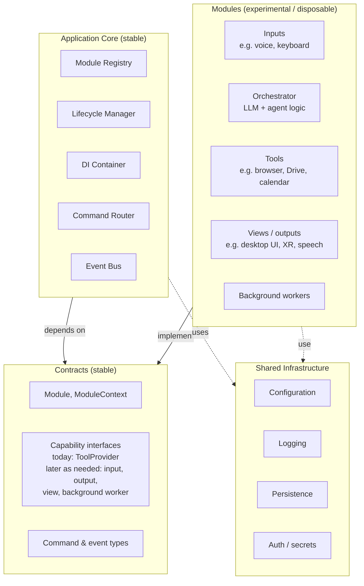
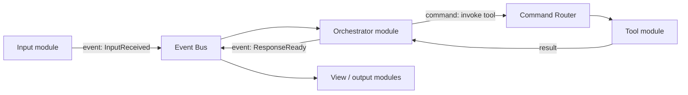
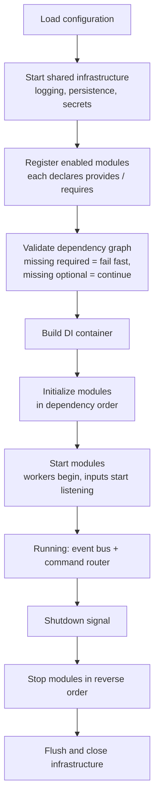
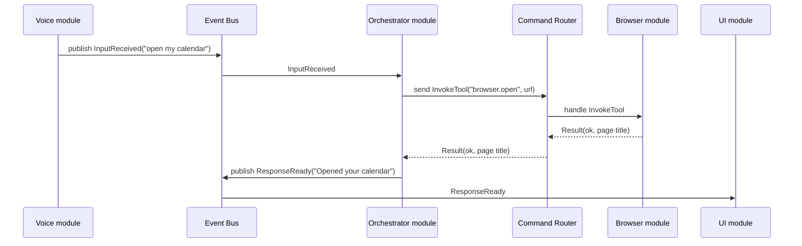
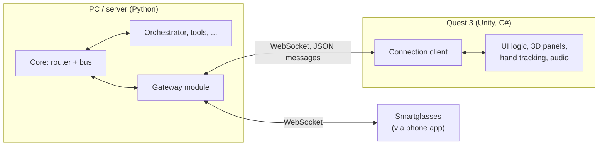

# Architecture

Conceptual architecture for the whole project. For the classes and functions behind each component, follow the links in the component table. For the public interface, see the [API reference](../api/README.md).

## Summary

A highly modular personal AI assistant that serves as a long-term experimental platform. A small, stable core hosts an ever-changing set of independent modules (inputs, outputs, views, tools, background workers, and the AI orchestration itself) that can be added, replaced, or discarded with minimal changes elsewhere.

The style is a **modular monolith** using **ports & adapters**, **dependency injection**, and **event-driven communication**. Everything runs in one process and is rebuilt and restarted when modules change. Hot-swapping and independent deployment are explicitly not goals.

The core runs on a PC today and will later move to a server, so it must not assume a local desktop: configuration, secrets, and data paths come from config files and environment variables, and user-facing interfaces are modules or remote clients. Headsets (Quest 3) and smartglasses are [remote clients](#remote-clients) that connect over the network.

## Principles

These guide every design and implementation decision. If a change conflicts with one, raise it before proceeding.

**The core controls communication; modules control functionality.**

1. **Modularity and ease of experimentation come first**, ahead of architectural sophistication for its own sake.
2. **Stable contracts, disposable implementations.** Modules depend on interfaces, never on concrete implementations.
3. **Loose coupling.** Modules never import each other's internals. Use contract interfaces for direct interactions, commands for explicit actions, and events for notifications. DI only ever resolves shared contract interfaces, never a module's concrete type.
4. **Minimal core.** No experimental or module-specific logic in the host.
5. **Replaceable AI orchestration.** The model, agent framework, and orchestration logic are a module like any other.
6. **Module-owned state.** Each module manages its own state and exposes only what its contracts require.
7. **Independent lifecycles.** Modules can be initialized, started, suspended, and stopped independently.
8. **Graceful removal.** Removing an optional module must not break unrelated modules or require widespread changes.
9. **Technology independence.** Modules may later run out of process in other languages, so messages crossing module boundaries are plain, serializable data.
10. **Avoid premature complexity.** No distributed infrastructure, elaborate plugin systems, or speculative abstractions without an actual requirement.

## Overview

Dependency direction: the core and modules both depend on contracts; contracts depend on nothing. The core never references a concrete module, and modules never reference each other.

### Runtime flow (typical request)

The orchestrator discovers available tools by asking the DI container for every `ToolProvider`, so adding a tool module makes it available to the AI without touching the orchestrator.

## Startup and shutdown

The host is the composition root. It's the only place that knows which concrete modules exist.

- **Registration is explicit**: `MODULES` in `src/assistant/__main__.py` lists every module the app can run, and `modules.enabled` in config picks which ones start. No directory scanning or plugin loading. Adding a module means one line in each; swapping one (e.g. the orchestrator) is a config change; removing it means deleting its folder and those lines. Details in [core architecture](core.md#adding-replacing-or-removing-a-module).
- **A module failing to initialize** is logged and the module is skipped, unless something else declares it as a required dependency.

## Communication

| Mechanism | Shape | Use for | Example |
|-----------|-------|---------|---------|
| Interface (via DI) | Direct call through a shared contract | Querying a capability another module provides | Orchestrator lists all `ToolProvider`s |
| Command | Exactly one handler, returns a typed result, has a timeout, cancellable | An explicit action someone wants done | `OpenUrl`, `CreateCalendarEvent` |
| Event | Zero or more subscribers, no result | Notifying that something happened | `InputReceived`, `ResponseReady` |

Commands and events are plain data records defined in Contracts, not objects with behavior.

### How modules reach each other

A module never holds a reference to another module. Its only access to the app is the `ModuleContext` the core passes to `init`, which wraps the **Command Router**, **Event Bus**, and **DI container** and removes everything the module registered when it stops. Contracts only define shapes (interfaces and message types). The core does the delivery.

- **Interface call:** the module asks DI for a contract (e.g. all `ToolProvider`s) and calls methods on it directly, getting return values back. This is still direct communication between modules; it's only decoupled from the concrete implementation. Use it deliberately, and only through interfaces defined in Contracts. If no module provides it, the module gets nothing (an empty list or none), so it must handle absence.
- **Command (request/response):** `result = await ctx.send(command, timeout=None)`. The router finds the one module registered as that command's handler, calls it, and returns a typed result (see [Command results](#command-results)) to the sender. If no handler is registered, the sender gets `NotAvailable` instead of a crash.
- **Event (one-way):** `ctx.publish(event)`. Every subscriber gets a copy; the publisher gets nothing back. When a reply is needed for long-running work (transcription, a multi-step browser task), the event carries a **correlation id**, and the replying module publishes its own event (progress, completed, failed) with the same id.

Choosing between them:

| Need | Use |
|------|-----|
| An answer now, from a capability that may have zero or many providers | Interface |
| Something done by one owner, with a result back | Command |
| Tell whoever cares that something happened | Event |
| Long-running work with progress or a delayed result | Command to start it, then events with a correlation id |

**Where message types live:** shared commands and events (`InputReceived`, `ResponseReady`, `InvokeTool`) are defined in Contracts. The AI calls tools through the single generic `InvokeTool(name, args)` command, using the name and argument schema each `ToolProvider` advertises, so the orchestrator needs no per-tool code. A typed command such as `CreateCalendarEvent` is added to Contracts only when one module needs to call another directly.

### Command results

Every command returns exactly one of these statuses. They mean different things, especially to an AI agent deciding what to do next:

| Status | Meaning | Typical agent reaction |
|--------|---------|------------------------|
| `Ok` | Succeeded; carries the result payload | Continue |
| `InvalidArguments` | Handler rejected the input; carries what was wrong | Fix the arguments and retry |
| `NotAvailable` | No handler registered, or the module is disabled or suspended | Use another approach or tell the user |
| `Failed` | Handler ran and hit an error; carries the error and whether a retry might help | Retry if retryable, else report |
| `TimedOut` | No result within the timeout | Retry, or ask the user whether to wait longer |
| `Cancelled` | Cancelled by the sender, the user, or shutdown | Stop; don't retry automatically |

Handler exceptions never propagate to the sender. The router catches them and returns `Failed`.

### Timeouts and cancellation

- Every command has a timeout: a default from config, overridable per command type or per call. When it expires, the router returns `TimedOut` and signals cancellation to the handler.
- Cancellation is cooperative asyncio task cancellation: the handler gets `CancelledError` at its next `await`. Long-running work is identified by its correlation id and can be cancelled with `ctx.cancel(correlation_id)`, from the sender, the UI, or shutdown. Handlers that start external processes clean those up themselves for now.
- Handlers for long-running work (browser, 3D, remote desktop) must check the cancellation signal and stop promptly.
- On shutdown, the lifecycle manager cancels all in-flight commands before stopping modules.

### Event delivery

- `publish` returns immediately. It never waits on subscribers.
- Each subscriber is delivered to independently, so one slow or failing subscriber can't block the bus or other subscribers.
- Subscriber exceptions are caught and logged, never passed back to the publisher.
- Each subscriber has one worker and a bounded queue, so background tasks never grow with traffic. When a subscriber's queue is full, new events are dropped for it and logged.
- A handler that exceeds its time budget is cancelled and logged. Heavy work belongs in a command or background worker, not inside an event handler.

## Modules

Each module:

- lives in its own folder and depends only on Contracts and Shared Infrastructure
- has a manifest: id, the capabilities it provides, and what it requires (required vs optional)
- implements `Module` for lifecycle, plus any number of small capability interfaces
- owns its own state, config section, and storage

Contracts grow as needed. Add a new capability interface when a real module needs it, not in anticipation. The interfaces named above are a starting point, not a fixed list.

## Remote clients

Devices such as the Quest 3 and smartglasses are separate applications (e.g. a Unity app for the Quest) that connect to the core over the network. They own their own UI logic and local state; the core owns AI, tools, and data.

- **Gateway module:** relays commands, events, and results between the core and connected clients. It's an ordinary, removable module; the core never knows clients exist.
- **Protocol:** a versioned message envelope (`kind: command | event | result`, `name`, `correlationId`, `payload`) using the same message types and result statuses as in-process communication. Defined as a language-neutral schema in the API reference so Python and C# share one definition.
- **Content, not layout:** the core sends content and events ("here's the response", "task finished"). Clients decide how to present them.
- **Client capabilities:** on connect, a client can advertise tools (e.g. "place a 3D object in the room"). The gateway exposes them as an `ToolProvider`, so the orchestrator invokes them through `InvokeTool` like any other tool.
- **Connectivity:** direct on the local network; a private VPN (e.g. Tailscale) when away from home, so nothing is exposed to the internet.
- **Audio:** starts as chunks over the WebSocket; WebRTC later only if latency demands it.
- **Repo:** client apps live in this repo under `clients/` (e.g. `clients/quest/`) so the protocol and both sides change together.

## Components

| Component | Responsibility | Location | Details |
|-----------|----------------|----------|---------|
| Module Registry | Selects enabled modules from their manifests; validates the dependency graph | `src/assistant/core/registry.py` | [core](core.md) |
| Lifecycle Manager | Initializes, starts, and stops modules in dependency order (suspend deferred until needed) | `src/assistant/core/lifecycle.py` | [core](core.md#lifecycle) |
| DI Container | Resolves shared contracts to the implementations modules provide | `src/assistant/core/container.py` | [core](core.md#communication-internals) |
| Command Router | Routes each command to its single handler and returns the result | `src/assistant/core/router.py` | [core](core.md#communication-internals) |
| Event Bus | In-process publish/subscribe for events | `src/assistant/core/bus.py` | [core](core.md#communication-internals) |
| Contracts | `Module`, `ModuleContext`, capability interfaces, command and event types | `src/assistant/contracts/` | [API](../api/README.md) |
| Shared Infrastructure | Configuration and logging today; persistence and auth/secrets later | `src/assistant/infra/` | [API](../api/infra.md) |
| Modules | All capabilities, including the AI orchestrator. Today: `console_io`, `echo_orchestrator` | `src/assistant/modules/` | |
| Gateway module | Relays messages to and from remote clients over WebSocket | _TBD_ | |
| Remote clients | Device apps with their own UI logic (Quest 3 first) | `clients/` | |

## Decisions

- **Core and PC-side modules:** Python.
- **Quest 3 client:** separate Unity (C#) app, connecting through the gateway module.
- **Deployment:** runs on a PC for now, a server later.

## Open decisions

- **Persistence technology**
- **Initial orchestrator** (model and agent framework)

## Deliberately deferred

Don't add more architectural machinery until two or three very different modules (e.g. a text input, a browser tool, and a view) are built and we've checked that each can be replaced independently. Let those real modules show which abstractions are actually missing.
