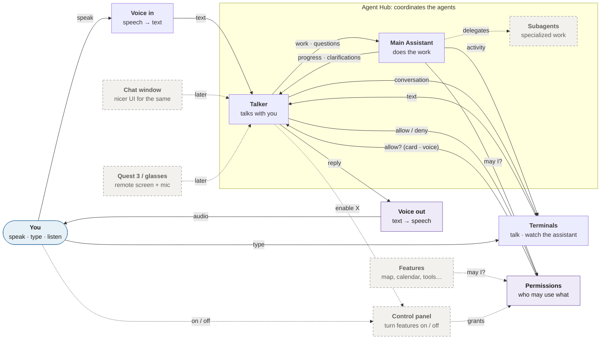

# Architecture

The whole project at a glance. Each part links to its own page; the public interface is in the [API reference](../api/README.md).

## Bird's-eye view

Each block is one part, named with what it does. Arrows show what flows between parts. Every arrow actually travels through the app's core; the core isn't drawn because everything connects to it.

**Built today:** a single app: the core, terminal 1 (talk), the Talker, the Main Assistant, the Agent Hub, and a [temp UI](../agents/runtime.md#temp-ui) (a web page with both, a stand-in for the chat window until a UI handler is designed). **Voice in:** the [voice service](voice.md) and its thin `voice_in` module are built; it's off until the temp UI gets its mic button. **Terminals:** one to talk in, one view-only window showing what the Main Assistant is doing; the chat window later gives the same with nicer UX. **Permissions:** every part asks one [permissions handler](permissions.md) before using location, the mic, files, or accounts; it asks you when it has no answer. Today only the Main Assistant asks, through the Agent Hub. **Purple:** planned next. **Dashed:** later. The [Agent Hub](agents.md) is a module, not part of the core.

## Summary

A highly modular personal AI assistant that serves as a long-term experimental platform. A small, stable core hosts an ever-changing set of independent modules (inputs, outputs, views, tools, background workers, and the AI orchestration itself) that can be added, replaced, or discarded with minimal changes elsewhere.

The style is a **modular monolith** using **ports & adapters**, **dependency injection**, and **event-driven communication**. The modules run in one process. Changing code means a rebuild and restart; turning existing modules on and off happens while the app runs ([runtime module control](core.md#runtime-module-control): built in the core; a control panel and asking the Talker come later). Loading new code without a restart is not a goal. **Independent deployment is, for parts that are useful on their own:** such a part is its own app that the main app launches and talks to through two-way hooks, via a thin module ([decisions](decisions.md#decided)). The [HTML viewer](html-viewer.md) is the first.

The core runs on a PC today and will later move to a server, so it must not assume a local desktop: configuration, secrets, and data paths come from config files and environment variables, and user-facing interfaces are modules or remote clients. Headsets (Quest 3) and smartglasses are [remote clients](remote-clients.md) that connect over the network.

## Pages

- [Principles](principles.md): the rules behind every decision
- [Reusable parts](reusable-parts.md): build it once; where shared parts live
- [Core](core.md): the host, lifecycle, and how modules are added or swapped
- [Communication](communication.md): commands, events, results, timeouts
- [Agents](agents.md): the Agent Hub, Talker, Main Assistant, subagents
- [Permissions](permissions.md): who may use what, per module
- [Remote clients](remote-clients.md): Quest, glasses, the gateway
- [Decisions](decisions.md): decided, open, and deferred
- [HTML viewer](html-viewer.md): viewing and editing HTML in tabs; state, commands, view
- [Voice](voice.md): speech to text through a shared voice service (service and `voice_in` built; the mic button is next)

## Parts

| Component | Responsibility | Location | Details |
|-----------|----------------|----------|---------|
| Module Registry | Selects enabled modules from their manifests; validates the dependency graph | `src/assistant/core/registry.py` | [core](core.md) |
| Lifecycle Manager | Initializes, starts, and stops modules in dependency order; turns modules on and off at runtime | `src/assistant/core/lifecycle.py` | [core](core.md#lifecycle) |
| DI Container | Resolves shared contracts to the implementations modules provide | `src/assistant/core/container.py` | [core](core.md#communication-internals) |
| Command Router | Routes each command to its single handler and returns the result | `src/assistant/core/router.py` | [core](core.md#communication-internals) |
| Event Bus | In-process publish/subscribe for events | `src/assistant/core/bus.py` | [core](core.md#communication-internals) |
| Contracts | `Module`, `ModuleContext`, capability interfaces, command and event types | `src/assistant/contracts/` | [API](../api/README.md) |
| Shared Infrastructure | Configuration and logging today; persistence and auth/secrets later | `src/assistant/infra/` | [API](../api/infra.md) |
| Reusable parts | Behavior two parts need, built once and listed with who uses it: contracts, infra helpers, and `app_kit` for what the independent apps share too | `src/assistant/contracts/`, `src/assistant/infra/`, `src/app_kit/` | [reusable parts](reusable-parts.md), [index](../api/reusable.md) |
| Log handler | Owns where logs go: one folder per app launch, named by start time and the theme of your first question | `src/assistant/infra/log.py` | [core](core.md#logging) |
| Modules | All capabilities, including the AI orchestration. Today: `console_io`, `talker`, `main_assistant`, `agent_hub`, `temp_ui`, `html_viewer` (the HTML viewer's thin module), and, off by default, `voice_in` (voice input's thin module), `assistant_view` and the `echo_orchestrator` stand-in | `src/assistant/modules/` | [agent runtime](../agents/runtime.md) |
| UI handler | Owns the user-facing UIs (chat window, Quest, glasses). Not designed yet; `temp_ui` stands in | _TBD_ | [decisions](decisions.md#open-decisions) |
| HTML viewer | Its own app: view, edit, highlight, and snip HTML files. The main app launches it through the thin `html_viewer` module, with `CompanionApp` | `src/html_viewer/` | [HTML viewer](html-viewer.md) |
| Voice handler | Speech to text: a shared `voice_service` app (mic and engine; built, runs alone) and the thin `voice_in` module that launches it, relays the mic's state and live text, and sends the final text to the Talker (built, off by default until the temp UI's mic button); built on `CompanionApp` and `load_layered` | `src/voice_service/`, `src/assistant/modules/voice_in/` | [voice](voice.md) |
| Agent Hub | Coordinates the agents: who is doing what, task state, routing, clarifications | `src/assistant/modules/agent_hub/` | [agents](agents.md) |
| Permissions handler | Knows what the app has, what each module needs, and what you've granted; asks you otherwise. Modules call it through `ctx.permissions`; today a stand-in that allows and logs answers (built), the handler is planned | _TBD_ `modules/permissions/` | [permissions](permissions.md) |
| Control panel | UI module to turn modules on and off while running, through the core's control interface (planned) | _TBD_ module | [core](core.md#runtime-module-control) |
| Gateway module | Relays messages to and from remote clients over WebSocket | _TBD_ | |
| Remote clients | Device apps with their own UI logic (Quest 3 first) | `clients/` | |
