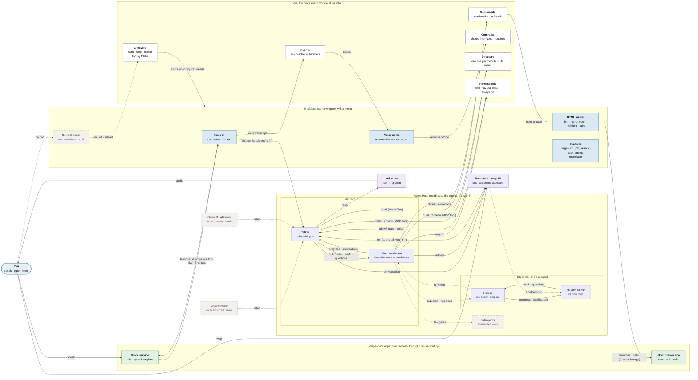
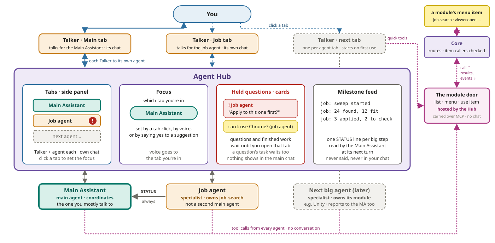

# Architecture

The whole project at a glance. Each part links to its own page; the public interface is in the [API reference](../api/README.md).

## Bird's-eye view

Each block is one part, named with what it does. The core sits in the middle with its ports: every module plugs into the same ones, and every arrow between parts travels through them. Each module is a wrapper with a menu of what it can do ([modules](modules.md)).

**Built today:** a single app: the core, terminal 1 (talk), the Talker, the Main Assistant, the Agent Hub, and a [temp UI](../agents/runtime.md#temp-ui) (a web page with both, a stand-in for the chat window until a UI handler is designed). **Agent tabs:** every agent tab is a pair, its own Talker and its own worker with its own chat (built 2026-11-05). **Voice in:** the [voice service](../../src/assistant/modules/voice_in/docs/voice-service.md) and its thin `voice_in` module are built and on; the temp UI's mic button turns the mic on and off. **Terminals:** one to talk in, one view-only window showing what the Main Assistant is doing; the chat window later gives the same with nicer UX. **Permissions:** every part asks one [permissions handler](permissions.md) before using location, the mic, files, or accounts; it asks you when it has no answer. It's part of the core and always on. Its first piece is built: a task agent's access list is asked on one card when its module is turned on, and the grant is saved per kind of agent. Single names (the mic) are still allowed and logged, and the Main Assistant still asks through the Agent Hub. **Modules:** each is a wrapper (manifest, start / stop / reload, context) with a menu of tools inside (a `Menu` part); built, with the HTML viewer's and the echo stand-in's menus so far, and the [module library](module-library.md) generated from them. Voice notes is built and off at launch (like the HTML viewer, turned on with `modules.on`); it requires the voice contract (`IVoice`), which `voice_in` provides ([voice_notes](../../src/assistant/modules/voice_notes/docs/README.md)). The directory is built in the core (one line per module, then its menu, plus the core's own `modules.*` menu), and the core finds modules by folder. The Main Assistant and the Talker use the directory through one MCP door (list · menu · call, hosted by the Agent Hub) ([modules](modules.md)). Each module has its own page; the [module library](module-library.md) lists them all with their interfaces. **White in the core:** its ports, and the permissions handler. **Blue:** a module. **Green:** an independent app, in its own process, launched by its thin module through `CompanionApp`; it refuses other hosts and other origins. **Purple:** planned next. **Dashed:** later. The [Agent Hub](agents.md) is a module, not part of the core.

## The core idea: agents and modules

Messages go through the Agent Hub; tools go through the module door. You talk to the agent with the focus, other agents' questions wait behind a **!** on their tab, and every agent sends one-line milestones to the Main Assistant. More in [Agents: big agents and their modules](agents.md#big-agents-and-their-modules).

## Summary

A highly modular personal AI assistant that serves as a long-term experimental platform. A small, stable core hosts an ever-changing set of independent modules (inputs, outputs, views, tools, background workers, and the AI orchestration itself) that can be added, replaced, or discarded with minimal changes elsewhere.

The agents reach every module through one MCP door with three fixed tools, not an MCP server per module. That keeps every caller behind the core's checks and the agents' context small ([why not plain MCP?](modules.md#why-not-plain-mcp)).

The style is a **modular monolith** using **ports & adapters**, **dependency injection**, and **event-driven communication**. The modules run in one process. Changing a module's code needs no restart: the module is reloaded in place (turned off, given its new code, turned on), and a brand-new module is added the same way ([reloading](core.md#reloading-a-modules-code)). Changes to the core, contracts or shared helpers, and a new module that needs a new contract or port type, still need a restart. Turning modules on and off also happens while the app runs ([runtime module control](core.md#runtime-module-control): built in the core; a control panel and asking the Talker come later). **Independent deployment is, for parts that are useful on their own:** such a part is its own app that the main app launches and talks to through two-way hooks, via a thin module ([decisions](decisions.md#decided)). The [HTML viewer](../../src/assistant/modules/html_viewer/docs/viewer-app.md) is the first.

The core runs on a PC today and will later move to a server, so it must not assume a local desktop: configuration, secrets, and data paths come from config files and environment variables, and user-facing interfaces are modules or remote clients. Headsets (Quest 3) and smartglasses are [remote clients](remote-clients.md) that connect over the network.

## Currently fixing

Making modules truly self-contained: each module's code, companion app, defaults, tests, docs and dependency list live in its own `modules/<id>` folder. Beside them sit a core group (the host and the core modules), `config/` (your choices only) and `generated/`. Dependencies are declared per module, and removing a module asks whether to purge its settings or keep them. The plan: [module folders](../../html-next-steps/module-folders.html). Progress: **5 of 20 done**, item by item in the checklist `docs/next-steps/module-folders-checklist.md`, each checked against the code.

## Pages

- [Principles](principles.md): the rules behind every decision
- [Reusable parts](reusable-parts.md): build it once; where shared parts live
- [Code map](code-map.md): every package and its main classes, with who calls whom
- [Core](core.md): the host, lifecycle, and how modules are added or swapped
- [Modules](modules.md): a module is a wrapper with a menu; the directory, chaining, dependencies, hot swap, finding by folder
- [Module library](module-library.md): every module's one-liner and interface (tools, commands, events, data types), each linking to its own [module page](module-library.md#module-pages)
- [Communication](communication.md): commands, events, results, timeouts
- [Agents](agents.md): the Agent Hub, Talker, Main Assistant, subagents
- [Agents: code layout](agents-code.md): the agent code in layers, and which method calls which (focus, reports, the door)
- [Permissions](permissions.md): who may use what, per module
- [Remote clients](remote-clients.md): Quest, glasses, the gateway
- [Decisions](decisions.md): decided, open, and deferred
- [HTML viewer](../../src/assistant/modules/html_viewer/docs/viewer-app.md): viewing and editing HTML in tabs; state, commands, view
- [Voice](../../src/assistant/modules/voice_in/docs/voice-service.md): speech to text through a shared voice service (service, `voice_in`, the temp UI's mic button and the real-mic check built; the engine comparison is next)

## Parts

| Component | Responsibility | Location | Details |
|-----------|----------------|----------|---------|
| Module Registry | Finds the available modules by folder (`loader.find_modules`); selects the enabled ones from their manifests; validates the dependency graph | `src/assistant/core/registry.py`, `loader.py` | [core](core.md), [modules](modules.md#found-by-folder) |
| Module directory | One line per module (`ListModules`), then that module's menu (`GetMenu`), plus the core's own menu (`modules.*`: list, menu, on, off, reload, add). Built; the Talker and the Main Assistant using it are planned | `src/assistant/core/directory.py`, `app.py` | [modules](modules.md#find-a-module-then-open-its-menu) |
| Lifecycle Manager | Initializes, starts, and stops modules in dependency order; turns modules on and off at runtime; reloads a module's code and adds new modules (with `core/loader.py`) | `src/assistant/core/lifecycle.py` | [core](core.md#lifecycle) |
| DI Container | Resolves shared contracts to the implementations modules provide | `src/assistant/core/container.py` | [core](core.md#communication-internals) |
| Command Router | Routes each command to its single handler and returns the result | `src/assistant/core/router.py` | [core](core.md#communication-internals) |
| Event Bus | In-process publish/subscribe for events | `src/assistant/core/bus.py` | [core](core.md#communication-internals) |
| Contracts | `ModuleProtocol`, `Manifest`, `ModuleContext`, capability interfaces, command and event types | `src/assistant/contracts/` | [API](../api/README.md) |
| Shared Infrastructure | Configuration and logging today; persistence and auth/secrets later | `src/assistant/infra/` | [API](../api/infra.md) |
| Reusable parts | Behavior two parts need, built once and listed with who uses it: contracts, infra helpers, and `app_kit` for what the independent apps share too | `src/assistant/contracts/`, `src/assistant/infra/`, `src/app_kit/` | [reusable parts](reusable-parts.md), [index](../api/reusable.md) |
| Log handler | Owns where logs go: one folder per app launch, named by start time and the theme of your first question. Modules reach it through their `ctx.logs` port | `src/assistant/infra/log.py`, `core/logs.py` | [core](core.md#logging) |
| Modules | All capabilities, including the AI orchestration; each a wrapper (manifest, lifecycle, context) with a menu of tools. Today: `console_io`, `talker`, `main_assistant`, `agent_hub`, `temp_ui`, `voice_in` (voice input's thin module), and, off by default, `html_viewer` (the HTML viewer's thin module), `voice_notes`, `task_agents` (helper agents launched by name from kinds in config), `job_search` (the job agent and its menu), `assistant_view` and the `echo_orchestrator` stand-in | `src/assistant/modules/` | [module library](module-library.md), [agent runtime](../agents/runtime.md) |
| UI handler | Owns the user-facing UIs (chat window, Quest, glasses). Not designed yet; `temp_ui` stands in | _TBD_ | [decisions](decisions.md#open-decisions) |
| HTML viewer | Its own app: view, edit, highlight, and snip HTML files. The main app launches it through the thin `html_viewer` module, with `CompanionApp` | `src/html_viewer/` | [HTML viewer](../../src/assistant/modules/html_viewer/docs/viewer-app.md) |
| Voice handler | Speech to text: a shared `voice_service` app (mic and engine; built, runs alone) and the thin `voice_in` module that launches it, relays the mic's state and live text, and sends the final text to the Talker (built and on; the temp UI's mic button drives it); built on `CompanionApp` and `load_layered`. Engines: by default two passes, the Zipformer's live text cleaned piece by piece by whisper, whose text is sent; or one engine, Zipformer (live text) or whisper (text on send). Chosen in the service's config, which restarts the service on a change; `transcribe` gives a file's text with no server. `voice_in` provides the voice contract `IVoice` (built): sessions each owned by their caller, with a destination (the Talker, or only the caller) | `src/voice_service/`, `src/assistant/modules/voice_in/` | [voice](../../src/assistant/modules/voice_in/docs/voice-service.md) |
| CV Tool | The `cv` module's own UI half, its own app: the four tabs (Job & CV, the pick, First Draft, ATS Loop), the CV's local PDF (text under 9 pt only warns), and your Submit (never refused; pushed to the `cv` module on its event stream, which tells the asker). The `cv` module launches and calls it through `CompanionHandover` (`cv.open_tool`, `cv.tool_*`); built 2026-11-09; in the module's folder since 2026-11-13 (`app/`, on the import path at startup) | `src/assistant/modules/cv/app/cv_tool/`, `src/assistant/modules/cv/tool.py` | [cv architecture](../../src/assistant/modules/cv/docs/architecture.md#the-cv-tool-app-srccv_tool) |
| Voice notes | Notes by voice in its own window, with its own record button; requires the voice contract (`IVoice.listen` without the Talker) and listens to voice events (built) | `src/assistant/modules/voice_notes/` | [voice_notes](../../src/assistant/modules/voice_notes/docs/README.md), [modules](modules.md#chaining-modules) |
| Agent Hub | Coordinates the agents: who is doing what, task state, routing, clarifications; the focus (who you talk to), held questions, and milestones fed to the coordinator; messages between agents (`DeliverMessage`, never into a turn; a card before an agent messages one that isn't its child); agent names (`IAgentNames`: one claim per id); its `hub.*` menu on the module door, each item knowing its caller | `src/assistant/modules/agent_hub/` | [agents](agents.md) |
| Permissions handler | Part of the core, always on: knows what each module needs and what you've granted; asks you otherwise. Modules call it through `ctx.permissions`. First piece built: access lists on one card, saved grants per kind of agent, the Main Assistant's review, and `permissions.grants / grant / revoke` on the core's menu. Single names are still allowed and logged | `src/assistant/core/permissions/` | [permissions](permissions.md) |
| Control panel | UI module to turn modules on and off while running, through the core's control interface (planned) | _TBD_ module | [core](core.md#runtime-module-control) |
| Gateway module | Relays messages to and from remote clients over WebSocket | _TBD_ | |
| Remote clients | Device apps with their own UI logic (Quest 3 first) | `clients/` | |
