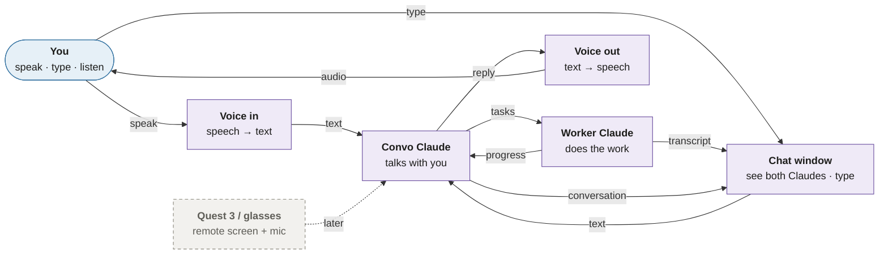

# Architecture

The whole project at a glance. Each part links to its own page; the public interface is in the [API reference](../api/README.md).

## Bird's-eye view

Each block is one part, named with what it does. Arrows show what flows between parts. Every arrow actually travels through the app's core; the core isn't drawn because everything connects to it.

**Built today:** a single app (the core, plus a terminal input and an echo stand-in in place of Convo Claude). **Purple:** planned next. **Dashed:** later.

## Summary

A highly modular personal AI assistant that serves as a long-term experimental platform. A small, stable core hosts an ever-changing set of independent modules (inputs, outputs, views, tools, background workers, and the AI orchestration itself) that can be added, replaced, or discarded with minimal changes elsewhere.

The style is a **modular monolith** using **ports & adapters**, **dependency injection**, and **event-driven communication**. Everything runs in one process and is rebuilt and restarted when modules change. Hot-swapping and independent deployment are explicitly not goals.

The core runs on a PC today and will later move to a server, so it must not assume a local desktop: configuration, secrets, and data paths come from config files and environment variables, and user-facing interfaces are modules or remote clients. Headsets (Quest 3) and smartglasses are [remote clients](remote-clients.md) that connect over the network.

## Pages

- [Principles](principles.md): the rules behind every decision
- [Core](core.md): the host, lifecycle, and how modules are added or swapped
- [Communication](communication.md): commands, events, results, timeouts
- [Remote clients](remote-clients.md): Quest, glasses, the gateway
- [Decisions](decisions.md): decided, open, and deferred

## Parts

| Component | Responsibility | Location | Details |
|-----------|----------------|----------|---------|
| Module Registry | Selects enabled modules from their manifests; validates the dependency graph | `src/assistant/core/registry.py` | [core](core.md) |
| Lifecycle Manager | Initializes, starts, and stops modules in dependency order (suspend deferred until needed) | `src/assistant/core/lifecycle.py` | [core](core.md#lifecycle) |
| DI Container | Resolves shared contracts to the implementations modules provide | `src/assistant/core/container.py` | [core](core.md#communication-internals) |
| Command Router | Routes each command to its single handler and returns the result | `src/assistant/core/router.py` | [core](core.md#communication-internals) |
| Event Bus | In-process publish/subscribe for events | `src/assistant/core/bus.py` | [core](core.md#communication-internals) |
| Contracts | `Module`, `ModuleContext`, capability interfaces, command and event types | `src/assistant/contracts/` | [API](../api/README.md) |
| Shared Infrastructure | Configuration and logging today; persistence and auth/secrets later | `src/assistant/infra/` | [API](../api/infra.md) |
| Modules | All capabilities, including the AI orchestrator. Today: `console_io`, `echo_orchestrator` | `src/assistant/modules/` | |
| Gateway module | Relays messages to and from remote clients over WebSocket | _TBD_ | |
| Remote clients | Device apps with their own UI logic (Quest 3 first) | `clients/` | |
