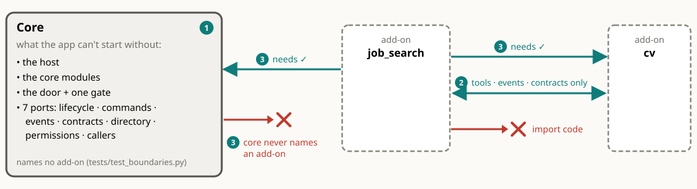

# Architecture

The whole project at a glance. Each part links to its own page; the public interface is in the [API reference](../api/README.md).

## Bird's-eye view

The numbers are the three rules of the core line:

1. **The core** is what the app can't start without: the host, the core modules, the one module door with its gate, and the seven ports. It names no add-on.
2. **Add-ons talk only through tools, events and contracts**, never by importing each other's code.
3. **Arrows point one way:** an add-on may need the core or another add-on; the core never names an add-on.

## Summary

A modular personal AI assistant, built as a long-term experimental platform. A small, stable core hosts a changing set of independent modules (inputs, outputs, views, tools, background workers and the AI agents themselves), which can be added, replaced or dropped with little change elsewhere.

- **The core** is the host (`src/assistant/core/`), the core modules (each module's `docs/docs.toml` says `group = "core"`), the one module door with its one gate (`dispatch_tool`), and seven ports: lifecycle, commands, events, contracts, the directory, permissions and callers ([core](core.md)).
- **Add-ons** are every other module, one folder each: in the repo's `src/assistant/modules/<id>/`, or in a folder outside the repo named in `[core] module_folders` ([modules](modules.md)).
- **The agents.** The Talker talks with you, the Main Assistant does the work and coordinates, and helpers and module agents do jobs. They reach every module through one MCP door with three tools (list modules, show a menu, use an item), so each module costs them one line until they open its menu ([agents](agents.md)). The Agent Hub is a core module that does coordination only: focus, tasks, held questions and messages. The door, the agent names and each agent's permission mode belong to the core (its Callers port).
- **The style** is a modular monolith with ports and adapters: the modules run in one process, and a module's code is reloaded in place without a restart. A part that is useful on its own (the HTML viewer, the voice service, the CV Tool) runs as its own app, launched by its thin module through `CompanionApp` ([decisions](decisions.md#decided)).
- **Where it runs:** a PC today, a server later, so the core assumes no desktop. Config, secrets and data paths come from config files and environment variables; user-facing interfaces are modules or [remote clients](remote-clients.md).

## Restructuring

The core and hub restructuring: [the note](../../html-next-steps/core-and-hub-definition.html) ([`core-and-hub-definition.md`](../next-steps/core-and-hub-definition.md)).

## Pages

- [Short overview](short-overview.md): the one page the repo's CLAUDE.md loads
- [Principles](principles.md): the rules behind every decision
- [Reusable parts](reusable-parts.md): build it once; where shared parts live, the companion app checklist
- [Code map](code-map.md): every package and its main classes and files, with who calls whom
- [Core](core.md): the host, lifecycle, the inside of the core, and how modules talk
- [Modules](modules.md): a module's folder and lifecycle, the three rules, outside folders (`module_folders`), adding and removing a module
- [Module library](module-library.md): every module's one-liner and interface (tools, commands, events, data types), each linking to its own [module page](module-library.md#module-pages)
- [Communication](communication.md): commands, events, results, timeouts, who may send what
- [Agents](agents.md): who is who, where each agent works, which CLAUDE.md it loads, the Agent Hub
- [Agents: code layout](agents-code.md): the agent code in layers, and which method calls which
- [Permissions](permissions.md): cards, permission modes, the access-list review, the access card
- [Remote clients](remote-clients.md): Quest, glasses, the gateway (planned)
- [Decisions](decisions.md): decided and open
- Restructuring (built 2026-11-13; the result is on the Core, Modules, Agents and Permissions pages, the history in these change notes): [the note](../../html-next-steps/core-and-hub-definition.html), [the proposal](../../html-next-steps/core-and-hub-proposal.html), [the piping](../../html-next-steps/piping.html), [module layouts](../../html-next-steps/module-layouts.html), [agents and CLAUDE.md](../../html-next-steps/agent-claude-md-options.html)
- [HTML viewer](../../src/assistant/modules/html_viewer/docs/viewer-app.md): viewing and editing HTML in tabs; state, commands, view
- [Voice](../../src/assistant/modules/voice_in/docs/voice-service.md): speech to text through a shared voice service, its `voice_in` module and the temp UI's mic button

## Parts

| Component | Responsibility | Location | Details |
|-----------|----------------|----------|---------|
| Module Registry | Finds the modules by folder (`loader.find_modules`), in the repo and in the outside folders `[core] module_folders` names (`loader.add_module_folders`); selects the enabled ones; validates the dependency graph | `src/assistant/core/registry.py`, `loader.py` | [core](core.md), [modules](modules.md#found-by-folder) |
| Module directory | One line per module (`ListModules`), then that module's menu (`GetMenu`), plus the core's own menu (`modules.*`: list, menu, docs, on, off, reload, add, remove). The menus sit in a core-private table (`MenuTable`), not the container | `src/assistant/core/directory.py`, `tools.py`, `app.py` | [modules](modules.md#find-a-module-then-open-its-menu), [core](core.md#tools) |
| Module door | The agents' one MCP door (list · menu · call), hosted by the core and opened before any module starts. A module gets a door config only for itself or the agents it claimed. Every call passes one gate in `dispatch_tool`: the item's callers, then a card for items that ask first | `src/assistant/core/door.py`, `tools.py`, `infra/mcp_door.py` | [core](core.md#the-module-door) |
| Callers | The seventh port: agent names (`IAgentNames`, one claim per id; claims outlive a Hub reload), each agent's permission mode (Auto only from you), who is "you" (`[core.permissions] you`) and who relays your card answers (`relays`, the Talker) | `src/assistant/core/callers.py` | [core](core.md#callers) |
| Lifecycle Manager | Initializes, starts and stops modules in dependency order; turns modules on and off at runtime; reloads a module's code and adds new modules (with `core/loader.py`) | `src/assistant/core/lifecycle.py` | [core](core.md#lifecycle) |
| DI Container | Resolves shared contracts to the implementations modules provide | `src/assistant/core/container.py` | [core](core.md#communication-internals) |
| Command Router | Routes each command to its single handler and returns the result. Every command carries its sender (`sent_by`); a module sends only what its manifest lists, and control commands only from you | `src/assistant/core/router.py`, `context.py` | [core](core.md#who-may-send-what) |
| Event Bus | In-process publish/subscribe for events; a module publishes only what its manifest lists | `src/assistant/core/bus.py` | [core](core.md#communication-internals) |
| Contracts | `ModuleProtocol`, `Manifest`, `ModuleContext`, `Menu`, capability interfaces, command and event types | `src/assistant/contracts/` | [API](../api/README.md) |
| Shared Infrastructure | Helpers for the main app's modules: config and logging, the agent parts (`ClaudeSession`, `SessionTaskAgent`, `ProfileAgent`, `AgentKit`), access lists and module folders (`agent_access`), the door's relay (`mcp_door`), page opening (`show_page`) | `src/assistant/infra/` | [API](../api/infra.md) |
| Reusable parts | Behavior two parts need, built once and listed with who uses it: contracts, infra helpers, `app_kit` for what the independent apps share too, and the test kit for every test | `src/assistant/contracts/`, `src/assistant/infra/`, `src/app_kit/`, `src/assistant/testkit/` | [reusable parts](reusable-parts.md), [index](../api/reusable.md) |
| Generated files | `generated/` (gitignored, safe to delete): the live module list, the directory and the dependencies, rewritten by the core on every module state change | `src/assistant/core/generated.py` | [core](core.md#generated-files) |
| Log handler | Owns where logs go: one folder per app launch, named by start time and the theme of your first question. Modules reach it through their `ctx.logs` port | `src/assistant/infra/log.py`, `core/logs.py` | [core](core.md#logging) |
| Modules | All capabilities, the AI agents included; each a wrapper (manifest, lifecycle, context) with a menu of tools. Core modules: `console_io`, `talker`, `main_assistant`, `agent_hub`, `temp_ui`, `voice_in`, `usage` (on at launch), `task_agents`, `assistant_view`. Add-ons: `html_viewer`, `voice_notes`, `job_search`, `cv`, `echo_orchestrator` | `src/assistant/modules/<id>/` or an outside folder, one folder each (code, `module.toml`, `app/`, `tests/`, `docs/`; an agent's `workspace/`, gitignored) | [module library](module-library.md), [agent runtime](../agents/runtime.md) |
| UI handler | Owns the user-facing UIs (chat window, Quest, glasses). Not designed yet; `temp_ui` stands in | _TBD_ | [decisions](decisions.md#open-decisions) |
| HTML viewer | Its own app: view, edit, highlight and snip HTML files. Launched by the thin `html_viewer` module through `CompanionApp`; its tabs and snips are its named events (`html_viewer.*`) | `src/assistant/modules/html_viewer/app/html_viewer/` | [HTML viewer](../../src/assistant/modules/html_viewer/docs/viewer-app.md) |
| Voice handler | Speech to text: the `voice_service` app (mic and engines) and the thin `voice_in` module that launches it, relays the mic's state and live text, and sends the final text to the Talker. `voice_in` provides the voice contract `IVoice` | `src/assistant/modules/voice_in/` (the service in its `app/voice_service/`) | [voice](../../src/assistant/modules/voice_in/docs/voice-service.md) |
| CV Tool | The `cv` module's own UI, its own app: the four tabs (Job & CV, the pick, First Draft, ATS Loop), the CV's local PDF and your Submit. The `cv` module launches and calls it through `CompanionHandover` (`cv.open_tool`, `cv.tool_*`) | `src/assistant/modules/cv/app/cv_tool/`, `src/assistant/modules/cv/tool.py` | [cv architecture](../../src/assistant/modules/cv/docs/architecture.md#the-cv-tool-app-cvappcv_tool) |
| Voice notes | Notes by voice in its own window; needs `voice_in`, requires `IVoice` (`listen` without the Talker) and listens to voice events | `src/assistant/modules/voice_notes/` | [voice_notes](../../src/assistant/modules/voice_notes/docs/README.md), [modules](modules.md#chaining-modules) |
| Agent Hub | Coordination only: task state and routing (`TaskBoard`), the focus and held questions (`Focus`), milestones fed to the coordinator, messages between agents (`Delivery`: `DeliverMessage`, never into a turn; `MessageGate`: a card before an agent messages one that isn't its child), agents' notices and resets (`AgentNotice`, `ResetRequested`), the access-list review (`Reviewer`: `ReviewAccessList`, answered with `AddCardNotes`), and its `hub.*` menu, each item knowing its caller | `src/assistant/modules/agent_hub/` | [agents](agents.md) |
| Permissions handler | Part of the core, always on: knows what each module needs and what you've granted, and asks you on a card otherwise. Modules call it through `ctx.permissions`. Access lists on one card, saved grants per kind of agent, the review asked of the Hub's listener, confirm cards before risky steps (Auto never skips them), and `permissions.grants / grant / request / revoke` on the core's menu. Reads each agent's mode from Callers. Single names (the mic) are allowed and logged | `src/assistant/core/permissions/` (your saved grants: `config/permissions.toml`, gitignored) | [permissions](permissions.md), [core](core.md#the-ask-first-gate) |
| Control panel | UI module to turn modules on and off while running, through the core's control commands (planned) | _TBD_ module | [core](core.md#runtime-module-control) |
| Gateway module | Relays messages to and from remote clients over WebSocket (planned) | _TBD_ | [remote clients](remote-clients.md) |
| Remote clients | Device apps with their own UI logic, Quest 3 first (planned) | _TBD_ (planned: `clients/`) | [remote clients](remote-clients.md) |
