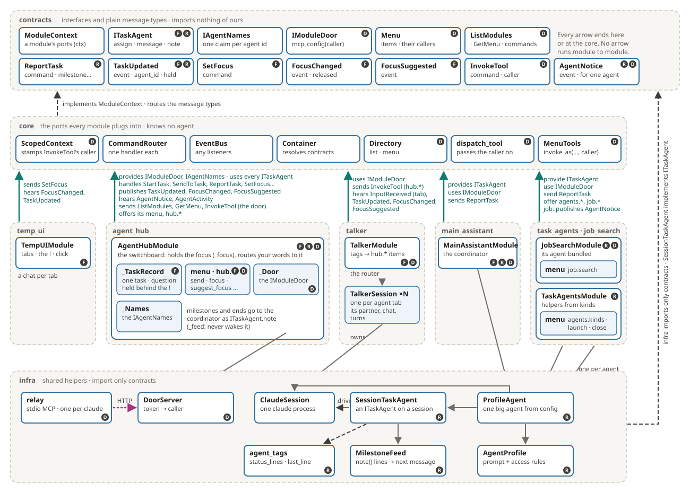
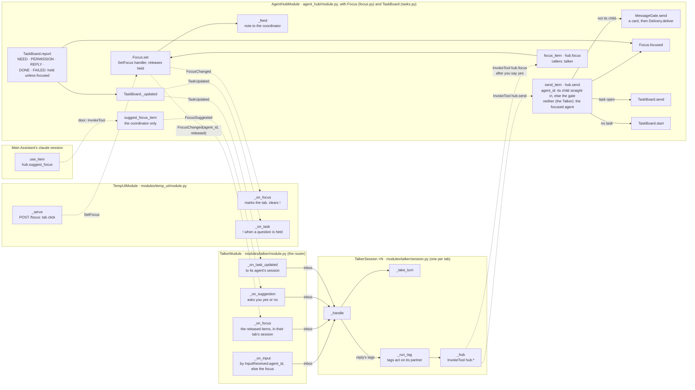
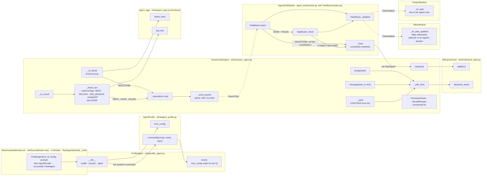

# Agents: code layout

How the agent code is laid out: which classes live in which package, and which method calls which. Back to [Agents](agents.md); the ideas behind it are in [Big agents and their modules](agents.md#big-agents-and-their-modules).

> **Agent talkers (built 2026-11-05):** the `talker` module is a router with one `TalkerSession` per agent tab, each with its own partner agent and chat (`TalkerSession ×N` in the pictures).

Three topics run through it, marked on the boxes: **F** focus and switching, **R** agents reporting to the Main Assistant, **D** the module door.

## The layers

Boxes are classes, grey regions are packages, and every arrow is a structural link.

- **Grey ━** owns (a box inside a box owns too). **Teal ━** through a core port (`ctx`): what the module sends, handles, publishes, hears, provides or uses. **Dashed ┅** implements or imports contracts, or calls functions. **Magenta ┈** the door's HTTP hop.
- **No line joins two module regions.** Each module reaches the others through its teal stub into the core, by a message or a contract named on the stub.
- **Every arrow points up**, toward the core and contracts. Modules own infra helpers, infra imports only contracts, and the core implements the contracts' ports.
- **One spine for the three topics.** Focus, reports and the door all go through `AgentHubModule` and a few contract types. The core only carries the caller (`ScopedContext` stamps it, `dispatch_tool` and `MenuTools.invoke_as` pass it on); it holds no agent logic.
- **Every big agent is a `ProfileAgent`** (`infra/profile_agent.py`): its `AgentProfile`, its `ClaudeSession` and the `SessionTaskAgent` on it, plus the door under its own name. `main_assistant` has one, `job_search` bundles one, `task_agents` builds one per helper.
- **The Hub's parts** (split 2026-11-08). `AgentHubModule` (`agent_hub/module.py`) is a small coordinator: it wires the commands, events and its menu to a `TaskBoard` (`tasks.py`: every `TaskRecord` and the task state machine, the cap, the folder check), a `Focus` (`focus.py`: the focused agent, its fallback to the coordinator, releasing what a tab held) and `AgentNames` (`names.py`: `IAgentNames`). It keeps only the running-agent lookup (`_agents`, `_agent`) and the coordinator's feed (`_feed`), which it hands to the parts. A held question is `TaskRecord.held` next to its `question`; `Focus.set` releases it through `TaskBoard.release`. Two more parts (built 2026-11-10): `Delivery` (`delivery.py`: the `DeliverMessage` handler; never into a turn, waits per agent and tries again on every `AgentStateChanged` / `ModuleStateChanged` with `flush`; `later` holds an answer whose agent is in a turn) and `MessageGate` (`gate.py`: an agent's `hub.send` to an agent that isn't its child; asks `ctx.permissions.ask` with `message:<receiver>`, holds the messages behind one card per pair, then hands them to `Delivery.deliver`).
- **A question is its task record.** On a `need`, `TaskBoard.report` makes the record `idle` with its question and `question_key` and drops its holder (`TaskRecord.asked`); the agent is free. `TaskBoard.send` into an asked record calls `_answer`, which assigns the same task id again ("Answer to your question …"); if the agent is active, `AgentHubModule._send` hands the answer to `Delivery.later`. `export_questions` / `restore` carry the asked records over a Hub reload.
- **The Talker reaches the Hub only through its menu.** Its mode switch and card answers are `hub.mode` (Manual only) and `hub.answer`, both `callers=("talker",)`, like `hub.focus`. The UI still sends `SetPermissionMode` and `AnswerPermission` as commands (your own clicks).
- **SHOW tags go through one helper.** `SessionTaskAgent._show` and the Talker's `SHOW` tag both call [`show_page`](../api/infra.md#show_page) (`infra/show_pages.py`), which opens the page through the page-opener slot ([`IPageOpener`](../api/modules.md#ipageopener), filled by an add-on; started on use with `StartProvider`); each words its own message from the outcome. temp_ui's Open in viewer button uses the same helper's `open_page`.
- **The worker's parts** (split 2026-11-08). `SessionTaskAgent` keeps the task state machine and composes a `PermissionGate` (the one open question, the Auto policy, the `git push` block), a `HandoffKeeper` (handoff count, reminder and reset texts) and a `LastLineTags` table (`_finish_turn` looks up `NEED` / `RELOAD` / `ADD_MODULE` / `HANDOFF`); the session's `UsageMeter` counts tokens. A `NEED` goes through `_ask_user`: it reports the question with its key and drops the task; the agent is `idle` once the Hub has it. The owning module sets the key and the notes with `set_context(key, notes)` (default `default_context`: the handoff note); `assign` of an answer carries on in the live session or adds the notes to a fresh one (`_first_text`). Every agent module builds its agents through `AgentKit` and declares `AGENT_USES` / `SENDS` / `PUBLISHES` / `LISTENS`. Picture 2 shows this below.
- **The Talker's parts** (split 2026-11-08). `TalkerModule` routes; `RestartFlow` (`talker/restart.py`) is the main tab's restart; each `TalkerSession` runs its tags from a table (`_tags`, one `_tag_*` handler each) and uses the module only through its methods for the sessions (`task_started`, `usage_of`, `hub`, `restart`, ...).
- **The feed lives in each agent.** The Hub passes milestones, task ends and focus moves to the coordinator with `ITaskAgent.note`; the agent's `MilestoneFeed` keeps them and `_with_feed` adds them to its next message, its own `CONTINUE` turns included. Nothing wakes the coordinator.

## 1. Focus and switching

Each big box is a class with the file it lives in; the small boxes are its methods. **Solid** arrows are direct calls; **dashed** ones go through the core (`ctx.send` → `CommandRouter` → handler, or `ctx.publish` → `EventBus` → listener, or the door's hop), with the message on the edge.

**How it reads:** a tab click sends `SetFocus`. The four `_on_*` methods on `TalkerModule` pick the session: your words go to their tab's `TalkerSession`, whose `PASS` tag sends them on with `hub.send(agent_id=its partner)`, so they reach that agent's task, or start one. The Main Assistant can only suggest: `hub.suggest_focus` publishes `FocusSuggested`, the tab's Talker asks you, and the focus moves only when you say yes (`FOCUS` → `hub.focus`, an item only the Talkers may use). A question, reply or end from an agent out of focus is held on its task record; `Focus.set` releases it (`TaskBoard.release`) in `FocusChanged`, and that tab's Talker says it then.

## 2. Agents reporting to the Main Assistant

**How it reads:** a helper writes `STATUS: …`. `_on_block` picks it out with `status_lines`, and it reaches the Hub as a `ReportTask` of kind `milestone`. The Hub hands it to the coordinator's agent with `note`, which files it in that agent's `MilestoneFeed`. The Main Assistant sees the feed as one block at the end of its next message, task or `CONTINUE` turn (`_with_feed`). The loop Hub → agent → `ReportTask` → Hub is safe: reports go through the `_send_reports` queue and the router, never back into the same call.

## 3. The module door

```mermaid
flowchart LR
  subgraph AG["ProfileAgent · TalkerSession.command"]
    a_door["mcp_config(own id)"]
  end
  subgraph HDOOR["_Door · IModuleDoor · modules/agent_hub/module.py"]
    door_cfg["mcp_config(caller)"]
  end

  subgraph CS["claude -p · the agent's process"]
    cs_tool["mcp__modules__use_item<br/>name, args"]
  end

  subgraph RELAY["relay · infra/mcp_door.py · own process"]
    r_relay["relay()<br/>JSON-RPC on stdin"]
    r_answer["answer(message, url, token, caller)"]
    r_post["_post"]
  end

  subgraph DS["DoorServer · infra/mcp_door.py"]
    d_cfg["mcp_config(caller)<br/>token_for(caller)"]
    d_serve["_serve<br/>checks token → caller"]
    d_call["call(tool, arguments, caller)"]
  end

  subgraph CTX["ScopedContext · core/context.py (the Hub's)"]
    c_send["send(command)<br/>keeps the caller: the door's host"]
  end
  subgraph RT["CommandRouter · core/router.py"]
    rt_send["send(command)"]
  end
  subgraph TOOLS["core/tools.py"]
    dt["dispatch_tool"]
    prov["_providers(name)"]
    mt_inv["MenuTools.invoke_as(name, args, caller)"]
  end
  subgraph APP["App · core/app.py"]
    app_sou["start on use<br/>module off, item on its menu"]
  end
  subgraph MENU["Menu · contracts/menu.py"]
    m_call["call(module, name, args, caller)"]
    m_allowed["allowed(name, caller)"]
    m_check["check(name, args)"]
  end

  subgraph JOB["JobSearchModule · modules/job_search/module.py"]
    j_search["search(days, caller) · job.search<br/>answers at once"]
    j_bg["_search<br/>background task"]
  end

  subgraph HUB["AgentHubModule · modules/agent_hub/module.py"]
    h_notice["_on_notice"]
  end
  subgraph JA["SessionTaskAgent · the caller's agent"]
    ja_note["note(text)"]
  end

  a_door --> door_cfg
  door_cfg --> d_cfg

  cs_tool -- "stdio" --> r_relay
  r_relay --> r_answer
  r_answer --> r_post
  r_post -. "HTTP POST /tool + token" .-> d_serve
  d_serve --> d_call
  d_call -- "InvokeTool(name, args, caller)" --> c_send
  c_send --> rt_send
  rt_send --> dt
  dt --> prov
  dt -- "nobody offers it" --> app_sou
  dt --> mt_inv
  mt_inv --> m_call
  m_call --> m_allowed
  m_call --> m_check
  m_call -- "runs the item" --> j_search

  j_search -- "spawns" --> j_bg
  j_bg -. "AgentNotice(agent_id = caller)" .-> h_notice
  h_notice -- "via ITaskAgent" --> ja_note
```

**How it reads:** each session's door config carries a token for its own id, so `DoorServer` knows the caller and the agent can't fake it. Every other module's `InvokeTool` gets its own id stamped by `ScopedContext.send`; only the door's host (`agent_hub`) may pass on the one its token proved. The caller rides on `InvokeTool` through the core down to the menu item, where `Menu.allowed` checks the item's `callers`. `job.search` returns at once; when its background task finishes, it publishes `AgentNotice` addressed to the caller, and the Hub passes it to that agent with `note`, for its next message.

## Known limits

- **One point of failure:** the door lives in `agent_hub`, so with the Hub off no agent has module tools.
- **A name in config:** the Hub knows the coordinator by id (`coordinator` in `[modules.agent_hub]`, default `main_assistant`). A replacement Main Assistant must keep that id, or change the setting.
- **A near-loop to keep loose:** agent modules use `IModuleDoor`, which `agent_hub` provides, and `agent_hub` uses every `ITaskAgent`. It stays safe while both remain optional lookups and neither becomes a `requires`.
- **Risky items ask for themselves:** each risky menu item calls `ctx.permissions` (or `request_approval`) on its own. There is no `risky` flag on `Menu.item` checked once in `MenuTools`, so a new item can forget to ask.
- **A bundled agent reloads with its module:** reloading `job_search` restarts its agent, so the reload waits while that agent is busy (`busy()`).
