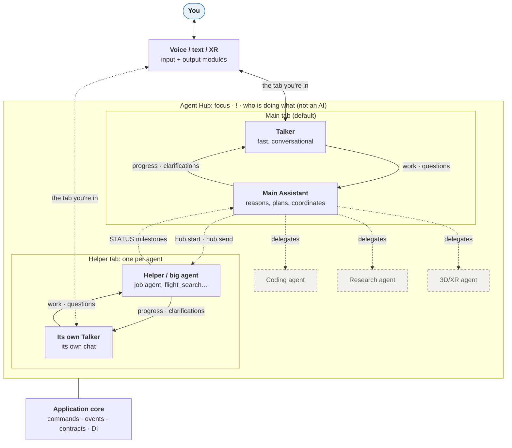
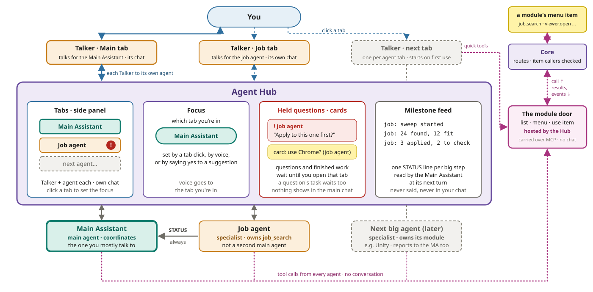
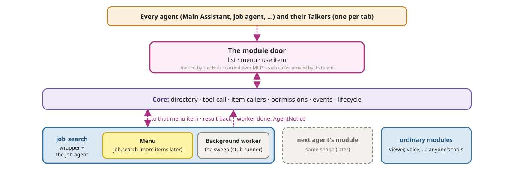
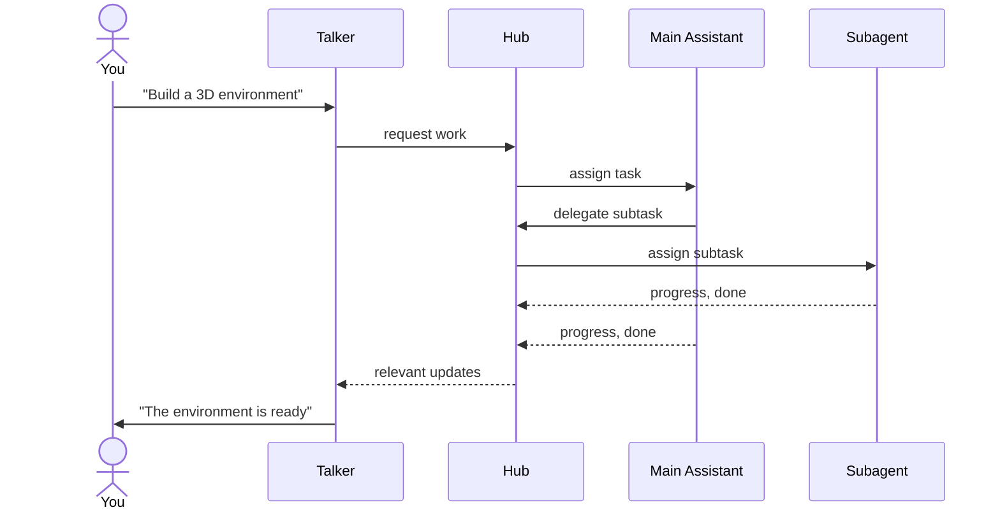
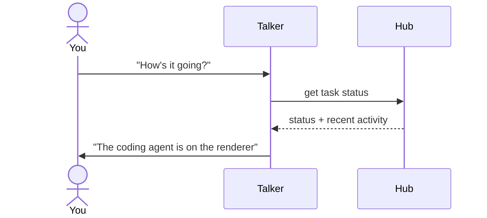
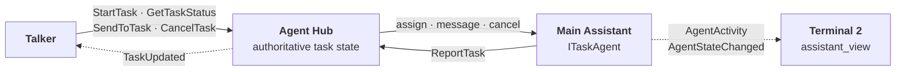
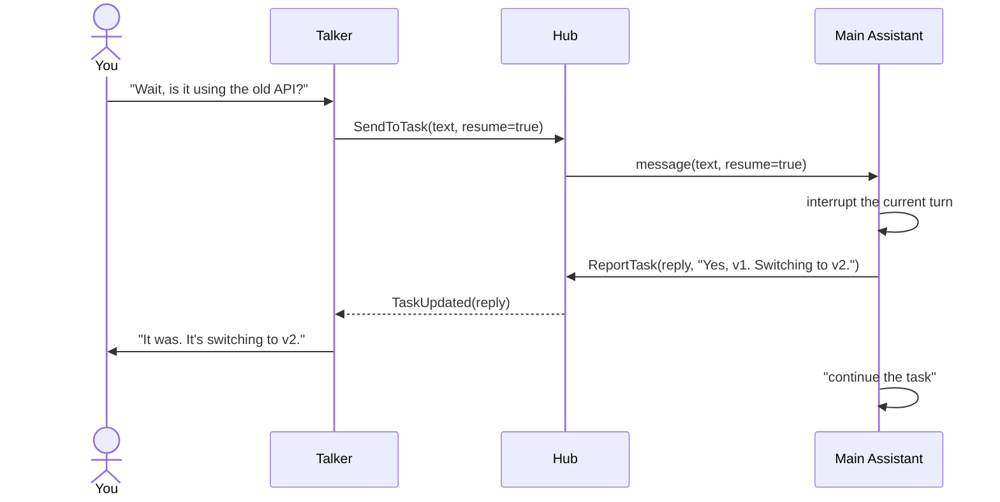
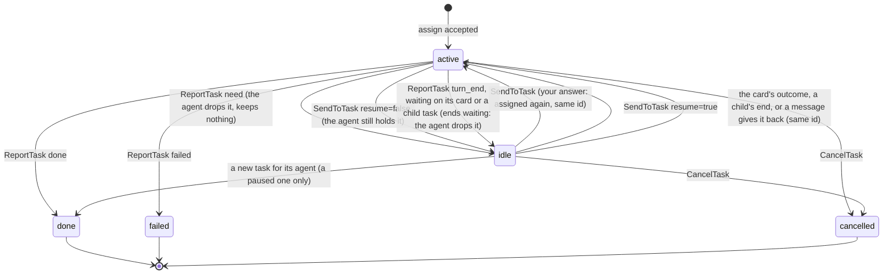

# Agents

How the AI side fits the system: an **Agent Hub** coordinates a **Talker**, a **Main Assistant**, and **subagents**. Back to the [overview](README.md). How we actually run and test the agents is in the [Agents tab](../agents/README.md).

> **Status: built (2026-10-25)** for the Talker, one Main Assistant, and the Hub. Hub subagents are still to come; for now the Main Assistant uses Claude Code's own subagents (a `debugger`) inside its session. Since 2026-10-27 the Main Assistant starts a fresh session per task and hands off between big parts ([runtime](../agents/runtime.md#fresh-sessions-and-handoffs)). Since 2026-11-03 the worker is reminded at 150k and hands off to a fresh session by itself, and batches its edits through a standing prompt line and a once-per-file hook note, with no interrupts ([runtime](../agents/runtime.md#fresh-sessions-and-handoffs), [decision](decisions.md#decided)). **Restart:** `python -m assistant` is a launcher that starts the app again whenever it exits with code 75; when you ask for a restart, the Talker gets reset instructions from the worker, the app exits with 75, and the new launch hands those instructions to the Talker as its first input ([core](core.md#lifecycle), [runtime](../agents/runtime.md#the-talker-on-its-own)). The [spike](../agents/spike.md) confirmed the interrupt the design relies on. API: [Agents](../api/agents.md).

> **Agent tabs: built (2026-11-05).** Every agent tab is a pair, its own Talker and its own worker, with its own chat. A helper's Talker starts the first time its tab is used and closes with its tab; there is no idle timeout.

## The idea

Separate **communication** (Talker), **coordination** (Hub), **intelligence** (Main Assistant), and **execution** (subagents), each a replaceable module.



Each tab is a pair, its Talker and its agent. A helper's Talker talks only for its own agent, its updates never reach the main chat, and the agents reach each other only through the Hub's menu.

The picture shows **logical relationships, not containment or mandatory paths**. Every agent is its own module, and all messages travel through the core's [commands, events, and `InvokeTool`](communication.md). Not every request passes every level: the Talker reads task status straight from the Hub.

## Big agents and their modules

The core idea of agents and modules: **messages go through the Agent Hub, tools go through the module door.** Each big agent (a specialist like the job agent) is in charge of its own module, and every agent reports one-line milestones to the Main Assistant. Built (module system chunks 1–9); the job agent's search runner is still a stub, and the next big agent is later. How the code is laid out is in [Agents: code layout](agents-code.md).

### The Agent Hub: the switchboard

The Hub decides who you're talking to (the **focus**), holds what's waiting for you (questions and cards behind the **!** on a tab), and keeps the **milestone feed**. The UI is built around it. The pictures below show the pairs: one Talker per tab, each with its own chat; the questions, cards, replies and finished work of a tab you're not in wait behind its **!**.

[](img/agents-switchboard.svg)

**Two separate routes.** Messages (your talk, the focus, the held questions, and the `STATUS:` milestones) go only through the Hub, between you, the Talker and the agents (blue and grey). Tools go another way (dotted magenta): any agent, and the Talker for quick things, calls the [module door](modules.md#find-a-module-then-open-its-menu), which the Hub hosts but which carries no conversation. The door passes the call to the core, the core checks the item's callers and runs a module's menu item, and the result and any events come back the same way.

### How an agent's messages move: two modes

One agent sends two kinds of message at once: **status lines to the Main Assistant** and **questions to you**. Only the focus decides who you're talking to. Blue: your conversation, through the Talker. Grey: a `STATUS:` line to the Main Assistant. Red: a question or card for you, held behind the **!**. Teal: the Main Assistant suggests a switch.

[](img/agents-modes.svg)

- **Mode A (normal).** You talk to the Main Assistant. The job agent sends a one-line `STATUS:` only for big steps, which the Main Assistant reads at its next turn without being interrupted. If the job agent needs you, its question waits behind the **!**. The Main Assistant can suggest a switch (`hub.suggest_focus`), and the Talker asks you. The job agent's finished work waits behind the **!** too, and its Talker takes no turns while you're away.
- **Mode B (direct).** You click the job agent's tab or say yes to the suggestion. The Hub moves the focus (`SetFocus`), and the held question and its card load into the job tab's own Talker, in the job tab's own chat. You now talk to the job agent, while it still sends `STATUS:` lines to the Main Assistant, whose own questions wait behind a **!** on its tab.
- **Back to A.** You click the Main Assistant's tab, and the job agent's next question goes behind the **!** again. The main chat shows only your conversation with the Main Assistant.

### Below the Hub: modules, the door, the core

A big agent is in charge of its own module. No agent calls a tool directly: every agent uses a module's menu items, through the door.

[](img/agents-below-hub.svg)

- **The job module** (`job_search`) is a wrapper with a menu, a background worker and its own agent (a `ProfileAgent`, id `job_search_agent`). `job.search` starts the sweep and returns at once, so the agent stays free. When the sweep is done, the module publishes an `AgentNotice` to the caller, and the Hub hands it to that agent at its next turn.
- **The Main Assistant** has no module of its own. It works in this repo and uses any module's menu through the door.
- **Permission cards** from a risky item name their agent, and the Hub holds them behind the **!** unless that agent has the focus.

### The workflow in steps (job search)

1. You tell the Talker "run a job search." It goes to the Main Assistant, which has the focus (Mode A).
2. The Main Assistant hands it to the job agent with `hub.start` and suggests talking to it directly. You say yes, so the focus moves (Mode B).
3. The job agent uses `job.search` on its own module through the door. The sweep runs in the background, and the agent stays free to talk.
4. You switch back to the Main Assistant (Mode A). When the sweep is done, the job agent gets the notice and sends `STATUS: 24 found, 12 fit`.
5. The Main Assistant reads that one line at its next turn. Your conversation with it isn't interrupted.
6. The job agent needs you ("apply to this one first?") or a Chrome permission. That's held, and its tab shows **!**.
7. You click the tab when you're ready (Mode B). The Talker says the question and the card shows. You answer, and the job agent goes on, stopping before Submit.

In steps 2–7 the job tab has its own Talker and its own chat: step 2 opens it, step 4's end waits behind its **!** instead of reaching the main chat, and step 7's question is said by the job tab's Talker. The sequence diagrams under [Flows](#flows) stay true per tab: their `T` is the Talker of the tab you're in.

## Responsibilities

| Part | Does | Doesn't |
|------|------|---------|
| **Application core** | Generic module communication and lifecycle, including turning modules on and off | Know that the Hub, agents, or Claude exist |
| **Agent Hub** (module) | Agent registry and capabilities, availability, task ids and parent/child links, routing requests and results, progress and failures, task history, clarification and cancellation flows | Reason or decide how to solve anything; duplicate the core's registry, lifecycle, DI, router, bus, or tool dispatch |
| **Talker** | Converse, answer simple things directly, hand substantial work to the Main Assistant, report progress and results, relay clarification questions, stay responsive and interruptible. Read spoken input (marked `[Spoken]`, from `InputReceived(source="voice")`) for what was meant, using the conversation, with no extra cleanup call | Do substantial work itself |
| **Main Assistant** | The central intelligence: reasoning, planning, executing, choosing tools, splitting work, delegating to subagents (through the Hub), combining results | Own bookkeeping or talk to the human directly |
| **Subagents** | Specialized execution (coding, research, 3D, browser, robotics…), possibly in parallel, reporting progress | Plan the overall task |

**The Hub manages who is doing what, not how the work is done.** Not every capability needs to be an agent: browser, file, or 3D services can stay ordinary tool modules.

A Claude Code session can also spawn its own internal subagents. Those are its own business; **Hub subagents** are separate, registered modules. Today the Main Assistant uses an internal one, `debugger`, so debugging loops run in their own small context; the Hub can't list or stop it separately. Hub subagents come when stopping one at a time is needed.

## Startup

The core's lifecycle manager starts every module, agents included; the Hub launches nothing. Each agent module owns its `claude` process, and the terminals belong to view modules, not to the agents:

```
python -m assistant
 └─ core lifecycle activates the enabled modules, in dependency order:
     ├─ console_io       terminal 1, the app's own: you talk here
     ├─ main_assistant   its own hidden `claude -p` process
     ├─ talker           its own hidden `claude -p` process
     ├─ assistant_view   opens terminal 2: the Main Assistant's activity, view only
     └─ agent_hub        coordinates; launches nothing (after the agents it finds)
```

Each module decides when to start its expensive part ([runtime module control](core.md#runtime-module-control)):

| Module | Process starts | Why |
|--------|----------------|-----|
| Talker | When activated, kept warm | You expect an instant reply |
| Main Assistant | When activated; restarted on the next task if it was closed | Ready for the first task; a restart's few seconds are fine before a long task |
| Subagents | When the Hub first delegates to one; stop when idle | Most aren't used most of the time |
| Assistant view | When activated | Terminal 2 should be there when you look |

The Hub "taps" an agent by sending it a task through its contract; if that agent's process isn't running, the agent module starts it. Swapping terminal 2 for the chat window later is a config change.

## Flows

### Task assignment



### Progress request



The Main Assistant isn't interrupted or asked for routine status. The status carries the task's last activity lines (the Hub keeps them from `AgentActivity`), and the Talker always has both sessions' usage (`SessionUsage`), so "what is it doing?" and "how full is it?" never need an interrupt.

### Clarification

```mermaid
sequenceDiagram
    actor You
    participant T as Talker
    participant H as Hub
    participant A as Agent
    A->>H: ReportTask need (its turn ends; it's free)
    H->>T: clarification request
    T->>You: "Realistic or stylized?"
    You->>T: "Stylized"
    T->>H: SendToTask (your answer)
    H->>A: assign the same task: "Answer to your question …"
```

Communication is two-way: agents can ask the human for information, and the Talker stays responsive. A question never keeps an agent busy: it ends its turn, takes other work meanwhile, and your answer comes back as a message to the same task, whenever you give it ([questions are messages](#questions-are-messages)).

## Task agents

The v1 design: a minimal Hub, one Main Assistant, real modules (no relay script). Full signatures are on the [Agents API page](../api/agents.md). Processes, spawning, each agent's loop, and prompts: [Agent runtime](../agents/runtime.md).

### `ITaskAgent`

Any agent that takes tasks provides **`ITaskAgent`** (`multiple = True`): the Main Assistant now, subagents later. The Hub knows only this contract, finds agents with `ctx.get_all(ITaskAgent)`, and never imports an agent module. The Talker doesn't provide it; it stays driven by `InputReceived` / `ResponseReady`.

| Method | Does | Like in Claude Code |
|--------|------|---------------------|
| `info()` | Id, description, capabilities, `state`: `active` (in a turn, or held in one by a permission card) or `idle` (takes new work, whatever questions it has open). Read on every lookup | |
| `assign(task)` | Accept or refuse a task. Returns at once, never waits for the work | Typing a new request |
| `message(task_id, text, resume)` | Interrupt, answer quickly, then continue the task unless `resume` is false (stop or pause) | Typing while it works |
| `cancel(task_id)` | Stop the task now. The session and its memory survive | Pressing Esc |

There's no `Agent` base class. Each class inherits one interface and is assembled from parts ([principle 12](principles.md)):

| Class | Inherits | Composed from |
|-------|----------|---------------|
| `MainAssistantModule` | `ModuleProtocol` | `SessionTaskAgent`, `ClaudeSession` |
| `SessionTaskAgent` | `ITaskAgent` | `ClaudeSession`, `ModuleContext` |
| `ClaudeSession` (`infra`) | nothing | one `claude -p` stream-json process |

The module provides the contract through its composed part: `ctx.provide(ITaskAgent, self._agent)`. A later subagent reuses `SessionTaskAgent` and `ClaudeSession` with its own prompt and permissions.

### Who sends what



Solid: commands and contract calls, which always return a `Result`. Dotted: events, which may be dropped.

- **Talker → Hub:** commands `StartTask`, `GetTaskStatus` (status without bothering the agent), `SendToTask` (a question, extra instruction, or your answer), `CancelTask`. In v1 the `talker` module turns tags in the Talker's text (`<<WORK: …>>`, `<<ASK: …>>`, `<<PAUSE: …>>`, `<<CANCEL>>` etc.) into these commands. Planned: both agents find module tools through the [directory, then menu](modules.md#find-a-module-then-open-its-menu) instead of hardcoded tags.
- **You never use keywords or flags.** You just talk; the Talker (a Claude too) infers from context whether you meant continue, pause, or cancel, and emits the matching tag.
- **Agent → any UI:** the `AgentStateChanged` event whenever its `state` (active or idle) changes, so a UI shows it live. `ListAgents` (Hub) is the authoritative read.
- **Hub → agent:** the `ITaskAgent` methods.
- **Agent → Hub:** the `ReportTask(task_id, kind, text, key)` command, with `kind` = `progress` / `reply` / `need` / `turn_end` / `done` / `failed`, and with a `need` its context `key`. A turn that ends with no last-line tag (or with its card open) reports `turn_end`, and the Hub answers whether the task ends waiting or is done ([a waiting task ends with a note](#task-state)). A command, not an event, because the Hub's state must not miss it.
- **Hub → Talker:** the `TaskUpdated` event on every report and state change. The Talker can always re-read with `GetTaskStatus`.
- **Agent → terminal 2:** the `AgentActivity` event, the agent's raw text and tool calls. Published by the agent module directly, since it's high-volume and only for viewing.

### Messages and cancel

**`message`** works like typing into Claude Code while it works:



- **`resume=true`** (default): after the reply, the agent sends "continue the task" to its session itself.
- **`resume=false`**: you said stop or pause. The agent replies and the task goes `idle`, still held by its agent; a later `SendToTask` with `resume=true` (e.g. "carry on") continues it. A new task for that agent drops it. To abandon the task, use `CancelTask`.
- **Answering a question:** if the agent asked you something (`need`), its turn has ended and it dropped the task, so there's nothing to interrupt. Your answer gives the same task back to it ([questions are messages](#questions-are-messages)).
- The Talker infers `resume` from context; you never say a keyword. The reply is how it (and you) decide whether to cancel.

**`cancel`** works like Esc: interrupt the turn, mark the task `cancelled`, keep the session (and its memory) for the next task. Killing the process is only the fallback if the interrupt doesn't stop it; the next task then starts a fresh session or resumes it by id.

### Task state

The Hub owns the authoritative state. An accepted assignment is not a finished task.



Two live states: **active** (its agent is in a turn on it; a permission card mid-turn keeps it active) and **idle**. An idle task is either paused (you stopped it; its agent still holds it, and a new task for that agent ends it as done) or holds its agent's note (a `need`, or what it ended waiting on; the agent dropped it and is free). `progress`, `milestone` and `reply` reports don't change the state. Each agent runs **one task at a time**; `assign` to an active agent is refused and `StartTask` returns `not_available`. An idle agent takes new work, whatever questions it has open.

**A waiting task ends with a note** (built 2026-11-13): a task never sits in an open-ended pause. When a turn ends with no last-line tag, or with its card (an approval: `RELOAD:`, `ADD_MODULE:`, a helper launch in Manual) still open, the agent reports `turn_end` with the task's context key, and the Hub decides (`TaskBoard._settle`). If the task waits on its card, or on child tasks started with `tell_parent` (the default), it **ends waiting**, the way a `need` does: the agent drops it (its live session kept) and is free for new tasks and messages, and the Hub's record is the note: what it waits on (`question_kind` `wait`, "waiting on child task …"; a card keeps `permission`, so it shows as before), its key, its recent reports. The note outlives a Hub reload (`export_questions`). An open approval stays in the agent's gate for that task (`PermissionGate.park`). Otherwise the task is done, as before. **What gives it back** (the same task id, through `_answer`: into the live session if nothing ran since, else a fresh one with the key's notes): each child's end, delivered into that parent task by id (for the coordinator too), the card's outcome (the agent reports it as the task's `progress`), or your message. If the agent is busy then, it waits in `Delivery` until the agent is free. If other children are still open, the resumed turn ends waiting again. A child started with `tell_parent=False` doesn't count (its module reports the end itself). An agent still in a turn, a `need`, and messages it sent that wait elsewhere are never ended this way. No queues, priorities, progress percentages, or crash resume yet.

### Questions are messages

A question never makes an agent busy (built 2026-11-10; the change note: `docs/next-steps/agent-talk-and-questions.md`).

- **A `NEED:` ends the turn.** The agent reports `need` with the question's context **key** (`ReportTask.key`; its module decides it: cv uses the job's folder, others the task's last handoff note), drops the task and is idle. The Hub keeps the task `idle` with its question (`TaskInfo.question_key`), behind the tab's **!** as before.
- **Your answer is a message,** whenever you give it: the Hub assigns the same task id to the agent again, with "Answer to your question in task <id> (…): <answer>" and the key (`Task.question_key`). If the agent is in a turn on other work, the answer waits and goes in when it's free (`hub.send` says "delivered: when its agent is free").
- **The agent finds the context again.** If its session still has the question, it carries on there. If not (a relaunch, a reset, other work in between), it starts a fresh session and adds its module's notes for the key: the hook `SessionTaskAgent.set_context(key, notes)`, by default the handoff note ([`default_context`](../api/infra.md#sessiontaskagent)); cv adds the job's `job_start.json` summary and its handoff note.
- **A permission card** (a tool call mid-turn) is unchanged: the turn stays active, and Allow or Deny lets it carry on.
- **Open questions survive a Hub reload** (handed over in `export_state`) and don't hold up the reload. An app restart doesn't wait for them either: they're listed in the reset note with their context.

### Working together

Several task agents can run at once (built 2026-11-05). The helpers beside the Main Assistant come from kinds of helper in config, in the [`task_agents`](../../src/assistant/modules/task_agents/docs/README.md) module, launched by name ([launching a helper](#launching-a-helper)); a big agent with code of its own is bundled with its own module. Both are built on the shared `ProfileAgent`. The build plan is the multi-agent change note (`docs/next-steps/multi-agent.md`).

- **The focus:** the Hub keeps which agent you're talking to. At launch it's the coordinator (`[modules.agent_hub] coordinator`, the Main Assistant). Only the Talker moves it (`hub.focus`, after you said so) or a UI (`SetFocus`); the coordinator can only suggest a move (`hub.suggest_focus`), which the Talker asks you about.
- **Held questions:** a `need` or `permission` from an agent out of focus is held on its task (the **!** on its tab) until you focus it; `FocusChanged` then releases it.
- **Milestones to the coordinator:** each agent's prompt (the shared block from `AgentProfile`) asks for `STATUS:` lines at milestones, reported as `milestone`. The Hub feeds every other agent's milestones and ends, and each focus move, to the coordinator's `note`, read at the end of its next message. Never an interrupt.
- **A child's end to its parent** (built 2026-11-12): when a child task ends `done` or `failed`, the Hub sends its parent's agent the end as a message (`[Message from agent_hub] Your child task … ended …`), delivered like any `DeliverMessage`. A child started with `StartTask.tell_parent=False` tells no one: its module reports the end itself as a named event (`cv.task` → `cv.job_finished`, which job_search turns into a message for its agent). The coordinator as parent gets only its feed line. A parent hands work over and ends its turn; the result wakes it ([Agent Hub](../../src/assistant/modules/agent_hub/docs/architecture.md)).
- **One road to the Hub:** agents and the Talker reach the Hub through its menu on the module door; every item knows its caller (`InvokeTool.caller`, set by the door from the session's token, never by the session). Others may cancel only their own child tasks.
- **Agents message each other** (built 2026-11-10): `hub.send` with `agent_id` works for every agent. Into its own child task a message goes straight in (it interrupts, as before). Anything else goes through the Hub's **message gate**: the first message from A to B opens a permission card, "A wants to message B", with **Allow once** · **Always allow** · **Deny**. Always saves a grant under `agent_hub` for A's kind, one per direction ([permissions](permissions.md#messages-between-agents)). On Allow the message is delivered; on Deny or no answer A gets a `[messages]` note and nothing is sent. The Talker is never asked.
- **Delivery never interrupts a turn** (`DeliverMessage`, handled by the Hub's `Delivery`): the text arrives as `[Message from <sender>] …`, into the agent's open task, or as a new task if it has none. An agent in a turn gets it when the turn ends; one that isn't running gets it when it starts. Messages to one agent keep their order. Modules use it too: the cv module's result at Submit ([cv](../../src/assistant/modules/cv/docs/architecture.md)).
- **Limits:** besides the coordinator (not counted), at most `[modules.agent_hub] max_extra_agents` agents (3 by default) with an active task at once, and no two active agents writing the same folders. An idle agent, or one whose task only holds a question, holds no folder. `[modules.agent_hub] named_only` lists agents a free pick (`hub.start` with no `agent_id`) never lands on; anyone may still name them (cv_agent: `cv.task` starts it).
- **The Talker's part** ([talker](../../src/assistant/modules/talker/docs/README.md)): one `TalkerSession` per agent tab, each with its partner agent; the module routes your input by its tab (else the focus) and each `TaskUpdated` to its agent's session. A session's tags act on its partner, it hears only its partner's updates, and it reaches the Hub through its menu with `InvokeTool` (its tags are a shorthand). PASS sends your words to its own agent unchanged (`hub.send(agent_id)`); a bare "yes" answers that tab's card when it has only one, and asks which when it has more.
- **The coordinator delegates:** its prompt block tells it to use `hub.agents`, `hub.start` (a child task), `hub.status` / `hub.send` / `hub.cancel` on its own children, and `hub.suggest_focus`; only you move the focus. It launches a helper (`agents.launch`) only when you asked for one.
- **In the temp UI** ([temp_ui](../../src/assistant/modules/temp_ui/docs/README.md)): one tab per big agent with a state dot and the **!**, the Main Assistant's in its own colour; a click moves the focus and brings the held items. A chat per tab under a "Talker · agent" header, the last 300 items of each replayed, not saved across a relaunch.
- **The job agent** ([job_search](../../src/assistant/modules/job_search/docs/README.md)): `job_search_agent`, the first big agent bundled with its own module (a `ProfileAgent` plus its `job.search` menu item, a stub that answers through `AgentNotice`).

### Agent names

Every task agent has one id. The Hub, the tabs, the focus, messages, usage and the module door all find an agent by it (built 2026-11-05; the note: `docs/next-steps/agent-names.md`).

- **Three kinds of agent, kept apart.** The coordinator and module agents come with their own module and start with it: the Main Assistant (`main_assistant`) and the job agent (`job_search_agent`). Helpers come from `task_agents`, launched by name for one task (`flight_search`) from a kind of helper in config. Sub-agents are what a `claude` session starts inside itself (its own Task tool); they have no id and never reach the Hub.
- **Conventions:** short, lowercase, letters, digits and `_`, starting with a letter, at most 32 characters (`flight_search`, `helper_2`). A module's agent is named after its module plus `_agent`. Extra copies are `<name>_2`, `<name>_3`.
- **Reserved:** `main_assistant`, `talker`, `core`, `hub`, and every module's id, since the door's caller names are agent or module ids. A module's own agent may carry its module's id (`main_assistant`). The rules are one helper, [`check_agent_id`](../api/infra.md#agent_names).
- **The Hub holds the claims** ([`IAgentNames`](../api/agents.md#iagentnames)). `ProfileAgent` claims its agent's id on start and releases it on stop, so every agent gets the check with no code of its own. A refused claim stops that agent with the reason; at launch its module fails to start and the log says why. A taken id's refusal names a free one (`flight_search_2`). The claims survive a Hub reload.
- **Safety net:** an agent that skipped the claim and shares an id is seen once: the Hub uses the first one everywhere (`hub.agents`, `ListAgents`, routing) and logs the clash once.

### Launching a helper

A helper starts only with your yes (built 2026-11-05). `agents.launch(name, task, kind)` on the `task_agents` menu only *proposes* it. The caller must be an agent with an open task, because the question hangs on that task as the usual permission card. The Talker has none, so from it the call is refused with "hand it to the Main Assistant".

```mermaid
sequenceDiagram
    actor You
    participant M as Main Assistant
    participant TA as task_agents
    participant H as Hub
    You->>M: "start a helper to search flights"
    M->>TA: agents.launch("flight_search", task)
    TA->>H: IAgentNames.check
    TA->>M: request_approval(action, run)
    M->>H: ReportTask(permission)
    H-->>You: the card: Allow / Deny
    Note over M: ends its turn; the task waits
    You->>H: AnswerPermission(allow)
    H->>M: answer_permission
    M->>TA: run()
    TA->>TA: build the helper, provide it, claim its name
    TA->>H: StartTask(parent = the caller's task)
    M->>M: next message: "[App] ... flight_search started on task ..."
```

- **The card** is the same one a tool permission uses (the temp UI's Allow / Deny, the Talker's ALLOW / DENY, `AnswerPermission`). A launch asks in Manual; once you switch the calling agent to Auto with its button, it launches at once with no card (decided 2026-11-13: each pair's own mode governs its own asks). Deny, or no answer before the card times out, and nothing is built.
- **On Allow** the helper is a `ProfileAgent` in its own sub-folder `<kind workspace>/<name>`, with its own transcript. Its task is the caller's child (`StartTask`), so the cap and the folder check apply. The outcome reaches the caller as its next message.
- **The turn waits:** the caller ends its turn after `agents.launch`; while the approval is open that doesn't finish the task. An answer that comes mid-turn is sent when the turn ends.
- **Taken names:** a name the Main Assistant made up: it takes the suggested free one and tells you. A name you gave: it asks you again.
- **Closing:** `agents.close(agent_id)` closes a launched helper with no task, frees its name, and takes it back with `ctx.withdraw`, without stopping `task_agents`. Launched helpers end with the module.

**Opening one yourself** (the temp UI's **+**, built 2026-11-05): you pick a kind, a name (filled with a free one from `agents.kinds`) and an optional first task. `agents.launch` from `temp_ui` (you) needs no open task and no launch card: your click is the yes. The name and kind are checked at once. The kind's access card, if it has no saved grant, and the build run in the background, so the call returns at once. With no task the helper opens idle, and your first message to its tab starts one (PASS → `hub.send`). With a task it starts as your own task, with no parent. The new tab takes the focus. For now `task_agents` treats caller `temp_ui` as you; later `ctx.permissions.is_you(caller)` will read the permissions handler's one list.

**Closing a tab** (the temp UI's **×**, on every tab but the Main Assistant's): the page asks first ("Close this agent?", Close / Cancel). On Close, the agent's running task is cancelled (`CancelTask`), then a launched helper is closed with `agents.close`, and a module's agent is closed by turning its module off (`modules.off`; the job agent: `job_search`, which comes back with its saved grant when turned on). A helper `task_agents` autostarted closes only with its module. Closing the focused agent moves the focus back to the Main Assistant.

## Principles

1. **The Hub encompasses all agents.** Talker, Main Assistant, and subagents share one coordination layer.
2. **One central intelligence.** The Main Assistant plans and reasons; the Talker communicates; subagents execute.
3. **The Hub is not an AI.** Deterministic coordination, routing, bookkeeping.
4. **No direct cross-module dependencies.** Only core infrastructure and shared contracts.
5. **Replaceable implementations.** Talker, Main Assistant, Hub, and subagents change independently.
6. **Capability-based contracts.** No rigid agent class hierarchy; a module may provide several contracts (the core already supports this via `Manifest.provides`).
7. **Logical hierarchy, flexible routing.** Skip levels where it makes sense.
8. **Independent execution.** Subagents can eventually work in parallel without blocking the Talker.
9. **Authoritative task state.** Status and results never depend only on events, which may be dropped.
10. **Minimal first.** No scheduling, queues, or distributed machinery until needed.
11. **Full paths for files you should see.** When an agent's reply points you to an HTML file, it writes the full absolute path, never a bare file name. The chat turns the path into an Open in viewer button, and a bare name is looked for in the app's folder and fails with "No such file". Pages agents open on their own stay in the background; only your click brings the viewer to the front ([HTML viewer](../../src/assistant/modules/html_viewer/docs/viewer-app.md)).

## State, context, transcripts, events

These are different things and aren't interchangeable:

| Kind | What it is | Who gets it |
|------|------------|-------------|
| **Task state** | Authoritative status, ownership, progress, results | Anyone, by query to the Hub |
| **Agent context** | What a model needs to reason well | Talker: compact summaries and status snapshots, never the full transcript. Main Assistant: relevant conversation context on assignment. Subagents: only what their task needs |
| **Transcripts** | Full record of an agent's activity | Stored; read on demand (e.g. the chat window) |
| **Events** | Notifications of activity or state changes | Subscribers; may be dropped, so never the source of truth |

The Hub stores and serves these; deciding what's *relevant* stays with the agents. Eventually: stable task ids, parent/child tasks, cancellation, progress, and idempotent submissions so retries don't duplicate work.

## Open questions

Answered by the [task-agent design](#task-agents): the Hub holds task state and each agent its session; agents share `ITaskAgent`; the Talker reaches a busy agent with `SendToTask` (interrupt, reply, continue); clarifications are `need` reports answered with `SendToTask`. By [working together](#working-together): the Main Assistant delegates through the Hub's menu (`hub.start`, `hub.send`).

Still open:

- How do multiple front-ends share the same task state?
- How do interrupted or crashed agents recover without repeating side effects?
- How do we stay simple while keeping room for parallel execution?
