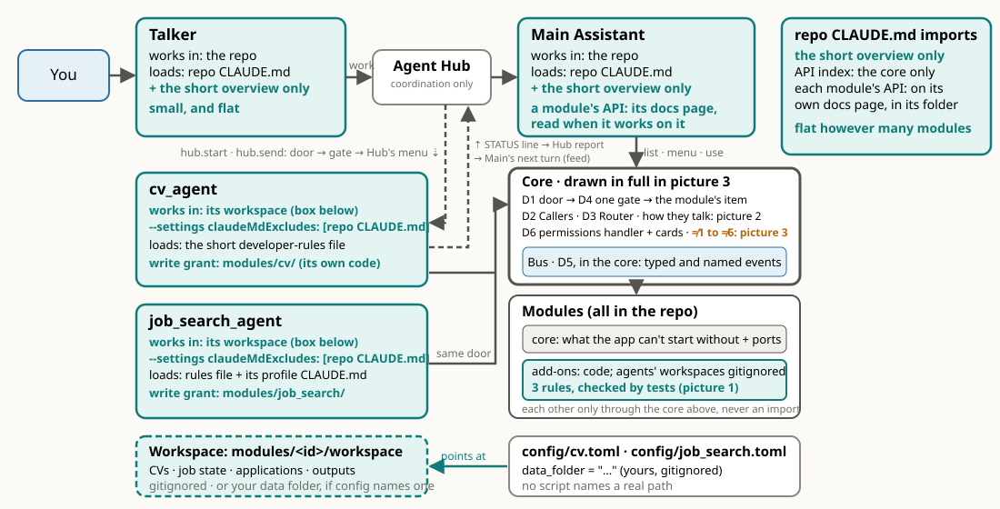
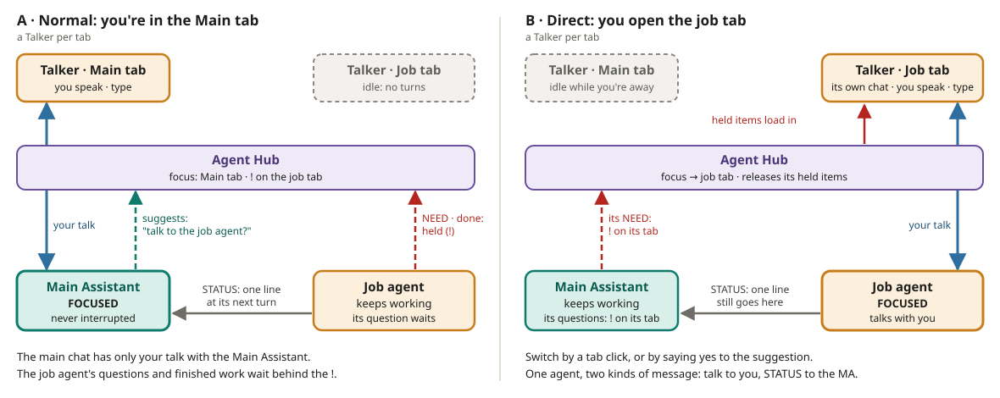
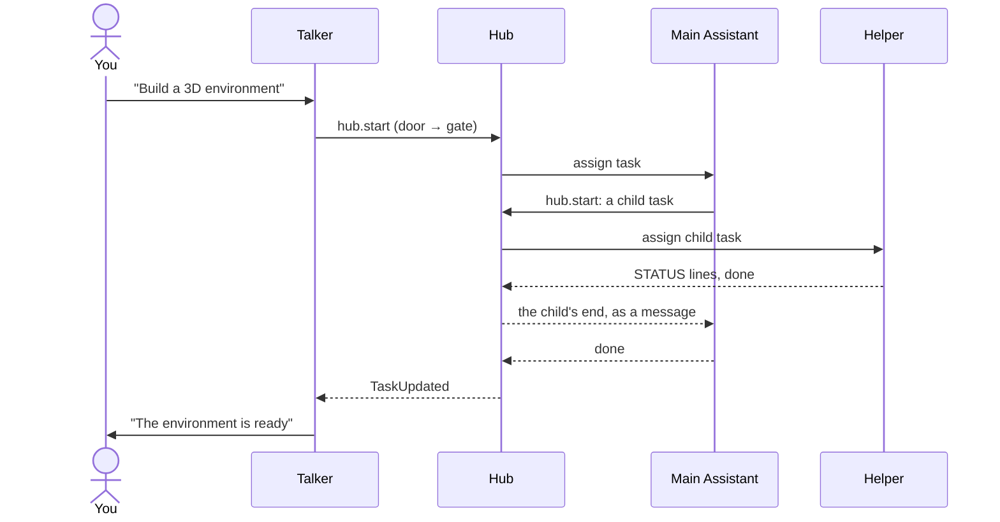
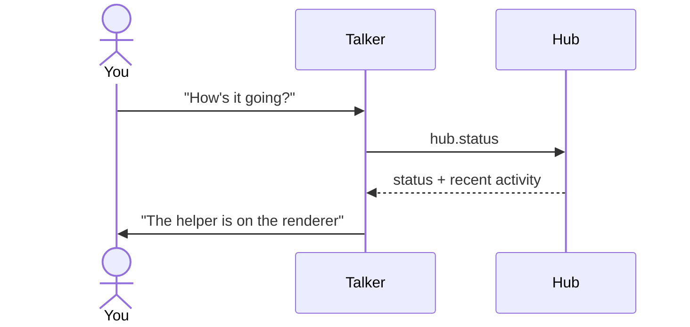
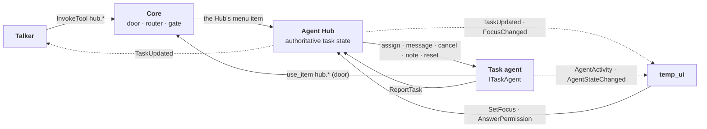
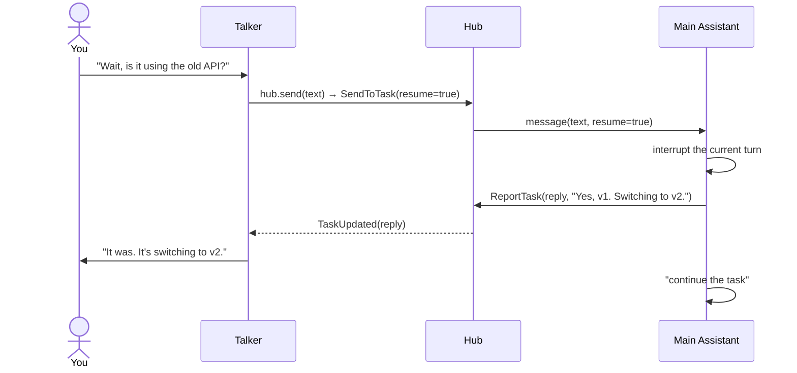
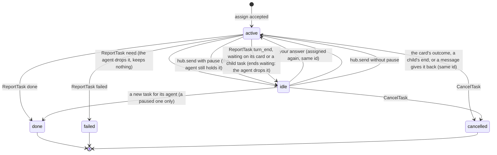

# Agents

How the AI side fits the system: who each agent is, where it works, which CLAUDE.md it loads, and how the **Agent Hub** coordinates them. Back to the [overview](README.md). How we run and test the agents is in the [Agents tab](../agents/README.md); processes, prompts and loops are in [Agent runtime](../agents/runtime.md). The code, class by class: [Agents: code layout](agents-code.md). API: [Agents](../api/agents.md).

## Who is who

You talk with the **Talker**. The **Main Assistant** does the work and coordinates the others: **helpers** (one-task agents from `task_agents`) and **module agents** (`cv_agent`, `job_search_agent`, each bundled with its add-on). Each agent is its own Claude Code session (`claude -p`). The **Agent Hub** is not an AI: it only coordinates.

[](img/agents-sessions.svg)

**Reading the picture.** Grey solid boxes are the core, a core module or an agent; dashed boxes are add-ons; teal marks the part the picture is about (here the sessions and what they load); blue is you. Arrows: a tool call goes through the core's door and gate; a dashed arrow with a filled head is a helper's `STATUS` line becoming a report. The core box is drawn in full on the [core](core.md) page (its parts D1 to D6, how modules talk, and the spots that work in an unexpected way); the three rules for the core line are on [modules](modules.md).

1. **The repo's CLAUDE.md is small:** it imports only the [short overview](short-overview.md). The API index covers the core only, and each module's API is on its own docs page in its folder. So the Talker's and the Main Assistant's base context stays the same size however many modules there are.
2. **The Main Assistant hands work on:** `hub.start` and `hub.send` go through the door and the gate to the Hub's menu. A helper reports back with a `STATUS:` line, which the Hub turns into a note for the Main Assistant's next turn.
3. **Module agents skip the repo's CLAUDE.md:** `claudeMdExcludes` is passed per agent with `--settings`, set from its `AgentProfile`. They write code, so the short developer rules load in its place, without the overview and the API index.
4. **Each module agent works in its workspace:** its module's own `modules/<id>/workspace` (gitignored), or your data folder outside the repo if `config/<id>.toml` names one (`data_folder`). It edits its own code through a write grant on its module folder, on the same access card.

The picture shows **logical relationships, not containment**: no agent lives inside the Hub, and every message travels through the core's [commands, events, and `InvokeTool`](communication.md). Not every request passes every level: the Talker reads task status straight from the Hub.

| Agent | Module | Core or add-on | Starts |
|-------|--------|----------------|--------|
| Talker (one session per agent tab) | `talker` | core | with the app; a helper tab's Talker on that tab's first use |
| Main Assistant (`main_assistant`), the coordinator | `main_assistant` | core | with the app |
| Agent Hub (not an AI) | `agent_hub` | core | with the app |
| Helpers (`flight_search`, `helper_2`, …) | `task_agents` | core, off at launch | launched by name, with your yes |
| `cv_agent` | `cv` | add-on, off at launch | when cv turns on (`job.tailor_cv` turns it on) |
| `job_search_agent` | `job_search` | add-on, off at launch | when job_search turns on (`modules.on`) |

### Which CLAUDE.md each agent loads

| Agent | Works in | Loads |
|-------|----------|-------|
| Talker | The app's folder (the repo), unless `cwd` is set in its config. No built-in tools: only the door's three | Nothing is excluded, so Claude Code's own lookup finds the repo's `CLAUDE.md` (the short overview). Not checked by a test |
| Main Assistant | The repo (`workspace = "."`) | The repo's `CLAUDE.md`, the short overview. A module's API is read on that module's docs page when it works on it |
| Helpers | `<kind workspace>/<name>`. The default kinds use `../assistant-helper` and `../assistant-rezi`, outside the repo, so they never clash with the Main Assistant's folder | Nothing is excluded (`repo_claude_md` defaults to true), but their folder is outside the repo, so the repo's `CLAUDE.md` isn't on their path. **Unverified** which CLAUDE.md, if any, they load |
| `cv_agent` | `modules/cv/workspace`, or `data_folder` from `config/cv.toml` | `repo_claude_md = false`: the repo's CLAUDE.md files are excluded, and the developer rules (`infra/developer_rules.md`) are in its prompt, with its module's folder and docs page named |
| `job_search_agent` | `modules/job_search/workspace`, or `data_folder` from `config/job_search.toml` | The same as cv's, plus the job project's own `CLAUDE.md` in its workspace |

Why module agents skip it: they work on one module, so the whole app's overview is noise in every step they take, and the developer rules (keep to your folder, talk only through the door, events and contracts, test in `tests/`) are all they need. The data folder must be absolute and outside the repo; on its first use the old workspace is copied into it, never moved or deleted ([`data_folder`](../api/infra.md#agent_access), [`AgentProfile`](../api/infra.md#agentprofile)).

## The idea

Separate **communication** (Talker), **coordination** (Hub), **intelligence** (Main Assistant), and **execution** (helpers and module agents), each a replaceable module. The Talker stays fast and interruptible because it does no work; the Main Assistant keeps one line of reasoning because the Hub does the bookkeeping.

## Big agents and their modules

The core idea: **messages go through the Agent Hub, tools go through the module door.** Each big agent (a specialist like the job agent) is in charge of its own module, and every agent reports one-line milestones to the Main Assistant.

### The Agent Hub: coordination only

The Hub holds four things, and nothing else of the agents:

- **The task board:** every task, its state, its parent and children, its reports (`TaskBoard`).
- **The focus:** which agent you're talking to (`Focus`).
- **Held questions:** a question, card, reply or finished task from an agent out of focus waits behind the **!** on its tab until you open it.
- **Message delivery:** agent-to-agent messages, never into a turn (`Delivery`, behind the `MessageGate`).

It also runs the access-list review when the core asks (`ReviewAccessList`): a short task on the reviewer agent, whose notes go back onto the card (`AddCardNotes`). With the Hub off, the card says "not reviewed".

**Two separate routes.** Messages (your talk, the focus, the held questions, and the `STATUS:` milestones) go only through the Hub, between you, the Talker and the agents. Tools go another way: any agent, and the Talker for quick things, calls the [module door](modules.md#find-a-module-then-open-its-menu), which the core hosts and which carries no conversation. The door sends the call to the router, the router to the one gate, and the gate checks the item's callers (and asks you first for a risky item) before it runs a module's menu item ([core](core.md)).

**Between Main and a helper** the two routes meet. `hub.start` and `hub.send` are tool calls: items on the [Hub's menu](../api/agents.md#the-hubs-menu), reached through the door. `STATUS` is neither a tool nor an event: it's a `STATUS: <one line>` line in the helper's text, read by `agent_tags.status_lines` and sent to the Hub as a `ReportTask` of kind `milestone`; the Hub passes it to the Main Assistant's `note`, and its `MilestoneFeed` adds it to the end of its next message. The event bus only carries copies for the UIs: the Hub publishes `TaskUpdated`, and each agent publishes its own `AgentActivity`.

### How an agent's messages move: two modes

One agent sends two kinds of message at once: **status lines to the Main Assistant** and **questions to you**. Only the focus decides who you're talking to. Blue: your conversation, through the Talker. Grey: a `STATUS:` line to the Main Assistant. Red: a question or card for you, held behind the **!**. Teal: the Main Assistant suggests a switch.

[](img/agents-modes.svg)

- **Mode A (normal).** You talk to the Main Assistant. The job agent sends a one-line `STATUS:` only for big steps, which the Main Assistant reads at its next turn without being interrupted. If the job agent needs you, its question waits behind the **!**. The Main Assistant can suggest a switch (`hub.suggest_focus`), and the Talker asks you. The job agent's finished work waits behind the **!** too, and its Talker takes no turns while you're away.
- **Mode B (direct).** You click the job agent's tab or say yes to the suggestion. The Hub moves the focus (`SetFocus`), and the held question and its card load into the job tab's own Talker, in the job tab's own chat. You now talk to the job agent, while it still sends `STATUS:` lines to the Main Assistant, whose own questions wait behind a **!** on its tab.
- **Back to A.** You click the Main Assistant's tab, and the job agent's next question goes behind the **!** again. The main chat shows only your conversation with the Main Assistant.

### Below the Hub: modules, the door, the core

No agent calls another module's code: every agent uses a module's menu items through the door (list the modules, show a menu, use an item). The way a call travels, door → router → gate → item, is drawn on the [core](core.md) page.

- **The job module** (`job_search`, an add-on) is a wrapper with a menu and its own agent (a `ProfileAgent`, id `job_search_agent`):
  - `job.search` answers at once. The search runner isn't built: the module sends an `AgentNotice` command for the caller straight away, saying nothing ran, and the Hub hands it to that agent at its next turn. The note is labelled with the sending module (`[job_search] …`), stamped by the core, not chosen by the sender.
  - `job.tailor_cv` (only the job agent) turns cv on if it's off, waits for your answer on cv_agent's access card (`cv_wait`), and sends `cv.task` for its agent. cv's named events (`cv.job_finished`, `cv.job_submitted`) come back, and job_search turns them into a message for its agent.
  - `job.open_ui` opens the job UI in its own window.
- **The cv module** (`cv`, an add-on) bundles `cv_agent`. Its jobs come from `cv.task` (callers `job_search_agent` and `main_assistant`, and the module `job_search`), which starts the worker as the caller's child task. A free pick never lands on it (`named_only = true`).
- **The Main Assistant** has its own module, `main_assistant`, but no menu. It works in the repo and uses any module's menu through the door.
- **Permission cards** from a risky item name their agent, and the Hub holds them behind the **!** unless that agent has the focus.

### What the core keeps, what the Hub keeps

The Hub does coordination only; who may do what is the core's ([decisions](decisions.md), D1 to D7). Why: the checks then hold with the Hub off or reloading, and the Hub stays a replaceable module.

- **The door is the core's.** The core opens it before any module starts, so every agent's first session has it, and a Hub reload doesn't touch it. A module gets a door config only for itself or an agent id it claimed ([modules](modules.md#find-a-module-then-open-its-menu)).
- **Callers is the core's** (`core/callers.py`): agent names and claims, each agent's permission mode, who is you (`[core.permissions] you`, today `temp_ui`) and the relays that pass your answers (`relays`, today the Talker).
- **Modes:** the core handles `SetPermissionMode`. Auto comes only from you (the UI's button) or the core; Manual from anyone, the Talker's `hub.mode` included. An agent's own switch to Auto is refused unless Callers already says Auto. The Hub listens to `PermissionModeChanged` to close a card the switch answered.
- **Notices and resets are commands** the Hub handles: `AgentNotice` (passed to the agent's `note`, labelled with the sender) and `ResetRequested` (`ITaskAgent.reset()`: at once when idle, a handoff mid-task). A Talker session's reset is the Talker's own: its RESET tag, or its `talker.reset` menu item, for you only. `ShutdownRequested` is a command the core handles. Events only tell; they never control.
- **Risky steps ask, in Auto too.** `modules.add`, `modules.remove`, `modules.reload`, and `modules.off` with dependents, open a `confirm` card for every agent caller; a `you` caller runs at once. An agent's `RELOAD:` / `ADD_MODULE:` line keeps its own permission card, shown in Auto too, and the Talker's restart opens a `confirm` card ([permissions](permissions.md#risky-steps-ask-even-in-auto)).
- **The review is the Hub's:** the core asks for it with `ReviewAccessList` and takes the notes back with `AddCardNotes`; the core never starts a task ([permissions](permissions.md#the-review)).
- **Agent cards are the Hub's:** an agent's tool permission is a `permission` report on its task, and your answer (`AnswerPermission`) goes to the Hub, which passes it to the agent.

### The workflow in steps (job search)

1. You tell the Talker "run a job search." It goes to the Main Assistant, which has the focus (Mode A).
2. The Main Assistant hands it to the job agent with `hub.start` and suggests talking to it directly. You say yes, so the focus moves (Mode B).
3. The job agent uses `job.search` on its own module through the door. The item answers at once, and the agent stays free to talk.
4. You switch back to the Main Assistant (Mode A). When the result comes, the job agent gets the notice and sends `STATUS: 24 found, 12 fit`.
5. The Main Assistant reads that one line at its next turn. Your conversation with it isn't interrupted.
6. The job agent needs you ("apply to this one first?") or a Chrome permission. That's held, and its tab shows **!**.
7. You click the tab when you're ready (Mode B). The Talker says the question and the card shows. You answer, and the job agent goes on, stopping before Submit.

In steps 2–7 the job tab has its own Talker and its own chat: step 2 opens it, step 4's end waits behind its **!** instead of reaching the main chat, and step 7's question is said by the job tab's Talker. The sequence diagrams under [Flows](#flows) hold per tab: their `T` is the Talker of the tab you're in. (Step 3's search runner is a stub today: the notice says nothing ran.)

## Responsibilities

| Part | Does | Doesn't |
|------|------|---------|
| **Application core** | Generic module communication and lifecycle, including turning modules on and off. The module door, the one gate for menu items, and the Callers port: agent names, each caller's permission mode, who is you | Start a task, or hold any agent logic. It still names agents in three spots ([known limits](agents-code.md#known-limits)) |
| **Agent Hub** (module) | Coordination only: the task board (ids, parent/child links, state, reports, history), the focus, held questions, message delivery, agent cards, notices and resets for agents, the access-list review | Reason or decide how to solve anything; host the door or the agent names; set permission modes; duplicate the core's registry, lifecycle, router, bus, or tool dispatch |
| **Talker** | Converse, answer simple things directly, hand substantial work to its agent, report progress and results, relay clarification questions, stay responsive and interruptible. Read spoken input (marked `[Spoken]`, from `InputReceived(source="voice")`) for what was meant, using the conversation, with no extra cleanup call | Do substantial work itself |
| **Main Assistant** | The central intelligence: reasoning, planning, executing, choosing tools, splitting work, delegating to helpers and module agents (through the Hub), combining results | Own bookkeeping or talk to the human directly |
| **Helpers and module agents** | Specialized execution, possibly in parallel, reporting milestones | Plan the overall task |

**The Hub manages who is doing what, not how the work is done.** Not every capability needs to be an agent: browser, file, or 3D services can stay ordinary tool modules.

A Claude Code session can also spawn its own internal subagents. Those are its own business: they have no id, and the Hub can't list or stop them. The Main Assistant uses one, `debugger`, so debugging loops run in their own small context.

## Startup

The core's lifecycle manager starts every module, agents included; the Hub launches nothing. Each agent module owns its `claude` process, and the windows belong to view modules, not to the agents:

```
python -m assistant
 └─ the core opens the module door, then activates the enabled modules
    (config/modules.toml), in dependency order:
     ├─ console_io       terminal 1, the app's own
     ├─ main_assistant   its own hidden `claude -p` process (before the Hub, which lists ITaskAgent as optional)
     ├─ agent_hub        coordinates; launches nothing
     ├─ talker           a hidden `claude -p` per tab session
     ├─ temp_ui          the app's window: tabs, chats, cards
     └─ voice_in, usage
    off at launch: task_agents, job_search, cv, html_viewer, voice_notes,
    assistant_view (terminal 2); turned on with modules.on, or on use
```

Each module decides when to start its expensive part ([runtime module control](core.md#runtime-module-control)):

| Module | Process starts | Why |
|--------|----------------|-----|
| Talker | The main tab's when activated, kept warm; a helper tab's on first use, closed with its tab | You expect an instant reply |
| Main Assistant | When activated; a fresh session for each task | Ready for the first task; a task's context holds only that task |
| Module agents | When their module turns on | Most aren't used most of the time |
| Helpers | When launched, with your yes | They exist for one task |

The Hub "taps" an agent by sending it a task through its contract; if that agent's process isn't running, the agent module starts it.

**Restart:** `python -m assistant` is a launcher that starts the app again whenever it exits with code 75. When you ask for a restart, the Talker gets reset instructions from the worker, the app exits with 75, and the new launch hands those instructions to the Talker as its first input ([core](core.md#lifecycle), [runtime](../agents/runtime.md#the-talker-on-its-own)).

## Flows

Every `T → H` arrow below is a `hub.*` item: the Talker's `InvokeTool`, through the router and the gate to the Hub's menu.

### Task assignment



### Progress request



The Main Assistant isn't interrupted or asked for routine status. The status carries the task's last activity lines (the Hub keeps them from `AgentActivity`), and the Talker always has both sessions' usage (`SessionUsage`), so "what is it doing?" and "how full is it?" never need an interrupt.

### Clarification

```mermaid
sequenceDiagram
    actor You
    participant T as Talker
    participant H as Hub
    participant A as Agent
    A->>H: ReportTask need (its turn ends; it's free)
    H-->>T: TaskUpdated: the question
    T->>You: "Realistic or stylized?"
    You->>T: "Stylized"
    T->>H: hub.send (your answer)
    H->>A: assign the same task: "Answer to your question …"
```

Communication is two-way: agents can ask the human for information, and the Talker stays responsive. A question never keeps an agent busy: it ends its turn, takes other work meanwhile, and your answer comes back as a message to the same task, whenever you give it ([questions are messages](#questions-are-messages)).

## Task agents

Full signatures are on the [Agents API page](../api/agents.md). Processes, spawning, each agent's loop, and prompts: [Agent runtime](../agents/runtime.md). The classes: [Agents: code layout](agents-code.md).

### `ITaskAgent`

Any agent that takes tasks provides **`ITaskAgent`** (`multiple = True`): the Main Assistant, the helpers and the module agents. The Hub knows only this contract, finds agents with `ctx.get_all(ITaskAgent)`, and never imports an agent module. The Talker doesn't provide it; it stays driven by `InputReceived` / `ResponseReady`.

| Method | Does | Like in Claude Code |
|--------|------|---------------------|
| `info()` | Id, description, capabilities, `state`: `active` (in a turn, or held in one by a permission card) or `idle` (takes new work, whatever questions it has open). Read on every lookup | |
| `assign(task)` | Accept or refuse a task. Returns at once, never waits for the work | Typing a new request |
| `message(task_id, text, resume)` | Interrupt, answer quickly, then continue the task unless `resume` is false (stop or pause) | Typing while it works |
| `cancel(task_id)` | Stop the task now. The session and its memory survive | Pressing Esc |

It also has `note` (a line for its next message: milestones, notices), `reset`, `answer_permission`, `set_permission_mode` and `request_approval`, each with a default ([API](../api/agents.md#itaskagent)). There's no `Agent` base class: each big agent is a `ProfileAgent` assembled from parts ([code layout](agents-code.md#the-layers), [principle 12](principles.md)).

### Who sends what



Solid: tool calls, commands and contract calls, which always return a `Result`. Dotted: events, which may be dropped.

- **Talker → Hub:** only through the Hub's menu (`TalkerModule.hub` sends `InvokeTool`): `hub.start`, `hub.status` (status without bothering the agent), `hub.send` (a question, extra instruction, or your answer), `hub.cancel`, `hub.focus`, `hub.answer`, `hub.mode` (Manual only). The Talker's tags (`<<WORK: …>>`, `<<PASS>>`, `<<CANCEL>>` etc.) are a shorthand for these items. It also sends `AnswerPermissionRequest` (your answer to a core card, as a relay), `ResetRequested` and `ShutdownRequested` (a restart, after its confirm card).
- **You never use keywords or flags.** You just talk; the Talker (a Claude too) infers from context whether you meant continue, pause, or cancel, and uses the matching item.
- **Agents → Hub:** the same menu, through the door (`hub.start` for a child task, `hub.send`, `hub.suggest_focus`, …), each call carrying the caller its token proved.
- **Agent → any UI:** the `AgentStateChanged` event whenever its `state` (active or idle) changes, so a UI shows it live. `ListAgents` (Hub) is the authoritative read.
- **Hub → agent:** the `ITaskAgent` methods.
- **Agent → Hub:** the `ReportTask(task_id, kind, text, key)` command, with `kind` = `progress` / `milestone` / `reply` / `need` / `turn_end` / `done` / `failed`, and with a `need` its context `key`. A turn that ends with no last-line tag (or with its card open) reports `turn_end`, and the Hub answers whether the task ends waiting or is done ([task state](#task-state)). A command, not an event, because the Hub's state must not miss it.
- **Hub → Talker and UIs:** the `TaskUpdated` event on every report and state change. The Talker can always re-read with `hub.status`.
- **Agent → viewers:** the `AgentActivity` event, the agent's raw text and tool calls. Published by the agent module directly, since it's high-volume and only for viewing.

### Messages and cancel

**`message`** works like typing into Claude Code while it works:



- **`resume=true`** (default): after the reply, the agent sends "continue the task" to its session itself.
- **`resume=false`** (`hub.send` with `pause`): you said stop or pause. The agent replies and the task goes `idle`, still held by its agent; a later `hub.send` without `pause` (e.g. "carry on") continues it. A new task for that agent drops it. To abandon the task, use `hub.cancel`.
- **Answering a question:** if the agent asked you something (`need`), its turn has ended and it dropped the task, so there's nothing to interrupt. Your answer gives the same task back to it ([questions are messages](#questions-are-messages)).
- The Talker infers `resume` from context; you never say a keyword. The reply is how it (and you) decide whether to cancel.

**`cancel`** works like Esc: interrupt the turn, mark the task `cancelled`, keep the session (and its memory) for the next task. Killing the process is only the fallback if the interrupt doesn't stop it; the next task then starts a fresh session or resumes it by id.

### Task state

The Hub owns the authoritative state. An accepted assignment is not a finished task.



Two live states: **active** (its agent is in a turn on it; a permission card mid-turn keeps it active) and **idle**. An idle task is either paused (you stopped it; its agent still holds it, and a new task for that agent ends it as done) or holds its agent's note (a `need`, or what it ended waiting on; the agent dropped it and is free). `progress`, `milestone` and `reply` reports don't change the state. Each agent runs **one task at a time**; `assign` to an active agent is refused and `StartTask` returns `not_available`. An idle agent takes new work, whatever questions it has open.

**A waiting task ends with a note:** a task never sits in an open-ended pause, so an agent is never blocked by a card or a child. When a turn ends with no last-line tag, or with its card (an approval: `RELOAD:`, `ADD_MODULE:`, a helper launch in Manual) still open, the agent reports `turn_end` with the task's context key, and the Hub decides (`TaskBoard._settle`):

- **It waits** on its card, or on child tasks started with `tell_parent` (the default): it **ends waiting**, the way a `need` does. The agent drops it (its live session kept) and is free; the Hub's record is the note: what it waits on (`question_kind` `wait`; a card keeps `permission`), its key, its recent reports. The note outlives a Hub reload. An open approval stays in the agent's gate for that task (`PermissionGate.park`).
- **Otherwise** the task is done.
- **What gives it back** (the same task id: into the live session if nothing ran since, else a fresh one with the key's notes): each child's end, the card's outcome, or your message. If the agent is busy then, it waits in `Delivery`. A child started with `tell_parent=False` doesn't count (its module reports the end itself).

No queues, priorities, progress percentages, or crash resume. The Hub's own detail is on its [module page](../../src/assistant/modules/agent_hub/docs/architecture.md).

### Questions are messages

A question never makes an agent busy.

- **A `NEED:` ends the turn.** The agent reports `need` with the question's context **key** (`ReportTask.key`; its module decides it: cv uses the job's folder, others the task's last handoff note), drops the task and is idle. The Hub keeps the task `idle` with its question (`TaskInfo.question_key`), behind the tab's **!**.
- **Your answer is a message,** whenever you give it: the Hub assigns the same task id to the agent again, with "Answer to your question in task <id> (…): <answer>" and the key. If the agent is in a turn on other work, the answer waits and goes in when it's free (`hub.send` says "delivered: when its agent is free").
- **The agent finds the context again.** If its session still has the question, it carries on there. If not (a relaunch, a reset, other work in between), it starts a fresh session and adds its module's notes for the key: the hook `SessionTaskAgent.set_context(key, notes)`, by default the handoff note ([`default_context`](../api/infra.md#sessiontaskagent)); cv adds the job's `job_start.json` summary and its handoff note.
- **A permission card** (a tool call mid-turn) keeps the turn active, and Allow or Deny lets it carry on.
- **Open questions survive a Hub reload** (handed over in `export_state`) and don't hold up the reload. An app restart doesn't wait for them either: they're listed in the reset note with their context.

### Working together

Several task agents run at once. The helpers beside the Main Assistant come from kinds of helper in config, in the [`task_agents`](../../src/assistant/modules/task_agents/docs/README.md) module, launched by name ([launching a helper](#launching-a-helper)); a big agent with code of its own is bundled with its own module. Both are built on the shared `ProfileAgent`.

- **The focus:** the Hub keeps which agent you're talking to. At launch it's the coordinator (`[modules.agent_hub] coordinator`, the Main Assistant). Only the Talker moves it (`hub.focus`, after you said so) or a UI (`SetFocus`); the coordinator can only suggest a move (`hub.suggest_focus`), which the Talker asks you about.
- **Held questions:** a `need` or `permission` from an agent out of focus is held on its task (the **!** on its tab) until you focus it; `FocusChanged` then releases it.
- **Milestones to the coordinator:** each agent's prompt (the shared block from `AgentProfile`) asks for `STATUS:` lines at milestones, reported as `milestone`. The Hub feeds every other agent's milestones and ends, and each focus move, to the coordinator's `note`, read at the end of its next message. Never an interrupt: it would cost a full step at the coordinator's whole context.
- **A child's end to its parent:** when a child task ends `done` or `failed`, the Hub sends its parent's agent the end as a message (`[Message from agent_hub] Your child task … ended …`), delivered like any `DeliverMessage`. A child started with `StartTask.tell_parent=False` tells no one: its module reports the end itself as a named event (`cv.task` → `cv.job_finished`, which job_search turns into a message for its agent). The coordinator as parent gets only its feed line. A parent hands work over and ends its turn; the result wakes it ([Agent Hub](../../src/assistant/modules/agent_hub/docs/architecture.md)).
- **One road to the Hub:** agents and the Talker reach the Hub through its menu on the module door; every item knows its caller (`InvokeTool.caller`, set by the door from the session's token, never by the session). Others may cancel only their own child tasks.
- **Agents message each other:** `hub.send` with `agent_id` works for every agent. Into its own child task a message goes straight in (it interrupts). Anything else goes through the Hub's **message gate**: the first message from A to B opens a permission card, "A wants to message B", with **Allow once** · **Always allow** · **Deny**. Always saves a grant under `agent_hub` for A's kind, one per direction ([permissions](permissions.md#messages-between-agents)). On Allow the message is delivered; on Deny or no answer A gets a `[messages]` note and nothing is sent. The Talker is never asked.
- **Delivery never interrupts a turn** (`DeliverMessage`, handled by the Hub's `Delivery`): the text arrives as `[Message from <sender>] …`, into the agent's open task, or as a new task if it has none. An agent in a turn gets it when the turn ends; one that isn't running gets it when it starts. Messages to one agent keep their order. Modules use it too: the cv module's result at Submit ([cv](../../src/assistant/modules/cv/docs/architecture.md)).
- **Limits:** besides the coordinator (not counted), at most `[modules.agent_hub] max_extra_agents` agents (3 by default) with an active task at once, and no two active agents writing the same folders, or one inside the other. The exception: a module's own folder (`src/assistant/modules/<id>`) under a wider grant such as the Main Assistant's whole repo, so a module agent can edit its own code while the Main Assistant works. An idle agent, or one whose task only holds a question, holds no folder. A free pick (`hub.start` with no `agent_id`) never lands on an agent whose own config says `named_only = true` ([`AgentInfo.named_only`](../api/agents.md#agentinfo)); anyone may still name it (cv_agent: `cv.task` starts it). `[modules.agent_hub] named_only` is an optional fallback list of ids, empty by default.
- **The Talker's part** ([talker](../../src/assistant/modules/talker/docs/README.md)): one `TalkerSession` per agent tab, each with its partner agent; the module routes your input by its tab (else the focus) and each `TaskUpdated` to its agent's session. A session's tags act on its partner, it hears only its partner's updates, and it reaches the Hub through its menu with `InvokeTool`. PASS sends your words to its own agent unchanged (`hub.send(agent_id)`); a bare "yes" answers that tab's card when it has only one, and asks which when it has more.
- **The coordinator delegates:** its prompt block tells it to use `hub.agents`, `hub.start` (a child task), `hub.status` / `hub.send` / `hub.cancel` on its own children, and `hub.suggest_focus`; only you move the focus. It launches a helper (`agents.launch`) only when you asked for one.
- **In the temp UI** ([temp_ui](../../src/assistant/modules/temp_ui/docs/README.md)): one tab per big agent with a state dot and the **!**, the Main Assistant's in its own colour; a click moves the focus and brings the held items. A chat per tab under a "Talker · agent" header, the last 300 items of each replayed, not saved across a relaunch.

### Agent names

Every task agent has one id. The Hub, the tabs, the focus, messages, usage and the module door all find an agent by it.

- **Three kinds of agent, kept apart.** The coordinator and module agents come with their own module and start with it: the Main Assistant (`main_assistant`), the job agent (`job_search_agent`) and cv's worker (`cv_agent`). Helpers come from `task_agents`, launched by name for one task (`flight_search`) from a kind of helper in config. Sub-agents are what a `claude` session starts inside itself (its own Task tool); they have no id and never reach the Hub.
- **Conventions:** short, lowercase, letters, digits and `_`, starting with a letter, at most 32 characters (`flight_search`, `helper_2`). A module's agent is named after its module plus `_agent`. Extra copies are `<name>_2`, `<name>_3`.
- **Reserved:** `core`, `hub`, `talker`, and every module's id (so `main_assistant` too), since the door's caller names are agent or module ids. A module's own agent may carry its module's id (`main_assistant`). The rules are one helper, [`check_agent_id`](../api/infra.md#agent_names).
- **The core holds the claims,** in its Callers port (`core/callers.py`, provided as [`IAgentNames`](../api/agents.md#iagentnames)). `ProfileAgent` claims its agent's id on start and releases it on stop, so every agent gets the check with no code of its own. A refused claim stops that agent with the reason; at launch its module fails to start and the log says why. A taken id's refusal names a free one (`flight_search_2`). A Hub reload doesn't touch the claims. A released id goes back to Manual.
- **Safety net:** an agent that skipped the claim and shares an id is seen once: the Hub uses the first one everywhere (`hub.agents`, `ListAgents`, routing) and logs the clash once.

### Launching a helper

A helper starts only with your yes. `agents.launch(name, task, kind)` on the `task_agents` menu only *proposes* it. The caller must be an agent with an open task, because the question hangs on that task as the usual permission card. The Talker has none, so from it the call is refused with "hand it to the Main Assistant".

```mermaid
sequenceDiagram
    actor You
    participant M as Main Assistant
    participant TA as task_agents
    participant H as Hub
    participant C as Core
    You->>M: "start a helper to search flights"
    M->>C: use_item agents.launch("flight_search", task) (door → gate)
    C->>TA: the menu item
    TA->>C: IAgentNames.check
    TA->>M: request_approval(action, run)
    M->>H: ReportTask(permission)
    H-->>You: the card: Allow / Deny
    Note over M: ends its turn; the task waits
    You->>H: AnswerPermission(allow)
    H->>M: answer_permission
    M->>TA: run()
    TA->>TA: build the helper, provide it, claim its name
    TA->>H: StartTask(parent = the caller's task)
    M->>M: next message: "[App] ... flight_search started on task ..."
```

- **The card** is the same one a tool permission uses (the temp UI's Allow / Deny, the Talker's ALLOW / DENY, `AnswerPermission`). A launch asks in Manual; once you switch the calling agent to Auto with its button, it launches at once with no card: each pair's own mode governs its own asks. Deny, or no answer before the card times out, and nothing is built.
- **On Allow** the helper is a `ProfileAgent` in its own sub-folder `<kind workspace>/<name>`, with its own transcript. Its task is the caller's child (`StartTask`), so the cap and the folder check apply. The outcome reaches the caller as its next message.
- **The turn waits:** the caller ends its turn after `agents.launch`; while the approval is open that doesn't finish the task. An answer that comes mid-turn is sent when the turn ends.
- **Taken names:** a name the Main Assistant made up: it takes the suggested free one and tells you. A name you gave: it asks you again.
- **Closing:** `agents.close(agent_id)` closes a launched helper with no task, frees its name, and takes it back with `ctx.withdraw`, without stopping `task_agents`. Launched helpers end with the module.

**Opening one yourself** (the temp UI's **+**): you pick a kind, a name (filled with a free one from `agents.kinds`) and an optional first task. `agents.launch` from `temp_ui` (you) needs no open task and no launch card: your click is the yes. The name and kind are checked at once. The kind's access card, if it has no saved grant, and the build run in the background, so the call returns at once. With no task the helper opens idle, and your first message to its tab starts one (PASS → `hub.send`). With a task it starts as your own task, with no parent. The new tab takes the focus. `task_agents` asks the core whether the caller is you (`IAgentNames.is_you`, from the one list `[core.permissions] you`, today `temp_ui`).

**Closing a tab** (the temp UI's **×**, on every tab but the Main Assistant's): the page asks first ("Close this agent?", Close / Cancel). On Close, the agent's running task is cancelled (`CancelTask`), then a launched helper is closed with `agents.close`, and a module's agent is closed by turning its module off (`modules.off`; the job agent: `job_search`, which comes back with its saved grant when turned on). A helper `task_agents` autostarted closes only with its module. Closing the focused agent moves the focus back to the Main Assistant.

## Principles

1. **One coordination layer.** Talker, Main Assistant, helpers and module agents share the Hub's task board and focus; the Hub holds no agent.
2. **One central intelligence.** The Main Assistant plans and reasons; the Talker communicates; helpers and module agents execute.
3. **The Hub is not an AI.** Deterministic coordination, routing, bookkeeping.
4. **No direct cross-module dependencies.** Only core infrastructure and shared contracts.
5. **Replaceable implementations.** Talker, Main Assistant, Hub, helpers and module agents change independently.
6. **Capability-based contracts.** No rigid agent class hierarchy; a module may provide several contracts (`Manifest.provides`).
7. **Logical hierarchy, flexible routing.** Skip levels where it makes sense.
8. **Independent execution.** Agents work in parallel, one task each, without blocking the Talker.
9. **Authoritative task state.** Status and results never depend only on events, which may be dropped.
10. **Minimal first.** No scheduling, queues, or distributed machinery until needed.
11. **Full paths for files you should see.** When an agent's reply points you to an HTML file, it writes the full absolute path, never a bare file name. The chat turns the path into an Open in viewer button, and a bare name is looked for in the app's folder and fails with "No such file". Pages agents open on their own stay in the background; only your click brings the viewer to the front ([HTML viewer](../../src/assistant/modules/html_viewer/docs/viewer-app.md)).

## State, context, transcripts, events

These are different things and aren't interchangeable:

| Kind | What it is | Who gets it |
|------|------------|-------------|
| **Task state** | Authoritative status, ownership, progress, results | Anyone, by query to the Hub |
| **Agent context** | What a model needs to reason well | Talker: compact summaries and status snapshots, never the full transcript. Main Assistant: relevant conversation context on assignment. Helpers and module agents: only what their task needs |
| **Transcripts** | Full record of an agent's activity | Stored; read on demand (e.g. the chat window) |
| **Events** | Notifications of activity or state changes | Subscribers; may be dropped, so never the source of truth |

The Hub stores and serves task state; deciding what's *relevant* stays with the agents. Task ids, parent/child tasks, cancellation and progress are built; idempotent submissions (so retries don't duplicate work) are not.

## Good to know and known gaps

- **The Talker relays card answers.** It may send `AnswerPermission` and `AnswerPermissionRequest` (`[core.permissions] relays`, `core/context.py:51-52`). Whether those count as your own answers is an open decision ([decisions](decisions.md)).
- **The review is a task the Hub starts** (`agent_hub/review.py`), the Hub's one job beyond coordination; with the Hub off, the card shows "not reviewed".
- **Risky steps and Auto:** risky core-menu items card even in Auto, and `modules.off` without dependents gets no card ([permissions](permissions.md)).
- **job_search reads cv's output by file path,** not through a tool: the job project's `cv_output` link in `job_paths.json` points into cv's workspace. That goes past the door, so wherever cv's workspace sits, the link has to point there.
- **The CLAUDE.md exclude list covers only the repo's files** (`infra/agent_profile.py:121-125`). A module agent working under an add-ons folder outside the repo would load any CLAUDE.md in a parent folder there, and the developer rules point at repo paths.
- **Which CLAUDE.md the Talker and the helpers load** follows from their working folder and Claude Code's own lookup; the code sets no exclude list for them, and no test checks it.
- **The core still names agents in three spots** ([known limits](agents-code.md#known-limits)).

## Open questions

- How do multiple front-ends share the same task state?
- How do interrupted or crashed agents recover without repeating side effects?
- How do we stay simple while keeping room for parallel execution?
