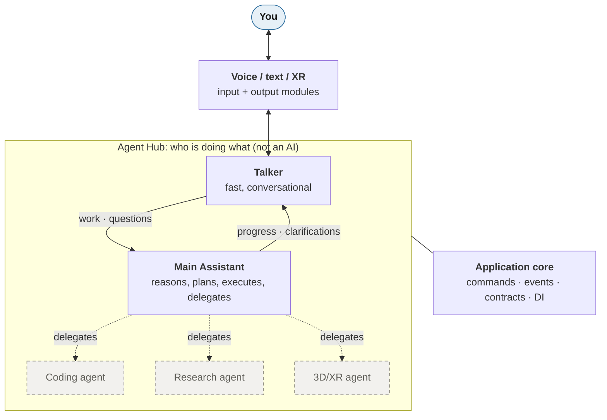
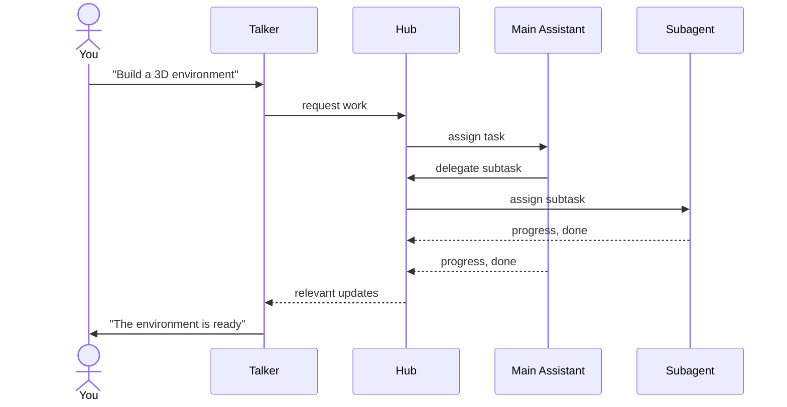
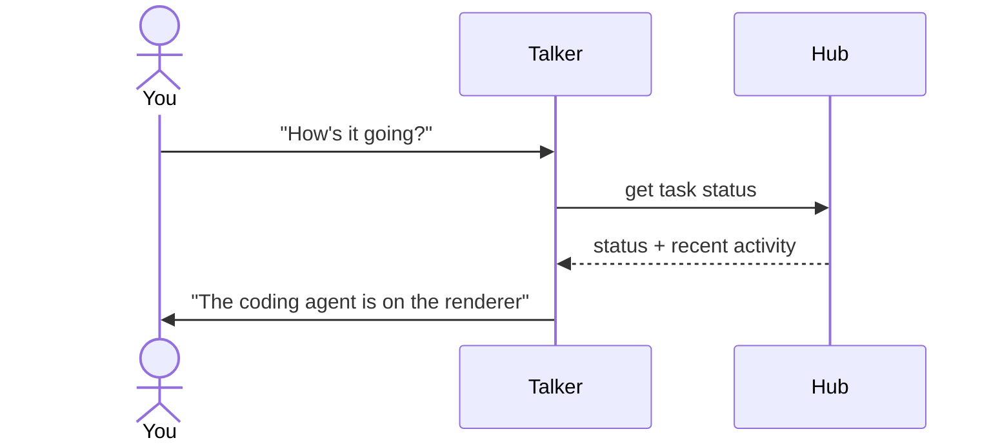
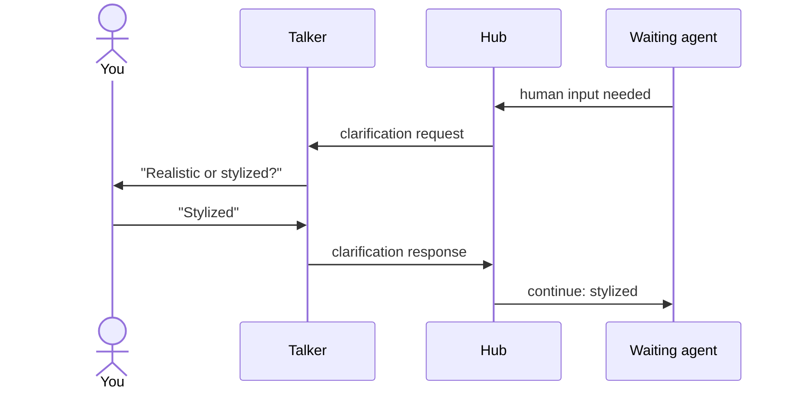
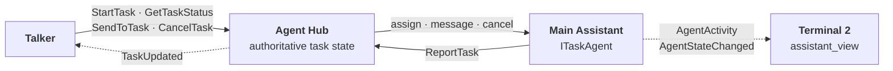
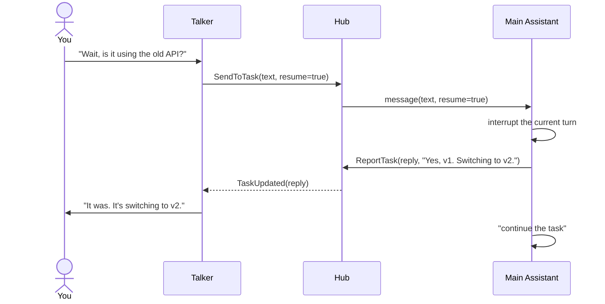
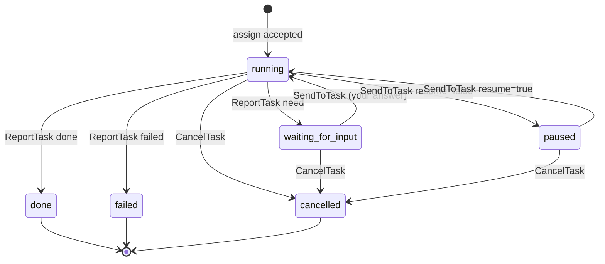

# Agents

How the AI side fits the system: an **Agent Hub** coordinates a **Talker**, a **Main Assistant**, and **subagents**. Back to the [overview](README.md). How we actually run and test the agents is in the [Agents tab](../agents/README.md).

> **Status: built (2026-10-25)** for the Talker, one Main Assistant, and the Hub; subagents are still to come. The [spike](../agents/spike.md) confirmed the interrupt the design relies on. API: [Agents](../api/agents.md).

## The idea

Separate **communication** (Talker), **coordination** (Hub), **intelligence** (Main Assistant), and **execution** (subagents), each a replaceable module.



The picture shows **logical relationships, not containment or mandatory paths**. Every agent is its own module, and all messages travel through the core's [commands, events, and `InvokeTool`](communication.md). Not every request passes every level: the Talker reads task status straight from the Hub.

## Responsibilities

| Part | Does | Doesn't |
|------|------|---------|
| **Application core** | Generic module communication and lifecycle, including turning modules on and off | Know that the Hub, agents, or Claude exist |
| **Agent Hub** (module) | Agent registry and capabilities, availability, task ids and parent/child links, routing requests and results, progress and failures, task history, clarification and cancellation flows | Reason or decide how to solve anything; duplicate the core's registry, lifecycle, DI, router, bus, or tool dispatch |
| **Talker** | Converse, answer simple things directly, hand substantial work to the Main Assistant, report progress and results, relay clarification questions, stay responsive and interruptible | Do substantial work itself |
| **Main Assistant** | The central intelligence: reasoning, planning, executing, choosing tools, splitting work, delegating to subagents (through the Hub), combining results | Own bookkeeping or talk to the human directly |
| **Subagents** | Specialized execution (coding, research, 3D, browser, robotics…), possibly in parallel, reporting progress | Plan the overall task |

**The Hub manages who is doing what, not how the work is done.** Not every capability needs to be an agent: browser, file, or 3D services can stay ordinary tool modules.

A Claude Code session can also spawn its own internal subagents. Those are its own business; **Hub subagents** are separate, registered modules.

## Startup

The core's lifecycle manager starts every module, agents included; the Hub launches nothing. Each agent module owns its `claude` process, and the terminals belong to view modules, not to the agents:

```
python -m assistant
 └─ core lifecycle activates the enabled modules, in dependency order:
     ├─ console_io       terminal 1, the app's own: you talk here
     ├─ main_assistant   its own hidden `claude -p` process
     ├─ talker           its own hidden `claude -p` process
     ├─ assistant_view   opens terminal 2: the Main Assistant's activity, view only
     └─ agent_hub        coordinates; launches nothing (after the agents it finds)
```

Each module decides when to start its expensive part ([runtime module control](core.md#runtime-module-control)):

| Module | Process starts | Why |
|--------|----------------|-----|
| Talker | When activated, kept warm | You expect an instant reply |
| Main Assistant | When activated; restarted on the next task if it was closed | Ready for the first task; a restart's few seconds are fine before a long task |
| Subagents | When the Hub first delegates to one; stop when idle | Most aren't used most of the time |
| Assistant view | When activated | Terminal 2 should be there when you look |

The Hub "taps" an agent by sending it a task through its contract; if that agent's process isn't running, the agent module starts it. Swapping terminal 2 for the chat window later is a config change.

## Flows

### Task assignment



### Progress request



The Main Assistant isn't interrupted or asked for routine status.

### Clarification



Communication is two-way: agents can ask the human for information, and the Talker stays responsive while an agent waits.

## Task agents

The v1 design: a minimal Hub, one Main Assistant, real modules (no relay script). Full signatures are on the [Agents API page](../api/agents.md). Processes, spawning, each agent's loop, and prompts: [Agent runtime](../agents/runtime.md).

### `ITaskAgent`

Any agent that takes tasks provides **`ITaskAgent`** (`multiple = True`): the Main Assistant now, subagents later. The Hub knows only this contract, finds agents with `ctx.get_all(ITaskAgent)`, and never imports an agent module. The Talker doesn't provide it; it stays driven by `InputReceived` / `ResponseReady`.

| Method | Does | Like in Claude Code |
|--------|------|---------------------|
| `info()` | Id, description, capabilities, `busy` (has an unfinished task), `working` (its session is in a turn right now). Read on every lookup | |
| `assign(task)` | Accept or refuse a task. Returns at once, never waits for the work | Typing a new request |
| `message(task_id, text, resume)` | Interrupt, answer quickly, then continue the task unless `resume` is false (stop or pause) | Typing while it works |
| `cancel(task_id)` | Stop the task now. The session and its memory survive | Pressing Esc |

There's no `Agent` base class. Each class inherits one interface and is assembled from parts ([principle 12](principles.md)):

| Class | Inherits | Composed from |
|-------|----------|---------------|
| `MainAssistantModule` | `Module` | `SessionTaskAgent`, `ClaudeSession` |
| `SessionTaskAgent` | `ITaskAgent` | `ClaudeSession`, `ModuleContext` |
| `ClaudeSession` (`infra`) | nothing | one `claude -p` stream-json process |

The module provides the contract through its composed part: `ctx.provide(ITaskAgent, self._agent)`. A later subagent reuses `SessionTaskAgent` and `ClaudeSession` with its own prompt and permissions.

### Who sends what



Solid: commands and contract calls, which always return a `Result`. Dotted: events, which may be dropped.

- **Talker → Hub:** commands `StartTask`, `GetTaskStatus` (status without bothering the agent), `SendToTask` (a question, extra instruction, or your answer), `CancelTask`. In v1 the `talker` module turns tags in the Talker's text (`<<WORK: …>>`, `<<ASK: …>>`, `<<PAUSE: …>>`, `<<CANCEL>>` etc.) into these commands; real tools need an MCP bridge, later.
- **You never use keywords or flags.** You just talk; the Talker (a Claude too) infers from context whether you meant continue, pause, or cancel, and emits the matching tag.
- **Agent → any UI:** the `AgentStateChanged` event whenever `busy` or `working` changes, so a UI shows it live. `ListAgents` (Hub) is the authoritative read.
- **Hub → agent:** the `ITaskAgent` methods.
- **Agent → Hub:** the `ReportTask(task_id, kind, text)` command, with `kind` = `progress` / `reply` / `need` / `done` / `failed`. A command, not an event, because the Hub's state must not miss it.
- **Hub → Talker:** the `TaskUpdated` event on every report and state change. The Talker can always re-read with `GetTaskStatus`.
- **Agent → terminal 2:** the `AgentActivity` event, the agent's raw text and tool calls. Published by the agent module directly, since it's high-volume and only for viewing.

### Messages and cancel

**`message`** works like typing into Claude Code while it works:



- **`resume=true`** (default): after the reply, the agent sends "continue the task" to its session itself.
- **`resume=false`**: you said stop or pause. The agent replies and stays paused; a later `SendToTask` with `resume=true` (e.g. "carry on") continues it. To abandon the task, use `CancelTask`.
- **Waiting for input:** if the agent asked you something (`need`), its turn has already ended, so there's nothing to interrupt. Your answer goes in as the next message and the work continues.
- The Talker infers `resume` from context; you never say a keyword. The reply is how it (and you) decide whether to cancel.

**`cancel`** works like Esc: interrupt the turn, mark the task `cancelled`, keep the session (and its memory) for the next task. Killing the process is only the fallback if the interrupt doesn't stop it; the next task then starts a fresh session or resumes it by id.

### Task state

The Hub owns the authoritative state. An accepted assignment is not a finished task.



`progress` and `reply` reports don't change the state. In v1 each agent runs **one task at a time**; `assign` to a busy agent is refused and `StartTask` returns `not_available`. No queues, priorities, progress percentages, or crash resume yet.

## Principles

1. **The Hub encompasses all agents.** Talker, Main Assistant, and subagents share one coordination layer.
2. **One central intelligence.** The Main Assistant plans and reasons; the Talker communicates; subagents execute.
3. **The Hub is not an AI.** Deterministic coordination, routing, bookkeeping.
4. **No direct cross-module dependencies.** Only core infrastructure and shared contracts.
5. **Replaceable implementations.** Talker, Main Assistant, Hub, and subagents change independently.
6. **Capability-based contracts.** No rigid agent class hierarchy; a module may provide several contracts (the core already supports this via `Manifest.provides`).
7. **Logical hierarchy, flexible routing.** Skip levels where it makes sense.
8. **Independent execution.** Subagents can eventually work in parallel without blocking the Talker.
9. **Authoritative task state.** Status and results never depend only on events, which may be dropped.
10. **Minimal first.** No scheduling, queues, or distributed machinery until needed.

## State, context, transcripts, events

These are different things and aren't interchangeable:

| Kind | What it is | Who gets it |
|------|------------|-------------|
| **Task state** | Authoritative status, ownership, progress, results | Anyone, by query to the Hub |
| **Agent context** | What a model needs to reason well | Talker: compact summaries and status snapshots, never the full transcript. Main Assistant: relevant conversation context on assignment. Subagents: only what their task needs |
| **Transcripts** | Full record of an agent's activity | Stored; read on demand (e.g. the chat window) |
| **Events** | Notifications of activity or state changes | Subscribers; may be dropped, so never the source of truth |

The Hub stores and serves these; deciding what's *relevant* stays with the agents. Eventually: stable task ids, parent/child tasks, cancellation, progress, and idempotent submissions so retries don't duplicate work.

## Open questions

Answered by the [task-agent design](#task-agents): the Hub holds task state and each agent its session; agents share `ITaskAgent`; the Talker reaches a busy agent with `SendToTask` (interrupt, reply, continue); clarifications are `need` reports answered with `SendToTask`.

Still open:

- How does the Main Assistant delegate through the Hub?
- How do multiple front-ends share the same task state?
- How do interrupted or crashed agents recover without repeating side effects?
- How do we stay simple while keeping room for parallel execution?
