# Code map

Every package and its main classes, with who calls whom. The [overview](README.md) shows the parts by what they do; this page shows them by where their code lives. Back to the [overview](README.md).

> **Kept up to date by the architecture check** after each build: a new package, class or link between packages is added here. First drawn 2026-11-08 from the code review.

Plain arrows are calls; dashed arrows are events or processes.

```mermaid
flowchart LR
    You(["<b>You</b>"])

    subgraph Apps["Independent apps: own process, never import assistant"]
        VS["<b>voice_service</b><br/>server → ListenSession<br/>SttEngine · AudioSource · PieceCutter"]
        HV["<b>html_viewer</b><br/>ViewerServer → Tab · HtmlDocument<br/>highlight · snip · MarkdownSource"]
    end

    subgraph Kit["app_kit: standard library only"]
        CA["CompanionApp"]
        Guard["local_guard<br/>refuse other hosts · origins"]
        KitOther["window · load_layered · merge · module_docs"]
    end

    subgraph Core["Core: the host"]
        App["<b>App</b><br/>wires everything"]
        Life["LifecycleManager<br/>+ loader · registry"]
        Router["CommandRouter"]
        Bus["EventBus"]
        DI["Container"]
        Dir["CoreMenu · directory<br/>MenuTools · dispatch_tool"]
        Perm["PermissionsHandler<br/>card actions table · GrantStore · rules · port · menu"]
        Logs["SessionLogs"]
        App --> Life & Router & Bus & DI & Dir & Perm & Logs
        Life -- "ScopedContext per module" --> DI
    end

    subgraph Contracts["Contracts: interfaces · commands · events"]
        CMod["ModuleProtocol · ModuleContext · Manifest · Menu"]
        CAg["ITaskAgent · IAgentNames · IModuleDoor"]
        CVo["IVoice · voice events"]
        CMsg["messages · control · permissions · tools"]
    end

    subgraph Infra["Infra: shared helpers for modules"]
        Kit["AgentKit<br/>provide · reset · grants · AGENT_* declarations"]
        PA["ProfileAgent<br/>AgentProfile · agent_access"]
        STA["SessionTaskAgent<br/>task state machine"]
        Gate["PermissionGate · HandoffKeeper<br/>LastLineTags"]
        CS["ClaudeSession<br/>process I/O"]
        Meter["UsageMeter<br/>token counting · TOKEN_KINDS"]
        Show["show_page<br/>SHOW → viewer.open · highlight"]
        Door["mcp_door · DoorServer"]
        InfraOther["MilestoneFeed · ContextWatch · agent_tags<br/>agent_names · UsageLedger · LogSession · config"]
        Kit --> PA --> STA --> CS --> Meter
        STA --> Gate
        STA --> Show
    end

    subgraph Mods["Modules: each a wrapper with a menu"]
        Hub["<b>agent_hub</b><br/>TaskBoard · Focus · AgentNames<br/>Delivery · MessageGate · door host"]
        Talker["<b>talker</b><br/>module + session + prompt"]
        MA["main_assistant"]
        TA["task_agents"]
        Job["job_search"]
        CV["cv (rezi · build · compare)"]
        TUI["<b>temp_ui</b><br/>module + page.html"]
        VIn["voice_in"]
        VN["voice_notes"]
        HVm["html_viewer (thin)"]
        Use["usage"]
        Misc["console_io · assistant_view · echo"]
    end

    Agents(["claude -p processes"])

    You -- type · click --> TUI
    You -- speak --> VS
    TUI -- "InputReceived" --> Talker
    Talker -- "hub.* · viewer.* · usage.*" --> Hub
    Talker --> Show
    Hub -- "StartTask → ITaskAgent" --> MA & TA & Job & CV
    MA & TA & Job & CV --> PA
    CS -. "stream-json" .-> Agents
    Talker --> CS
    Agents -. "MCP: list · menu · use" .-> Door
    Hub -- hosts --> Door
    Door -- "ListModules · GetMenu · InvokeTool" --> Router
    Show -- "InvokeTool" --> Router
    Router --> Dir
    VIn -- CompanionApp --> VS
    HVm -- CompanionApp --> HV
    VS & HV --> Guard
    VN -- "requires IVoice" --> VIn
    Perm -- "StartTask (review) · cards" --> Hub
    Hub -- "message cards (ctx.permissions.ask)" --> Perm
    CV -- "StartTask · DeliverMessage" --> Hub
    Perm -. "PermissionRequested" .-> TUI
    Mods -. "events" .-> Bus
    Use -. "SessionUsage" .-> Bus

    classDef port fill:#ffffff,stroke:#6b4fa0,color:#1d1d1b
    classDef module fill:#dbe9f4,stroke:#2f6f9f,color:#1d1d1b
    classDef app fill:#e3f1e6,stroke:#3d7f4f,color:#1d1d1b
    classDef person fill:#e6f0f7,stroke:#2f6f9f,color:#1d1d1b
    class Life,Router,Bus,DI,Dir,Logs,App,Perm port
    class Hub,Talker,TUI,MA,TA,Job,CV,VIn,VN,HVm,Use,Misc module
    class VS,HV app
    class You person
```

## How it reads

- **Imports point one way.** Modules import contracts and infra; infra imports contracts and `app_kit`; the core imports contracts and infra. No module imports another module, and the core imports no module. `app_kit`, `html_viewer` and `voice_service` never import `assistant`.
- **Agents.** Every big agent is a `ProfileAgent` (its `AgentProfile`, `ClaudeSession` and `SessionTaskAgent`); the Agent Hub starts their tasks through `ITaskAgent` and hosts the one MCP door their `claude` processes call. Messages between agents and from modules go through the Hub's `Delivery` (`DeliverMessage`, never into a turn), and an agent's message to one that isn't its child asks first through the `MessageGate`. More in [Agents: code layout](agents-code.md).
- **SHOW tags.** The worker and the Talker both turn a SHOW tag into the viewer's tool call with one helper, [`show_page`](../api/infra.md#show_page); the core starts the viewer if it's off.
- **Independent apps.** Each runs in its own process, launched by its thin module through `CompanionApp`, and refuses other hosts and other origins with [`local_guard`](../api/app_kit.md#local_guard) ([companion app checklist](reusable-parts.md#companion-app-checklist)).
- **The permissions handler** is part of the core; it asks you through cards (`PermissionRequested`) and runs the Main Assistant's review as a Hub task.

## Known gaps

The code review of 2026-11-08 found where the code doesn't follow [principles 18 to 22](principles.md) yet: big classes doing several jobs (`SessionTaskAgent`, `temp_ui`, the Agent Hub, the permissions handler, the Talker, `ClaudeSession`), facts passed as text prefixes, if-chains where a table would do, and module names in the core and shared code. They are cleaned up in small chunks, each redrawn here when it lands. **Built 2026-11-08 (waiting on the app restart):** `SessionTaskAgent` split into its gate, handoff keeper and tag table; `UsageMeter` out of `ClaudeSession`; `AgentKit` for the agent modules; `CompanionHandover` and `window_profile` in `app_kit`; the reserved ids and the coordinator block out of shared code; honest manifests (`Manifest.uses`, logged undeclared uses); the core's one init path, one single-provider rule (`allows_another`) and the card actions table; the Talker's `RestartFlow` and tag table; the permissions reviewer and "you" in config; typed question kinds (`QuestionKind` on `TaskInfo` / `TaskUpdated`, set by the Hub, read by the Talker and the temp UI) and the shared snip limits (`MAX_SNIPS`, `PASTED_FILE`) in the contracts. **Still open:** `show_page` names the viewer's two tools (kept, in one place, by your choice), the Agent Hub split (not approved yet), the `"permission allowed"` text the temp UI still reads, and `temp_ui`.
