# Code map

Every package and its main classes and files, with who calls whom. The [overview](README.md) shows the parts by what they do; this page shows them by where their code lives. Back to the [overview](README.md).

> **Kept up to date by the architecture check** after each build: a new package, class or link between packages is added here.

Plain arrows are calls; dashed arrows are events or processes.

```mermaid
flowchart LR
    You(["<b>You</b>"])

    subgraph Apps["Independent apps: own process, in their module's app/ folder, never import assistant"]
        VS["<b>voice_service</b> (voice_in/app)<br/>server → ListenSession<br/>SttEngine · AudioSource · PieceCutter"]
        HV["<b>html_viewer</b> (html_viewer/app)<br/>ViewerServer → Tab · HtmlDocument<br/>highlight · snip · MarkdownSource"]
        CVT["<b>cv_tool</b> (cv/app)<br/>the CV Tool's four tabs"]
    end

    subgraph Kit["app_kit: standard library only"]
        CA["CompanionApp · CompanionHandover"]
        Guard["local_guard<br/>refuse other hosts · origins"]
        KitOther["window · load_layered · merge · module_docs"]
    end

    subgraph Core["Core: the host (src/assistant/core)"]
        App["<b>App</b> (app.py)<br/>wires everything"]
        Life["LifecycleManager<br/>+ loader (module_folders, app/ folders) · registry"]
        Ctx["ScopedContext<br/>one per module · strict send / publish"]
        Router["CommandRouter"]
        Bus["EventBus"]
        DI["Container"]
        Callers["Callers<br/>agent names · modes · who is you"]
        CDoor["CoreDoor · ModuleDoor<br/>hosts the DoorServer"]
        Gate["dispatch_tool<br/>the one gate · MenuTools · MenuTable"]
        CMenu["CoreMenu (directory.py)<br/>modules.*"]
        Perm["PermissionsHandler<br/>Card · GrantStore · rules<br/>PermissionsPort · PermissionsMenu"]
        Logs["SessionLogs"]
        Gen["GeneratedFiles<br/>generated/*.json"]
        App --> Life & Router & Bus & DI & Callers & CDoor & Gate & CMenu & Perm & Logs & Gen
        Life -- "a ScopedContext per module" --> Ctx
        Ctx --> Router & Bus & DI
        Router -- InvokeTool --> Gate
        Gate -- "confirm (ask-first items)" --> Perm
        Callers -- "mode_of" --> Perm
        CDoor -- "claims" --> Callers
    end

    subgraph Contracts["Contracts: interfaces · commands · events"]
        CMod["module · menu<br/>ModuleProtocol · ModuleContext · Manifest · Menu<br/>ModuleLogs · ModulePermissions"]
        CAg["agents · door · pages<br/>ITaskAgent · IAgentNames · IModuleDoor · IPageOpener"]
        CVo["voice<br/>IVoice · voice events"]
        CMsg["messages · control · permissions · tools"]
    end

    subgraph Infra["Infra: shared helpers for modules"]
        AKit["AgentKit<br/>provide · grants · open · AGENT_* declarations"]
        PA["ProfileAgent<br/>AgentProfile · developer_rules.md"]
        Access["agent_access<br/>access lists · module_roots · in_module_folder · data_folder"]
        STA["SessionTaskAgent<br/>task state machine"]
        PGate["PermissionGate · HandoffKeeper<br/>LastLineTags"]
        CS["ClaudeSession<br/>process I/O"]
        Meter["UsageMeter<br/>token counting · TOKEN_KINDS"]
        Show["show_page · open_page<br/>SHOW → IPageOpener"]
        Door["mcp_door<br/>DoorServer · stdio relay"]
        InfraOther["MilestoneFeed · ContextWatch · agent_tags<br/>agent_names · UsageLedger · LogSession · config"]
        AKit --> PA --> STA --> CS --> Meter
        AKit --> Access
        STA --> PGate
        STA --> Show
    end

    subgraph CoreMods["Core modules"]
        Hub["<b>agent_hub</b><br/>TaskBoard · Focus · Delivery<br/>MessageGate · Reviewer"]
        Talker["<b>talker</b><br/>module · session · prompt · restart"]
        MA["main_assistant"]
        TA["task_agents"]
        TUI["<b>temp_ui</b><br/>module · agent_tabs · page.html"]
        VIn["voice_in"]
        Use["usage"]
        Misc["console_io · assistant_view"]
    end

    subgraph AddOns["Add-ons: in the repo or an outside module folder"]
        Job["job_search"]
        CV["cv (rezi · build · compare · tool)"]
        VN["voice_notes"]
        HVm["html_viewer (thin)"]
        Echo["echo_orchestrator"]
    end

    Agents(["claude -p processes"])

    You -- type · click --> TUI
    You -- speak --> VS
    TUI -- "InputReceived" --> Talker
    Talker -- "InvokeTool (its tags)" --> Router
    Talker --> CS
    Hub -- "StartTask → ITaskAgent" --> MA & TA & Job & CV
    MA & TA & Job & CV --> AKit
    PA -- "claims its id" --> Callers
    CS -. "stream-json" .-> Agents
    Agents -. "MCP: list · menu · use" .-> Door
    CDoor -- hosts --> Door
    Door -- "ListModules · GetMenu · InvokeTool (as the caller)" --> Router
    Show -- "StartProvider (none on)" --> Router
    VIn -- CompanionApp --> VS
    HVm -- CompanionApp --> HV
    CV -- CompanionHandover --> CVT
    VS & HV & CVT --> Guard
    VN -- "requires IVoice" --> VIn
    Perm -- "ReviewAccessList" --> Hub
    Hub -- "AddCardNotes" --> Perm
    Hub -- "message cards (ctx.permissions.ask)" --> Perm
    CV -- "StartTask · DeliverMessage" --> Hub
    Perm -. "PermissionRequested" .-> TUI
    CoreMods & AddOns -. "events" .-> Bus

    classDef port fill:#ffffff,stroke:#6b4fa0,color:#1d1d1b
    classDef module fill:#dbe9f4,stroke:#2f6f9f,color:#1d1d1b
    classDef app fill:#e3f1e6,stroke:#3d7f4f,color:#1d1d1b
    classDef person fill:#e6f0f7,stroke:#2f6f9f,color:#1d1d1b
    class App,Life,Ctx,Router,Bus,DI,Callers,CDoor,Gate,CMenu,Perm,Logs,Gen port
    class Hub,Talker,TUI,MA,TA,VIn,Use,Misc,Job,CV,VN,HVm,Echo module
    class VS,HV,CVT app
    class You person
```

## How it reads

- **Imports point one way.** Modules import contracts, infra and `app_kit`; infra imports contracts and `app_kit`; the core imports contracts, infra and `app_kit` (`merge`, `module_docs`). No module imports another module, and the core imports no module. `app_kit` and the independent apps (`voice_service`, `html_viewer`, `cv_tool`) never import `assistant`. Tests sit apart: the [test kit](../api/testkit.md) (`assistant.testkit`) holds the fakes they share, may import anything, and is imported by tests only, the central `tests/` and each module's own `tests/`.
- **Module folders.** The loader finds modules by folder: the repo's `src/assistant/modules/` first, then each outside folder `[core] module_folders` names (`add_module_folders`); every module's `app/` folder goes on the import path (`add_app_folders`).
- **The door and the gate.** The core opens the `DoorServer` (in its `CoreDoor`) before any module starts. Each door call becomes the core's own `ListModules`, `GetMenu` or `InvokeTool`, with the caller its token proves; `InvokeTool` goes through `dispatch_tool`, the one gate (the item's callers, then a confirm card for items that ask first). A module asks for a door config through its `ModuleDoor`, only for itself or an agent it claimed in Callers.
- **Agents.** Every big agent is a `ProfileAgent` (its `AgentProfile`, `ClaudeSession` and `SessionTaskAgent`), built through `AgentKit`; it claims its id from the core's Callers port. The Agent Hub starts their tasks through `ITaskAgent`. Messages between agents and from modules go through the Hub's `Delivery` (`DeliverMessage`, never into a turn), and an agent's message to one that isn't its child asks first through the `MessageGate`. More in [Agents: code layout](agents-code.md).
- **SHOW tags.** The worker and the Talker both open a SHOW tag's page with one helper, [`show_page`](../api/infra.md#show_page), through the page-opener slot ([`IPageOpener`](../api/modules.md#ipageopener)); the core starts the module that provides it if it's off (`StartProvider`).
- **Independent apps.** Each runs in its own process, launched by its thin module through `CompanionApp`, and refuses other hosts and other origins with [`local_guard`](../api/app_kit.md#local_guard) ([companion app checklist](reusable-parts.md#companion-app-checklist)).
- **The permissions handler** is part of the core; it asks you through cards (`PermissionRequested`), reads each agent's mode from Callers, and asks the Hub's `Reviewer` to review an access list (`ReviewAccessList`, answered with `AddCardNotes`), so the core never starts a task.

## Known gaps

Where the code doesn't follow [principles 18 to 22](principles.md) yet, cleaned up in small chunks and redrawn here when each lands:

- **The Agent Hub split** (not approved): the Hub's module still does several jobs.
- **Facts as text:** the Hub writes "permission allowed" / "permission denied" as free text in `TaskUpdated.text`.
- **`temp_ui`** is a stand-in until the UI handler is designed.
- **The core still names agents** in three spots: the reserved ids `hub` and `talker` in `core/callers.py`, the `talker:` prefix in the permissions handler, and any `ITaskAgent` provider may send `ReloadModule` / `AddModule` (`core/context.py`).
