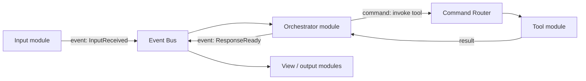
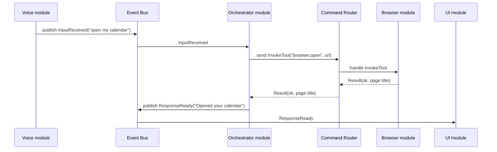

# Communication

How modules talk to each other through the core. Internals are in [core](core.md#communication-internals). Back to the [overview](README.md).

## Runtime flow (typical request)

The orchestrator discovers available tools by asking the DI container for every `IToolProvider`, so adding a tool module makes it available to the AI without touching the orchestrator.

## Mechanisms

| Mechanism | Shape | Use for | Example |
|-----------|-------|---------|---------|
| Interface (via DI) | Direct call through a shared contract | Querying a capability another module provides | Orchestrator lists all `IToolProvider`s |
| Command | Exactly one handler, returns a typed result, has a timeout, cancellable | An explicit action someone wants done | `OpenUrl`, `CreateCalendarEvent` |
| Event | Zero or more subscribers, no result | Notifying that something happened | `InputReceived`, `ResponseReady` |

Commands and events are plain data records defined in Contracts, not objects with behavior.

## How modules reach each other

A module never holds a reference to another module. Its only access to the app is the `ModuleContext` the core passes to `init`, which wraps the **Command Router**, **Event Bus**, and **DI container** and removes everything the module registered when it stops. Contracts only define shapes (interfaces and message types). The core does the delivery.

- **Interface call:** the module asks DI for a contract (e.g. all `IToolProvider`s) and calls methods on it directly, getting return values back. This is still direct communication between modules; it's only decoupled from the concrete implementation. Use it deliberately, and only through interfaces defined in Contracts. If no module provides it, the module gets nothing (an empty list or none), so it must handle absence.
- **Command (request/response):** `result = await ctx.send(command, timeout=None)`. The router finds the one module registered as that command's handler, calls it, and returns a typed result (see [Command results](#command-results)) to the sender. If no handler is registered, the sender gets `NotAvailable` instead of a crash.
- **Event (one-way):** `ctx.publish(event)`. Every subscriber gets a copy; the publisher gets nothing back. When a reply is needed for long-running work (transcription, a multi-step browser task), the event carries a **correlation id**, and the replying module publishes its own event (progress, completed, failed) with the same id.

Choosing between them:

| Need | Use |
|------|-----|
| An answer now, from a capability that may have zero or many providers | Interface |
| Something done by one owner, with a result back | Command |
| Tell whoever cares that something happened | Event |
| Long-running work with progress or a delayed result | Command to start it, then events with a correlation id |

**Where message types live:** shared commands and events (`InputReceived`, `ResponseReady`, `InvokeTool`) are defined in Contracts. The AI calls tools through the single generic `InvokeTool(name, args)` command, using the name and argument schema each `IToolProvider` advertises, so the orchestrator needs no per-tool code. A typed command such as `CreateCalendarEvent` is added to Contracts only when one module needs to call another directly.

## Command results

Every command returns exactly one of these statuses. They mean different things, especially to an AI agent deciding what to do next:

| Status | Meaning | Typical agent reaction |
|--------|---------|------------------------|
| `Ok` | Succeeded; carries the result payload | Continue |
| `InvalidArguments` | Handler rejected the input; carries what was wrong | Fix the arguments and retry |
| `NotAvailable` | No handler registered, or the module is disabled or suspended | Use another approach or tell the user |
| `Failed` | Handler ran and hit an error; carries the error and whether a retry might help | Retry if retryable, else report |
| `TimedOut` | No result within the timeout | Retry, or ask the user whether to wait longer |
| `Cancelled` | Cancelled by the sender, the user, or shutdown | Stop; don't retry automatically |

Handler exceptions never propagate to the sender. The router catches them and returns `Failed`.

## Timeouts and cancellation

- Every command has a timeout: a default from config, overridable per command type or per call. When it expires, the router returns `TimedOut` and signals cancellation to the handler.
- Cancellation is cooperative asyncio task cancellation: the handler gets `CancelledError` at its next `await`. Long-running work is identified by its correlation id and can be cancelled with `ctx.cancel(correlation_id)`, from the sender, the UI, or shutdown. Handlers that start external processes clean those up themselves for now.
- Handlers for long-running work (browser, 3D, remote desktop) must check the cancellation signal and stop promptly.
- On shutdown, the lifecycle manager cancels all in-flight commands before stopping modules.

## Event delivery

- `publish` returns immediately. It never waits on subscribers.
- Each subscriber is delivered to independently, so one slow or failing subscriber can't block the bus or other subscribers.
- Subscriber exceptions are caught and logged, never passed back to the publisher.
- Each subscriber has one worker and a bounded queue, so background tasks never grow with traffic. When a subscriber's queue is full, new events are dropped for it and logged.
- A handler that exceeds its time budget is cancelled and logged. Heavy work belongs in a command or background worker, not inside an event handler.
