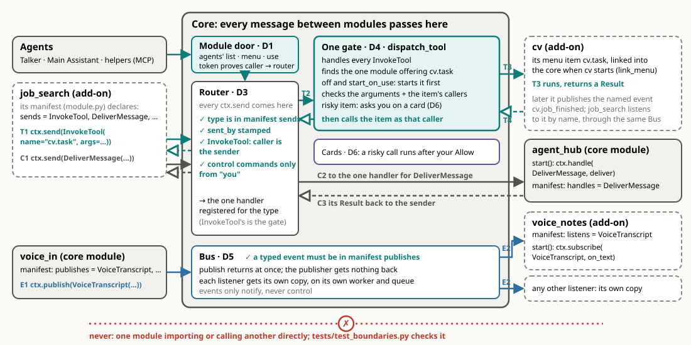
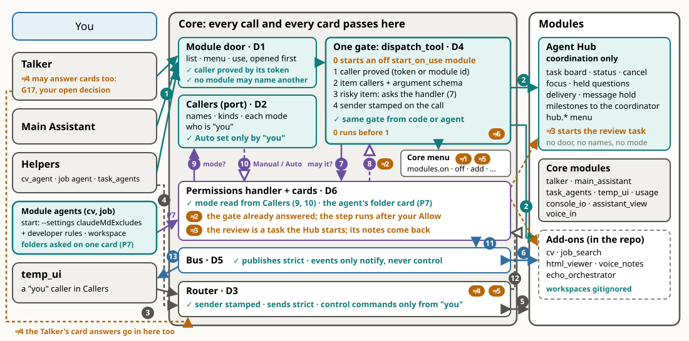
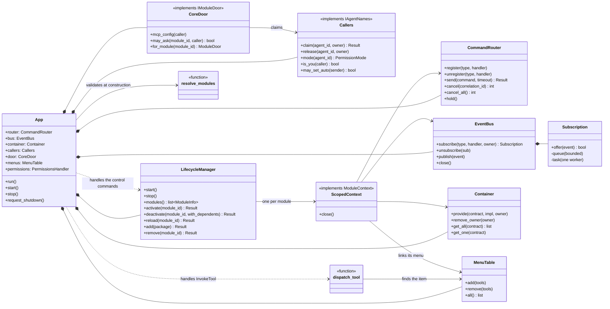
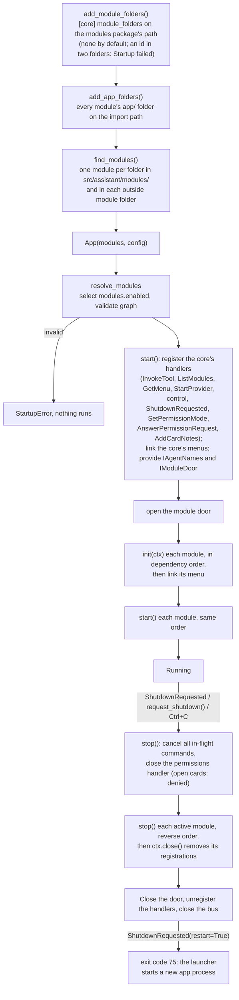
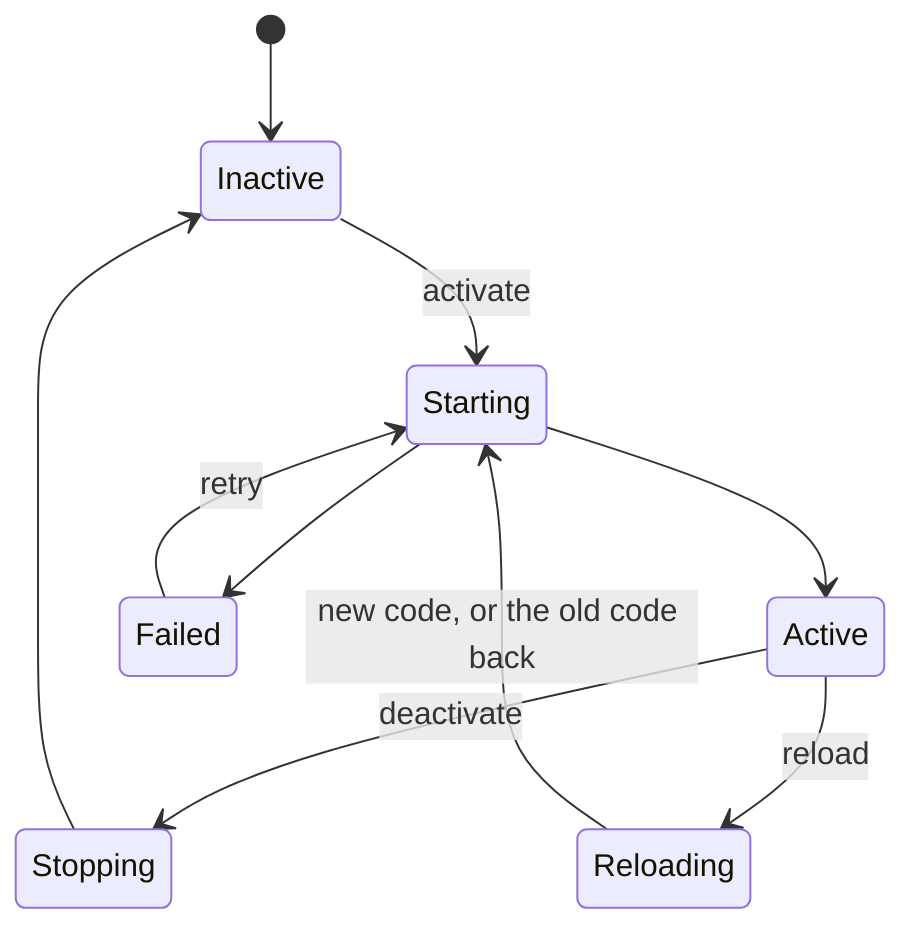
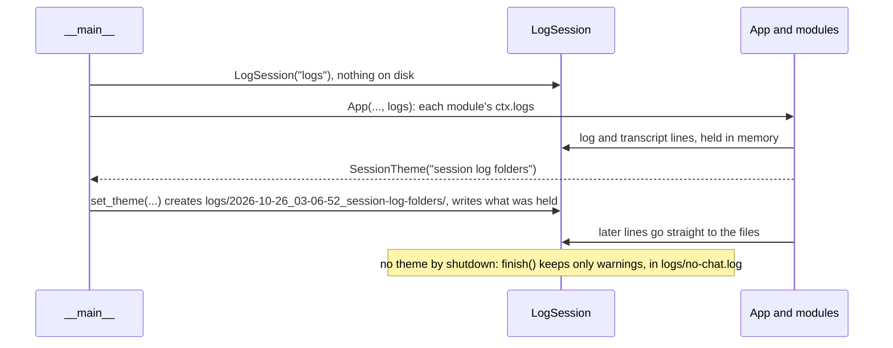

# Core host

The application core (`src/assistant/core/`): the host, its lifecycle, the six parts every call and card passes through, and how modules talk through it. For where it sits in the whole system, see the [overview](README.md). Commands, events and results in detail are on [communication](communication.md); cards and modes on [permissions](permissions.md); module folders, `needs` and the three core-line rules on [modules](modules.md). Signatures: the API pages for the [core host](../api/core.md), [modules](../api/modules.md), [messaging](../api/messaging.md) and [tools](../api/tools.md).

## Responsibility

The core controls communication and lifecycle: it checks which modules can run together, starts and stops them in dependency order, routes commands, delivers events, resolves contracts, and gates every tool call. It has seven ports: lifecycle, commands, events, contracts, the directory with the agents' door, permissions, and [Callers](#callers).

Inside, six parts carry every call and every card (the D numbers are the [decisions](decisions.md) behind them):

| Part | What it does | Code |
|------|--------------|------|
| D1 [Module door](#the-module-door) | The agents' one MCP door: list modules, show a menu, use an item; proves the caller by its token | `door.py`, `infra/mcp_door.py` |
| D2 [Callers](#callers) | Agent names, each agent's permission mode, who is "you" | `callers.py` |
| D3 Router | One handler per command type; the sender stamped, `sends` strict, control commands only from you ([who may send what](communication.md#who-sent-it-and-what-may-control)) | `router.py`, `context.py` |
| D4 [One gate](#the-ask-first-gate) | `dispatch_tool`, the handler of every `InvokeTool`: finds the item, checks it, asks you first for a risky one | `tools.py` |
| D5 Bus | Events to every listener, each on its own queue; events only notify, never control | `bus.py` |
| D6 Permissions handler | Access lists, grants, confirm cards; always on | `permissions/` |

**The permissions handler is part of the core** (`core/permissions/`), so no module or agent can turn it off or reload it. It uses only the core's generic parts (the router's `send`, the bus's `publish`, the container's `get_one`, the Callers port's modes) and the shared contracts, and knows no module by code; only its config defaults name agents. Each module's `ctx.permissions` is a `PermissionsPort` bound to its id. Design: [permissions](permissions.md#part-of-the-core).

**The Agent Hub does agent coordination only** (the task board, the focus, held questions, message delivery). The door, the agent names and the modes are the core's, so they work with the Hub off ([agents](agents.md)).

The core is **not** responsible for any capability: no input, output, AI or tool logic, and it never imports anything from `assistant.modules`. It never starts an agent's task either: the access-list review is asked of a listener ([the review](#the-access-list-review)). The only place that names concrete modules is the composition root, `src/assistant/__main__.py`.

## How modules talk through the core

[](img/modules-talk.svg)

Three ways one module reaches another, each through the core. Teal T1 to T4: a tool call. Grey C1 to C3: a command. Blue E1, E2: an event. Dashed with a hollow head: the answer coming back. Red ✗: never. Boxes: grey is the core, a core module or an agent; dashed is an add-on.

- **T, a tool call** ("do this and tell me the result"). job_search runs `ctx.send(InvokeTool(name="cv.task", args=…))` (T1). An agent does the same through the door D1, which proves the caller by its token. The send is checked (`InvokeTool` is in job_search's `sends`), `job_search` is stamped as the caller, and the router hands it to the one handler for `InvokeTool`: the gate D4 (T2). The gate finds the one module offering `cv.task`, starts cv first if it's off and `start_on_use`, checks the arguments and the item's callers, asks you on a card if the item asks, and calls cv's item (T3). The `Result` goes back the same way (T4).
- **C, a command** (one message to the one module that handles it). job_search runs `ctx.send(DeliverMessage(…))` (C1). The send is checked and stamped, and the router passes it to the one handler registered for its type (C2): the Agent Hub's, which it registered in `start` with `ctx.handle(DeliverMessage, …)` and lists in its manifest's `handles`. The `Result` goes back to the sender (C3).
- **E, an event** ("this happened", to whoever listens). voice_notes calls `ctx.subscribe(VoiceTranscript, on_text)` in its `start()` and lists it in `listens`; job_search calls `ctx.subscribe_named("cv.job_finished", …)` and lists it in `listens_named`. voice_in calls `ctx.publish(VoiceTranscript(…))` (E1); cv calls `ctx.publish_named("cv.job_finished", data)`, whose name starts with cv's own id and whose data is plain JSON. The bus returns at once and gives every listener its own copy, on its own worker and queue (E2). The publisher gets nothing back; for a reply, the replying module publishes its own event with the same correlation id.

**Good to know:**
- The router box in the picture also holds the module's own checks: `sends`, the stamp and the control table run in the module's context (`ScopedContext.send`) before the router; the router delivers and stamps `core` on a send with no sender.
- The door sends `InvokeTool` through the router, not straight to the gate (`DoorServer.call` uses `router.send`), so agents and module code share one path: router, then gate. The picture below draws it short, as door → gate.
- Listening is loose: a subscription or named event the manifest doesn't list still works and is logged once. `sends`, the typed `publishes`, `handles` and `provides` are strict ([communication](communication.md#who-sent-it-and-what-may-control)).

## Inside the core

[](img/core-inside.svg)

Who calls in (left), the six parts D1 to D6 (middle), and the modules (right). Every tool call goes door → gate → the module's item, and an item that asks shows you a card. Teal marks a part that checks; blue is you and where you see things (temp_ui). Arrows: tool call, command through the router, event on the bus; a permission question is solid with a filled head, an answer dashed with a hollow head.

| # | From → to | What travels | What is checked |
|---|-----------|--------------|-----------------|
| 1 | Every agent → door D1 → gate D4 | tool call (`use_item` becomes `InvokeTool`) | the caller is proved by its token; no module may name another; the item's `callers` and argument schema; an item that asks asks (7, 8). The agent's own Claude Code asks stay on its side |
| 2 | Gate → any module's item: the Hub's `hub.*`, an add-on's, or the core menu's | tool call | the same gate whether the call comes from an agent or a module's code |
| 3 | temp_ui, Talker → router | commands: your card answers, `SetPermissionMode` | sender stamped; control commands only from a "you" caller; `SetPermissionMode` is handled by the core with Callers |
| 4 | Helper → router → Hub | a STATUS line → `ReportTask` (a milestone) → the coordinator's next turn | sender stamped, so a report is only about the sender's own task |
| 5 | Router ⇄ modules | each command to the one handler registered for it; a module's own sends come in here | `handles` and `sends` strict. An add-on calling another add-on's tool: in at 5, router → gate, out at 2 |
| 6 | Bus ↔ modules | events (`TaskUpdated`, `AgentActivity`, `PermissionRequested` …) | typed `publishes` strict; events only notify. Reset, shutdown and agent notices are commands |
| 7 | Gate → permissions handler | question: "may it?" for an item that asks | asked once, from an agent or a module's code |
| 8 | Permissions handler → gate | answer: allow, deny, or "asked on a card" | a `risky` item for a caller in Auto: allow with no card (≠1); the gate doesn't wait (≠2) |
| 9, 10 | Permissions handler ⇄ Callers | the caller's mode: Manual or Auto | read in the core, so it works with the Hub off; Auto is set only by "you" |
| 11 | Permissions handler → bus | `PermissionRequested`: the card | publishes strict |
| 12 | Router → permissions handler | your answer, `AnswerPermissionRequest`, sent along 3 | sender stamped; only from a "you" caller or a relay (≠4) |
| 13 | Bus → temp_ui and the Talker | the card reaches you; `PermissionChanged` closes it | temp_ui shows it with buttons; the Talker reads it to you |
| P7 | Module agent's start → permissions handler | its access card: its workspace and the write grant on its own module folder | shown and answered like any card (11, 13, 3, 12); the agent then calls the app through the same door and gate (1, 2) |

**Good to know:**
- **≠1** The core menu's risky items (`modules.add`, `remove`, `reload`, and `off` with dependents) are `ask="always"`: they card even for a caller in Auto. Only a `you` caller runs them at once.
- **≠2** The gate doesn't wait for your answer: it answers "Asked the user on a card" at once, and after your Allow the permissions handler runs the step itself. Why: the router's timeout would cut a waiting call.
- **≠3** The access-list review is a task the Agent Hub starts; its notes come back onto the card by `AddCardNotes` ([the review](#the-access-list-review)).
- **≠4** The Talker is a relay (`[core.permissions] relays`), so it may send card answers too. Whether those count as yours is an open decision ([decisions](decisions.md)).
- **≠5** `modules.off` without `with_dependents` shows no card, and the core menu sends every control command as `core`, so an agent's `modules.off` isn't held to "control commands only from you".
- **≠6** The gate starts an off `start_on_use` module before it checks the item's `callers`, so a caller who may not use the item can still switch the module on.

## Structure



| File | Contents |
|------|----------|
| `app.py` | `App`: builds the parts, owns startup and shutdown order; handles `InvokeTool` (the gate), `ListModules`, `GetMenu`, `StartProvider`, the control commands, `ShutdownRequested`, `SetPermissionMode`, `AnswerPermissionRequest` and `AddCardNotes` |
| `registry.py` | `resolve_modules`, `StartupError`: selection and dependency validation |
| `lifecycle.py` | `LifecycleManager`: init / start / stop at startup and shutdown, runtime activate / deactivate / reload / add / remove, module states, failure handling |
| `loader.py` | Finding modules by folder, the outside module folders, fresh import of a module's package, what may be reloaded, rollback |
| `context.py` | `ScopedContext`: a module's handle on the core, tracks what it registered; stamps `sent_by`, checks `sends`, `publishes` and `handles`, and the `CONTROL` table |
| `router.py` | `CommandRouter`: commands, results, timeouts, cancellation, holding sends during a reload |
| `bus.py` | `EventBus`, `Subscription`: event delivery |
| `container.py` | `Container`, `is_shared_contract`: DI restricted to shared contracts |
| `callers.py` | `Callers`: agent names and claims, permission modes, `you` and `relays`; `RESERVED_AGENT_IDS` |
| `door.py` | `CoreDoor`, `ModuleDoor`, `CORE_LINE`: the agents' module door |
| `tools.py` | `MenuTable` (the menus, core-private) and `dispatch_tool`: the `InvokeTool` handler and the one gate |
| `directory.py` | `CoreMenu`: the core's own menu (`modules.*`), id `core` |
| `generated.py` | `GeneratedFiles`: the [generated files](#generated-files) |
| `logs.py` | `SessionLogs`: each module's `ctx.logs` |
| `permissions/` | The permissions handler: `PermissionsHandler` (`handler.py`: access lists, grant and revoke cards, confirm cards before risky steps, one-item `message` cards through `kind_of` / `granted` / `ask`, Allow once or Always, a review's notes through `add_notes`), `PermissionsPort` (`port.py`, each module's `ctx.permissions`), `PermissionsMenu` (`menu.py`, `permissions.*`), the saved grants (`store.py`) and the guardrails (`rules.py`). In the protected zone |

Modules only ever see the `ModuleContext` interface (defined in `assistant.contracts`), never `App` or these classes.

## Lifecycle



**Companion apps on the path.** A module's companion app lives in its folder as `app/<its package>/` (`cv/app/cv_tool/`); `app/` is no package, so the app keeps its own import name and never imports the module. Before importing any module, `find_modules` puts every module's `app/` folder on `sys.path` ([`add_app_folders`](../api/core.md#loader), found by folder, no names), and so do a reload and `AddModule` (`import_fresh`) and the test setup (the root `conftest.py`). `CompanionApp` launches the app with that folder first on `PYTHONPATH` ([`launch_env`](../api/app_kit.md#companionapp)). A new `app/` folder is found without a restart; an app already running keeps the path it started with.

**Module folders outside the repo.** `[core] module_folders` (absolute folders, `[]` by default) names more folders holding module folders. At startup `find_modules` appends them to the `assistant.modules` package's path, after the repo's ([`add_module_folders`](../api/core.md#loader)), so a module there keeps its import name and is found, started and reached the same way. A module id in two folders stops the startup, never shadowed. That check runs only at startup: a module loaded later with `AddModule` isn't checked for a twin. Changing the list needs a restart. How it works and its known gaps: [modules](modules.md).

**Shutdown is a command.** `ShutdownRequested` is a command the core handles, so it has one handler and a known sender ([decisions](decisions.md)). Only modules that list it in `sends` can send it: `console_io` (its `exit` line) and the Talker's restart. The core logs who sent it (`sent_by`).

**Restart.** `python -m assistant` is a small launcher. It runs the app as a child process in the same console and starts it again whenever the app exits with `core.restart_exit_code` (75). The app exits with 75 after a `ShutdownRequested(restart=True)` (`App.restart_requested`). A new process loads all new code, the core's included. The Talker triggers a restart when you ask for one, with reset instructions for the next launch ([Restart](../agents/runtime.md#the-talker-on-its-own)); it asks you on a confirm card first, in Auto too, and sends the command on your Allow.

**Validation before anything runs** (`resolve_modules`). Startup fails for:
- an id in `modules.enabled` that isn't in the module list, or two modules with the same id
- a manifest listing a type that isn't a contract from `assistant.contracts`
- a `requires` contract that no enabled module provides
- a module id in a `needs` list that doesn't exist (the error names it); a bad `needs` value in a `module.toml`
- a single-provider contract (`multiple = False`) provided by more than one module
- circular dependencies

A module a selected module `needs` ([`Manifest.needs`](../api/modules.md#manifest), read from its `module.toml`) is started too, even if `modules.enabled` doesn't list it. Order: a module comes after every provider of the contracts it `requires` or lists as `optional`, and after every module it `needs`. Otherwise it keeps its position from `modules.enabled`.

**Failures while starting** (`LifecycleManager`):
- If `init` or `start` raises, that module's registrations are removed and it is skipped.
- A module whose needed module didn't come up still starts (a warning is logged): `needs` is start order only, and the module copes with the other being off.
- Startup is aborted with `StartupError` only if the failed module provides a contract that another module `requires` and no other healthy module provides.
- `stop()` is called for every module whose `init` succeeded, even if its `start` never ran.

**Shutdown:**
- Each module gets `module_stop_timeout` seconds to stop. Errors and timeouts are logged and shutdown continues.
- Cleanup doesn't depend on modules behaving: `ScopedContext.close()` removes every subscription, command handler, provided contract and linked menu the module registered. After that, the context drops `publish`, refuses `send` with `not_available`, and raises on new registrations, so a leftover thread or callback can't keep talking to the app.
- Events still queued for a stopped module are dropped.

### Runtime module control

Turning modules on and off while the app runs. **The core owns the transitions; each module owns its resources.** Every module found is *available*; `modules.enabled` only says which are active at startup. The lifecycle manager tracks every available module's state:



- **Control interface:** core commands, [`ListModules`, `ActivateModule`, `DeactivateModule`, `ReloadModule`, `AddModule`, `RemoveModule`](../api/control.md), plus a `ModuleStateChanged` event on every transition. The core stays generic: it doesn't know what any module does.
- **Who calls it:** you, through temp_ui, and the agents (the Talker when you say "turn the viewer on"), through the core's menu (`modules.*`). There is no separate control panel module. `DeactivateModule`, `RemoveModule`, `ReloadModule` and `AddModule` come only from the core and you ([who may send what](communication.md#who-sent-it-and-what-may-control)); an agent reaches them through the menu, where the risky ones ask you first ([the gate](#the-ask-first-gate)).
- **Activating** a module first activates the provider of each contract it `requires`, if exactly one module could provide it; if several could, it refuses and asks which. It refuses if the module would be a second provider of a single-provider contract. It then activates each module it `needs`, by id (`not_available` naming an id that doesn't exist); if a needed one fails, it's logged and the module turns on anyway.
- **Deactivating** is never refused: the modules that require something only this one provides, or need this one, stay on, and the result names them ("voice_in is off; voice_notes needs it and stays on"). With `with_dependents`, those are deactivated first. Taking a module's grant back turns off only that module.
- **A call to a module that's off:** `InvokeTool` for an item on the menu of a module that's off (and not started on use) answers `not_available` with "The X module isn't on, so 'tool' can't run. Ask the user whether to turn X on; on their yes, use modules.on …". Every agent's prompt says to ask the user (a NEED line) and, on their yes, turn it on with `modules.on` and carry on. Nothing turns on by itself unless its config has `start_on_use`, or a module turns on the add-on it chains to when it needs it ([on-demand chaining](modules.md#dependencies)).
- **Fresh instance per activation.** Deactivating stops the module and removes everything it registered; activating creates a new instance and runs `init` and `start` again. So `stop` must release everything, and in-memory state doesn't survive (persist it if it must).
- **Failures:** a module that fails to activate is marked `failed` and can be retried; nothing else is affected.
- **Transitions finish:** one at a time, and a transition finishes even if the command that asked for it times out. Shutdown waits for it, then stops everything.
- **Modules load expensive things lazily:** a `claude` process, a speech model, or a window starts when the module is activated or first used, not at app start.
- **Agents adapt automatically:** tools are looked up at call time, so a deactivated module's tools disappear from what the agents can use.
- **Reloading a module:** `ReloadModule` swaps its code and `AddModule` loads a module that wasn't loaded at launch, both while the app runs ([below](#reloading-a-modules-code)).
- **Removing a module:** `RemoveModule` (`modules.remove`, which asks first) turns it off and takes it out of the module list for this run; it never deletes its folder. Details: [modules](modules.md).
- **What needs a restart:** changes to the core, contracts, `infra`, `app_kit`, or `__main__`, and a new module that needs a new contract or port type (contracts are shared by every module). Enabling, disabling, reloading, and loading resources don't.
- **Not the Agent Hub's job:** the Hub coordinates agents through their contracts. It never starts or stops modules itself.

#### Reloading a module's code

- **`ReloadModule(module_id)`:** the module stops as in a deactivation, and so does any active module that requires something only it provides. Its package (the one its class lives in, e.g. `assistant.modules.voice_in`, with every submodule) is dropped from `sys.modules`, its `__pycache__` too, and imported fresh. The new class goes through the same checks as an activation, a fresh instance starts, and the modules stopped with it start again. States: `reloading`, then `starting`, `active`.
- **Rollback:** if the new code fails to import, `init`, or `start`, the old package and class are put back and started. The result says what failed and that the old code runs again.
- **Config:** `App`'s `config_loader` (given by `__main__`) re-reads the config before each reload or add, so the module gets its current settings.
- **During the swap:** a command with no handler waits for one, up to its timeout (`CommandRouter.hold`), instead of failing. Events published meanwhile miss the module. Contracts are looked up at call time, so callers get the new instance; no module caches a provider. Agent names are claimed in the core, so a Hub reload keeps them.
- **`AddModule(package)`:** imports a package that wasn't loaded at launch, makes its module available, and activates it. Its folder must be named with its id. The next launch finds it by folder; to start it then, add it to `modules.enabled`. If its code needs a contract the running app doesn't have, it fails with "needs a restart".
- **Not reloadable:** `assistant.core`, `assistant.contracts`, `assistant.infra`, `app_kit`, and a class that isn't in its own package. Why: every module holds their classes, so swapping them would break `isinstance` checks and contract identity.
- **Old code left running:** a thread the old copy didn't stop keeps running old code, muted by its closed context. `stop` must release everything.
- **Busy modules:** before stopping, the core asks the module's [`busy()`](../api/modules.md#moduleprotocolbusy). While it gives a reason, the reload waits (polling every 0.2 s, up to `core.reload_idle_timeout`, 300 s), then fails with that reason. `ReloadModule(now=True)` cuts in.
- **Handover:** just before stopping, the core calls [`export_state()`](../api/modules.md#moduleprotocolexport_state) and passes the result to the new instance as `ctx.handover`; on rollback it goes back to the old one. Only plain data and `infra` / `app_kit` objects, which are never reloaded. Who hands over: `voice_in` and `html_viewer` their `CompanionApp` (the voice app or the viewer keeps running; an open mic session still ends, and its words are dropped); the Talker its tabs' histories, focus and open tasks; the Agent Hub its focus, waiting messages and held questions; also `cv`, `job_search` and `usage`. The Main Assistant has none: a reload waits until its task ends and starts it clean.
- **Companion apps with new code:** if the companion app's own source changed since the module started using it (`CompanionApp.code_changed()`), `export_state` hands nothing over and `stop` quits the app, even one it found running. The new copy launches the new code on its next use. Turning the module off quits the app only if it launched it, so a viewer you started yourself stays open.
- **Who triggers it:** `modules.reload` and `modules.add` on the core's menu, which ask you on a confirm card first ([the gate](#the-ask-first-gate)), and the Main Assistant's last line `RELOAD: <id> [now]` or `ADD_MODULE: <package>` after its tests pass. That line keeps the agent's own permission card, **shown in Auto too**; on your Allow its module sends the command, which the `CONTROL` table lets a task agent's module send. The outcome comes back to its session, and it can't reload itself ([runtime](../agents/runtime.md#loading-new-code)). No file watcher: it would load half-written code.

## Callers

`core/callers.py`, `App.callers` ([decision D2](decisions.md)). The one list of who calls, as the core knows them.

- **Agent names.** One claim per agent id ([`IAgentNames`](../api/agents.md#iagentnames), provided by the core). The id rules are the shared `check_agent_id`; every module id and `core`, `hub`, `talker` are refused. A taken id gets a free one offered (`free_agent_id`). Claims live in the core, so a Hub reload keeps them.
- **Permission modes.** Each agent's mode; only non-Manual modes are kept, and a released id goes back to Manual (a restarted agent starts in Manual). The core handles [`SetPermissionMode`](../api/agents.md#setpermissionmode) (`App._set_mode`): Auto only when `sent_by` is `core` or a `you` caller (`may_set_auto`), Manual from anyone. Callers records the mode first and goes back if the agent refuses. An agent's own `set_permission_mode(AUTO)` refuses unless Callers already holds Auto, so no module can put its agent in Auto by itself. The permissions handler reads the modes here (`mode_of`).
- **You.** `[core.permissions] you` (`temp_ui` by default): callers that are you clicking in a UI. `relays` (the Talker by default): modules that pass on your answer to a card. A relay is never "you" for Auto, and never sets it.
- **Who asks.** `IAgentNames.mode(agent_id)` and `is_you(caller)` let a module check a caller without naming the core (task_agents' launch item, the Talker's `talker.reset`).
- **Known gap:** "you" is trusted by module id, not by the folder the code came from. A module in an outside module folder named like a core module (`temp_ui`, say) would get your rights; only `tests/test_boundaries.py` catches it, when pytest runs.

## The module door

`core/door.py`, `core/tools.py`, `App.door`, `App.menus` ([decisions D1 and D4](decisions.md)).

The agents' one MCP door (list modules · show a menu · use an item, [`IModuleDoor`](../api/tools.md#imoduledoor)) is hosted by the core. `App` opens it in `start()` before any module starts, so every agent's first session has the door; it closes after the modules stop. Its calls go to the router as the core's own sends (`ListModules`, `GetMenu`, `InvokeTool` with the caller its token proved), so a door call takes the same path as a module's own: router, then gate. Config: `[core.door]` (`enabled`, `host`, `port`). If its port is taken, the agents go without it and a warning is logged.

- **Configs only for your own.** A module never gets the core's door: `ctx.get_one(IModuleDoor)` gives a `ModuleDoor` bound to its id. Its `mcp_config(caller)` answers only for the module itself or an agent id it claimed in Callers; for anyone else it logs a warning and gives `{}`.
- **The caller is the sender.** A module's own `InvokeTool` always carries its id as `caller` (`ScopedContext.send` sets it); only the door passes on the caller its token proved.
- **Menus in the core.** Each module's [`Menu`](../api/modules.md#menu) is linked after its `init` into a core-private `MenuTable` (`App.menus`), as a [`MenuTools`](../api/core.md#menutools) adapter, and taken out when its context closes, so a reloaded module's menu runs its new code. Menus are never in the container. Why: nobody can reach a menu as a plain `IToolProvider` and pick their own caller. A module that provides `IToolProvider` itself still counts.

### The ask-first gate

Every menu call ends in one gate, `dispatch_tool`, whether it came through the door or a module's own `InvokeTool`:

0. A tool nobody offers, on the menu of a module that is off and has `start_on_use`, turns that module on first (≠6: before the `callers` check).
1. The item's arguments are checked, then its `callers` list, if it has one. For an item that asks, the gate does this before the card; for any other, `Menu.call` does it. A module that provides `IToolProvider` itself checks its own arguments.
2. An item marked `ask` ([`Menu.item(..., ask=, ask_when=)`](../api/modules.md#menu)) opens a **confirm card** through the permissions handler, with the call itself as the step. `ask_when` names a boolean argument: the item asks only when it's true.
3. On Allow the call runs and its outcome reaches the caller as a note; Deny runs nothing and the caller gets a note. The tool call itself answers at once ("Asked the user on a card"), so the router's timeout never cuts it.

**Who skips the card:** a `you` caller runs at once (you clicked it). `ask="always"` cards for everyone else, **Auto included**. `ask="risky"` runs at once for a caller Callers holds in Auto. The Talker is never in Auto, so a risky item cards for it too. Modes and cards: [permissions](permissions.md#risky-steps-ask-even-in-auto).

**Marked:** on the core's menu, `modules.add`, `modules.remove` and `modules.reload` (`ask="always"`), and `modules.off` (`ask="always"`, `ask_when="with_dependents"`). No item is marked `risky`: `rezi.write_resume` is already your yes (your Send to Rezi click), `hub.cancel` and `agents.close` are your word or can be undone, and `permissions.grant / revoke` card in their own code.

**Outside the menu:** the Talker's restart opens a confirm card itself (`ctx.permissions.confirm`), and the Main Assistant's `RELOAD:` / `ADD_MODULE:` line keeps its own permission card ([above](#reloading-a-modules-code)). An outside `scripts/restart_app.ps1` run has no card.

**Known gaps:**
- The microphone isn't asked: voice_in calls `ctx.permissions.request("microphone")` before each session, but a single-name request only logs and allows.
- The `modules.add` card shows the package, not the folder the code comes from.

### The access-list review

Before an access card shows, the reviewer (`[core.permissions] reviewer`, `main_assistant`) may add notes to it. **The core never starts that task:** the permissions handler sends [`ReviewAccessList`](../api/messaging.md#reviewaccesslist), the Agent Hub starts the review task, and the notes come back by [`AddCardNotes`](../api/messaging.md#addcardnotes), which the core handles. With no Hub the card shows "not reviewed" at once. Flow and timeouts: [permissions](permissions.md).

The handler does send `GetTaskStatus` / `CancelTask` when a revoke turns a module off (`_stop_tasks`). That's on purpose: it cancels tasks, it never starts one.

## Communication internals

How commands and events are delivered, the results, timeouts, and who may send what: [communication](communication.md). Here only the core's side.

### Who may send what

Every command a module sends is checked in its context (`core/context.py`, [decision D3](decisions.md)): its type must be in `manifest.sends`, its sender is stamped (`sent_by`), and a control command (the `CONTROL` table: `DeactivateModule`, `RemoveModule`, `ReloadModule`, `AddModule`, the card answers) comes only from the core, a `you` caller, or the others each one names. Anything that makes a part act is a command, never an event ([decision D5](decisions.md)). The table and the reasons for what's left out of it: [communication](communication.md#who-sent-it-and-what-may-control).

### Contracts

`Container`:
- Only `Contract` subclasses defined under `assistant.contracts` are accepted, so modules can't resolve each other's concrete types.
- A module can only `provide` contracts declared in its manifest's `provides`.
- Single-provider contracts reject a second provider at runtime too, not just at startup.
- The core provides `IAgentNames` (Callers) and `IModuleDoor` (the door) in its own name.

### Tools

`dispatch_tool`:
- Handles `InvokeTool` by looking in the `MenuTable` and at every module that provides `IToolProvider` itself, *at call time*, nothing cached, so tools can appear and disappear while running.
- Unknown name → `NotAvailable`; a name offered by more than one provider → `Failed`.
- It is the one gate ([above](#the-ask-first-gate)).
- **Start on use:** a tool nobody offers, but on the menu of a module that is off and has `start_on_use = true` in its config, turns that module on first (as `ActivateModule` does), then runs. A failed start returns its error; calls during the start wait for it. Only `html_viewer` uses it ([`dispatch_tool`](../api/core.md#dispatch_tool)). The same works by contract: [`StartProvider`](../api/control.md#startprovider)`(contract)` turns on the module that provides it, so a core module opening a page (through [`IPageOpener`](../api/modules.md#ipageopener)) never names the viewer ([needs arrows](modules.md#the-needs-arrows-point-one-way)).
- The [directory, then menu](modules.md#find-a-module-then-open-its-menu): `ListModules` gives one line per module, `GetMenu(id)` one module's `ToolSpec`s (read from its class, on or off). Calling stays `InvokeTool`.
- The core's own menu (`core/directory.py`, id `core`): `modules.list / menu / docs / on / off / reload / add / remove`, each sending the matching control command as the core. Linked in the `MenuTable` in the name `core` while the app runs. The grant calls `permissions.grants / grant / request / revoke` are on the same `core` menu ([permissions](permissions.md#managing-grants)).

## Configuration

| Key | Default | Meaning |
|-----|---------|---------|
| `modules.enabled` | `[]` | Module ids to run, from the modules found by folder; `enabled` in `config/modules.toml` |
| `modules.<id>` | `{}` | That module's settings, passed as `ctx.config`; your choices in `config/<id>.toml` |
| `core.module_folders` | `[]` | More folders holding module folders, outside the repo (absolute paths); see [modules](modules.md) |
| `core.command_timeout` | `30.0` | Default command timeout, seconds |
| `core.command_timeouts.<CommandClass>` | | Per-type override |
| `core.module_stop_timeout` | `5.0` | Seconds each module gets to stop |
| `core.reload_idle_timeout` | `300.0` | Seconds a reload waits for a busy module |
| `core.restart_exit_code` | `75` | The exit code that makes the launcher start the app again |
| `core.event_queue_size` | `100` | Per-subscriber queue size |
| `core.event_handler_timeout` | `10.0` | Seconds before a stuck event handler is cancelled |
| `core.door.enabled` / `host` / `port` | `true` / `"127.0.0.1"` / `0` | The agents' [module door](#the-module-door); port `0` takes any free one |
| `core.permissions.grants_file` | `"config/permissions.toml"` | The saved grants (relative to the repo; yours, gitignored, in the protected zone). At startup, if it's missing, the old `data/permissions.toml` is copied to it once; the old file stays |
| `core.permissions.reviewer` | `"main_assistant"` (in `default.toml`; `""` in code) | The agent that reviews an access list before its card shows, passed in `ReviewAccessList`; `""` for none |
| `core.permissions.review_timeout` / `answer_timeout` | `90.0` / `600.0` | Seconds for the review (then "not reviewed") and for your answer (then Deny) |
| `core.permissions.you` | `["temp_ui"]` (in `default.toml`; none in code) | Callers that are you clicking: they send control commands, set Auto, and skip confirm cards; an agent's grant or revoke shows you a card |
| `core.permissions.relays` | `["talker"]` (in `default.toml`) | Modules that pass on your answer to a card; never Auto |
| `core.generated_dir` | `"generated"` (in `default.toml`; none in code) | The core's [generated files](#generated-files), relative to the repo; `""` or missing writes none (tests pass a tmp folder) |
| `logging.dir` | `"logs"` | Where the session folders go. See [Logging](#logging) |
| `logging.file` | `"assistant.log"` | The app log's file name inside the session folder |
| `logging.level` / `stderr` | `INFO` / `false` | See `setup_logging` |
| `modules.<id>.transcript` | | A file name; the module writes it through `ctx.logs.sink(name)`, in the session folder |

`config/` holds your choices only. [`load_config`](../api/infra.md#load_config) reads it, each layer merged key by key over the one before:

1. `config/default.toml`: the core's settings (`[core]`, `[core.door]`, `[core.permissions]`, `[core.command_timeouts]`, `[logging]`); no on/off list and no module's defaults.
2. `config/modules.toml` (committed), then `config/modules.local.toml`: which modules are on (`enabled = [...]`).
3. `config/<id>.toml`, then `config/<id>.local.toml`: your choices for one module, its settings as top-level keys (no `[modules.<id>]` header). Gitignored: they may hold your paths; none is shipped. `default`, `local`, `modules`, `permissions` (the saved grants' name) and `voice_service` are never read as a module's file.
4. `config/local.toml` last: its `[modules] enabled` and `[modules.<id>]` sections win.

A module's own defaults, its `module.toml`, go under all of these: the core merges its section over them (`App._config_of`). So for one module: `module.toml` → `config/<id>.toml` → `config/<id>.local.toml` → `[modules.<id>]` in `config/local.toml`. Every module folder has a `module.toml`; tripwires (`tests/test_module_folders.py`) keep `config/default.toml` free of module defaults and of `enabled`. `ASSISTANT_CONFIG_DIR` points elsewhere (e.g. on a server).

## Logging

**One owner for where logs go:** the log handler, [`LogSession`](../api/infra.md#logsession) in `src/assistant/infra/log.py`. It's shared infrastructure, not a module, because it must exist before any module starts. Modules decide *what* they write, through `ctx.log` or their own transcript; none picks its own path.

- **Session = one app launch.** At startup `__main__.use_log_session()` creates a `LogSession`. It creates nothing on disk yet.
- **Nothing on disk until the first message:** there's one [`LogSink`](../api/infra.md#logsink) per file. The app log gets its sink through `LogSession.handler` (added by `setup_logging`). `__main__` gives the session to `App`, and every module reaches it through its [`ctx.logs`](../api/modules.md#modulecontextlogs) port: `sink(name)` for its transcript (the Talker, the Main Assistant), `folder()` for the folder once it exists, else `logs/` (the temp UI's Logs button, the viewer's snips). Nothing log-related goes into a module's config. Sinks hold what's written in memory until the folder exists.
- **Theme creates the folder:** the Talker publishes a [`SessionTheme`](../api/messaging.md#sessiontheme) after your first message (its THEME tag, else the message itself, also if its turn failed). `__main__` passes it to `LogSession.set_theme`, which makes it folder-safe (at most five words), creates `logs/<start time>_<theme>/` (`-2` added after the time if taken), and writes what was held. A session folder holds `assistant.log`, `talker.jsonl`, and `main_assistant.jsonl`. The name is final from the start, so a crash or a force-kill (relaunch) leaves it named.
- **A launch without a chat leaves no folder.** At shutdown `LogSession.finish()` drops what was held, unless the app log has a warning or error (a module failed, `Startup failed`): then that log is appended to `logs/no-chat.log` under a `--- <start time>: no chat ---` line. If the app is killed before any message, nothing is kept.
- **Not in a session folder:** `logs/no-chat.log`, and `logs/relaunch.log`, written by `scripts/relaunch.ps1` outside the app. Old session folders are kept, with no automatic cleanup.



## Generated files

`generated/` at the repo root (`[core] generated_dir`) is built for you to read, never hand-edited, gitignored and safe to delete. One small core part, [`GeneratedFiles`](../api/core.md#generatedfiles) in `core/generated.py`, writes it from the lifecycle's view:

| File | Holds |
|------|-------|
| `modules.json` | The live module list: each module's id, state and description |
| `directory.json` | The module directory: each module's line (as `ListModules`) with its menu's tool specs (as `GetMenu`), and the core's own menu |
| `dependencies.json` | Each module's `needs`, `requires` and `packages` |
| `module-library.md` | A copy of the [module library](module-library.md) page, written by `scripts/build_docs.py` (the docs keep theirs) |

`App` writes the three JSON files once after startup and again on every module state change (from its lifecycle callback, beside `ModuleStateChanged`). Each write replaces the whole file through a temp file, so a reader never sees half of one; a failed write is logged and never reaches the lifecycle. Deleted, the folder comes back on the next state change. Each file says it's generated (a `_generated` key in the JSON, a top comment in the Markdown). Nothing reads these files to decide anything.

## Adding, replacing, or removing a module

A module is one folder with a manifest, `ModuleProtocol` for its lifecycle, and any small capability interfaces; it depends only on contracts and shared infrastructure, and owns its state, config and storage. How to add, replace or remove one: [modules](modules.md). To replace one (e.g. the orchestrator), enable the new id instead of the old one; no core changes (`tests/test_app.py::test_orchestrator_is_replaceable_by_config_alone`).

Contracts grow as needed: add a capability interface when a real module needs it, not in anticipation. Before writing a helper, check the [reusable parts index](../api/reusable.md) ([principle 13](principles.md)). A menu item that does something risky gets `ask="always"` or `ask="risky"` ([the gate](#the-ask-first-gate)).

## Running

```powershell
py -3.12 -m venv .venv
.\.venv\Scripts\python -m pip install -e ".[dev]"
.\.venv\Scripts\python -m assistant      # type a line; `exit` to quit
.\.venv\Scripts\python -m pytest
.\.venv\Scripts\python scripts\build_docs.py   # regenerate docs/html/ and docs/html-next-steps/ after editing docs
```
