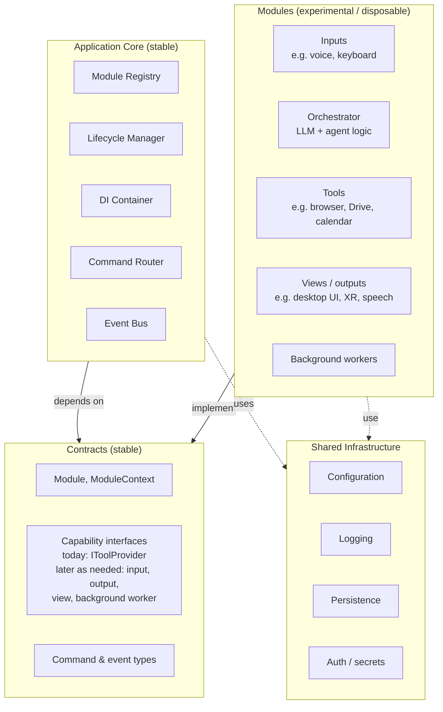
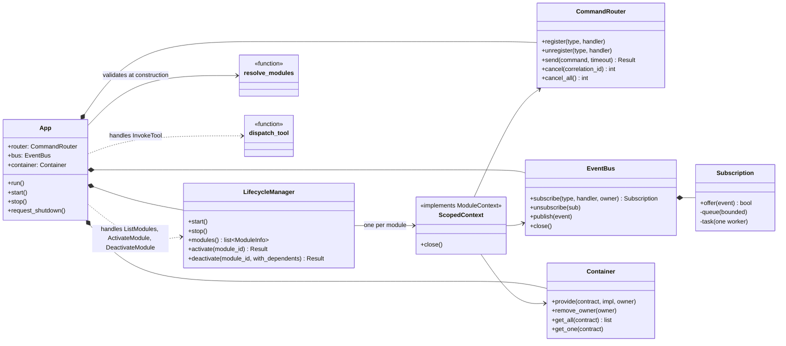
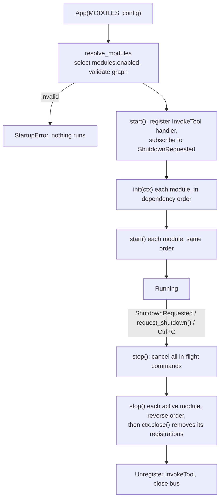
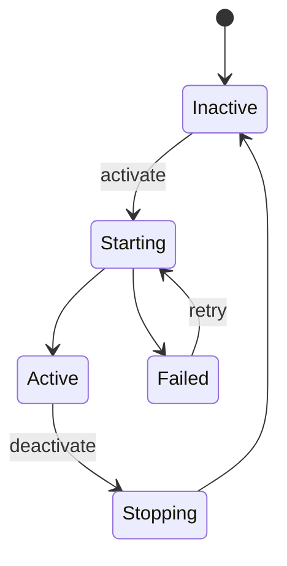

# Core host

In-depth architecture of the application core (`src/assistant/core/`). For where it sits in the whole system, see the [overview](README.md). For signatures, see the API pages for [modules](../api/modules.md), [messaging](../api/messaging.md), [tools](../api/tools.md), and the [core host](../api/core.md).

## Where the core sits



Dependency direction: the core and modules both depend on contracts; contracts depend on nothing. The core never references a concrete module, and modules never reference each other.

## Responsibility

The core controls communication and lifecycle: it validates which modules can run together, starts and stops them in dependency order, routes commands, delivers events, and resolves contracts.

It is **not** responsible for any capability. It contains no input, output, AI, or tool logic, and never imports anything from `assistant.modules`. The only place that names concrete modules is the composition root, `src/assistant/__main__.py`.

## Structure



| File | Contents |
|------|----------|
| `app.py` | `App`: builds the parts, owns startup and shutdown order |
| `registry.py` | `resolve_modules`, `StartupError`: selection and dependency validation |
| `lifecycle.py` | `LifecycleManager`: init / start / stop at startup and shutdown, runtime activate / deactivate, module states, failure handling |
| `context.py` | `ScopedContext`: a module's handle on the core, tracks what it registered |
| `router.py` | `CommandRouter`: commands, results, timeouts, cancellation |
| `bus.py` | `EventBus`, `Subscription`: event delivery |
| `container.py` | `Container`, `is_shared_contract`: DI restricted to shared contracts |
| `tools.py` | `dispatch_tool`: the `InvokeTool` handler |

Modules only ever see the `ModuleContext` interface (defined in `assistant.contracts`), never `App` or these classes.

## Lifecycle



**Validation before anything runs** (`resolve_modules`). Startup fails for:
- an id in `modules.enabled` that isn't in the module list, or two modules with the same id
- a manifest listing a type that isn't a contract from `assistant.contracts`
- a `requires` contract that no enabled module provides
- a single-provider contract (`multiple = False`) provided by more than one module
- circular dependencies

Order: a module comes after every provider of the contracts it `requires` or lists as `optional`. Otherwise it keeps its position from `modules.enabled`.

**Failures while starting** (`LifecycleManager`):
- If `init` or `start` raises, that module's registrations are removed and it is skipped.
- Startup is aborted with `StartupError` only if the failed module provides a contract that another module `requires` and no other healthy module provides.
- `stop()` is called for every module whose `init` succeeded, even if its `start` never ran.

**Shutdown:**
- Each module gets `module_stop_timeout` seconds to stop. Errors and timeouts are logged and shutdown continues.
- Cleanup doesn't depend on modules behaving: `ScopedContext.close()` removes every subscription, command handler, and provided contract the module registered. After that, the context drops `publish`, refuses `send` with `not_available`, and raises on new registrations, so a leftover thread or callback can't keep talking to the app.
- Events still queued for a stopped module are dropped.

### Runtime module control

> **Built in the core.** The control panel UI module that uses it comes later.

Turning modules on and off while the app runs. **The core owns the transitions; each module owns its resources.** Every module listed in `__main__.py` is *available*; `modules.enabled` only says which are active at startup. The lifecycle manager tracks every available module's state:



- **Control interface:** three core commands, [`ListModules`, `ActivateModule`, `DeactivateModule`](../api/control.md), plus a `ModuleStateChanged` event on every transition. The core stays generic: it doesn't know what any module does.
- **Who calls it:** a **control panel** UI module, or the Talker when you say "enable the browser module". Both send the same request.
- **Activating** a module first activates the provider of each contract it `requires`, if exactly one module could provide it; if several could, it refuses and asks which. It refuses if the module would be a second provider of a single-provider contract.
- **Deactivating** is refused while an active module requires something only this one provides, and the error names them. With `with_dependents`, those are deactivated first.
- **Fresh instance per activation.** Deactivating stops the module and removes everything it registered; activating creates a new instance and runs `init` and `start` again. So `stop` must release everything, and in-memory state doesn't survive (persist it if it must).
- **Failures:** a module that fails to activate is marked `failed` and can be retried; nothing else is affected.
- **Transitions finish:** one at a time, and a transition finishes even if the command that asked for it times out. Shutdown waits for it, then stops everything.
- **Modules load expensive things lazily:** a `claude` process, a speech model, or a window starts when the module is activated or first used, not at app start.
- **Agents adapt automatically:** tools are looked up at call time, so a deactivated module's tools disappear from what the agents can use.
- **What needs a restart:** adding or changing code. Enabling, disabling, and loading resources don't. Switching an AI model should be a runtime setting, restarting only that agent's session if the provider needs it.
- **Not the Agent Hub's job:** the Hub coordinates agents through their contracts. It never starts or stops modules itself.

## Communication internals

**Commands** (`CommandRouter.send`):
- One handler per command type; registering a second raises `ValueError`.
- Each send runs the handler as its own task and waits up to the timeout: the per-call `timeout`, else `core.command_timeouts.<ClassName>`, else `core.command_timeout`.
- Every outcome becomes a `Result`: no handler → `NotAvailable`; exception → `Failed`; timeout → `TimedOut` (handler cancelled); cancelled → `Cancelled`; a non-`Result` return → `Failed`.
- If the sender is cancelled, the handler is cancelled too.
- Cancellation is cooperative asyncio task cancellation. A handler sees `CancelledError` at its next `await`. Handlers that run external processes must clean those up themselves; there's no extra machinery for that yet.

**Events** (`EventBus`):
- Each subscription has a bounded queue (`core.event_queue_size`) and exactly one worker task. Task count grows with subscriptions, never with traffic.
- `publish` only enqueues, so it never blocks the publisher. If a subscriber's queue is full, the event is dropped for that subscriber and a warning is logged.
- A handler is cancelled after `core.event_handler_timeout` seconds. Exceptions are logged. In both cases the worker moves on to the next event.
- Subscribing to a base type receives subclasses too, so subscribing to `Event` receives everything (useful for the future gateway).

**Contracts** (`Container`):
- Only `Contract` subclasses defined under `assistant.contracts` are accepted, so modules can't resolve each other's concrete types.
- A module can only `provide` contracts declared in its manifest's `provides`.
- Single-provider contracts reject a second provider at runtime too, not just at startup.

**Tools** (`dispatch_tool`):
- Handles `InvokeTool` by asking every `IToolProvider` for its tools *at call time*, nothing cached, so tools can appear and disappear while running (e.g. a remote client connecting).
- Unknown name → `NotAvailable`; a name offered by more than one provider → `Failed`.
- A future `ToolsChanged` event, published by providers when their list changes, slots in without core changes: orchestrators would subscribe to refresh what they tell the model.

## Configuration

| Key | Default | Meaning |
|-----|---------|---------|
| `modules.enabled` | `[]` | Module ids to run, from the list in `__main__.py` |
| `modules.<id>` | `{}` | That module's settings, passed as `ctx.config` |
| `core.command_timeout` | `30.0` | Default command timeout, seconds |
| `core.command_timeouts.<CommandClass>` | | Per-type override |
| `core.module_stop_timeout` | `5.0` | Seconds each module gets to stop |
| `core.event_queue_size` | `100` | Per-subscriber queue size |
| `core.event_handler_timeout` | `10.0` | Seconds before a stuck event handler is cancelled |
| `logging.level` / `file` / `stderr` | `INFO` / none / `false` | See `setup_logging` |

Config comes from `config/default.toml`, with `config/local.toml` deep-merged over it. `ASSISTANT_CONFIG_DIR` points elsewhere (e.g. on a server).

## Adding, replacing, or removing a module

Each module:

- lives in its own folder and depends only on Contracts and Shared Infrastructure
- has a manifest: id, the capabilities it provides, and what it requires (required vs optional)
- implements `Module` for lifecycle, plus any number of small capability interfaces
- owns its own state, config section, and storage

Contracts grow as needed. Add a new capability interface when a real module needs it, not in anticipation. The interfaces named above are a starting point, not a fixed list.

1. Create `src/assistant/modules/<name>/` with a `Module` subclass. Import only from `assistant.contracts` and `assistant.infra`.
2. Add the class to `MODULES` in `src/assistant/__main__.py`.
3. Add its id to `modules.enabled` in config.

To **replace** a module (e.g. the orchestrator), enable the new id instead of the old one. No core changes; `tests/test_app.py::test_orchestrator_is_replaceable_by_config_alone` checks this. To **remove** one, delete its folder, its `MODULES` entry, and its config.

## Running

```powershell
py -3.12 -m venv .venv
.\.venv\Scripts\python -m pip install -e ".[dev]"
.\.venv\Scripts\python -m assistant      # type a line; `exit` to quit
.\.venv\Scripts\python -m pytest
.\.venv\Scripts\python scripts\build_docs.py   # regenerate docs/html/ after editing docs
```
