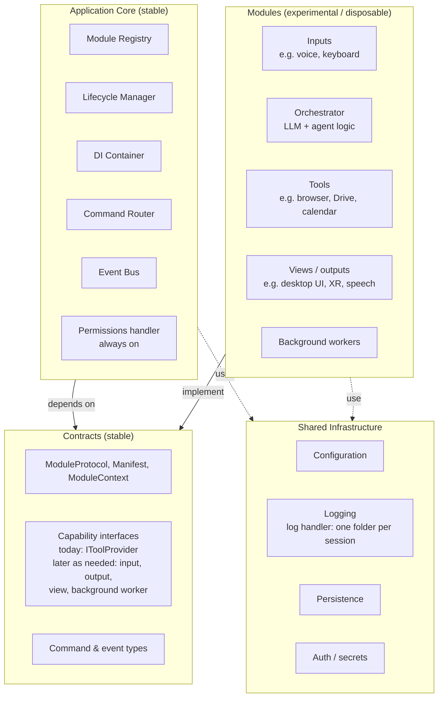
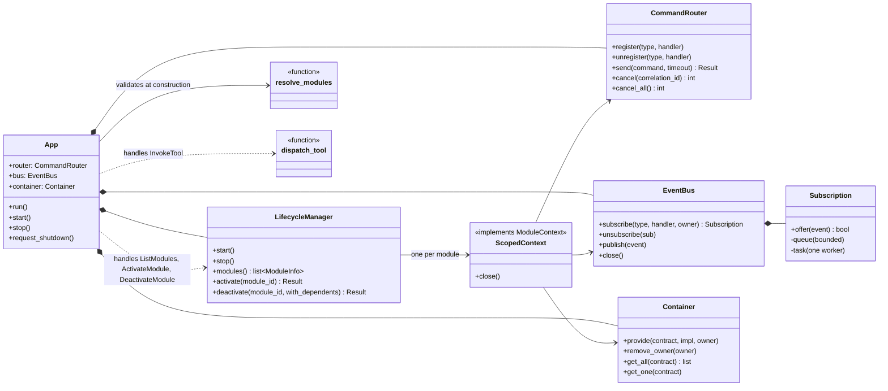
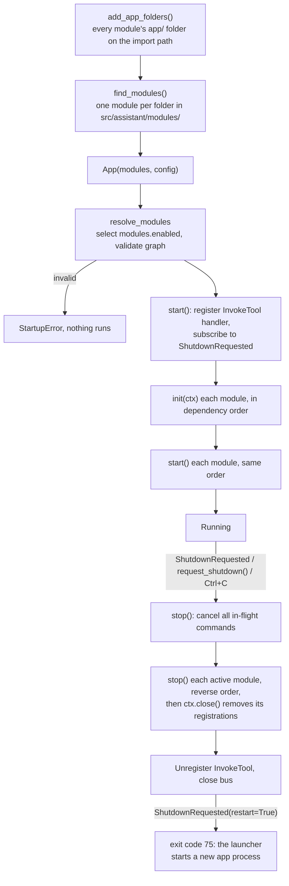
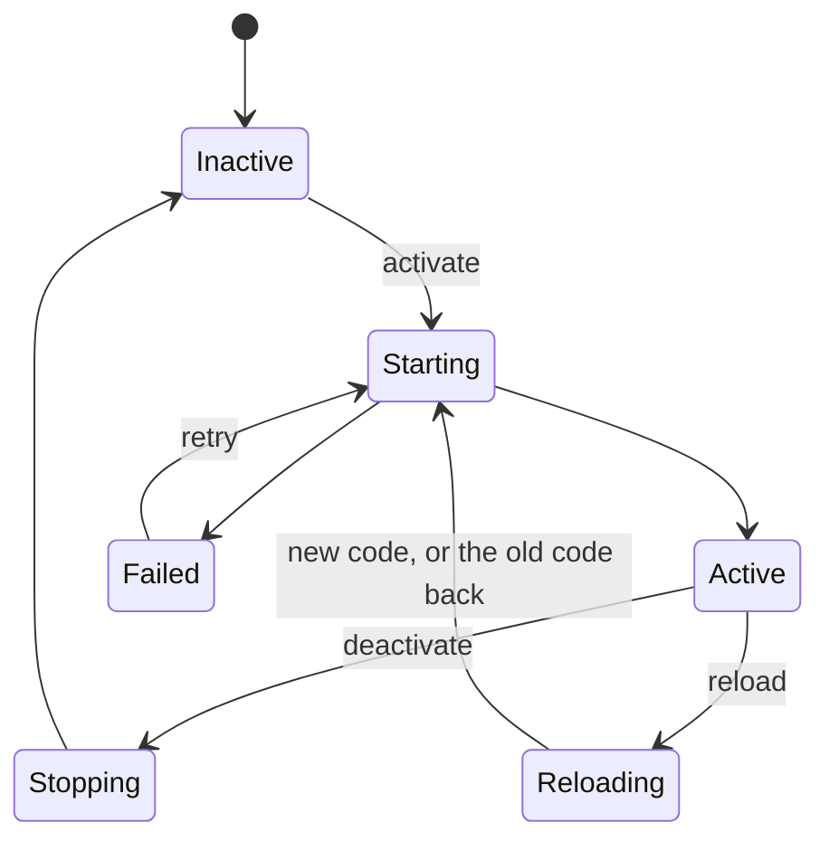
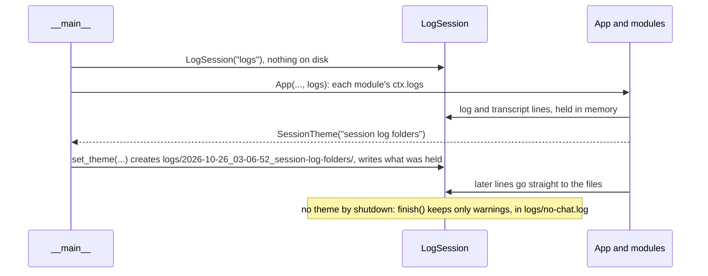

# Core host

In-depth architecture of the application core (`src/assistant/core/`). For where it sits in the whole system, see the [overview](README.md). For signatures, see the API pages for [modules](../api/modules.md), [messaging](../api/messaging.md), [tools](../api/tools.md), and the [core host](../api/core.md).

## Where the core sits



Dependency direction: the core and modules both depend on contracts; contracts depend on nothing. The core never references a concrete module, and modules never reference each other.

## Responsibility

The core controls communication and lifecycle: it validates which modules can run together, starts and stops them in dependency order, routes commands, delivers events, and resolves contracts.

It also holds the **permissions handler** (`core/permissions/`), so it's always on and no module or agent can turn it off or reload it. The handler uses only the core's generic parts (the router's `send`, the bus's `publish`, the container's `get_one`) and the shared contracts, and knows no module by code; only its defaults name agents. Each module's `ctx.permissions` is a `PermissionsPort` bound to its id. The Agent Hub's message gate uses it like any module (`granted` / `ask` with a `message:` item); the handler knows nothing about agents' messages beyond the item kind. Design: [permissions](permissions.md#part-of-the-core).

It is **not** responsible for any capability. It contains no input, output, AI, or tool logic, and never imports anything from `assistant.modules`. The only place that names concrete modules is the composition root, `src/assistant/__main__.py`.

## Structure



| File | Contents |
|------|----------|
| `app.py` | `App`: builds the parts, owns startup and shutdown order |
| `registry.py` | `resolve_modules`, `StartupError`: selection and dependency validation |
| `lifecycle.py` | `LifecycleManager`: init / start / stop at startup and shutdown, runtime activate / deactivate / reload / add, module states, failure handling |
| `loader.py` | Fresh import of a module's package, what may be reloaded, rollback |
| `context.py` | `ScopedContext`: a module's handle on the core, tracks what it registered |
| `router.py` | `CommandRouter`: commands, results, timeouts, cancellation |
| `bus.py` | `EventBus`, `Subscription`: event delivery |
| `container.py` | `Container`, `is_shared_contract`: DI restricted to shared contracts |
| `tools.py` | `dispatch_tool`: the `InvokeTool` handler |
| `permissions/` | The permissions handler: `PermissionsHandler` (`handler.py`: access lists, grant and revoke cards, and one-item `message` cards through `kind_of` / `granted` / `ask`, Allow once or Always), `PermissionsPort` (`port.py`, each module's `ctx.permissions`), `PermissionsMenu` (`menu.py`, `permissions.*`), the saved grants (`store.py`) and the guardrails (`rules.py`). In the protected zone |

Modules only ever see the `ModuleContext` interface (defined in `assistant.contracts`), never `App` or these classes.

## Lifecycle



**Companion apps on the path.** A module's companion app lives in its folder as `app/<its package>/` (`cv/app/cv_tool/`); `app/` is no package, so the app keeps its own import name and never imports the module. Before importing any module, `find_modules` puts every module's `app/` folder on `sys.path` ([`add_app_folders`](../api/core.md#loader), found by folder, no names), and so do a reload and `AddModule` (`import_fresh`) and the test setup (the root `conftest.py`). `CompanionApp` launches the app with that folder first on `PYTHONPATH` ([`launch_env`](../api/app_kit.md#companionapp)). A new `app/` folder is found without a restart; an app already running keeps the path it started with.

**Restart.** `python -m assistant` is a small launcher. It runs the app as a child process in the same console and starts it again whenever the app exits with `core.restart_exit_code` (75). The app exits with 75 after a `ShutdownRequested(restart=True)` (`App.restart_requested`). A new process loads all new code, the core's included. The Talker triggers a restart when you ask for one, with reset instructions for the next launch ([Restart](../agents/runtime.md#the-talker-on-its-own)).

**Validation before anything runs** (`resolve_modules`). Startup fails for:
- an id in `modules.enabled` that isn't in the module list, or two modules with the same id
- a manifest listing a type that isn't a contract from `assistant.contracts`
- a `requires` contract that no enabled module provides
- a module id in a `needs` list that doesn't exist (the error names it); a bad `needs` value in a `module.toml`
- a single-provider contract (`multiple = False`) provided by more than one module
- circular dependencies

A module a selected module `needs` ([`Manifest.needs`](../api/modules.md#manifest), read from its `module.toml`) is started too, even if `modules.enabled` doesn't list it. Order: a module comes after every provider of the contracts it `requires` or lists as `optional`, and after every module it `needs`. Otherwise it keeps its position from `modules.enabled`.

**Failures while starting** (`LifecycleManager`):
- If `init` or `start` raises, that module's registrations are removed and it is skipped.
- A module whose needed module didn't come up is skipped too.
- Startup is aborted with `StartupError` only if the failed module provides a contract that another module `requires` and no other healthy module provides.
- `stop()` is called for every module whose `init` succeeded, even if its `start` never ran.

**Shutdown:**
- Each module gets `module_stop_timeout` seconds to stop. Errors and timeouts are logged and shutdown continues.
- Cleanup doesn't depend on modules behaving: `ScopedContext.close()` removes every subscription, command handler, and provided contract the module registered. After that, the context drops `publish`, refuses `send` with `not_available`, and raises on new registrations, so a leftover thread or callback can't keep talking to the app.
- Events still queued for a stopped module are dropped.

### Runtime module control

> **Built in the core.** The control panel UI module that uses it comes later.

Turning modules on and off while the app runs. **The core owns the transitions; each module owns its resources.** Every module listed in `__main__.py` is *available*; `modules.enabled` only says which are active at startup. The lifecycle manager tracks every available module's state:



- **Control interface:** three core commands, [`ListModules`, `ActivateModule`, `DeactivateModule`](../api/control.md), plus a `ModuleStateChanged` event on every transition. The core stays generic: it doesn't know what any module does.
- **Who calls it:** a **control panel** UI module, or the Talker when you say "enable the browser module". Both send the same request.
- **Activating** a module first activates the provider of each contract it `requires`, if exactly one module could provide it; if several could, it refuses and asks which. It refuses if the module would be a second provider of a single-provider contract. It then activates each module it `needs`, by id (`not_available` naming an id that doesn't exist).
- **Deactivating** is refused while an active module requires something only this one provides, or needs this one, and the error names them. With `with_dependents`, those are deactivated first.
- **Fresh instance per activation.** Deactivating stops the module and removes everything it registered; activating creates a new instance and runs `init` and `start` again. So `stop` must release everything, and in-memory state doesn't survive (persist it if it must).
- **Failures:** a module that fails to activate is marked `failed` and can be retried; nothing else is affected.
- **Transitions finish:** one at a time, and a transition finishes even if the command that asked for it times out. Shutdown waits for it, then stops everything.
- **Modules load expensive things lazily:** a `claude` process, a speech model, or a window starts when the module is activated or first used, not at app start.
- **Agents adapt automatically:** tools are looked up at call time, so a deactivated module's tools disappear from what the agents can use.
- **Reloading a module:** `ReloadModule` swaps its code and `AddModule` loads a brand-new module, both while the app runs ([below](#reloading-a-modules-code)).
- **What still needs a restart:** changes to the core, contracts, `infra`, `app_kit`, or `__main__`, and a new module that needs a new contract or port type (contracts are shared by every module). Enabling, disabling, reloading, and loading resources don't. Switching an AI model should be a runtime setting, restarting only that agent's session if the provider needs it.
- **Not the Agent Hub's job:** the Hub coordinates agents through their contracts. It never starts or stops modules itself.

#### Reloading a module's code

> **Built (2026-11-03):** `ReloadModule`, `AddModule`, rollback, fresh config, commands held during a swap, waiting for a busy module, the handover, and the Main Assistant's `RELOAD:` line. `voice_in` and `html_viewer` hand over their companion app, or restart it when its code changed (2026-11-05). The Talker, Main Assistant and Agent Hub have no handover yet: they wait until idle, and a reload starts them clean (a fresh session, no tasks). Loaded into the running app after one relaunch.

- **`ReloadModule(module_id)`:** the module stops as in a deactivation, and so does any active module that requires something only it provides. Its package (the one its class lives in, e.g. `assistant.modules.voice_in`, with every submodule) is dropped from `sys.modules`, its `__pycache__` too, and imported fresh. The new class goes through the same checks as an activation, a fresh instance starts, and the modules stopped with it start again. States: `reloading`, then `starting`, `active`.
- **Rollback:** if the new code fails to import, `init`, or `start`, the old package and class are put back and started. The result says what failed and that the old code runs again.
- **Config:** `App`'s `config_loader` (given by `__main__`) re-reads the config before each reload or add, so the module gets its current `modules.<id>` section.
- **During the swap:** a command with no handler waits for one, up to its timeout (`CommandRouter.hold`), instead of failing. Events published meanwhile miss the module. Contracts are looked up at call time, so callers get the new instance; no module caches a provider (checked 2026-11-03).
- **`AddModule(package)`:** imports a package that wasn't loaded at launch, makes its module available, and activates it. Its folder must be named with its id. The next launch finds it by folder; to start it then, add it to `modules.enabled`. If its code needs a contract the running app doesn't have, it fails with "needs a restart".
- **Not reloadable:** `assistant.core`, `assistant.contracts`, `assistant.infra`, `app_kit`, and a class that isn't in its own package. Every module holds their classes, so swapping them would break `isinstance` checks and contract identity.
- **Old code left running:** a thread the old copy didn't stop keeps running old code, muted by its closed context. `stop` must release everything, as before.
- **Busy modules:** before stopping, the core asks the module's [`busy()`](../api/modules.md#moduleprotocolbusy). While it gives a reason, the reload waits (polling every 0.2 s, up to `core.reload_idle_timeout`, 300 s), then fails with that reason. `ReloadModule(now=True)` cuts in.
- **Handover:** just before stopping, the core calls [`export_state()`](../api/modules.md#moduleprotocolexport_state) and passes the result to the new instance as `ctx.handover`; on rollback it goes back to the old one. Only plain data and `infra` / `app_kit` objects, which are never reloaded. `voice_in` and `html_viewer` hand over their `CompanionApp`, so the voice app or the viewer (with its tabs) keeps running and the chat isn't touched; an open mic session still ends, and its words are dropped.
- **Companion apps with new code:** if the companion app's own source changed since the module started using it (`CompanionApp.code_changed()`), `export_state` hands nothing over and `stop` quits the app, even one it found running. The new copy launches the new code on its next use (the first mic click, the next page shown). Turning the module off quits the app only if it launched it, so a viewer you started yourself stays open.
- **Who triggers it:** any module that sends the command. Built: the Main Assistant, with a last line `RELOAD: <id> [now]` or `ADD_MODULE: <package>` after its tests pass. In Auto it sends the command at once; in Manual it asks you first with an Allow / Deny card. The outcome comes back to its session, and it can't reload itself ([runtime](../agents/runtime.md#loading-new-code)). Later: the control panel and the Talker. No file watcher: it would load half-written code.

## Communication internals

**Commands** (`CommandRouter.send`):
- One handler per command type; registering a second raises `ValueError`.
- Each send runs the handler as its own task and waits up to the timeout: the per-call `timeout`, else `core.command_timeouts.<ClassName>`, else `core.command_timeout`.
- Every outcome becomes a `Result`: no handler → `NotAvailable`; exception → `Failed`; timeout → `TimedOut` (handler cancelled); cancelled → `Cancelled`; a non-`Result` return → `Failed`.
- If the sender is cancelled, the handler is cancelled too.
- Cancellation is cooperative asyncio task cancellation. A handler sees `CancelledError` at its next `await`. Handlers that run external processes must clean those up themselves; there's no extra machinery for that yet.

**Events** (`EventBus`):
- Each subscription has a bounded queue (`core.event_queue_size`) and exactly one worker task. Task count grows with subscriptions, never with traffic.
- `publish` only enqueues, so it never blocks the publisher. If a subscriber's queue is full, the event is dropped for that subscriber and a warning is logged.
- A handler is cancelled after `core.event_handler_timeout` seconds. Exceptions are logged. In both cases the worker moves on to the next event.
- Subscribing to a base type receives subclasses too, so subscribing to `Event` receives everything (useful for the future gateway).

**Contracts** (`Container`):
- Only `Contract` subclasses defined under `assistant.contracts` are accepted, so modules can't resolve each other's concrete types.
- A module can only `provide` contracts declared in its manifest's `provides`.
- Single-provider contracts reject a second provider at runtime too, not just at startup.

**Tools** (`dispatch_tool`):
- Handles `InvokeTool` by asking every `IToolProvider` for its tools *at call time*, nothing cached, so tools can appear and disappear while running (e.g. a remote client connecting).
- Links each module's [`Menu`](../api/modules.md#menu) right after its `init`: a [`MenuTools`](../api/core.md#menutools) adapter provided in the module's name, removed when its context closes, so a reloaded module's menu runs its new code.
- Unknown name → `NotAvailable`; a name offered by more than one provider → `Failed`.
- **Start on use:** a tool nobody offers, but on the menu of a module that is off and has `start_on_use = true` in its config, turns that module on first (as `ActivateModule` does), then runs. A failed start returns its error; calls during the start wait for it. Only `html_viewer` uses it today ([`dispatch_tool`](../api/core.md#dispatch_tool)).
- A future `ToolsChanged` event, published by providers when their list changes, slots in without core changes: orchestrators would subscribe to refresh what they tell the model.
- The [directory, then menu](modules.md#find-a-module-then-open-its-menu): `ListModules` gives one line per module, `GetMenu(id)` one module's `ToolSpec`s (read from its class, on or off). Calling stays `InvokeTool`.
- The core's own menu (`core/directory.py`, id `core`): `modules.list / menu / on / off / reload / add`, each sending the matching control command. Provided as an `IToolProvider` in the name `core` while the app runs. `modules.off` with dependents and `modules.add` ask the core's `PermissionsPort("core")` first (single names aren't checked yet: allowed and logged). The grant calls `permissions.grants / grant / request / revoke` are on the same `core` menu ([permissions](permissions.md#managing-grants)).

## Configuration

| Key | Default | Meaning |
|-----|---------|---------|
| `modules.enabled` | `[]` | Module ids to run, from the modules found by folder; `enabled` in `config/modules.toml` |
| `modules.<id>` | `{}` | That module's settings, passed as `ctx.config`; your choices in `config/<id>.toml` |
| `core.command_timeout` | `30.0` | Default command timeout, seconds |
| `core.command_timeouts.<CommandClass>` | | Per-type override |
| `core.module_stop_timeout` | `5.0` | Seconds each module gets to stop |
| `core.event_queue_size` | `100` | Per-subscriber queue size |
| `core.event_handler_timeout` | `10.0` | Seconds before a stuck event handler is cancelled |
| `core.permissions.grants_file` | `"config/permissions.toml"` | The saved grants (relative to the repo; yours, gitignored, in the protected zone). Copied once at startup from the old `data/permissions.toml` if missing; the old file stays |
| `core.permissions.reviewer` | `"main_assistant"` (in `default.toml`; `""` in code) | The agent that reviews an access list before its card shows; `""` for none |
| `core.permissions.review_timeout` / `answer_timeout` | `90.0` / `600.0` | Seconds for the review (then "not reviewed") and for your answer (then Deny) |
| `core.permissions.you` | `["temp_ui"]` (in `default.toml`; none in code) | Callers that are you clicking; an agent's grant or revoke shows you a card |
| `core.generated_dir` | `"generated"` (in `default.toml`; none in code) | The core's [generated files](#generated-files), relative to the repo; `""` or missing writes none (tests pass a tmp folder) |
| `logging.dir` | `"logs"` | Where the session folders go. See [Logging](#logging) |
| `logging.file` | `"assistant.log"` | The app log's file name inside the session folder |
| `logging.level` / `stderr` | `INFO` / `false` | See `setup_logging` |
| `modules.<id>.transcript` | | A file name; the module writes it through `ctx.logs.sink(name)`, in the session folder |

`config/` holds your choices only (module folders item 12). [`load_config`](../api/infra.md#load_config) reads it, each layer merged key by key over the one before:

1. `config/default.toml`: the core's settings (`[core]`, `[core.permissions]`, `[core.command_timeouts]`, `[logging]`); no on/off list and no module's defaults.
2. `config/modules.toml` (committed), then `config/modules.local.toml`: which modules are on (`enabled = [...]`).
3. `config/<id>.toml`, then `config/<id>.local.toml`: your choices for one module, its settings as top-level keys (no `[modules.<id>]` header). Gitignored: they may hold your paths; none is shipped. `default`, `local`, `modules`, `permissions` (the saved grants' name) and `voice_service` are never read as a module's file.
4. `config/local.toml` last, unchanged: its `[modules] enabled` and `[modules.<id>]` sections still win.

A module's own defaults, its `module.toml`, go under all of these: the core merges its section over them (`App._config_of`). So for one module: `module.toml` → `config/<id>.toml` → `config/<id>.local.toml` → `[modules.<id>]` in `config/local.toml`. Every module folder has a `module.toml` (module folders item 11); tripwires (`tests/test_module_folders.py`) keep `config/default.toml` free of module defaults and of `enabled`. `ASSISTANT_CONFIG_DIR` points elsewhere (e.g. on a server).

## Logging

**One owner for where logs go:** the log handler, [`LogSession`](../api/infra.md#logsession) in `src/assistant/infra/log.py`. It's shared infrastructure, not a module, because it must exist before any module starts. Modules decide *what* they write, through `ctx.log` or their own transcript; none picks its own path.

- **Session = one app launch.** At startup `__main__.use_log_session()` creates a `LogSession`. It creates nothing on disk yet.
- **Nothing on disk until the first message:** there's one [`LogSink`](../api/infra.md#logsink) per file. The app log gets its sink through `LogSession.handler` (added by `setup_logging`). `__main__` gives the session to `App`, and every module reaches it through its [`ctx.logs`](../api/modules.md#modulecontextlogs) port: `sink(name)` for its transcript (the Talker, the Main Assistant), `folder()` for the folder once it exists, else `logs/` (the temp UI's Logs button, the viewer's snips). Nothing log-related goes into a module's config. Sinks hold what's written in memory until the folder exists.
- **Theme creates the folder:** the Talker publishes a [`SessionTheme`](../api/messaging.md#sessiontheme) after your first message (its THEME tag, else the message itself, also if its turn failed). `__main__` passes it to `LogSession.set_theme`, which makes it folder-safe (at most five words), creates `logs/<start time>_<theme>/` (`-2` added after the time if taken), and writes what was held. A session folder holds `assistant.log`, `talker.jsonl`, and `main_assistant.jsonl`. The name is final from the start, so a crash or a force-kill (relaunch) leaves it named.
- **A launch without a chat leaves no folder.** At shutdown `LogSession.finish()` drops what was held, unless the app log has a warning or error (a module failed, `Startup failed`): then that log is appended to `logs/no-chat.log` under a `--- <start time>: no chat ---` line. If the app is killed before any message, nothing is kept.
- **Not in a session folder:** `logs/no-chat.log`, and `logs/relaunch.log`, written by `scripts/relaunch.ps1` outside the app. Old session folders are kept, with no automatic cleanup.



## Generated files

`generated/` at the repo root (`[core] generated_dir`) is built for you to read, never hand-edited, gitignored and safe to delete. One small core part, [`GeneratedFiles`](../api/core.md#generatedfiles) in `core/generated.py`, writes it from the lifecycle's view:

| File | Holds |
|------|-------|
| `modules.json` | The live module list: each module's id, state and description |
| `directory.json` | The module directory: each module's line (as `ListModules`) with its menu's tool specs (as `GetMenu`), and the core's own menu |
| `dependencies.json` | Each module's `needs`, `requires` and `packages` |
| `module-library.md` | A copy of the [module library](module-library.md) page, written by `scripts/build_docs.py` (the docs keep theirs) |

`App` writes the three JSON files once after startup and again on every module state change (from its lifecycle callback, beside `ModuleStateChanged`). Each write replaces the whole file through a temp file, so a reader never sees half of one; a failed write is logged and never reaches the lifecycle. Deleted, the folder comes back on the next state change. Each file says it's generated (a `_generated` key in the JSON, a top comment in the Markdown).

## Adding, replacing, or removing a module

Each module:

- lives in its own folder and depends only on Contracts and Shared Infrastructure
- has a manifest: id, the capabilities it provides, and what it requires (required vs optional)
- implements `ModuleProtocol` for lifecycle, plus any number of small capability interfaces
- owns its own state, config section, and storage

Contracts grow as needed. Add a new capability interface when a real module needs it, not in anticipation. The interfaces named above are a starting point, not a fixed list.

Before writing a helper for it, check the [reusable parts index](../api/reusable.md) ([principle 13](principles.md)); after building, add any new reusable part there and update the **Used by** lines of the parts it uses. Permissions it needs go in its manifest and are asked through `ctx.permissions` ([permissions](permissions.md)). A module that launches its own app follows the [companion app checklist](reusable-parts.md#companion-app-checklist).

1. Create `src/assistant/modules/<id>/`, named with the manifest id, whose `__init__.py` exports one `ModuleProtocol` subclass. Import only from `assistant.contracts`, `assistant.infra`, and `app_kit`. The core [finds it by folder](modules.md#found-by-folder).
2. Add its id to `modules.enabled` in config to start it at launch, or `AddModule` it while the app runs.

To **replace** a module (e.g. the orchestrator), enable the new id instead of the old one. No core changes; `tests/test_app.py::test_orchestrator_is_replaceable_by_config_alone` checks this. To **remove** one, delete its folder and its config.

## Running

```powershell
py -3.12 -m venv .venv
.\.venv\Scripts\python -m pip install -e ".[dev]"
.\.venv\Scripts\python -m assistant      # type a line; `exit` to quit
.\.venv\Scripts\python -m pytest
.\.venv\Scripts\python scripts\build_docs.py   # regenerate docs/html/ and docs/html-next-steps/ after editing docs
```
