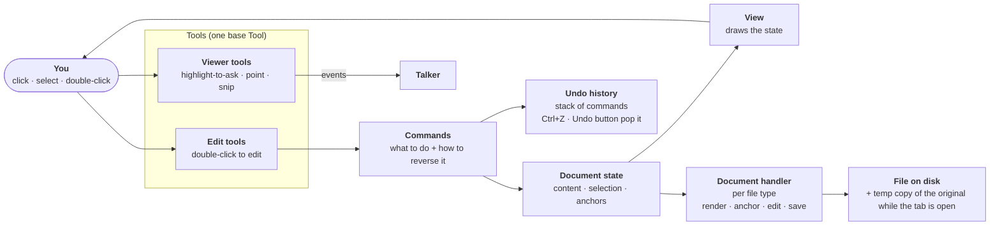
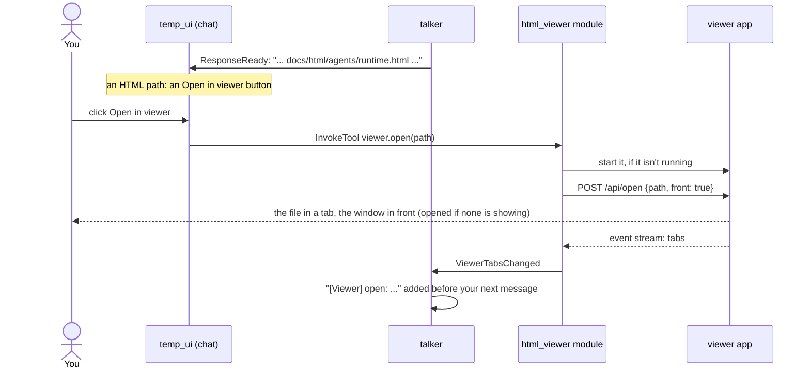
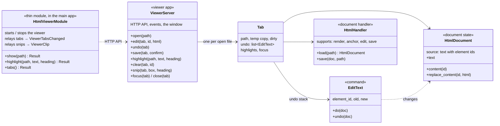

# HTML viewer

> **Status: built (2026-10-27), its own app.** Tabs, double-click to edit, save, undo; write-back to Markdown, highlights, and snip. It's a standalone app (`src/html_viewer`) that the main app launches through the thin `html_viewer` module. What was built and where it differs from the plan: [As built](#as-built-v1). Highlight-to-ask is not built.
**Asked:** "A html viewer. Whenever you want me to view a html file for these edits, I want you to give me a link in the talker chat I can click on. The module itself is a html viewer that can take any html and I can view it." Then: any HTML, especially flowcharts and diagrams like our docs; tabs, with a running tally of what's open that the Talker knows; later, the assistant scrolls to and highlights what it wants to talk about; later (or early if easy), you snip a region as an image or highlight part of a page and hand it to the assistant.

**Why:** the assistant makes and edits HTML (the docs, diagrams, change notes), but today you have to find the file and open it yourself, and the assistant doesn't know what you're looking at.

**What it touches:**
- The viewer app `src/html_viewer/` (`viewer.py`, `document.py`, `markdown_source.py`, `highlight.py`, `snip.py`, `page.html`, with its window from the shared `app_kit.window`), which doesn't import the assistant.
- The thin module `src/assistant/modules/html_viewer/module.py`, with config `[modules.html_viewer]`.
- Events in `src/assistant/contracts/`: `ViewerTabsChanged`, `ViewerClip`, `ViewerClipDropped`.
- `talker` (the `<<SHOW: ...>>` tag, the open-tabs tally, snips with your next message) and `main_assistant` (its prompt).
- `temp_ui` (the "Open in viewer" button; snip thumbnails above the input).
- Docs: [runtime](../agents/runtime.md), the [API](../api/README.md), the [overview](../architecture/README.md#parts), [decisions](decisions.md).

## Scope

| | What |
|---|---|
| **First version** | Open any HTML file in a tab of one viewer window. The Talker offers an "Open in viewer" button in the chat; you click it and the file opens in a new tab (or the viewer window opens first). Tabs can be closed and switched. The viewer keeps the list of open tabs, and the Talker sees it. Diagrams work as in `docs/html` (Mermaid, the click-to-zoom view) |
| **After the architecture is settled** | **Highlight to ask:** select text in a page, click "Ask about this", and the Talker gets the text, the file, and the nearest heading |
| **Built 2026-10-27** | **Write-back to Markdown for built pages:** saving a text edit in a page built from Markdown writes it into the source Markdown too, matched by text. Converting a whole HTML page back to Markdown is rejected because it rewrites the whole file and loses detail. **Highlight** (was "point at a section"): the assistant opens a page and highlights a quoted part; you clear it by clicking it. **Snip:** a button, then drag a box; Edge screenshots it, and the image goes to the Talker with your next message. See [As built](#as-built-v1) |
| **Later** | Highlights inside diagrams (Mermaid nodes); a label on a highlight |

## Architecture: state, commands, view

> Added after you asked for double-click editing, saving, and undo (Ctrl+Z and a button on top). Version 1 is built on it; see [As built (v1)](#as-built-v1).

The same split document editors and game editors like Unity's use: **data, commands, and view stay separate.**

- **Document state is the center.** It's the real data of an open file, like game state or a scene graph: the page's content, plus what's selected. The view only draws the state; it never owns it.
- **Commands are the only way to change the state.** A command is a small object that says what to do and how to reverse it, like a recorded input. "Replace this paragraph's text" is one command.
- **Tools turn your clicks and selection into commands or read-only actions.** One base `Tool` (a toolbar button, activate and deactivate, what it does on click or selection), with two kinds under it:
  - **Viewer tools** only read: highlight-to-ask, point, snip. They send events to the Talker and never change the state.
  - **Edit tools** change the document: double-click to edit is the first. They only ever produce commands.
- **Undo history is a stack of commands**, one per tab. Ctrl+Z and the Undo button both pop it, so they can't disagree. Any edit tool added later gets undo for free.
- **Selection and anchors are part of the state.** An anchor is a stable reference to a spot: the selected text plus its location (nearest heading, position). Highlight, point, snip, and edits all use it.
- **Saving is serialization**, like a save game. A **document handler** per file type loads the file into state and writes the state back: HTML first, Markdown later. Each handler declares what it supports (`render`, `anchor`, `edit`, `save`), and a tool hides when the open file's handler can't do it.
- **Undo history lives in memory only**, for as long as the tab is open. Saving doesn't clear it, so undo still works after a save. Redo, later, is cheap: it uses the same stack.
- **No permanent backups.** As a safety net, each open tab keeps one temporary copy of the file as it was when opened, deleted when the tab closes.

**Generated pages.** Pages in `docs/html` and `docs/html-next-steps` are generated from the Markdown, and a rebuild overwrites them. The viewer lets you edit and save them, and saving writes your text edits back into the page's Markdown source, so a rebuild keeps them. Edits it can't place in the Markdown get a warning first that the next rebuild will overwrite them (see [As built](#as-built-v1)).

## How it fits the design

- **Its own app, with a thin module in the main app** (decided 2026-10-27; see [decisions](decisions.md#decided)). The viewer is a standalone app (`src/html_viewer`, `python -m html_viewer`) that doesn't import the assistant. The hooks go both ways: the main app calls its local HTTP API (open, highlight, tabs), and reads its event stream (tabs and highlights, snips). A thin `html_viewer` module in the main app starts it on the first show request, turns its events into app events, and stops it when the app shuts down. If you started the viewer yourself, the app connects to it and leaves it running.
- **An ordinary tool module, not an agent** ([agents](../architecture/agents.md): "browser, file, or 3D services can stay ordinary tool modules"). It's also one of the "very different modules" [decisions](../architecture/decisions.md#deliberately-deferred) waits for before adding machinery. When the [UI handler](../architecture/decisions.md#open-decisions) is designed, the viewer becomes one of its UIs. Until then it stands alone, so throwing away `temp_ui` doesn't touch it.
- **Has a [`Menu`](../api/modules.md#menu), called with [`InvokeTool`](../api/tools.md#invoketool),** instead of new commands. Tools: `viewer.open(path)` opens the file in a tab (starting the viewer if needed); `viewer.highlight(path, text, heading?)` opens it and highlights a quoted part; `viewer.tabs()` lists what's open and its highlights. When agents can call app tools directly, they're already there.
- **New events only for what's new:** `ViewerTabsChanged(tabs, active, highlights)` when a tab or a highlight changes; `ViewerClip(id, image_path, file, heading)` for a snip, and `ViewerClipDropped(id)` when you drop one before sending.

- **The Main Assistant** writes `<<SHOW: path>>` on its own line, or `<<SHOW: path | "quoted text" | heading>>` to highlight; its `SessionTaskAgent` reads the tag and sends `viewer.open` or `viewer.highlight` as `InvokeTool` (it can also call them through the door). The Talker uses the same tag.
- **Off at launch, on when used:** `html_viewer` isn't in `enabled`; it has `start_on_use = true`, so the first page opened (SHOW, Open in viewer, any `viewer.*` call) turns it on through the core ([start on use](../api/core.md#dispatch_tool)), even if you turned it off. Both prompts say HTML files never open in the default browser.
- **To the front:** your click on Open in viewer sends `front: true`. The viewer finds its Edge window (`raise_window` in [`app_kit.window`](../api/app_kit.md#window), Windows only, ctypes), restores it if minimized, and brings it to the front, borrowing the input of the window in front (`AttachThreadInput`) because Windows keeps a background process from doing that. If the window is gone, it opens a new one at once. Pages an agent opens with SHOW don't take focus.
- **Full paths:** the Talker always writes an HTML file's full absolute path. The button can't find a bare file name: it would look for it in the app's folder.
- **The viewer app:** a stdlib HTTP server on `127.0.0.1:8766` in its own process. It opens in an Edge app-mode window on its own profile. Each tab is an `<iframe>` served from the viewer's own address (same origin), so the edit tool and highlights can reach into the page.

## Reuse: viewer and webview options

| Option | Fit | Verdict |
|--------|-----|---------|
| **Edge app window + our page** (what `temp_ui` does) | No new dependency; renders anything Edge does; tabs are a little custom HTML | **Recommended** for the first version |
| **pywebview** (BSD; WebView2 on Windows) | Native window with a Python ↔ JS bridge; tabs still custom; one more dependency | Later, if the window should feel like an app |
| **Electron / Tauri** | Full apps; a second toolchain | No |
| **mark.js** (MIT) | Highlighting text in a page | Not needed: a few lines of our own do it |
| **html2canvas / modern-screenshot** (MIT) | Snip inside the page; weak on some SVG and cross-origin images | Not used |
| **Edge DevTools protocol** (`Page.captureScreenshot`) | Pixel-exact snips of the viewer window; needs a debugging port on the viewer's own profile | **Used** for snip |
| **Hypothesis client** (BSD) | Full annotation tool | Too heavy for this |

No existing viewer combines tabs, an open-tabs list the app can read, and the hand-to-assistant features, so the shell is ours and the pieces inside are borrowed.

## File access and permissions

- **Any file, anywhere** (decided 2026-10-27): the viewer may read and save any file, with no per-folder restriction. Saving is your own action in the viewer, so it doesn't go through the [permissions handler](permissions.md).
- **Real paths in URLs:** a file is served at `/fs/<its full path>`, so a page's relative links, CSS, images, and scripts work as they do from disk. (The plan had short tokens per file; with "any file, anywhere" decided they protected nothing, and they broke links between pages.)
- Listens on `127.0.0.1` only (a non-local host is refused at start), and refuses other hosts and other origins with [`app_kit.local_guard`](../api/app_kit.md#local_guard): it answers only requests addressed to it (the `Host` header), so a web page can't reach it by DNS tricks, and refuses a browser request from another site's page (its `Origin`); its own pages still work. Every POST must be JSON, which a web page can't send to it without the browser asking first.
- Pages run their own scripts (the docs load Mermaid from a CDN), and same-origin tabs can reach the viewer's address. That's acceptable for your own files. Recommend keeping it that way and not opening web pages from the internet in it.
- **Snip's DevTools port:** the viewer's Edge window listens for DevTools on `127.0.0.1` (a port Edge picks). Any program on this PC could control that window through it, as with any local debugging port. It only ever shows the viewer.

## Decided

1. **Its own app:** a standalone app and window with a local HTTP API and event stream as two-way hooks, launched by a thin `html_viewer` module in the main app (see [How it fits the design](#how-it-fits-the-design)). First its own process inside the app's package; made fully independent 2026-10-27.
2. **Files:** read and save any file anywhere; no per-folder restriction.
3. **In the chat:** an interactive "Open in viewer" button, not a plain link.
4. **Clicking a file that's already open:** switches to its tab, and reloads it if edits were made.
5. **Highlight to ask:** wanted, but only after the architecture is settled; not in the base viewer. (Different from **highlight**, the assistant pointing at a part, which is built.)
6. **Generated pages:** editable; saving into `docs/html` or `docs/html-next-steps` writes text edits back to the Markdown source, matched by text, and warns about edits it can't place (2026-10-27; first a warning only). The viewer doesn't rebuild the docs.
7. **Undo:** in memory only, one stack per tab; no permanent backups; one temporary copy of the original per open tab, deleted when the tab closes. Redo comes later.
8. **Window code:** first shared in `assistant.infra`, then copied into the viewer when it became its own app (`html_viewer/window.py`, which also opens Edge's DevTools port for snip). **Replaced 2026-11-02 ([build it once](principles.md)):** one shared copy in [`app_kit.window`](../api/app_kit.md#window), used by the viewer and `temp_ui`. The thin `html_viewer` module launches the viewer with [`CompanionApp`](../api/app_kit.md#companionapp) and reads SHOW tags with [`agent_tags`](../api/infra.md#agent_tags). All three are built (2026-11-02).
9. **HTML opened through the chat goes to the viewer**, never the default browser. The Talker writes the file's path and the chat shows an Open in viewer button; the Main Assistant writes `<<SHOW: path>>`, and its `SessionTaskAgent` sends `viewer.open`, which turns the module on and starts the viewer if needed.
10. **Focus** (2026-10-28): only your click on Open in viewer brings the viewer to the front. Pages an agent opens on its own stay in the background. Agents write full absolute paths, never bare names.
10. **Highlights** (2026-10-27): the assistant quotes the page's words (plus an optional heading); several can be on a page and stay until you clear them; no labels; page text only, not inside diagrams.
11. **Snip** (2026-10-27): Edge's own screenshot of the box (DevTools), so diagrams come out exactly; up to 3 snips wait for your next message; thumbnails above the chat input, each with an × to drop it.

## As built (v1)

Code: the app `src/html_viewer/` (`viewer.py` server and API, `document.py`, `markdown_source.py`, `highlight.py`, `snip.py`, `page.html`; its window comes from `src/app_kit/window.py`); the thin module `src/assistant/modules/html_viewer/module.py`, built on `app_kit.CompanionApp`. Config: `[modules.html_viewer]` (`host`, `port` 8766, `window`, `generated`, `start_timeout`). Run the viewer alone with `python -m html_viewer [files...]` (or `html-viewer`, after `pip install -e .`). It doesn't import the assistant; `tests/test_html_viewer.py` tests both.

**Where state lives:** the document state, the undo stacks, and the highlights are in the viewer app (Python), one per tab. The page in the window is only the view: it draws the tabs and each tab's state, and sends your actions as commands. So undo and saving don't depend on the page, and they're tested without a browser.

- **Anchors:** loading a file gives every element an id (`data-hv-id`) in the state. The view shows that state, so a double-click in the page names the element by its id, and an edit replaces only that element's content in the file's text. Saving strips the ids; everything you didn't edit is written back byte for byte (line endings, entities, scripts).
- **What double-click edits:** text blocks: paragraphs, headings, list items, table cells, and similar. Code blocks, Mermaid diagrams, SVG, and form fields aren't editable. Enter or clicking away keeps the edit; Esc drops it. An element closed implicitly in the file (a `<li>` without `</li>`) can't be edited.
- **Opening a file that's already open** switches to its tab, and reloads it if the file changed on disk. If the tab has unsaved edits, it doesn't reload; the page offers "Reload (drop my edits)" instead.
- **Links** in a page to another local HTML file open in a new viewer tab; links to the web open in a new window.
- **The window:** opens when a file is opened and no viewer page is showing. Closing it doesn't close the tabs: they're still there, with their unsaved edits and undo, when it opens again. The Talker's tally still lists them while the window is closed.
- **Write-back to Markdown** (`markdown_source.py`): saving a page in a `generated` folder first finds its source from the page's `<!-- Generated from docs/... -->` line. For each element edited or undone since the last save, it looks for the one Markdown block (heading, paragraph, list item, table cell; code fences skipped) whose rendered text equals the element's old text, and replaces only the changed words in it, growing the match with unchanged text until it's unique. A change at the very start or end of a block goes at the block's edge. Then it writes the Markdown, then the HTML. No match, two matches (repeated table cells are common), or a change across bold or a link: that edit isn't written to the Markdown, and Save warns first, listing it. No source found: the old overwrite warning. The viewer doesn't rebuild the docs.
- **Highlights** (`highlight.py`, and `findQuote` in `page.html`, with the same rules): page text only (no scripts, styles, SVG, Mermaid); the quote's words in order, any whitespace between, case ignored; a heading narrows it to that heading's section and is ignored if no heading matches. The viewer app checks the quote is there (`found`, `matches`) and keeps the highlight in the tab's state; the page draws it as a blue `<mark>` with white text (`#2f5fa8`, readable on dark and light pages) over the first match and scrolls to the newest one (`focus` in the tab's state, so a window opened later still scrolls). The marks are never in the document: the edit tool removes them before an edit, and they're drawn again after. After an edit, undo, or reload, a highlight whose text is gone is dropped. Click a mark: **Clear** or **Clear all**. Double-click still edits.
- **Snip** (`snip.py`): **Snip** on the toolbar (or Ctrl+Shift+S) dims the tab; drag a box, Esc cancels. The page hides the overlay, then the viewer app asks Edge, through the window's DevTools port, for a screenshot of exactly that box. The PNG goes to the viewer's temp folder and out as a `snip` event, with the nearest content heading above the box (sidebars and sticky bars skipped). The thin module copies it to the launch's log folder (`snips/`) and publishes `ViewerClip`. The Talker keeps up to 3 and sends them as images with your next message, each with a `[Viewer] snip from <file>, near "<heading>"` line. The temp UI shows them as thumbnails above the input, with an × (`ViewerClipDropped`). Needs `window = "app"`; otherwise snip says why.
- **Not built:** highlight-to-ask, highlights inside diagrams, redo, opening Markdown files.
