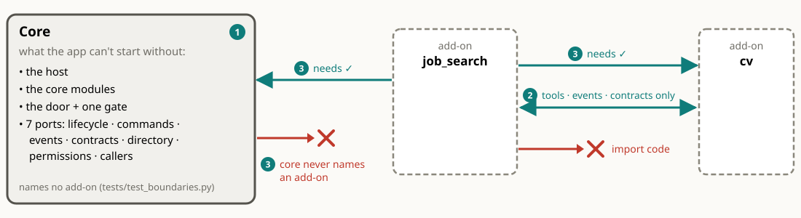
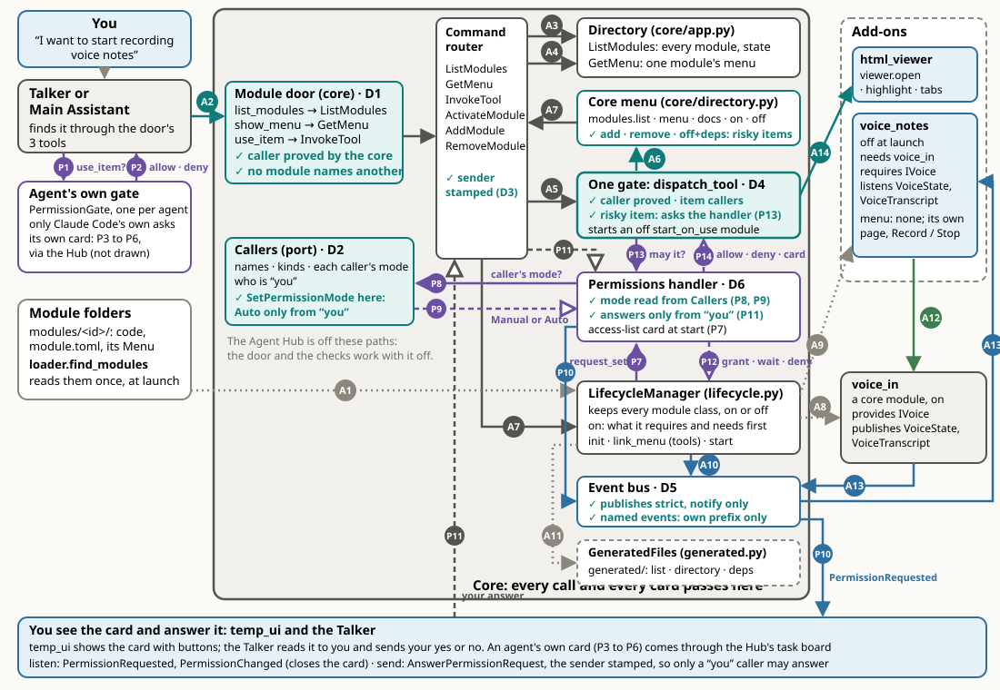
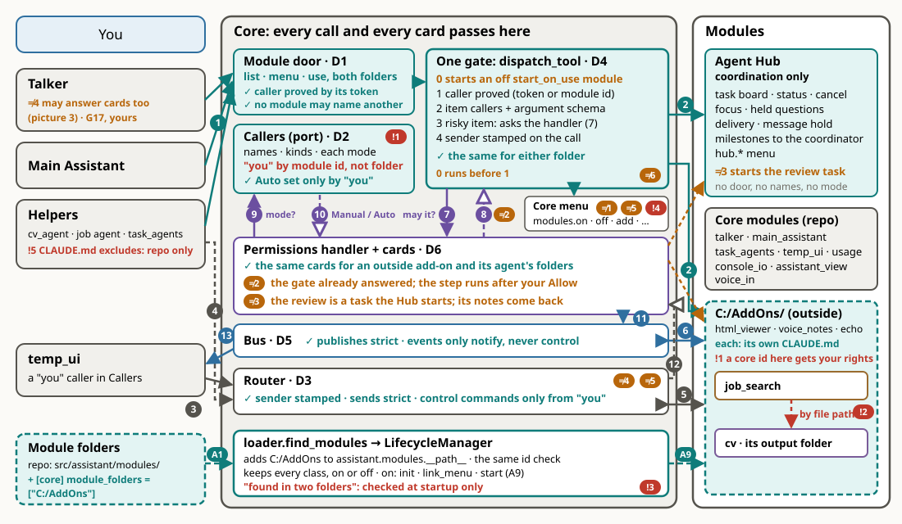

# Modules

This page covers what a module is, how its folder is laid out, how the core finds it, turns it on and reaches it, and the rules that keep the core and the add-ons apart. The core's side (the host, the router, the gate, the bus) is on [core](core.md), and the messages are on [communication](communication.md). Every module's interface, side by side, is in the [module library](module-library.md). Back to the [overview](README.md).

## A module is a wrapper with a menu

Every module has the same **wrapper**, owned by the core, and inside it a **menu** of what it can do.

| Part | What it is |
|------|------------|
| **Manifest** | Its id and a one-line `description`. The contracts it `provides`, `requires`, uses if present (`optional`) or looks up at each call (`uses`). The modules it `needs` and the pip `packages` it uses (both from its `module.toml`). The commands it `handles` and `sends`, the events it `publishes` and `listens` to, the named events it `publishes_named` and `listens_named`, and its permissions ([`Manifest`](../api/modules.md#manifest)) |
| **Lifecycle** | [`ModuleProtocol`](../api/modules.md#moduleprotocol): `init`, `start`, `stop`, `busy`, `export_state`. The core starts, stops and reloads it |
| **Context** | `ctx`, its only access to the app: commands, events, contracts, config, log, logs, permissions ([`ModuleContext`](../api/modules.md#modulecontext)) |
| **Menu** | A [`Menu`](../api/modules.md#menu) part on the module: named items, each with a one-line description and its inputs (`ToolSpec`), readable without starting the module. While the module is on, the core links the menu to the running copy in its own menu table, and [the gate](core.md) routes `InvokeTool` to it |

- **The wrapper is ours only.** Every module has the same one, so the core can start, stop, swap and list any module without knowing what it does.
- **The manifest is checked as the module runs.** `handles` is strict: `ctx.handle` for an unlisted command raises, and the module fails to start. `sends` and `publishes` are strict: an unlisted send is refused and an unlisted publish is dropped, both logged as errors. Listening and named publishing are loose: an unlisted subscription, lookup or named event still works and is logged once ([who may send what](communication.md)).
- **The menu is MCP-like:** a list of tools a model can read and call, each with a description and an argument schema. It isn't MCP itself. The agents reach every menu through [one MCP door](#how-the-agents-reach-the-menus-one-door) in front of the core, and modules never serve MCP.
- **A menu can be empty.** `voice_in` and `voice_notes` offer contracts, commands and events, not tools.

## The module folder

A module is one folder, `src/assistant/modules/<id>/` (or in an [outside folder](#module-folders-outside-the-repo)), named with its manifest id. Everything of the module is in it, so deleting the folder leaves nothing behind except your own (gitignored) choices in `config/`.

| In the folder | What it holds |
|---------------|---------------|
| `__init__.py` and the code | Exports exactly one `ModuleProtocol` class |
| `module.toml` | Its config defaults, its `needs` and its `packages`. Every module folder has one. Your `config/<id>.toml` overrides the defaults key by key ([configuration](core.md#configuration)) |
| `app/` | Its companion app, if it has one (cv's CV Tool, html_viewer's viewer, voice_in's voice service). `app/` is no package: the core puts it on the import path, found by folder, so the app keeps its own import name and never imports the module |
| `tests/` | Its tests. They import only `assistant.testkit`, never the central `tests/` |
| `docs/` | Its pages and `docs.toml`, whose `group` says core or add-on ([module pages](module-library.md#module-pages)) |
| `workspace/` | The working folder of its agent (cv, job_search), gitignored. Your documents and outputs live there unless `config/<id>.toml` names a data folder outside the repo ([agents](agents.md)) |
| `ruff.toml` (optional) | Its own lint exceptions (cv). It starts with `extend = "<path to the root pyproject.toml>"`, so the root settings still apply |

`static/` (temp_ui's page files) and other folders are the module's own business.

**Tripwire:** `test_nothing_of_an_add_on_is_outside_its_folder` in `tests/test_module_folders.py` checks each add-on: its app is in `app/`, its `needs` and `packages` are in its `module.toml` and reach its manifest, nothing of it is in `pyproject.toml` or committed `config/`, its tests are in its `tests/`, and its agent's workspace is in its folder. `test_every_module_folder_has_its_module_toml` checks every module.

## The three rules

Grey: the core and the core modules. Dashed: an add-on. The numbers are the rules:

1. **The core is what the app can't start without, plus its ports:** the host, the core modules (`group = "core"` in their `docs/docs.toml`), the module door and its one gate, and the seven ports (lifecycle, commands, events, contracts, directory, permissions, callers). Every other module is an add-on.
2. **Modules talk only through tools, events and contracts** (`assistant.contracts`), never by importing each other's code. Shared helpers are `assistant.infra` and `app_kit`. How each way passes through the core: [how modules talk](core.md).
3. **Arrows point one way:** an add-on may need the core or another add-on, and the core never names an add-on.

Why: the core stays small and stable, and an add-on can be added, replaced or deleted with no change anywhere else.

**The tests that check them.** They catch a break only when pytest runs.

| Test | Checks |
|------|--------|
| `tests/test_boundaries.py` | A module imports only `assistant.contracts`, `assistant.infra`, `app_kit`, its own package and its own `app/` packages. The shared code (`core`, `contracts`, `infra`, `app_kit`) imports no module. `config/default.toml` and the core modules' `module.toml` name no add-on. A core module `needs` only core modules, and no `needs` makes a cycle. The core group starts alone, and the shipped on-list turns on no add-on. A module in an outside folder is an add-on, and no id is in two folders. Each check also runs on a planted bad tree, to prove it catches a break |
| `tests/test_module_folders.py` | No core code names an add-on's id or its menu items (`test_no_core_code_names_an_add_on`). Each add-on is whole in its folder (the tripwire above). The config files hold your choices only, and `generated/` is gitignored |
| `tests/test_module_docs.py` | Every module has its docs and a [module library](module-library.md) row, and the library is fresh |

The tests number the rules their own way (their rule 1 is imports, rule 2 is "core settings name no add-on", rule 3 is "core needs only core"). They check the same line.

### The needs arrows point one way

No core module, and no code in the core, `contracts`, `infra` or `app_kit`, names an add-on's id or its menu items. When the core group wants something an add-on does, it asks for a **slot**: a contract in `assistant.contracts` that an add-on fills ("plugs in"), looked up at each call (`uses`, no start order). With nothing plugged in, the caller says so plainly.

- **Opening a page:** the Talker's and the workers' SHOW tags and temp_ui's Open in viewer button go through [`IPageOpener`](../api/modules.md#ipageopener), with [`open_page` / `show_page`](../api/infra.md#show_page). `html_viewer` fills it while it's on. With none on, the answer is "No page viewer is on".
- **Start on use, by contract:** with no provider on, `open_page` sends [`StartProvider`](../api/control.md#startprovider)`("IPageOpener")`. The core turns on the module that declares the contract in `manifest.provides` and has `start_on_use = true` in its config. No module is named anywhere on the way.
- **Hearing an add-on's named events by name is allowed** ([chaining modules](#chaining-modules)): the Talker and temp_ui listen to `html_viewer.tabs_changed` and `html_viewer.clip` by name, with no import, and nothing breaks when nobody publishes them.

## Find a module, then open its menu

The Talker, the Main Assistant and every other agent find what to use the same way: first a **directory** with one line per module, then the **menu** of the one module they need, then a call. They never see every tool at once, and no agent has another module's tools written into it.

1. **List modules:** `ListModules`, the directory: one line each, from each manifest's description, with its state.
2. **Give me its menu:** `GetMenu(id)`: that module's `ToolSpec`s only, read from its class, so it works while the module is off.
3. **Call an item:** `InvokeTool(name, args)`, through the gate to the module that offers it. A module that is off answers "isn't on", unless it starts on use (below).

Grey: the core, a core module or an agent. Dashed: an add-on. Teal: the part the picture is about; in the core, a part that checks. Blue: you, and where you see things. Arrows: teal is a tool call, grey a command through the router, blue an event on the bus, green a contract call, dotted grey the core's own call (no message). Purple solid with a filled head is a permission question; dashed with a hollow head is an answer, in any colour. ✓ marks a check the core makes. D1 to D6 are the core's parts ([inside the core](core.md)).

The picture follows voice_notes, an add-on, from "I want to start recording voice notes" to its first event:

| # | What happens | What is checked |
|---|--------------|-----------------|
| A1 | At launch, `loader.find_modules` takes every module folder. The `LifecycleManager` keeps every module class, on or off | Each folder must export one module class whose id is the folder's name |
| A2 | The agent calls the door's tools: `list_modules`, `show_menu`, `use_item` | The caller is proved by the core; no module may name another; this works with the Hub off |
| A3, A4 | Router → directory: `ListModules` finds voice_notes, off. `GetMenu("voice_notes")` shows an empty menu (its page has the Record button) | Read-only; the sender is stamped |
| A5, A6 | `use_item("modules.on")` becomes `InvokeTool` → the gate → the core menu's `modules.on` | The caller is proved, and the item's `callers` are checked; a risky item asks the permissions handler (P13) and gets allow, deny or a card back (P14) |
| A7 | The core menu sends `ActivateModule` through the router to the `LifecycleManager` | Sent as `core` |
| A8 | The `LifecycleManager` first turns on what voice_notes requires and needs: the provider of `IVoice`, and `voice_in` | voice_in is on from launch, so nothing more happens. Two providers of one contract are refused, and you pick one |
| A9 | It starts voice_notes: `init`, `link_menu` (its tools, if any), then `start()`, where it subscribes | A module with an access list asks its card here (P7 to P12); voice_notes has none |
| A10 | The core publishes `ModuleStateChanged` (starting, active) for the UIs | `publishes` is strict |
| A11 | `GeneratedFiles` writes `generated/` on every state change | A copy for people and the docs; nothing reads it to decide |
| A12 | On Record, voice_notes calls voice_in through the contract: `IVoice.listen(…)` | Contract calls aren't gated. voice_in's microphone ask only logs (a known gap, [permissions](permissions.md)) |
| A13 | voice_in publishes `VoiceState` and `VoiceTranscript`; voice_notes gets them | `publishes` is strict; voice_notes lists both in `listens` |
| A14 | Any later tool call to an add-on (here `viewer.open`) goes door → router → gate → its item | The same checks as A2 and A5, from an agent or from a module's code |
| P1, P2 | The agent asks its own gate "use_item?" and gets allow or deny | Only Claude Code's own asks: `use_item` asks in Manual for task agents. The Talker has no gate of its own; its calls pass the core's gate like any other |
| P3 to P6 | An agent's own card, through the Hub's task board (not drawn) | Its `ReportTask` and `AnswerPermission` carry a sender |
| P7, P12 | A module starting asks for its access list (`request_set`); the handler answers with the grant, a wait on the card, or a deny | Asked once, at start; none in Auto |
| P8, P9 | The handler asks Callers for the caller's mode and gets Manual or Auto | Read in the core, so it works with the Hub off; only "you" can set Auto |
| P10 | The handler publishes the card, `PermissionRequested`; it reaches you in temp_ui and the Talker | `publishes` is strict |
| P11 | Your answer, `AnswerPermissionRequest`, goes through the router to the handler | The sender is stamped; only a "you" caller may answer (or the Talker as a relay: an open decision, [permissions](permissions.md)) |
| P13, P14 | The gate asks the handler "may it?" for a risky item (`modules.add`, `modules.remove`, `modules.off` with dependents, and so on) and gets allow, deny or "card" | Asked once, from an agent or from code. In Auto it is allowed with no card, except risky core-menu items, which always card. The gate doesn't wait for your answer |

### The core's menu

The core has a menu of its own under the id `core`, so anything that can call a menu item can also find modules and turn them on or off:

| Item | Does | Asks you first |
|------|------|----------------|
| `modules.list`, `modules.menu` | The directory and one module's menu | no |
| `modules.docs` | A module's own docs pages: each page's title and path | no |
| `modules.on` | Turns a module on, with what it requires and needs | no; the module's own access card still shows (in Manual) |
| `modules.off` | Turns a module off. Never refused: the modules that need it stay on, and the reply names them. `with_dependents` turns them off first | only with `with_dependents` true |
| `modules.reload` | Swaps a module's code ([hot swap](#hot-swap)); `now` cuts in if it's busy | always |
| `modules.add` | Loads a module that wasn't there at launch, and turns it on | always |
| `modules.remove` | Takes a module out of this run ([turning modules on and off](#turning-modules-on-and-off)) | always |
| `permissions.grants`, `permissions.grant`, `permissions.request`, `permissions.revoke` | The saved access grants ([permissions](permissions.md)) | per [permissions](permissions.md) |

- **The ask mark is on the item** (`ask="always"`, with `ask_when` naming a boolean argument). `dispatch_tool`, the one gate, reads it and shows a `confirm` card, even in Auto, because these steps load code or take a module away. Only a "you" caller (a UI you click in, `[core.permissions] you`, temp_ui) runs them at once. An item marked `ask="risky"` skips the card for a caller in Auto ([risky steps](permissions.md)).
- **Good to know:** `modules.off` without dependents shows no card, and the core menu sends the `DeactivateModule` as `core`. So from any agent it isn't held to "control commands only from you".

### How the agents reach the menus: one door

The agents are `claude` sessions, and MCP is how a `claude` session calls tools in the middle of a reply. So the app serves **one MCP server, the door**, in front of the core. It has three fixed tools that map onto the three steps above: **list modules**, **show a menu**, **use an item**. Everything behind it is our own wrapper: the directory, the router, the gate and the permission check.

- **How a call travels:** the door is a small **stdio relay** that `claude` starts itself (`python -m assistant.infra.mcp_door`, from the session's `--mcp-config`). It passes each call over local HTTP, with a token, to the `DoorServer` the core hosts (`core/door.py`, `[core.door]` in config). That server sends `ListModules`, `GetMenu` or `InvokeTool` through the router, with the caller the token proved. Agents and module code share one path: router, then gate. The core offers the door as the [`IModuleDoor`](../api/tools.md#imoduledoor) contract.
- **The door is the core's** ([decision D1](decisions.md)). It opens before any module starts, so every agent's first session has it, and reloading a module (the Hub too) doesn't touch it.
- **A module gets a config only for itself or its agents.** Its `ctx.get_one(IModuleDoor)` is a door bound to its id: `mcp_config(caller)` answers only when `caller` is the module or an agent id it claimed in the core's Callers port. Anyone else gets a warning in the log and `{}`.
- **Menus aren't in the DI container.** The core keeps them in its own table (`MenuTable`), so no module can call a menu as a plain `IToolProvider` and name its own caller. A module's own `InvokeTool` always has the module as its caller.
- Agents, other modules and UI buttons all reach a module the same way, through the core ([how modules talk](core.md)).

| | **One door** (chosen) | **A door per module** |
|---|---|---|
| Directory: one line per module, then one menu | Kept | The agent sees every tool at once |
| Permissions: one check, your "Allow?" card | Kept, for every caller | Only the agent's own allow-list; buttons and modules unchecked |
| Module to module (job_search → cv) | Kept | No path between doors, or glue per pair |
| Hot swap (hand over state, wait while busy) | Kept; the agent's three tools never change | Each door just stops and starts; the agent's tool list changes |
| The agent calls mid-reply | Yes | Yes |

### Why not plain MCP?

Plain MCP here means an MCP server per module, each offering its tools to the agents directly. We chose one door for control. It wasn't because MCP can't change its tools: our test on Claude Code 2.1.318 showed that a running session follows tools added or removed when the server sends `list_changed`.

- **Per-module servers would go around the core.** Each would face only the agent. It would skip the permission check, the module directory, the links between modules (`requires`, events), and hot swap in one process (handing over state, waiting while busy).
- **Callers that aren't agents need the same checks.** The mic button, the viewer and other modules reach a module through commands, events and contracts. An MCP server would serve only the agents, so these callers would need a second path.
- **The agent's context stays small.** The door has three fixed tools, so it doesn't grow with every module that's on. They never change on a swap, so no `list_changed` notice is needed. In the test, a tool added without a notice was never seen, and a removed one stayed listed until a call failed.
- **MCP is still used.** The door is an MCP server (`assistant.infra.mcp_door`). An outside tool that already speaks MCP gets a module that is an MCP client of it and offers the tool's list on its own menu. cv does this for Rezi: its `rezi.*` items call Rezi's MCP server (`cv/mcp.py`). A module never serves MCP itself.

**What plain MCP would replace:** only the list, menu and call steps; the agent would see each tool directly. **What it wouldn't:** events, commands and contracts between modules; callers that aren't agents; hot swap inside the app; one permission check for every caller; the module directory; and the Agent Hub's coordination (task board, focus, held questions, message delivery).

## Found by folder

- **A module is its folder:** `src/assistant/modules/<id>/`, with the folder name equal to the manifest id. Its `__init__.py` exports exactly one `ModuleProtocol` class.
- **The core scans the folders once, at launch** (`find_modules()` in `core/loader.py`; `__main__.py` names no module) to know which modules are available. `config/modules.toml` says which start. Folders starting with `_` are ignored.
- **A bad folder is skipped and logged:** one that fails to import, exports no module class or two, or has an id that isn't the folder's name. The other modules still load. If it was on the on-list, startup then fails with "Enabled modules not found".
- **Adding a module is adding a folder,** then `modules.add` with `assistant.modules.<id>` while the app runs, or a restart. `modules.add` refuses a folder named differently from its id, a package that is already loaded ("use ReloadModule"), and an id that already exists.

### Module folders outside the repo

`[core] module_folders` (in `config/local.toml`) names more folders that hold module folders, outside the repo, such as `["C:/AddOns"]` with `cv/` inside. It is empty by default.

The legend is the same as in the picture above. Arrows 1 to 13 and the ≠ marks are those of the [inside of the core](core.md). Red marks are the known gaps below.

- **Found the same way.** At launch the loader appends each folder to `assistant.modules.__path__`, after the repo's, so a module there keeps the import name `assistant.modules.<id>`. `loader.find_modules` then takes every sub-folder with the same id check. The `LifecycleManager` keeps every class, on or off, and starts one with `init`, `link_menu` and `start` (A1, A9).
- **Reached the same way.** An add-on in an outside folder gets its tool calls through the same door and gate, and its cards through the same permissions handler. It uses the same Callers, router and bus, and its agent's folder grants go on the core's own access card. There is no separate path.
- **Absolute paths only.** A path relative to the current folder is refused, because the core may run on a server where the current folder means nothing.
- **An id in two folders stops the startup** (`LoadError`): a module is never shadowed by another copy.
- **The core group stays in the repo.** A module outside the repo must be an add-on.
- **Folders are read at launch.** A module added later with `modules.add` must already sit in a folder named at launch.

**Known gaps:**

- **!1 "You" is trusted by module id, not by folder** (`core/callers.py`, `[core.permissions] you`). A module in an outside folder named like a core module (`temp_ui`, say) would get your rights. The loader doesn't refuse it. Only `tests/test_boundaries.py` (`outside_core`) catches it, and only when pytest runs.
- **!2 job_search reads cv's output by file path, not through a tool.** The job project's `cv_output` link in its paths file points into cv's workspace, past the door, so wherever cv's workspace sits, the link has to point there ([job_search](../../src/assistant/modules/job_search/docs/README.md)).
- **!3 The "found in two folders" check runs only at startup** (`loader.add_module_folders`). A module added later with `modules.add` isn't checked.
- **!4 The `modules.add` card doesn't show which folder the code comes from.** It shows the item and its arguments only.
- **!5 The CLAUDE.md exclude list covers only the repo's files.** An agent working under an outside folder may load a CLAUDE.md from a parent folder there ([agents](agents.md)).

## Turning modules on and off

- **On:** `modules.on` (`ActivateModule`) turns on what the module requires and needs first ([dependencies](#dependencies)), then runs `init`, `link_menu` and `start`. A module with an access list asks its card at start (in Manual).
- **Start on use:** a tool call to an off module, or a `StartProvider` for a contract, turns that module on by itself only if its config says `start_on_use = true` (html_viewer). Otherwise the call answers "The <id> module isn't on…", and the agent asks you before it uses `modules.on`. **Good to know:** the gate starts an off `start_on_use` module before it checks the caller, so a caller who may not use the item can still switch the module on.
- **Off:** `modules.off` (`DeactivateModule`) is never refused. The modules that need or require it stay on and cope without it, and the reply names them. `with_dependents` turns them off first, after your yes on a card.
- **Add:** `modules.add` (`AddModule`) loads a module that wasn't there at launch, imports it fresh and turns it on (unless `activate` is false). It asks first, even in Auto, because it runs new code.
- **Remove:** `modules.remove` (`RemoveModule`) takes a module out of this run, after your yes on a card. It is never refused: the modules that need it stay on, and the reply names them. `settings` is `keep` (delete nothing) or `purge` (delete only `config/<id>.toml` and `config/<id>.local.toml`). It never deletes the module's folder and never edits `config/modules.toml`. The reply says what is left to you. `modules.add` brings it back.
- **Reload:** [hot swap](#hot-swap).

The core-side detail (the lifecycle manager, the order at startup and shutdown) is on [core](core.md#lifecycle).

## Dependencies

- **`requires` lists contracts, never module ids** ([principle 2](principles.md)). The core starts the provider first: in dependency order at startup, and at runtime `ActivateModule` activates the sole provider first. With two possible providers, it refuses and asks you to turn one on. Turning a provider off is never refused.
- **`needs` lists module ids** in `module.toml`: the modules this one can't run without. Only voice_notes has one (`needs = ["voice_in"]`, next to `requires IVoice`). Every other module has `needs = []`. A module that works on its own and only chains to another for one step doesn't list it (job_search and cv, below).
  - **`needs` is start order only.** Turning a module on turns on what it needs first, at startup too, even if the on-list doesn't name it. A needed module that fails doesn't stop it. Turning off or removing a needed module leaves the modules that need it on.
  - A needed id that doesn't exist is refused by name (at startup a `StartupError`, at runtime `not_available`). A cycle is refused.
  - A core module may need only core modules (rule 3). All the core modules' `needs` are empty, so each runs alone.
  - **Why both `needs` and `requires`:** `requires` is about code (which contract it calls), and `needs` is about running (which module must come up first). The code still talks to the other module only through contracts, its menu and named events.
- **`optional`** contracts are used if some module provides them, and the module copes without them. **`uses`** contracts are looked up at each call with no start order (the slots above).
- **`packages` lists its pip packages** in `module.toml` (cv: `pymupdf`, `pypdf`, `mcp`, `httpx2`; voice_in: the voice service's). The core reads them into `Manifest.packages`, but nothing installs them: install them by hand with pip from that list. `pyproject.toml` holds only the app's own packages and the `dev` extra. cv's `tests/test_packages.py` checks that every import is listed.
- **On-demand chaining** ([decisions](decisions.md)): a module may turn on the add-on it chains to at the moment it needs it, with [`ActivateModule`](../api/control.md#activatemodule). The core still asks that module's access card (in Manual), and the reply comes back as the other module's named events. Example: job_search's `job.tailor_cv` turns cv on at the CV step, sends `cv.task` for its agent (allowed by cv's `[hand_off] modules`), and hears `cv.job_finished`. If cv can't come on, job_search tells its agent, which asks you whether to use the base PDF untailored. Why not `needs`: job_search works without cv for everything else.
- **Voice:** `voice_in` provides the voice contract [`IVoice`](../api/messaging.md#ivoice), and voice notes requires it. Turning voice notes on turns `voice_in` on first. `voice_in` can still be turned off: voice notes stays on and says "voice input is off" at Record. Any other module that provides `IVoice` can replace `voice_in`.

## Chaining modules

Modules are combined through what they declare, with no glue code between pairs. The three ways (a tool call, a command and an event), each through the core, are drawn on [core](core.md) (how modules talk).

- **Listen to events.** A module uses another's output by subscribing to the events it announces. voice notes listens to `VoiceTranscript`; it never imports `voice_in`.
- **Call commands or menu items.** For an action with a result, through the core (`InvokeTool`, `DeliverMessage`).
- **Call a contract.** For a shared service: voice notes calls `IVoice.listen(session_id, VoiceDestination.CALLER)` with an id it made, so the words go only to its page, never to the Talker, and it follows only its own sessions. Contract calls are direct, not gated.
- **Share a service through sessions, not copies.** A shared service runs once and serves several users. Each user starts a **session** and says where the result goes (its **destination**), and the service keeps them apart by session id. Why: two copies of `voice_in` would fight over the one mic and load the speech engine twice. There is one mic, so the voice service takes one session at a time. The temp UI's mic button uses `StartListening`, whose `send_as_input` says whether the Talker gets the text ([voice](../../src/assistant/modules/voice_in/docs/voice-service.md#a-shared-service)).
- **Keep message shapes general.** Reuse a shared event before adding a new type, because a new type is a contract change and needs a restart. A module's own event is a **named event** instead ([`ModuleEvent`](../api/messaging.md#moduleevent)): `ctx.publish_named("cv.job_finished", data)` under its own id, and `ctx.subscribe_named("cv.job_finished", handler)` (or `cv.*`) on the other side. `ctx.unsubscribe(handle)` drops one subscription at any time. There is no class and no restart, and either side reloads on its own ([decided](decisions.md)). **Modules talk to each other through named events; a tool is only for a call out.** Example: the job agent calls `job.tailor_cv`. The job module turns cv on at that moment and sends `cv.task` for its agent. cv publishes `cv.job_finished` when its worker ends and `cv.job_submitted` at your Submit, and job_search subscribes and wakes its agent.

## Hot swap

A module's code is swapped while the app runs. `modules.reload` (`ReloadModule`) waits until the module isn't `busy()` (or cuts in with `now`), stops it, imports its package fresh, and starts a new instance with what the old one's `export_state` handed over. If the new code fails, the old code runs again. `modules.add` loads a module that wasn't there at launch.

Changes to the shared code (`assistant.core`, `contracts`, `infra`, `testkit`, `app_kit`) or `__main__`, and a new contract, still need a restart, because every module holds the same classes from them. Details: [reloading a module's code](core.md#reloading-a-modules-code).

## Not built yet

- **Installing a module's `packages`:** they're listed, not installed; install them by hand with pip.
- **Parallel voice sessions:** the voice service takes one listener at a time.
- **Generated data types:** the [module library](module-library.md)'s data types table is still hand-written.
