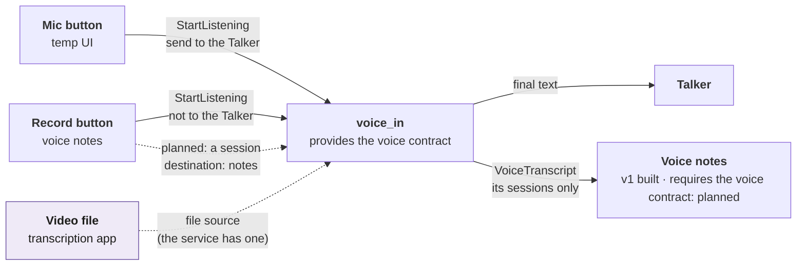

# Modules

How a module is shaped, how the assistants find what it can do, and how modules work together. The core's side is in [core](core.md); the messages are in [communication](communication.md). Each module's own page, and every module's interface side by side: the [module library](module-library.md). Back to the [overview](README.md).

> **Status: decided 2026-11-04, mostly planned.** Built: the wrapper (manifest, lifecycle, context), a menu through `IToolProvider` (the HTML viewer's), `requires` by contract, and reloading a module while the app runs. Planned: the one-line description, the directory, both assistants using it, finding modules by folder, a voice contract, and voice sessions. Each item: [Built and planned](#built-and-planned). The build plan is the module-shape change note (`docs/next-steps/module-shape-refactor.md`).

## A module is a wrapper with a menu

Every module has the same **wrapper**, owned by the core, and inside it a **menu** of what it can do.

| Part | What it is | Built? |
|------|------------|--------|
| **Manifest** | Its id, a one-line description, the contracts it provides, requires, and optionally uses, the events it announces, the commands it handles, its permissions | Id, contracts, permissions: built. Description, events, `handles`: planned |
| **Lifecycle** | `init`, `start`, `stop`, `busy`, `export_state`; the core starts, stops, and reloads it | Built |
| **Context** | `ctx`, its only access to the app: commands, events, contracts, config, log, permissions | Built; `ctx.logs` planned |
| **Menu** | Named tools, each with a one-line description and its inputs (`ToolSpec`), offered through `IToolProvider` and called with `InvokeTool` | Built; only the HTML viewer has one (`open`, `highlight`, `tabs`) |

- **The wrapper is ours only.** Every module has the same one, so the core can start, stop, swap, and list any module without knowing what it does.
- **The menu is MCP-like:** a list of tools a model can read and call, with a description and an argument schema each. It isn't MCP itself; an MCP bridge could expose menus later.
- **A menu can be empty.** `voice_in` offers commands (`StartListening`, `StopListening`) and events, not tools.

## Find a module, then open its menu

Both the Talker and the Main Assistant find what to use the same way: first a **directory** with one line per module, then the **menu** of the one module they need, then a call. They never see every tool at once, and no agent has another module's tools written into it.

Colors in the pictures: solid lines are built today, dashed orange is planned. Blue is a module's wrapper (ours only), yellow its menu (MCP-like), purple the core, faded grey the old way.

### Before the refactor (November 2026)

One shortcut to one module. The Talker turns its SHOW tags into the viewer's `viewer.open` / `viewer.highlight`; the Main Assistant can't call module tools at all, so the viewer watches its SHOW tags instead. The core keeps a flat list of tools, with no directory and no one-line descriptions.

### Step by step (planned)

1. **List modules** (planned): the directory, one line each, from each manifest's description.
2. **Give me its menu** (planned): that module's `ToolSpec`s only.
3. **Call an item** (built): `InvokeTool(name, args)`, routed to the module that offers it.

Asks 1 and 2 are new core asks: an extended `ListModules` or new commands, decided at build time. How the Main Assistant sends them (tags in its reply, or one generic tag) is [open](decisions.md#open-decisions).

### What changes

Each manifest gets a one-line description, the core gets the two asks, and both assistants use them instead of hardcoded tags. All of it is planned and needs an app restart (it touches the core and contracts).

## Chaining modules

> **Status:** events between modules are built (`voice_in` publishes `VoiceTranscript` and `VoiceState`; voice notes v1 listens to them). The voice contract and voice sessions are planned.

Modules are combined through what they declare, with no glue code between pairs:

- **Listen to events.** A module uses another's output by subscribing to the events it announces. A voice-notes module listens to `VoiceTranscript`; it never imports `voice_in`.
- **Call commands or menu items.** For an action with a result, through the core (`StartListening`, `InvokeTool`).
- **Share a service through sessions.** A shared service runs once and serves several users. Each user starts a **session** and says where the result goes (its **destination**); the service keeps them apart by session id. Two copies of `voice_in` would fight over the one mic and load the speech engine twice.
- **Keep message shapes general.** Reuse a general event (for example a text stream carrying its source and destination) before adding a new type per use: a new type is a contract change and needs a restart. How general is [open](decisions.md#open-decisions).

Solid: built (the mic button's flow, and voice notes v1, which follows its own sessions by the `StartListening` id; see [voice_notes](../modules/voice_notes.md)). Purple, dashed: planned. Today the voice service takes one listener at a time (a second `start` gets `busy`) and `StartListening` only chooses whether the Talker gets the text (`send_as_input`). The video case feeds a file instead of the mic; the service already has a file source and `transcribe_file` ([voice](voice.md#a-shared-service)).

## Dependencies

> **Status:** built, by contract. The voice contract is planned.

- **A manifest requires contracts, never module ids** ([principle 2](principles.md)). The core starts the provider first: in dependency order at startup, and at runtime `ActivateModule` activates the sole provider first. It refuses to turn a provider off while an active module requires it ([runtime module control](core.md#runtime-module-control)).
- **`optional`** contracts are used if some module provides them, and the module copes without them.
- **No module starts another itself.** Turning on voice notes turns on voice, like a package listing its dependency, but the core does it.
- **Voice:** `voice_in` will provide a new voice contract (planned; its name and methods are decided when it's built), and voice notes requires it. Any other module that provides the same contract can replace `voice_in`.

## Hot swap

> **Status:** built (2026-11-03).

A module's code is swapped while the app runs: `ReloadModule` stops it, imports its package fresh, and starts a new instance; if the new code fails, the old code runs again. `AddModule` loads a brand-new module. Changes to the core, contracts, `infra`, `app_kit`, or `__main__`, and a new contract, still need a restart. Details: [reloading a module's code](core.md#reloading-a-modules-code).

## Found by folder

> **Status: planned.** Today each module is imported by hand in `__main__.py` and listed in `MODULES`.

- **A module is its folder:** `src/assistant/modules/<id>/`, with the folder name equal to the manifest id.
- **The core scans the folder** to know which modules are available; `modules.enabled` still says which start. It reuses the reload's loader (`core/loader.py`).
- **Adding a module is adding a folder,** then `AddModule` while the app runs, or a restart.

## Built and planned

| Item | State |
|------|-------|
| Wrapper: manifest (id, contracts, permissions), lifecycle, context | Built |
| Menus through `IToolProvider`, called with `InvokeTool` | Built (the HTML viewer) |
| `requires` / `optional` by contract, dependency order, refusal to stop a needed provider | Built |
| Reload and add while running | Built (2026-11-03) |
| Events from one module heard by another (`VoiceTranscript`, `VoiceState`) | Built |
| Manifest description, announced events, `handles` (the core checks every command) | Planned |
| `ctx.logs` port | Planned |
| Directory and menu asks; both assistants using them | Planned |
| Finding modules by folder | Planned |
| Voice contract; voice sessions with a destination | Planned |
| Voice-notes module | v1 built (2026-11-04), without the voice contract; the version that requires it is planned |
| A page per module and the [module library](module-library.md) | Built, hand-written; generated from the manifests: planned |
