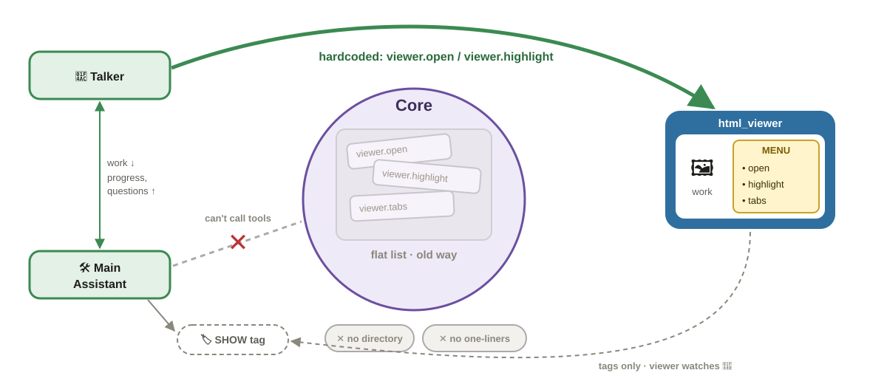
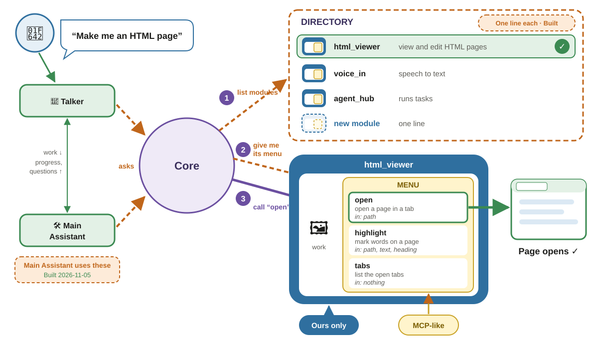
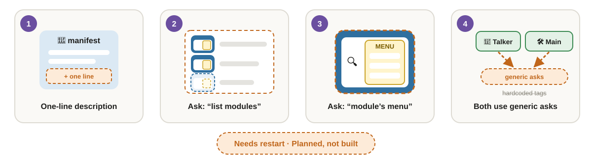
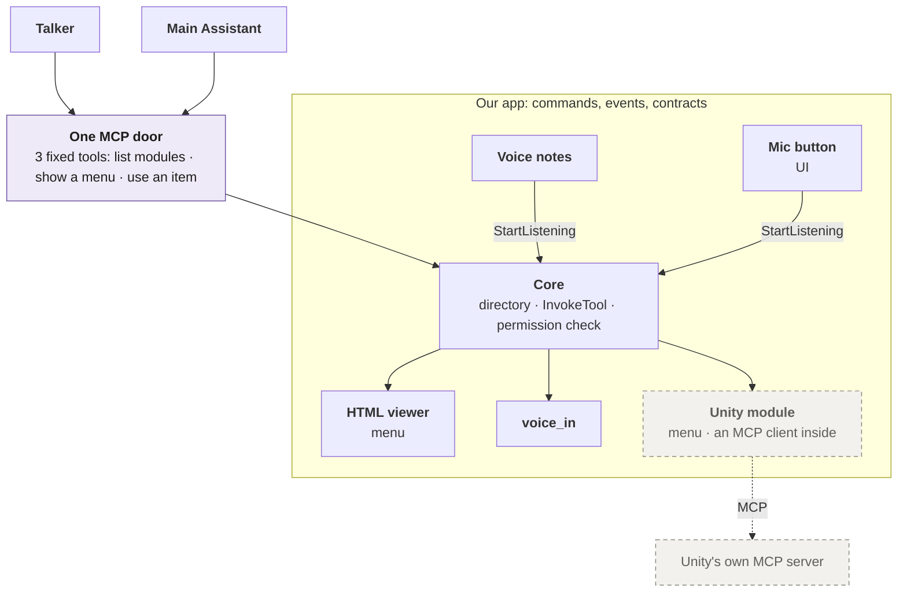
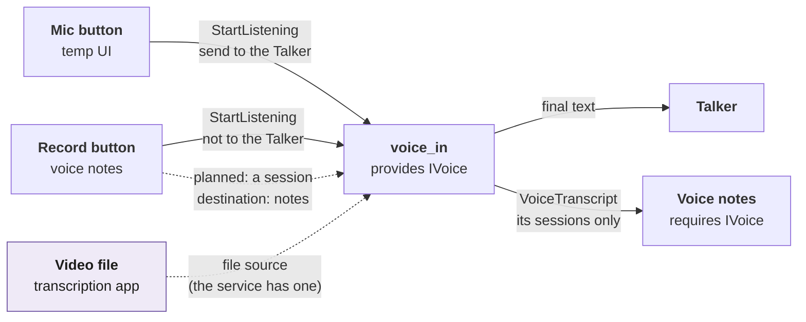

# Modules

How a module is shaped, how the assistants find what it can do, and how modules work together. The core's side is in [core](core.md); the messages are in [communication](communication.md). Each module's own page, and every module's interface side by side: the [module library](module-library.md). Back to the [overview](README.md).

> **Status: decided 2026-11-04, being built.** Built: the wrapper (`ModuleProtocol`, the manifest with its one-line description and inputs and outputs, lifecycle, context), the `Menu` part (the HTML viewer's and the echo stand-in's), the generated module library, `requires` by contract, reloading a module while the app runs, the directory (`ListModules`, `GetMenu`, the core's `modules.*` menu), finding modules by folder, the `ctx.logs` port, and the voice contract (`IVoice`) with sessions each owned by their caller. Planned: both assistants using the directory. Each item: [Built and planned](#built-and-planned). The build plan is the module system change note (`docs/next-steps/module-system.md`), which supersedes the module-shape note. The agents reach the menus through [one MCP door](#how-the-agents-reach-the-menus-one-door) (decided 2026-11-05).

## A module is a wrapper with a menu

Every module has the same **wrapper**, owned by the core, and inside it a **menu** of what it can do.

| Part | What it is | Built? |
|------|------------|--------|
| **Manifest** | Its id, a one-line `description`, the contracts it `provides`, `requires`, and optionally uses, the commands it `handles` and `sends`, the events it `publishes` and `listens` to, its permissions | Built (description, commands and events 2026-11-05). The core warns when a module handles a command it didn't list |
| **Lifecycle** | `ModuleProtocol`: `init`, `start`, `stop`, `busy`, `export_state`; the core starts, stops, and reloads it | Built |
| **Context** | `ctx`, its only access to the app: commands, events, contracts, config, log, permissions | Built, with `ctx.logs` (2026-11-05) |
| **Menu** | A [`Menu`](../api/modules.md#menu) part on the module: named items, each with a one-line description and its inputs (`ToolSpec`), readable without starting the module. The core links it to the running copy, checks the arguments, and routes `InvokeTool` to it | Built (2026-11-05): the HTML viewer (`open`, `highlight`, `tabs`) and the echo stand-in (`echo.say`) |

- **The wrapper is ours only.** Every module has the same one, so the core can start, stop, swap, and list any module without knowing what it does.
- **The menu is MCP-like:** a list of tools a model can read and call, with a description and an argument schema each. It isn't MCP itself. The agents reach every menu through [one MCP door](#how-the-agents-reach-the-menus-one-door) in front of the core; modules never speak MCP.
- **A menu can be empty.** `voice_in` offers commands (`StartListening`, `StopListening`) and events, not tools.

## Find a module, then open its menu

Both the Talker and the Main Assistant find what to use the same way: first a **directory** with one line per module, then the **menu** of the one module they need, then a call. They never see every tool at once, and no agent has another module's tools written into it.

Colors in the pictures: solid lines are built today, dashed orange is planned. Blue is a module's wrapper (ours only), yellow its menu (MCP-like), purple the core, faded grey the old way.

### Before the refactor (November 2026)

One shortcut to one module. The Talker turns its SHOW tags into the viewer's `viewer.open` / `viewer.highlight`; the Main Assistant can't call module tools at all, so the viewer watches its SHOW tags instead. The core keeps a flat list of tools, with no directory and no one-line descriptions.

### Step by step (the asks built; the agents using them planned)

1. **List modules** (built): `ListModules`, the directory, one line each, from each manifest's description.
2. **Give me its menu** (built): `GetMenu(id)`, that module's `ToolSpec`s only, read from its class, so it works while the module is off.
3. **Call an item** (built): `InvokeTool(name, args)`, routed to the module that offers it (the module must be on).

The core has a menu of its own under the id `core`: `modules.list`, `modules.menu`, `modules.on`, `modules.off`, `modules.reload`, `modules.add`, `modules.remove`. So anything that can call a menu item can also find modules and turn them on, off, or reload them. The risky items (turning off with dependents, adding new code, removing a module) ask the permissions first. `modules.remove` takes `settings`, `keep` or `purge` (deleting only `config/<id>.toml` and `config/<id>.local.toml`); it's refused while another module needs it, and never deletes the module's folder ([removing a module](core.md#runtime-module-control)). The agents will send all three asks through [one MCP door](#how-the-agents-reach-the-menus-one-door) (decided 2026-11-05; planned).

### What changes

Each manifest gets a one-line description, the core gets the two asks, and both assistants use them instead of hardcoded tags. All of it is planned and needs an app restart (it touches the core and contracts).

### How the agents reach the menus: one door

> **Status: built (2026-11-05)** for both the Main Assistant and the Talker (chunks 8 and 9 of the module system change note, `docs/next-steps/module-system.md`). The Talker's SHOW tags stay a shorthand for opening a page, now through the [page-opener slot](#the-needs-arrows-point-one-way) (`IPageOpener`), not the viewer's tools. The door is a small **stdio relay** that `claude` starts itself (`python -m assistant.infra.mcp_door`, from the session's `--mcp-config`); it passes each call over local HTTP, with a token, to a `DoorServer` the Agent Hub hosts, which sends `ListModules`, `GetMenu` or `InvokeTool` through the core. The Hub offers it as the [`IModuleDoor`](../api/tools.md#imoduledoor) contract. In Manual, `use_item` asks with the permission card; the two read-only tools don't.

The agents are `claude` sessions, and MCP is how a `claude` session calls tools in the middle of a reply. So the app serves **one MCP server, the door**, in front of the core. It has three fixed tools that map onto the three steps above: **list modules**, **show a menu**, **use an item**. Everything behind it is our own wrapper: the core's directory, `InvokeTool`, and the permission check.

Purple: planned. Dashed grey: an example for later. Agents, other modules and UI buttons all reach a module the same way, through the core.

| | **One door** (chosen) | **A door per module** |
|---|---|---|
| Directory: one line per module, then one menu | Kept | The agent sees every tool at once |
| Permissions: one check, your "Allow?" card | Kept, for every caller | Only the agent's own allow-list; buttons and modules unchecked |
| Module to module (voice notes → voice) | Kept | No path between doors, or glue per pair |
| Hot swap (hand over state, wait while busy) | Kept; the agent's three tools never change | Each door just stops and starts; the agent's tool list changes |
| The agent calls mid-reply | Yes | Yes |

### Why not plain MCP?

Plain MCP here means an MCP server per module, each offering its tools to the agents directly. We chose one door for control. It wasn't because MCP can't change its tools: our test on Claude Code 2.1.318 showed that a running session follows tools added or removed when the server sends `list_changed`.

- **Per-module servers would go around the core.** Each would face only the agent. It would skip the permission check, the module directory, the links between modules (`requires`, events), and hot swap in one process (handing over state, waiting while busy).
- **Callers that aren't agents need the same checks.** The mic button, the viewer and other modules reach a module through commands, events and contracts. That's how voice notes uses `voice_in`. An MCP server would serve only the agents, so these callers would need a second path.
- **The agent's context stays small.** The door has three fixed tools (list modules, show a menu, use an item), so it doesn't grow with every module that's on. They never change on a swap, so no `list_changed` notice is needed. In the test, a tool added without a notice was never seen, and a removed one stayed listed until a call failed.
- **MCP is still used.** The door is an MCP server (`assistant.infra.mcp_door`). An outside tool that already speaks MCP, such as Resi or Unity, gets a thin module that is an MCP client of it. That module offers the tool's list as its own menu and refreshes the menu when the tool sends `list_changed`. Modules are never MCP servers themselves and never import MCP.

**What plain MCP would replace:** only the list, menu and call steps; the agent would see each tool directly. **What it wouldn't:** events, commands and contracts between modules; callers that aren't agents; hot swap inside the app; one permission check for every caller; the module directory; and the Agent Hub (focus, held questions, milestones).

## Chaining modules

> **Status:** events between modules are built (`voice_in` publishes `VoiceTranscript` and `VoiceState`; voice notes listens to them), and so is the voice contract `IVoice` (2026-11-05): `voice_in` provides it, voice notes requires it, and each caller opens and ends only its own session. One mic, so one session at a time; the second press wins.

Modules are combined through what they declare, with no glue code between pairs:

- **Listen to events.** A module uses another's output by subscribing to the events it announces. A voice-notes module listens to `VoiceTranscript`; it never imports `voice_in`.
- **Call commands or menu items.** For an action with a result, through the core (`StartListening`, `InvokeTool`).
- **Share a service through sessions.** A shared service runs once and serves several users. Each user starts a **session** and says where the result goes (its **destination**); the service keeps them apart by session id. Two copies of `voice_in` would fight over the one mic and load the speech engine twice.
- **Keep message shapes general.** Reuse a shared event before adding a new type: a new type is a contract change and needs a restart. A module's own event is a **named event** instead ([`ModuleEvent`](../api/messaging.md#moduleevent), built 2026-11-12): `ctx.publish_named("cv.job_finished", data)` under its own id, `ctx.subscribe_named("cv.job_finished", handler)` (or `cv.*`) on the other side, `ctx.unsubscribe(handle)` to drop one subscription at any time. No class, no restart, and either side reloads on its own ([decided](decisions.md#decided)). **Modules talk to each other through named events; a tool is only for a call out.** Example: the job agent calls the `cv.task` tool to pass a job; cv publishes `cv.job_finished` when its worker ends and `cv.job_submitted` at the user's Submit; job_search subscribes and wakes its agent.

Solid: built (the mic button's flow, and voice notes v1, which follows its own sessions by the `StartListening` id; see [voice_notes](../../src/assistant/modules/voice_notes/docs/README.md)). Purple, dashed: planned. Today the voice service takes one listener at a time (a second `start` gets `busy`) and `StartListening` only chooses whether the Talker gets the text (`send_as_input`). The video case feeds a file instead of the mic; the service already has a file source and `transcribe_file` ([voice](../../src/assistant/modules/voice_in/docs/voice-service.md#a-shared-service)).

## Dependencies

> **Status:** built, by contract, including the voice contract (2026-11-05).

- **A manifest requires contracts, never module ids** ([principle 2](principles.md)). The core starts the provider first: in dependency order at startup, and at runtime `ActivateModule` activates the sole provider first. It refuses to turn a provider off while an active module requires it ([runtime module control](core.md#runtime-module-control)).
- **`needs` lists module ids** (built 2026-11-13, module folders item 2): the modules this one can't run without, written in its `module.toml` as `needs = []` (cv) or `needs = ["cv"]` (job_search, built 2026-11-13) and `needs = ["voice_in"]` (voice_notes, item 10: it keeps `requires IVoice` too). The core modules' `needs` are empty (item 11: agent_hub, talker, main_assistant, task_agents, console_io, temp_ui, usage, assistant_view; echo_orchestrator too): a core module may need only core modules, never an add-on, and each of these runs alone. Every module folder has a `module.toml`, which also holds the module's config defaults (cv, job_search, html_viewer, voice_in, voice_notes, agent_hub, talker, main_assistant, task_agents with its kinds of helper, console_io, temp_ui; usage, assistant_view and echo_orchestrator have none), and your `config/<id>.toml` (then `config/<id>.local.toml`, then `[modules.<id>]` in `config/local.toml`) only overrides them ([configuration](core.md#configuration)). `config/default.toml` holds no module's defaults, only the core's settings; which modules are on is `config/modules.toml`. The core reads the key into `Manifest.needs` when it loads the module. Turning a module on turns on what it needs first (at startup too, even if `modules.enabled` doesn't list it); turning off a needed module is refused while a module that needs it is on, and the error names that module (`with_dependents` turns them off first); a needed id that doesn't exist is refused by name. The code still talks to the other module only through contracts, its menu and named events; `requires` is unchanged.
- **`packages` lists its pip packages** (built 2026-11-13): written in its `module.toml` as `packages = ["pymupdf>=1.24"]` (cv), read into `Manifest.packages` by the same reader as `needs` (`loader.apply_module_toml`). Nothing installs them yet: install them by hand with pip from that list. `pyproject.toml` holds the app's own packages and the `dev` extra; no module extra is left there (voice_in's packages are in its `module.toml`).
- **Its ruff rules are in its folder:** a module's lint exceptions go in its own `ruff.toml` (cv: the CV Tool engine's per-file ignore), which starts with `extend = "<path to the root pyproject.toml>"`. Ruff uses the closest config file for each file, so the root settings (`src`, the rule selection, isort's first-party names) still apply inside the module folder, and only what the module's file adds is new.
- **`optional`** contracts are used if some module provides them, and the module copes without them.
- **No module starts another itself.** Turning on voice notes turns on voice, like a package listing its dependency, but the core does it.
- **Voice:** `voice_in` provides the voice contract [`IVoice`](../api/messaging.md#ivoice), and voice notes requires it: turning voice notes on turns `voice_in` on first, and `voice_in` can't be turned off while voice notes is on. Any other module that provides `IVoice` can replace `voice_in`.

### The needs arrows point one way

> **Status: built (2026-11-13, module folders item 15).** Tripwire: `test_no_core_code_names_an_add_on` in `tests/test_module_folders.py`.

"Needs" arrows go add-on → core, or add-on → add-on, **never core → add-on**. No core module (the `core` group in each module's `docs/docs.toml`), and no code in the core, `contracts`, `infra` or `app_kit`, names an add-on's id or its menu items. When the core group wants something an add-on does, it asks for a **slot**: a contract in `assistant.contracts` that an add-on fills ("plugs in"), looked up at each call (`uses`, no start order). With nothing plugged in, the caller says so plainly.

- **Opening a page:** the Talker's and the workers' SHOW tags and temp_ui's Open in viewer button go through [`IPageOpener`](../api/modules.md#ipageopener), with [`open_page` / `show_page`](../api/infra.md#show_page). `html_viewer` fills it while it's on; none on: "No page viewer is on". They used to send `InvokeTool viewer.open` / `viewer.highlight`, naming the viewer's tools.
- **Start on use stays, by contract:** with no provider on, `open_page` sends [`StartProvider`](../api/control.md#startprovider)`("IPageOpener")`, and the core turns on the module that declares it in `manifest.provides` and has `start_on_use = true` in its config. No module is named anywhere on the way.
- **Hearing an add-on's named events by name is allowed** (module folders decision 9, [chaining modules](#chaining-modules)): the Talker and temp_ui listen to `html_viewer.tabs_changed` / `html_viewer.clip` by name, with no import, and nothing breaks when nobody publishes them.

## Hot swap

> **Status:** built (2026-11-03).

A module's code is swapped while the app runs: `ReloadModule` stops it, imports its package fresh, and starts a new instance; if the new code fails, the old code runs again. `AddModule` loads a brand-new module. Changes to the core, contracts, `infra`, `app_kit`, or `__main__`, and a new contract, still need a restart. Details: [reloading a module's code](core.md#reloading-a-modules-code).

## Found by folder

> **Status: built (2026-11-05).** `find_modules()` in `core/loader.py`; `__main__.py` names no module.

- **A module is its folder:** `src/assistant/modules/<id>/`, with the folder name equal to the manifest id. Its `__init__.py` exports exactly one `ModuleProtocol` class.
- **The core scans the folder** at launch to know which modules are available; `modules.enabled` still says which start. It reuses the reload's loader (`core/loader.py`). Folders starting with `_` are ignored.
- **A bad folder is skipped and logged** (it fails to import, exports no module class or two, or its id isn't the folder's name); the other modules still load. If it was in `modules.enabled`, startup then fails with "Enabled modules not found".
- **Adding a module is adding a folder,** then `AddModule("assistant.modules.<id>")` while the app runs (which refuses a folder named differently from its id), or a restart.

## Built and planned

| Item | State |
|------|-------|
| Wrapper: manifest (id, contracts, permissions), lifecycle, context | Built |
| Menus: a `Menu` part on the module, linked by the core, called with `InvokeTool` | Built (2026-11-05; the HTML viewer, the echo stand-in) |
| `requires` / `optional` by contract, dependency order, refusal to stop a needed provider | Built |
| `needs` by module id, from `module.toml`: turned on first, refused off while needed | Built (2026-11-13) |
| Needs arrows one way: no core code names an add-on; slots (`IPageOpener`) and `StartProvider` instead | Built (2026-11-13, module folders item 15) |
| `packages` in `module.toml` (listed, not installed) and a module's own `ruff.toml` | Built (2026-11-13) |
| Reload and add while running | Built (2026-11-03) |
| Events from one module heard by another (`VoiceTranscript`, `VoiceState`) | Built |
| `ModuleProtocol`: the one interface, `Module` renamed | Built (2026-11-05) |
| Manifest description, commands (`handles`, `sends`) and events (`publishes`, `listens`) | Built (2026-11-05); the core refuses a handled command the manifest doesn't list |
| `ctx.logs` port | Built (2026-11-05) |
| Directory and menu asks (`ListModules` with descriptions, `GetMenu`, the core's `modules.*` menu) | Built (2026-11-05) |
| Both assistants using them through one MCP door | Built (2026-11-05): `IModuleDoor`, the stdio relay; the Main Assistant and the Talker get it in each session |
| Finding modules by folder | Built (2026-11-05) |
| Voice contract; voice sessions with a destination | Built (2026-11-05): `IVoice`, one mic, each caller owns its session; parallel sessions would need the voice service to take several listeners |
| Voice-notes module | Built (v1 2026-11-04; requires `IVoice` 2026-11-05) |
| A page per module and the [module library](module-library.md) | Built; the library's table is generated from the manifests and menus (2026-11-05), the module pages are hand-written |
