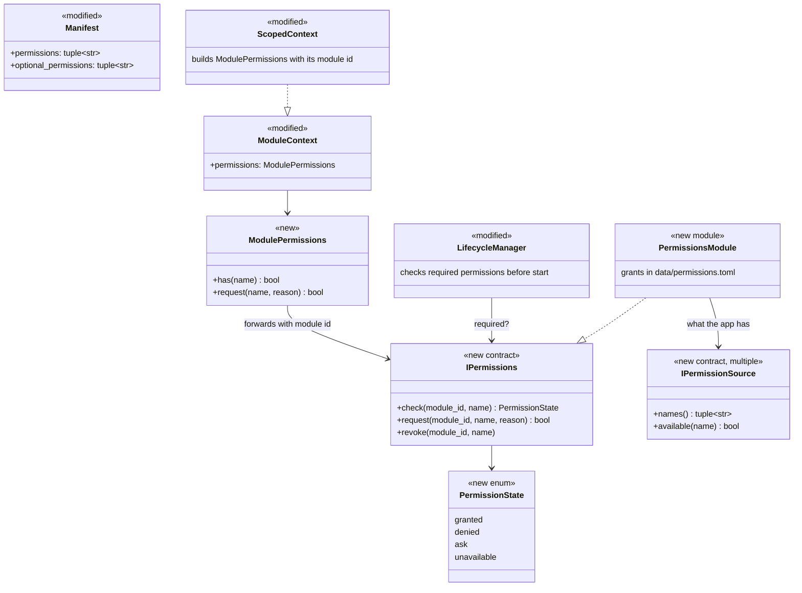
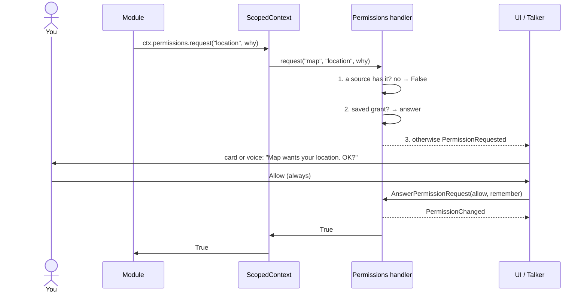
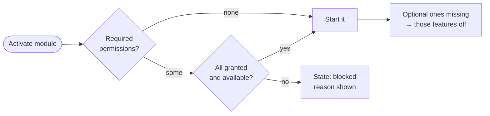

# Permissions

Who may use what: location, the microphone, files, accounts. Back to the [overview](README.md).

> **Status: planned (designed 2026-10-26).** Not built. Today only the Main Assistant asks for permission, through the Agent Hub ([permission requests](../next-steps/permission-requests.md)); this design replaces that with one handler every module uses. Change note: [permissions handler](../next-steps/permissions-handler.md).
>
> **Built: the stand-in** (2026-11-02, [change note](../next-steps/permissions-stand-in.md)): `ctx.permissions` on every module's context, with `has` and `request`, and the manifest's `permissions` / `optional_permissions` fields. With no handler, it applies the [no handler running](#what-happens-when-one-is-missing) rule: allow, and log a warning naming the module the first time each module uses each permission (debug after that). Required permissions aren't checked at start yet; the handler adds that. The handler later plugs in behind the same calls, so no module changes. Built as `AllowAllPermissions` (`core/permissions.py`), set by the core's `ScopedContext` ([API](../api/modules.md#modulecontextpermissions)).
>
> **Built: the [permission mode](#permission-mode-built)** (2026-11-02): Manual or Auto for the Main Assistant, switched with a button.

## The idea

Permissions are per module, not per app. A map module may get your location; a notes module doesn't. If a module lacks something it needs, only that module stops or loses a feature; everything else runs.

One **permissions handler** module knows three things:

1. **What the app has:** real capabilities it can check, such as Windows location being on, a microphone being present, or a Google account being connected. Each comes from a permission source.
2. **What each module needs:** declared in its manifest, as required or optional.
3. **What you've granted each module:** saved across restarts, for example "map: location yes" and "main_assistant: write `docs/` yes".

A module may use a permission only when the app has it **and** you've granted it to that module.

**Responsible for:** checking, asking you, remembering grants, and announcing changes. **Not responsible for:** operating-system prompts (Windows grants those to the whole process) or enforcing anything inside a module. See [the limit](#the-limit).

## How a module uses it

Every module uses the same two calls on its own context, `ctx.permissions`:

    if ctx.permissions.has("location"):
        ...
    allowed = await ctx.permissions.request("files.write:src", reason="Fix the bug you asked about")

A module never finds the handler or passes its own id. The core's [`ScopedContext`](core.md#communication-internals) already belongs to one module, so it fills in the caller's id and forwards the call to the handler. This is how Android, iOS, and browsers do it: one standard call, and the system, not the app, says who is asking. No module can ask in another's name.

The core only stamps the caller's id. All the logic lives in the handler, which is an ordinary module and can be replaced.

## Permission names

Plain strings, with a scope where one is needed:

| Name | Means |
|------|-------|
| `location` | Your location |
| `microphone`, `camera` | The device |
| `network` | Reaching the internet |
| `google.calendar` | A connected account |
| `files.read:<area>`, `files.write:<area>` | Reading or writing an area, such as `repo`, `docs`, or `src` |

## What happens when one is missing

| Situation | What happens |
|-----------|--------------|
| A **required** permission is missing at start | That module doesn't start; its state is `blocked` with the reason ("needs location"). Everything else starts normally |
| An **optional** permission is missing | The module runs with that feature off |
| A module needs one **in the moment** | It calls `request`; you get an Allow / Deny card or the Talker asks. Allow once or always |
| You **revoke** one | `PermissionChanged` is published; the module turns that feature off, or is turned off |
| Nobody answers | Denied after a timeout (10 minutes, as today) |
| **No handler running** (the `permissions` module is off) | Everything is allowed, and each check is logged as a warning ("no permissions handler: allowing main_assistant location"). Decided 2026-10-26 for now, while developing. This is what the stand-in does (built 2026-11-02; warns once per module and permission, then debug) |

## Classes

**Messages**

| Item | Kind | Purpose |
|------|------|---------|
| `PermissionRequested(request_id, module_id, name, reason)` | event | A module is asking; UIs and the Talker show it |
| `AnswerPermissionRequest(request_id, allow, remember)` | command | Your answer; `remember` makes it "always" |
| `PermissionChanged(module_id, name, state)` | event | A grant was given, revoked, or a source changed |
| `ListPermissions()` | command | Every module's needs and grants, for the control panel |

A permission source is anything that knows whether the app has a capability, such as `WindowsLocation` or `Microphone`. A source can be its own module, so a new device or account adds a source and nothing else changes.

## Flows

### A module asks

### A module starts

Startup never asks you; a module that's blocked waits until you grant the permission (in the control panel, or by telling the Talker) and is activated again.

## The Main Assistant

The Main Assistant uses the handler like any other module:

- Its standing rules become saved grants (`files.read:repo`, `files.write:docs`), turned into `--allowedTools` rules when its session starts ([`path_rule`](../api/infra.md#path_rule)).
- A `can_use_tool` request from `claude` becomes `ctx.permissions.request("files.write:<path>")`.
- The agent-specific [`AnswerPermission`](../api/agents.md#answerpermission) command, `ReportKind.PERMISSION`, and the Hub's part in permissions go away. The Allow / Deny cards and the Talker's `<<ALLOW>>` / `<<DENY>>` tags stay, and answer the handler instead.
- Its [permission mode](#permission-mode-built) becomes a grant per module ("main_assistant: auto"), and the handler handles `SetPermissionMode` in place of the Hub.

## Permission mode (built)

Built 2026-11-02 ([change note](../next-steps/permission-mode-button.md)). What the Main Assistant may do without asking, switched while the app runs:

| Mode | What it does |
|------|--------------|
| **Manual** (every launch) | Its standing rules, and an Allow / Deny card for anything else |
| **Auto** | Full permissions (`bypassPermissions`), no cards, except `git push`, which is refused (`--disallowedTools`; checked against the real `claude` to hold under bypass). It's told to stop and ask (`NEED: Risky: …`) before very risky steps: deleting beyond the task, rewriting git history, changing secrets or settings, installing software, spending money, sending anything off the machine, anything hard to undo |

- **Only you switch to Auto**, with the stand-in button in the temp UI's Talker pane, after a confirm dialog. The Talker can only switch back to Manual; the Main Assistant can't switch at all.
- **It's not a guarantee.** The risky-step pause is the model's own judgment. The one hard limit is `git push`, and it only catches a direct `git push`, not `git -C x push` or a script that pushes.
- **Through the Agent Hub for now:** [`SetPermissionMode`](../api/agents.md#setpermissionmode) → [`ITaskAgent.set_permission_mode`](../api/agents.md#itaskagentset_permission_mode) → [`PermissionModeChanged`](../api/agents.md#permissionmodechanged). How a switch takes effect: [runtime](../agents/runtime.md#permission-mode).

## Repo zones

The index of which part of the repo is the core app and which is modules, and what an agent may write in each. The Main Assistant reads all of it.

| Zone | Paths | Writes by an agent |
|------|-------|--------------------|
| **Protected** | `src/assistant/modules/permissions/`, `data/permissions.toml`, `config/`, `.claude/settings*` | Never, even if you say yes; otherwise it could grant itself permissions |
| **Core** | `src/assistant/core/`, `src/assistant/contracts/`, `src/assistant/infra/`, `src/assistant/__main__.py`, `scripts/`, `.github/`, `pyproject.toml` | On its branch; asks |
| **Modules** | `src/assistant/modules/<id>/` and that module's tests | On its branch; asks |
| **Docs and skills** | `docs/` (not `docs/html/`), `.claude/skills/` | `docs/` is a standing grant; skills ask |

- **Not enforced yet:** until the handler and the branch workflow are built, the Main Assistant edits any file in the repo, with the [same access as Claude Code](../next-steps/worker-access.md). In Auto nothing asks first, so its risky-step rule names `config/` and `.claude/settings*` as steps to ask about.
- **For now Core and Modules have the same rule** (decided 2026-10-26: everything is still being built). The split is recorded so the rules can differ later, for example "always" grants allowed for a module but never for the core.
- **The handler holds the same list in code**, in the protected zone, so an agent can't edit its own guardrails. This table mirrors it; if they disagree, the code wins and this table gets fixed.
- **Enforced by `claude`:** protected paths are never in an agent's rules and its requests for them are denied without asking you; other `src/` paths are never standing rules, so each write arrives as a request.
- **Branch edits happen in a git worktree** (a separate copy of the repo on its own branch, e.g. `../AI_Assistant-work`), so the running app on `main` is never touched. The app, not the agent, does the git work: branch, commit, tests, and merge when you say so. This is step 4 of [self-improvement](../agents/self-improvement.md#steps).

## The limit

Inside one process, this only holds if modules use it: a module could call the operating system directly. Real enforcement needs a separate process, as the `claude` agents have today: their own session enforces their rules. For our own modules, using `ctx.permissions` is the rule, and code review keeps to it.

## Open questions

- **Changing a grant of a running agent:** its `--allowedTools` are fixed when the session starts, so a new "always" grant applies from its next session; until then the handler answers its requests directly.
