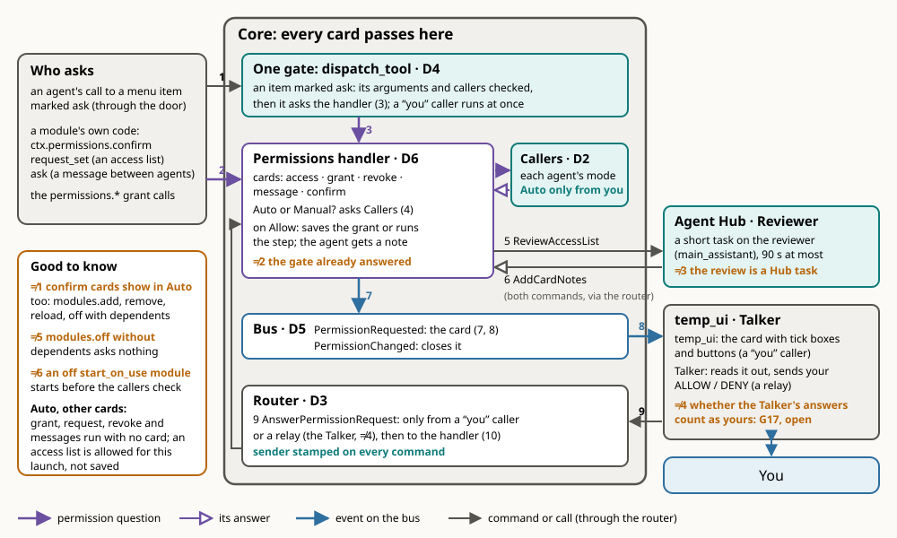
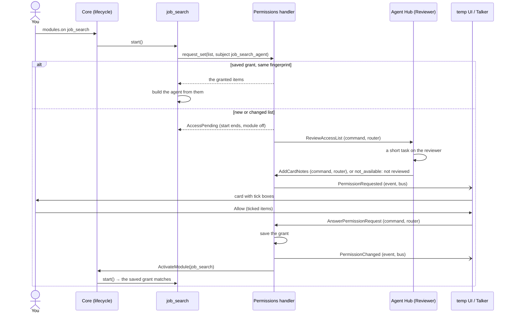
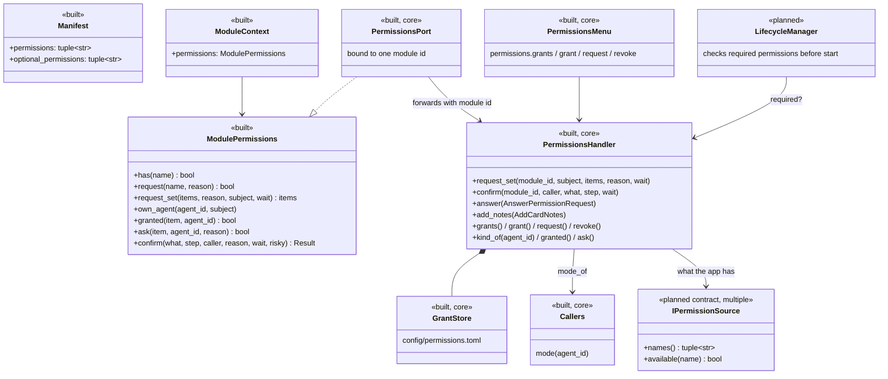
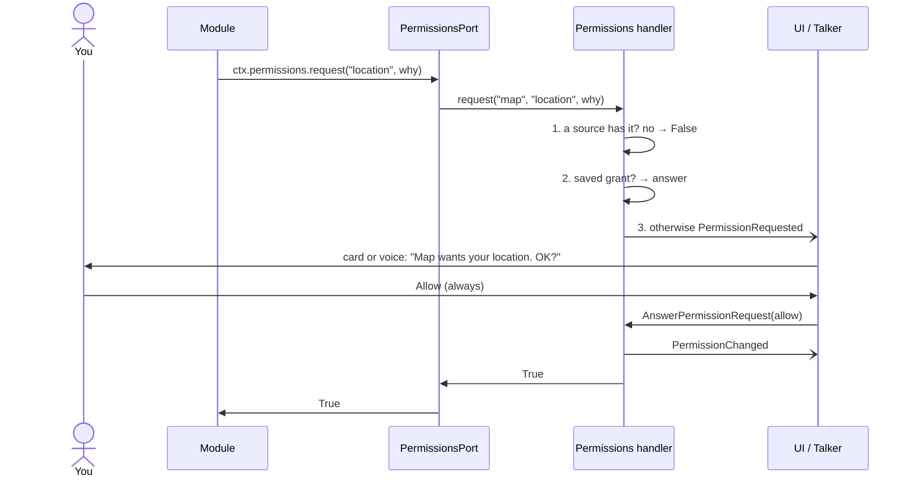

# Permissions

Who may use what: folders, commands, Chrome, the microphone, accounts, and the steps that change the running app. Back to the [overview](README.md). The full inside of the core (the door, Callers, the router, the gate, the bus and this handler, D1 to D6) is on [core](core.md); this page covers the cards, the modes, and grants.

> **Built:** access lists for task agents (one card per list, saved grants per kind of agent, the review), messages between agents, the `confirm` cards before risky steps, the grant calls on the core's menu, and Manual / Auto per agent.
>
> **Not built yet:** single names (`location`, `microphone`) are allowed and logged, not checked; permission sources; required permissions checked at start (the `blocked` state); the Main Assistant's own access as saved grants.

## The idea

Permissions are per module, not per app. A map module may get your location; a notes module doesn't. If a module lacks something it needs, only that module stops or loses a feature; everything else runs.

One **permissions handler** knows three things:

1. **What the app has:** real capabilities it can check, such as Windows location being on, a microphone being present, or a Google account being connected. Each comes from a permission source (planned).
2. **What each module needs:** declared in its manifest (`permissions`, `optional_permissions`). A task-agent module declares `agent.access` and lists its access in its config.
3. **What you've granted each module:** saved across restarts in `config/permissions.toml` (yours, gitignored), for example "job_search → job_search_agent: read `C:\Jobs`, use Chrome".

A module may use a permission only when the app has it **and** you've granted it to that module.

**Responsible for:** checking, asking you on a card, remembering grants, and announcing changes. **Not responsible for:** operating-system prompts (Windows grants those to the whole process) or enforcing anything inside a module. See [the limit](#the-limit).

## Part of the core

The handler is part of the core, not a module ([decisions](decisions.md#decided)), so nothing can turn its guardrails off:

- **Always on.** No module or agent can turn it off or reload it. It isn't in the module list.
- **Generic.** It gets only the core's generic parts from `App`: the router's `send`, the bus's `publish`, the container's `get_one` (for [`IAgentNames`](../api/agents.md#iagentnames) at revoke time), and `mode_of`, each agent's mode from the core's Callers port. It imports no module.
- **No module-specific logic.** A module only declares `agent.access` and lists its access in config. The handler never starts a task: the [review](#the-review) is a listener's job (the Agent Hub's). The one task call it makes is a revoke's stop: when a revoke turns a module off, it cancels that module's agents' running tasks (`GetTaskStatus` / `CancelTask`).
- **It names no agent:** the reviewer (`main_assistant`), "you" (`temp_ui`) and the relays (`talker`) are set in `config/default.toml` under `[core.permissions]`; the code's defaults are empty (principle 21).
- **Its grant calls are on the core's menu** (id `core`), beside `modules.*`: `permissions.grants / grant / request / revoke` ([API](../api/control.md#the-cores-menu)).

There's no `IPermissions` contract and no permissions module.

## How a card travels

1. **A call reaches the gate** (`dispatch_tool`), for a menu item marked `ask`.
2. **Or a module's own code asks** through `ctx.permissions` (`confirm`, `request_set`, `ask`), or an agent uses a `permissions.*` grant call.
3. **The gate asks the handler.** It checks the item's arguments and `callers` first, so a bad call never reaches a card.
4. **The handler reads the caller's mode from Callers.** In Auto, most cards are skipped. Confirm cards never are.
5. **For an access list, the handler asks for a review.** It sends `ReviewAccessList`.
6. **The reviewer answers.** The Hub's reviewer sends back `AddCardNotes`. Both are commands through the router.
7. **The handler publishes the card** on the bus as `PermissionRequested`. Events only notify: the card is shown, never acted on, by whoever hears it.
8. **temp_ui and the Talker show it.** temp_ui shows tick boxes and buttons. The Talker reads it out.
9. **Your answer is a command**, `AnswerPermissionRequest`, through the router. It's a control command: only a `you` caller (`temp_ui`) or a relay (`talker`) may send it ([communication](communication.md)).
10. **The handler applies it.** It saves the grant or runs the step, and publishes `PermissionChanged`, which closes the card. The asking agent gets the outcome as a note: `AgentNotice`, a command the Hub delivers. With no Hub, the note is only logged.

**Why a question is an event but an answer is a command:** anyone may show a card, but only you may answer one, and the router stamps every command's sender, so the core can check who answered.

### Two card roads

- **The handler's cards** (this page): access lists, an agent's grant, request or revoke, a message between agents, and `confirm` before a risky step. All are `PermissionRequested`, answered with `AnswerPermissionRequest`.
- **An agent's own card:** a `claude` tool request outside its rules, or an approval it asks for (a helper launch, a `RELOAD:` / `ADD_MODULE:` line). Its `PermissionGate` sends a `permission` report to the Agent Hub's task board. The Hub holds the agent's task until you answer with `AnswerPermission` (a control command too). The Talker answers through `hub.answer`. How an agent waits: [runtime](../agents/runtime.md#permission-mode).

## How a module uses it

Every module uses the same calls on its own context, `ctx.permissions`:

    if ctx.permissions.has("location"):
        ...
    allowed = await ctx.permissions.request("files.write:src", reason="Fix the bug you asked about")
    granted = await ctx.permissions.request_set(items, reason, subject="job_search_agent")
    result = await ctx.permissions.confirm("restart the app", step, caller=agent_id)

A module never finds the handler or passes its own id. The core gives each module a `PermissionsPort` bound to its id, which forwards to the handler. **Why:** this is how Android, iOS, and browsers do it: one standard call, and the system, not the app, says who is asking. No module can ask in another's name.

## Access lists (built)

A task agent asks for its whole access list in one request when its module is turned on. The list comes from its config section: `workspace` (its working folder, read and write; by default `modules/<id>/workspace`), `read_dirs`, `write_dirs`, `python`, `allowed_commands` and `chrome` ([`access_items`](../api/infra.md#agent_access)). Each item has a key (`kind:target`, for example `read:C:\Jobs`).

**Every module can edit itself.** A module's own agent (`cv_agent`, `job_search_agent`) gets one more item by default: a write on its own module folder. That's `src/assistant/modules/<id>`, or the add-on's folder outside the repo (`module_folder` looks in every module root). It never covers a parent folder or another module's folder. It's on the card like any item, so you can untick it. `task_agents` asks without it (`own_folder=False`): its helpers are generic, several run at once, and none is that module's own agent. The Agent Hub lets a module's agent work in its own folder beside the Main Assistant's whole-repo grant, but refuses two agents inside one module folder ([the folder check](../../src/assistant/modules/agent_hub/docs/architecture.md#owns-and-launches)).

**The fingerprint:** a hash of the list's keys. If it matches the saved grant, the saved grant is used and nothing is asked. Any change, even a narrower list, asks again.

**The card** shows who asks (`job_search → job_search_agent`), the list with a tick box per item (the working folder has none: it comes with the agent), the warnings, and the fixed rules. You allow the ticked items or deny. temp_ui's card has the tick boxes; the Talker reads the card out and answers it whole with `<<ALLOW>>` / `<<DENY>>`.

- **Refused:** a write to a folder in the [protected zone](#repo-zones) (or one holding part of it) is taken off the list and shown as refused.
- **Rule warnings**, fixed and predictable: writing plus Chrome; reading outside the working folder plus Chrome; Python.
- **The review:** the Main Assistant adds one line per further risk ([the review](#the-review)). The card says "not reviewed" in these cases: the reviewer is busy, no Hub is on, or no answer comes in 90 s.
- **Fixed rules:** never submit or send anything (a prompt rule, not enforced in code); protected paths are never granted; sessions start in Manual.
- **Sessions always start in Manual.** A list can't start an agent in Auto: `permission_mode` in config is clamped to `default`, `acceptEdits` or `plan` ([`manual_claude_mode`](../api/infra.md#agentprofile)). Auto stays your button.
- A denied card, or no answer in 10 minutes, leaves the module off. A denial is saved too, so the same list asks again only when it changes.
- **In Auto:** a module turned on by an agent in Auto (`modules.on` passes its caller on, so the modules it requires count too) gets its list allowed for this launch, not saved, so Manual asks again.

The agent is built from the config cut down to what you allowed ([`granted_config`](../api/infra.md#agent_access)). A trimmed folder never becomes a rule, so `claude` asks for it with a normal card.

### The flow

A module's start can't wait on a card (`ActivateModule` would time out). So `request_set(wait=False)` raises `AccessPending`: the start ends, the module stays off, and the handler turns it on after your Allow. A helper launched inside an approved run waits for the card instead (`wait=True`).

### The review

The review is a listener's job ([D6](decisions.md#decided)): the core asks, the Agent Hub runs it. **Why:** the core never starts a task, so it never names an agent kind.

- **The ask:** before a list's card shows, the handler sends `ReviewAccessList(request_id, reviewer, who, reason, items, warnings, timeout)`. The reviewer's id is in `[core.permissions] reviewer` (`main_assistant`).
- **The Agent Hub handles it** (`agent_hub/review.py`, `Reviewer`): it starts the review as a short task on the reviewer, watches for its end, and cancels it on timeout. It answers with `AddCardNotes(request_id, notes, reviewed)`, `reviewed=False` when the review didn't finish. If the task can't start (the reviewer is busy), it answers `ReviewAccessList` with `not_available` at once.
- **The core handles `AddCardNotes`** (`PermissionsHandler.add_notes`): it keeps at most 8 notes, marked as the review's. A late answer, with no card waiting, is refused.
- **No Hub:** the router answers `ReviewAccessList` with `not_available` at once, so the card shows "not reviewed" with no wait. **Why a command pair, not an event:** an event has no answer, so with no listener the card would wait the whole timeout. The handler waits at most the review's timeout plus 5 s.

### Grants per kind of agent

A grant is saved per module and **subject**: the kind of agent, not each copy. The job agent's subject is `job_search_agent`. For `task_agents` the subject is the kind: `helper_2` shares `helper`'s grant, and so does every helper launched from that kind. One section of `config/permissions.toml` per module and subject holds the fingerprint, the asked and granted keys, whether it was denied, and the date. It changes only through the handler's calls. The file is yours (it holds your paths), so it's gitignored, and it's never read as a module's settings. If it's missing at startup and an old `data/permissions.toml` exists, the handler copies that across once (`copy_old_grants` in `store.py`) and leaves it in place.

### Messages between agents

When an agent messages another agent that isn't its own child task (`hub.send` with `agent_id`), the Agent Hub's message gate (`agent_hub/gate.py`, `MessageGate`) asks first, with one item, `message:<receiver>` (`AccessKind.MESSAGE`).

- **The check:** `ctx.permissions.granted(item, sender)` reads the Hub's saved grant for the sender's kind (the handler's `kind_of`: `helper_2` shares `helper`'s). Granted: the message goes through with no card. In Auto: Allow once, no card.
- **The card** (`ctx.permissions.ask(item, sender, reason)`, action `message`): "job_search_agent wants to message cv_agent", with the start of the text. Three buttons: **Allow once** (`AnswerPermissionRequest.remember=False`: this message only, nothing saved), **Always allow** (saved), **Deny**. The Talker's ALLOW is Allow once; Always is only the button.
- **Saved:** under module `agent_hub`, subject = the sender's kind, item `message:<receiver>`. One grant per direction: job → cv and cv → job are each asked once. It shows in `permissions.grants` and the Grants panel.
- **While the card is open,** the message and any later ones from the same sender to the same receiver wait behind it. On Allow they're delivered (never into a running turn); on Deny or no answer nothing is sent and the sender gets a `[messages]` note.
- **Revoke:** `permissions.revoke` of only `message:` items keeps `agent_hub` on; the next message asks again.
- **Never asked:** the Talker (you), and a message into one's own child task.

### Managing grants

The calls are on the core's menu, with no UI in them, so any UI and any agent use the same ones. Each knows its caller (`InvokeTool.caller`, stamped by the core).

| Call | Does |
|------|------|
| `permissions.grants` | The saved grants per module and subject: what was granted, the date, and whether the current list still matches |
| `permissions.grant` | Grant asked-for items (or ones an agent added itself) to a module, then it turns on with them |
| `permissions.request` | An agent asks for more access **for itself**: folders to read or write, commands, a Python, Chrome, with a reason. Its module and subject come from its own id (the module tells the handler with `ctx.permissions.own_agent`, checked against the name's claim), so it can only ask for itself. On Allow the items join its saved grant as **added** items, beyond its config list. An agent with no access list (the Main Assistant) is refused with a reason |
| `permissions.revoke` | Take back a module's grant: all of it, or some items |

**Who:** "you" is a UI you click in (`you` in `[core.permissions]`, `temp_ui`): your calls apply at once. An agent in Auto: also at once. An agent in Manual: you get a card first, and only your Allow applies it; the answer reaches the agent as a note. **Why:** an agent can't take access away, or give itself more, without you.

**The rules:**

| Change | What happens |
|--------|--------------|
| A widened grant | Saved. A module that's off is turned on. A running agent takes it **live**: its module hears `PermissionChanged` ([`watch_grant`](../api/infra.md#agent_access)) and calls [`ProfileAgent.set_access`](../api/infra.md#profileagent); an idle open session restarts once at once, a busy one gets it at its next session (next task or handoff). No off and on |
| Added items | Saved under `added` in its section. The fingerprint stays the config list's, so an unchanged config still matches and the next start keeps them; `granted_config` adds them to the config |
| A narrowed revoke (some items) | The grant keeps its fingerprint, so the same list isn't asked again; it starts with fewer items |
| A full revoke, or a revoke of the workspace | The grant is removed; the module asks again when turned on |
| Any revoke but `message:` items only | The module turns off right away and its running tasks are stopped (like Esc). **Why:** a running session would keep the old access, since its rules are fixed when it starts |
| A revoke of only `message:` items | The module stays on; the next message between those agents asks again ([messages between agents](#messages-between-agents)) |

**Your snips:** every task agent built on `ProfileAgent` may read this launch's snips folder (`logs/<launch>/snips/`, your snips and pasted images) with no card: a read rule added at each session start, not on any access list.

The only screen is a rough, throwaway grants panel in the [temp UI](../../src/assistant/modules/temp_ui/docs/README.md), all in `temp_ui/static/grants.js`.

## Risky steps ask, even in Auto

Some steps change the running app itself. They get a yes/no **`confirm`** card (`PermissionRequested.action = "confirm"`, no items, Allow / Deny), and **Auto never skips it**. **Why:** Auto is for an agent's own work; changing the app under every agent stays your call.

| Step | The card |
|------|----------|
| `modules.add`, `modules.remove`, `modules.reload` on the core's menu | Always (`ask="always"` on the item) |
| `modules.off` | Only `with_dependents` (`ask_when`) |
| An agent's `RELOAD:` / `ADD_MODULE:` line | The agent's own card (`PermissionGate.ask(..., always=True)`, the [second road](#two-card-roads)), held on its task, shown in Auto too |
| The Talker's restart (its `RESTART` tag) | A `confirm` card from its code (`ctx.permissions.confirm`); on Allow the Talker sends `ShutdownRequested(restart=True)` |

- **Two ways in, one handler:** a menu item marked `ask` is caught by the one gate, `dispatch_tool` ([core](core.md)), on every road to a menu: the door, the Talker's `use_item`, a module's own `InvokeTool`. Module code asks directly with `ctx.permissions.confirm`. Both reach `PermissionsHandler.confirm`.
- **Who runs at once:** only a `you` caller (`[core.permissions] you`, `temp_ui`): your click is the yes. Every agent caller, Manual or Auto, gets the card, and so does the Talker.
- **`ask="risky"`** is a lesser mark: it asks unless the caller is in Auto. No item uses it.
- **The answer:** a menu call returns at once ("Asked the user on a card …"). **Why:** the router's timeout would cut a waiting call. On Allow the handler runs the step itself, and the outcome reaches the caller as a note. Deny runs nothing, and the agent gets a note.
- **`ctx.permissions.confirm(what, step, caller=...)`** with `wait=True` returns the step's `Result`. With no handler (a bare test context) it logs and runs the step.
- **Not covered:** `scripts/restart_app.ps1` runs outside the app, so it has no card.

## Permission names

Plain strings, with a scope where one is needed:

| Name | Means |
|------|-------|
| `location` | Your location |
| `microphone`, `camera` | The device |
| `network` | Reaching the internet |
| `google.calendar` | A connected account |
| `files.read:<area>`, `files.write:<area>` | Reading or writing an area, such as `repo`, `docs`, or `src` |
| `agent.access` | A task-agent module that asks for its config's access list when turned on |

## What happens when one is missing

| Situation | What happens |
|-----------|--------------|
| A **required** permission is missing at start | That module doesn't start; its state is `blocked` with the reason ("needs location"). Everything else starts normally (planned) |
| An **optional** permission is missing | The module runs with that feature off |
| A module needs one **in the moment** | It calls `request`; you get an Allow / Deny card or the Talker asks. Allow once or always (planned) |
| You **revoke** one | `PermissionChanged` is published; the module turns that feature off, or is turned off. Built for access lists: the module turns off |
| Nobody answers | Denied after a timeout (10 minutes) |
| **Single names** | `has` / `request` aren't checked yet: allowed, and the first use of each name per module is logged as a warning ("not checked yet: allowing voice_in microphone"), then debug |

## Classes

**Messages** ([API](../api/messaging.md#access-and-permissions))

| Item | Kind | Purpose |
|------|------|---------|
| `PermissionRequested(request_id, module_id, subject, action, reason, items, notes, reviewed, rules, caller)` | event | A card for you: an access list, an agent's grant or revoke, a message to another agent (`message`), or a yes/no before a risky step (`confirm`); UIs and the Talker show it |
| `AnswerPermissionRequest(request_id, allow, keep, remember)` | command | Your answer; `keep` is the ticked items (none: all); `remember=False` is a message card's Allow once. Only from a `you` caller or a relay |
| `PermissionChanged(module_id, subject, granted, request_id, text)` | event | A grant was saved, denied or revoked; closes the card |
| `ReviewAccessList(request_id, reviewer, who, reason, items, warnings, timeout)` | command | The core asks for a list's review; the Agent Hub handles it |
| `AddCardNotes(request_id, notes, reviewed)` | command | The review's notes for the waiting card; the core handles it |
| `ListPermissions()` | command | Every module's needs and grants, for the control panel (planned; `permissions.grants` covers access lists) |

A permission source is anything that knows whether the app has a capability, such as `WindowsLocation` or `Microphone`. A source can be its own module, so a new device or account adds a source and nothing else changes.

## Flows

### A module asks for a single name (planned)

### A module starts (planned)

Startup never asks you for a single name; a module that's blocked waits until you grant the permission (in the control panel, or by telling the Talker) and is activated again. Access lists differ: the card opens, and your Allow turns the module on.

## The Main Assistant

Its own access isn't on the handler: it keeps its config rules, and its tool requests come on the [second card road](#two-card-roads). It reviews access lists before their cards show. Planned:

- Its standing rules become saved grants (`files.read:repo`, `files.write:docs`), turned into `--allowedTools` rules when its session starts ([`path_rule`](../api/infra.md#path_rule)).
- A `can_use_tool` request from `claude` becomes `ctx.permissions.request("files.write:<path>")`.
- The agent-specific [`AnswerPermission`](../api/agents.md#answerpermission) command, `ReportKind.PERMISSION`, and the Hub's part in permissions go away. The Allow / Deny cards and the Talker's `<<ALLOW>>` / `<<DENY>>` tags stay, and answer the handler instead.
- Its [permission mode](#permission-mode-built) may become a grant per module ("main_assistant: auto").

## Permission mode (built)

What an agent may do without asking, switched while the app runs. Each worker and Talker pair has its own mode (a helper tab's Talker `talker:<id>` counts as `<id>`), kept in the core's Callers port and shown as `AgentInfo.permission_mode`.

| Mode | What it does |
|------|--------------|
| **Manual** (every launch) | Its standing rules, and an Allow / Deny card for anything else |
| **Auto** | Full permissions (`bypassPermissions`), no cards, except `git push`, which is refused (`--disallowedTools`; checked against the real `claude` to hold under bypass). It's told to stop and ask (`NEED: Risky: …`) before very risky steps: deleting beyond the task, rewriting git history, changing secrets or settings, installing software, spending money, sending anything off the machine, anything hard to undo |

- **Only you switch to Auto**, with the stand-in button in temp UI's Talker pane, after a confirm dialog. **Manual comes from anyone:** the Talker switches back with `hub.mode`, which the Hub sends on. The Main Assistant can't switch at all. No config starts a session in Auto. **Why:** Auto removes the cards, so only the person the cards protect may turn it on.
- **How it's held:** the core handles [`SetPermissionMode`](../api/agents.md#setpermissionmode). Auto only when the stamped sender is you or the core (`not_available` otherwise). Callers records the mode, then [`ITaskAgent.set_permission_mode`](../api/agents.md#itaskagentset_permission_mode) applies it and publishes [`PermissionModeChanged`](../api/agents.md#permissionmodechanged). If the agent refuses, Callers goes back. An agent's own switch to Auto is refused unless Callers already says Auto, and a released id goes back to Manual. The Hub listens to `PermissionModeChanged` and closes the card that a switch to Auto answered (`answered`). How a switch takes effect: [runtime](../agents/runtime.md#permission-mode).
- **Where the mode is read:** in two places only.
  - **On the agent's side, in `PermissionGate`:** tool requests are allowed (bar `git push`), and a helper launch through `request_approval` runs at once. A `RELOAD:` or `ADD_MODULE:` line still shows its card.
  - **In the core, in the handler's `_in_auto(caller)`:** it reads the mode from Callers, so it works with the Hub off. It decides:
    - a message to another agent is Allow once;
    - `permissions.grant / request / revoke` are carried out at once;
    - an access list is allowed for this launch ([above](#access-lists-built)).
  - **The card still shows** for you, an unknown caller, or the main tab's plain `talker`.
- **What Auto never skips:** the `confirm` cards, the risky-step stop and the `git push` block.
- **It's not a guarantee.** The risky-step pause is the model's own judgment. The one hard limit is `git push`, and it only catches a direct `git push`, not `git -C x push` or a script that pushes.

## Repo zones

The index of which part of the repo is the core app and which is modules, and what an agent may write in each. The Main Assistant reads all of it.

| Zone | Paths | Writes by an agent |
|------|-------|--------------------|
| **Protected** | `src/assistant/core/permissions/`, the repo's `config/` (with the saved grants, `config/permissions.toml`) or the config folder `ASSISTANT_CONFIG_DIR` names (the app passes the folder in use to the handler; writes refused, reads allowed), the old `data/permissions.toml`, `.claude/settings.json`, `.claude/settings.local.json` | Never, even if you say yes; otherwise it could grant itself permissions |
| **Core** | `src/assistant/core/`, `src/assistant/contracts/`, `src/assistant/infra/`, `src/assistant/__main__.py`, `scripts/`, `.github/`, `pyproject.toml` | Asks |
| **Modules** | `src/assistant/modules/<id>/`, or an add-on's folder outside the repo (`[core] module_folders`), with its `tests/` | Asks; a module's own agent holds a write grant on its own folder |
| **Docs and skills** | `docs/` (not `docs/html/`), `.claude/skills/` | `docs/` is a standing grant; skills ask |

- **Enforced for access lists:** the handler refuses a write to the protected zone on any list. Otherwise not enforced: the Main Assistant edits any file in the repo, with the same access as Claude Code. In Auto nothing asks first, so its risky-step rule names `config/` and `.claude/settings*` as steps to ask about.
- **Core and Modules have the same rule** while everything is still being built. The split is recorded so the rules can differ later, for example "always" grants allowed for a module but never for the core.
- **The handler holds the same list in code** (`PROTECTED` in `core/permissions/rules.py`), in the protected zone. **Why:** an agent can't edit its own guardrails. This table mirrors it; if they disagree, the code wins and this table gets fixed.
- **Enforced by `claude`:** protected paths are never in an agent's rules, and its requests for them are denied without asking you. Other `src/` paths are never standing rules, so each write arrives as a request.
- **Branch edits in a git worktree (planned):** a separate copy of the repo on its own branch (e.g. `../AI_Assistant-work`), so the running app on `main` is never touched. The app, not the agent, would do the git work: branch, commit, tests, and merge when you say so. Not built: no code makes a worktree. This is step 4 of [self-improvement](../agents/self-improvement.md#steps).

## The limit

Inside one process, this only holds if modules use it: a module could call the operating system directly. Real enforcement needs a separate process, as the `claude` agents have: their own session enforces their rules. For our own modules, using `ctx.permissions` is the rule, and code review keeps to it.

## Good to know

- **≠1 Risky core-menu items ask on a card even in Auto** (`modules.add`, `remove`, `reload`, `off` with dependents).
- **≠2 The gate doesn't wait for your answer.** It answers "asked on a card" at once; after your Allow the handler runs the step.
- **≠3 The review is a task the Hub starts** on the reviewer; its notes come back with `AddCardNotes`.
- **≠4 The Talker may send card answers** (`relays = ["talker"]`): it relays your spoken ALLOW / DENY. It can never set Auto.
- **≠5 `modules.off` without dependents asks nothing**, from any agent. The core menu sends `DeactivateModule` as the core, so the control-command check doesn't stop it ([communication](communication.md)).
- **≠6 The gate starts an off `start_on_use` module before it checks the caller,** so a caller that may not use an item can still switch its module on ([core](core.md)).

## Known gaps

- **"You" is trusted by module id,** not by the folder the code came from. An add-on outside the repo named like a core module (`temp_ui`, say) would get your rights. Only `tests/test_boundaries.py` catches it, and only when pytest runs.
- **The `modules.add` card doesn't show which folder the code comes from.**
- **The microphone is never asked:** voice_in's `request("microphone")` is a single name, which only logs and allows.

## Open questions

- **The next pieces:** checking single names (`has`, `request`), permission sources, and required permissions at start (the `blocked` state).
- **The Main Assistant's own access** moving to saved grants.
- **G17: do the Talker's card answers count as yours?** It may send them (≠4); whether it should is your decision ([decisions](decisions.md)).
