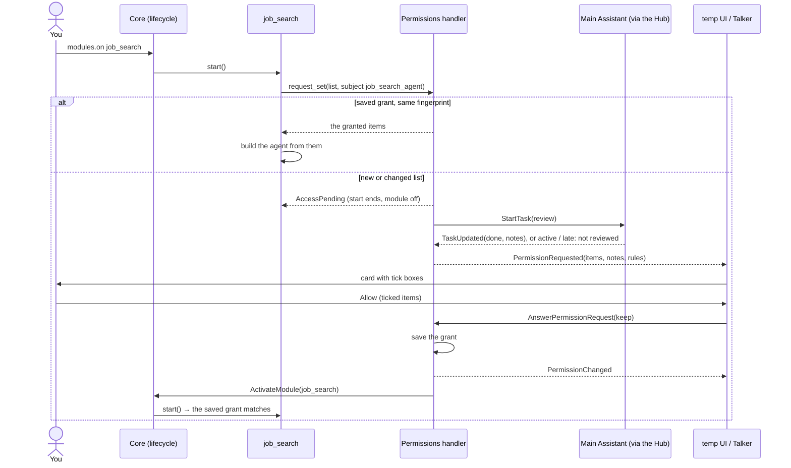
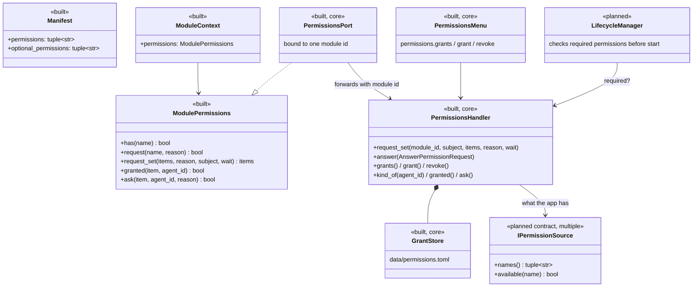
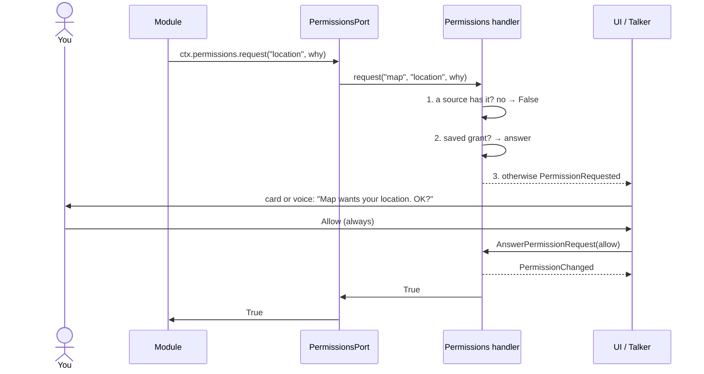

# Permissions

Who may use what: location, the microphone, files, accounts. Back to the [overview](README.md).

> **Status: first piece built (2026-11-05).** The permissions handler is part of the core (`src/assistant/core/permissions/`), always on. Built: [access lists](#access-lists-built) for task agents (one card per list, saved grants per kind of agent, the Main Assistant's review, the `permissions.*` grant calls). Built from the agent-permissions note (in next steps). Not built yet: single permissions (`location`, `microphone`) are still allowed and logged, permission sources, and required permissions checked at start.
>
> **Built: `ctx.permissions`** (2026-11-02) on every module's context, with `has` and `request`, and the manifest's `permissions` / `optional_permissions` fields. Since 2026-11-05 it's a `PermissionsPort` bound to the module, forwarding to the handler; `request_set` asks for a whole access list ([API](../api/modules.md#modulecontextpermissions)).
>
> **Built: the [permission mode](#permission-mode-built)** (2026-11-02): Manual or Auto for the Main Assistant, switched with a button.
>
> **Built: [messages between agents](#messages-between-agents)** (2026-11-10): the Agent Hub's message gate asks with a `message:<receiver>` item, answered Allow once, Always allow or Deny.

## The idea

Permissions are per module, not per app. A map module may get your location; a notes module doesn't. If a module lacks something it needs, only that module stops or loses a feature; everything else runs.

One **permissions handler** knows three things:

1. **What the app has:** real capabilities it can check, such as Windows location being on, a microphone being present, or a Google account being connected. Each comes from a permission source (planned).
2. **What each module needs:** declared in its manifest, as required or optional. A task-agent module declares `agent.access` and lists its access in its config.
3. **What you've granted each module:** saved across restarts in `data/permissions.toml`, for example "job_search → job_search_agent: read `C:\Chang\Jobs`, use Chrome".

A module may use a permission only when the app has it **and** you've granted it to that module.

**Responsible for:** checking, asking you, remembering grants, and announcing changes. **Not responsible for:** operating-system prompts (Windows grants those to the whole process) or enforcing anything inside a module. See [the limit](#the-limit).

## Part of the core

Decided 2026-11-05. The handler is part of the core, not a module ([decisions](decisions.md#decided)):

- **Always on.** No module or agent can turn it off or reload it. It isn't in the module list.
- **Generic.** It uses only the core's generic parts, handed in by `App`: the router's `send`, the bus's `publish`, and the container's `get_one` (for [`IAgentNames`](../api/agents.md#iagentnames) at revoke time). It imports no module.
- **No module-specific logic.** A new module only declares `agent.access` in its manifest and lists its access in config. The Main Assistant's review is a normal task (`StartTask` / `TaskUpdated` / `CancelTask`).
- **It names no agent:** the reviewer (`main_assistant`) and "you" (`temp_ui`) are set in `config/default.toml` under `[core.permissions]`; the code's defaults are empty (principle 21).
- **Its grant calls are on the core's menu** (id `core`), beside `modules.*`: `permissions.grants / grant / revoke` ([API](../api/control.md#the-cores-menu)).

There's no `IPermissions` contract and no permissions module; the stand-in that allowed everything is gone, and so is the registry's special start order for it.

## How a module uses it

Every module uses the same calls on its own context, `ctx.permissions`:

    if ctx.permissions.has("location"):
        ...
    allowed = await ctx.permissions.request("files.write:src", reason="Fix the bug you asked about")
    granted = await ctx.permissions.request_set(items, reason, subject="job_search_agent")

A module never finds the handler or passes its own id. The core gives each module a `PermissionsPort` bound to its id, which forwards to the handler. This is how Android, iOS, and browsers do it: one standard call, and the system, not the app, says who is asking. No module can ask in another's name.

## Access lists (built)

A task agent asks for its whole access list in one request when its module is turned on. The list comes from its config section: `workspace` (its working folder, read and write), `read_dirs`, `write_dirs`, `python`, `allowed_commands` and `chrome` ([`access_items`](../api/infra.md#agent_access)). Each item has a key (`kind:target`, for example `read:C:\Chang\Jobs`).

**The fingerprint:** a hash of the list's keys. If it matches the saved grant, the saved grant is used and nothing is asked. Any change, even a narrower list, asks again.

**The card** shows who asks (`job_search → job_search_agent`), the list with a tick box per item (the working folder has none: it comes with the agent), the warnings, and the fixed rules. You allow the ticked items or deny. The temp UI's card has the tick boxes; the Talker reads the card out and answers it whole with `<<ALLOW>>` / `<<DENY>>`.

- **Refused:** a write to a folder in the [protected zone](#repo-zones) (or one holding part of it) is taken off the list and shown as refused.
- **Rule warnings**, fixed and predictable: writing plus Chrome; reading outside the working folder plus Chrome; Python.
- **The review:** the Main Assistant gets the list and the rule warnings as a short task and adds one line per further risk. If it's active on other work or doesn't answer in time (90 s), the card says "not reviewed".
- **Fixed rules:** never submit or send anything (a prompt rule, not enforced in code); protected paths are never granted; sessions start in Manual.
- **Sessions always start in Manual.** A list can't start an agent in Auto: `permission_mode` in config is clamped to `default`, `acceptEdits` or `plan` ([`manual_claude_mode`](../api/infra.md#agentprofile)). Auto stays your button.
- A denied card, or no answer in 10 minutes, leaves the module off. A denial is saved too, so the same list asks again only when it changes.

The agent is built from the config cut down to what you allowed ([`granted_config`](../api/infra.md#agent_access)). A trimmed folder never becomes a rule, so `claude` asks for it with a normal card.

### The flow

A module's start can't wait on a card (`ActivateModule` would time out). So `request_set(wait=False)` raises `AccessPending`: the start ends, the module stays off, and the handler turns it on after your Allow. A helper launched inside an approved run waits for the card instead (`wait=True`).

Built 2026-11-05.

### Grants per kind of agent

A grant is saved per module and **subject**: the kind of agent, not each copy. The job agent's subject is `job_search_agent`. For `task_agents` the subject is the kind: `helper_2` shares `helper`'s grant, and so does every helper launched from that kind. One section of `data/permissions.toml` per module and subject holds the fingerprint, the asked and granted keys, whether it was denied, and the date. It changes only through the handler's calls.

### Messages between agents

Built 2026-11-10. When an agent messages another agent that isn't its own child task (`hub.send` with `agent_id`), the Agent Hub's message gate (`agent_hub/gate.py`, `MessageGate`) asks first, with one item, `message:<receiver>` (`AccessKind.MESSAGE`).

- **The check:** `ctx.permissions.granted(item, sender)` reads the Hub's saved grant for the sender's kind (the handler's `kind_of`: `helper_2` shares `helper`'s). Granted: the message goes through with no card.
- **The card** (`ctx.permissions.ask(item, sender, reason)`, action `message`): "job_search_agent wants to message cv_agent", with the start of the text. Three buttons: **Allow once** (`AnswerPermissionRequest.remember=False`: this message only, nothing saved), **Always allow** (saved), **Deny**. The Talker's ALLOW is Allow once; Always is only the button.
- **Saved:** under module `agent_hub`, subject = the sender's kind, item `message:<receiver>`. One grant per direction: job → cv and cv → job are each asked once. It shows in `permissions.grants` and the Grants panel.
- **While the card is open,** the message and any later ones from the same sender to the same receiver wait behind it. On Allow they're delivered (never into a running turn); on Deny or no answer nothing is sent and the sender gets a `[messages]` note.
- **Revoke:** `permissions.revoke` of only `message:` items keeps `agent_hub` on; the next message asks again.
- **Never asked:** the Talker (you), and a message into one's own child task.

### Managing grants

The calls are on the core's menu, with no UI in them, so any UI and any agent use the same ones. Each knows its caller (`InvokeTool.caller`).

| Call | Does |
|------|------|
| `permissions.grants` | The saved grants per module and subject: what was granted, the date, and whether the current list still matches |
| `permissions.grant` | Grant asked-for items (or ones an agent added itself) to a module, then it turns on with them |
| `permissions.request` | An agent asks for more access **for itself**: folders to read or write, commands, a Python, Chrome, with a reason. Its module and subject come from its own id (the module tells the handler with `ctx.permissions.own_agent`, checked against the name's claim), so it can only ask for itself. You get a card; on Allow the items join its saved grant as **added** items, beyond its config list. The Main Assistant (no access list) is refused with a reason |
| `permissions.revoke` | Take back a module's grant: all of it, or some items |

**Who:** "you" is a UI you click in (`you` in `[core.permissions]`, `temp_ui` in `default.toml`): your calls apply at once. An agent's grant or revoke shows you a card first, and only your Allow applies it; the answer reaches the agent as a note. An agent can't take access away on its own.

**The rules:**

| Change | What happens |
|--------|--------------|
| A widened grant | Saved. A module that's off is turned on. A running agent takes it **live** (built 2026-11-06, after the restart): its module hears `PermissionChanged` ([`watch_grant`](../api/infra.md#agent_access)) and calls [`ProfileAgent.set_access`](../api/infra.md#profileagent); an idle open session restarts once at once, a busy one gets it at its next session (next task or handoff). No off and on |
| Added items | Saved under `added` in its section. The fingerprint stays the config list's, so an unchanged config still matches and the next start keeps them; `granted_config` adds them to the config |
| A narrowed revoke (some items) | The grant keeps its fingerprint, so the same list isn't asked again; it starts with fewer items |
| A full revoke, or a revoke of the workspace | The grant is removed; the module asks again when turned on |
| Any other revoke | The module turns off right away and its running tasks are stopped (like Esc). A running session would keep the old access, since its rules are fixed when it starts |
| A revoke of only `message:` items | The module stays on; the next message between those agents asks again ([messages between agents](#messages-between-agents)) |

**Your snips:** every task agent built on `ProfileAgent` may read this launch's snips folder (`logs/<launch>/snips/`, your snips and pasted images) with no card: a read rule added at each session start, not on any access list.

The only screen is a rough, throwaway grants panel in the [temp UI](../modules/temp_ui.md), all in `temp_ui/static/grants.js`.

## Permission names

Plain strings, with a scope where one is needed:

| Name | Means |
|------|-------|
| `location` | Your location |
| `microphone`, `camera` | The device |
| `network` | Reaching the internet |
| `google.calendar` | A connected account |
| `files.read:<area>`, `files.write:<area>` | Reading or writing an area, such as `repo`, `docs`, or `src` |
| `agent.access` | A task-agent module that asks for its config's access list when turned on |

## What happens when one is missing

| Situation | What happens |
|-----------|--------------|
| A **required** permission is missing at start | That module doesn't start; its state is `blocked` with the reason ("needs location"). Everything else starts normally (planned) |
| An **optional** permission is missing | The module runs with that feature off |
| A module needs one **in the moment** | It calls `request`; you get an Allow / Deny card or the Talker asks. Allow once or always (planned) |
| You **revoke** one | `PermissionChanged` is published; the module turns that feature off, or is turned off. Built for access lists: the module turns off |
| Nobody answers | Denied after a timeout (10 minutes) |
| **Single names, for now** | `has` / `request` aren't checked yet (the handler's next piece): allowed, and the first use of each name per module is logged as a warning ("not checked yet: allowing voice_in microphone"), then debug |

## Classes

**Messages** (built for access lists; [API](../api/messaging.md#access-and-permissions))

| Item | Kind | Purpose |
|------|------|---------|
| `PermissionRequested(request_id, module_id, subject, action, reason, items, notes, reviewed, rules, caller)` | event | A card for you: an access list, an agent's grant or revoke, or an agent's message to another (`message`); UIs and the Talker show it |
| `AnswerPermissionRequest(request_id, allow, keep, remember)` | command | Your answer; `keep` is the ticked items (none: all); `remember=False` is a message card's Allow once |
| `PermissionChanged(module_id, subject, granted, request_id, text)` | event | A grant was saved, denied or revoked; closes the card |
| `ListPermissions()` | command | Every module's needs and grants, for the control panel (planned; `permissions.grants` covers access lists) |

A permission source is anything that knows whether the app has a capability, such as `WindowsLocation` or `Microphone`. A source can be its own module, so a new device or account adds a source and nothing else changes.

## Flows

### A module asks for a single name (planned)

### A module starts (planned)

Startup never asks you for a single name; a module that's blocked waits until you grant the permission (in the control panel, or by telling the Talker) and is activated again. Access lists differ: the card opens, and your Allow turns the module on.

## The Main Assistant

Its own access isn't moved to the handler yet (agent-permissions, decision 9): it keeps its config rules. Planned:

- Its standing rules become saved grants (`files.read:repo`, `files.write:docs`), turned into `--allowedTools` rules when its session starts ([`path_rule`](../api/infra.md#path_rule)).
- A `can_use_tool` request from `claude` becomes `ctx.permissions.request("files.write:<path>")`.
- The agent-specific [`AnswerPermission`](../api/agents.md#answerpermission) command, `ReportKind.PERMISSION`, and the Hub's part in permissions go away. The Allow / Deny cards and the Talker's `<<ALLOW>>` / `<<DENY>>` tags stay, and answer the handler instead.
- Its [permission mode](#permission-mode-built) becomes a grant per module ("main_assistant: auto"), and the handler handles `SetPermissionMode` in place of the Hub.

It already reviews access lists before their cards show.

## Permission mode (built)

Built 2026-11-02. What the Main Assistant may do without asking, switched while the app runs:

| Mode | What it does |
|------|--------------|
| **Manual** (every launch) | Its standing rules, and an Allow / Deny card for anything else |
| **Auto** | Full permissions (`bypassPermissions`), no cards, except `git push`, which is refused (`--disallowedTools`; checked against the real `claude` to hold under bypass). It's told to stop and ask (`NEED: Risky: …`) before very risky steps: deleting beyond the task, rewriting git history, changing secrets or settings, installing software, spending money, sending anything off the machine, anything hard to undo |

- **Only you switch to Auto**, with the stand-in button in the temp UI's Talker pane, after a confirm dialog. The Talker can only switch back to Manual; the Main Assistant can't switch at all. No config starts a session in Auto.
- **It's not a guarantee.** The risky-step pause is the model's own judgment. The one hard limit is `git push`, and it only catches a direct `git push`, not `git -C x push` or a script that pushes.
- **Through the Agent Hub for now:** [`SetPermissionMode`](../api/agents.md#setpermissionmode) → [`ITaskAgent.set_permission_mode`](../api/agents.md#itaskagentset_permission_mode) → [`PermissionModeChanged`](../api/agents.md#permissionmodechanged). How a switch takes effect: [runtime](../agents/runtime.md#permission-mode).

## Repo zones

The index of which part of the repo is the core app and which is modules, and what an agent may write in each. The Main Assistant reads all of it.

| Zone | Paths | Writes by an agent |
|------|-------|--------------------|
| **Protected** | `src/assistant/core/permissions/`, `data/permissions.toml`, `config/`, `.claude/settings.json`, `.claude/settings.local.json` | Never, even if you say yes; otherwise it could grant itself permissions |
| **Core** | `src/assistant/core/`, `src/assistant/contracts/`, `src/assistant/infra/`, `src/assistant/__main__.py`, `scripts/`, `.github/`, `pyproject.toml` | On its branch; asks |
| **Modules** | `src/assistant/modules/<id>/` and that module's tests | On its branch; asks |
| **Docs and skills** | `docs/` (not `docs/html/`), `.claude/skills/` | `docs/` is a standing grant; skills ask |

- **Enforced for access lists:** the handler refuses a write to the protected zone on any list. Otherwise not enforced yet: until the branch workflow is built, the Main Assistant edits any file in the repo, with the same access as Claude Code. In Auto nothing asks first, so its risky-step rule names `config/` and `.claude/settings*` as steps to ask about.
- **For now Core and Modules have the same rule** (decided 2026-10-26: everything is still being built). The split is recorded so the rules can differ later, for example "always" grants allowed for a module but never for the core.
- **The handler holds the same list in code** (`PROTECTED` in `core/permissions/rules.py`), in the protected zone, so an agent can't edit its own guardrails. This table mirrors it; if they disagree, the code wins and this table gets fixed.
- **Enforced by `claude`:** protected paths are never in an agent's rules and its requests for them are denied without asking you; other `src/` paths are never standing rules, so each write arrives as a request.
- **Branch edits happen in a git worktree** (a separate copy of the repo on its own branch, e.g. `../AI_Assistant-work`), so the running app on `main` is never touched. The app, not the agent, does the git work: branch, commit, tests, and merge when you say so. This is step 4 of [self-improvement](../agents/self-improvement.md#steps).

## The limit

Inside one process, this only holds if modules use it: a module could call the operating system directly. Real enforcement needs a separate process, as the `claude` agents have today: their own session enforces their rules. For our own modules, using `ctx.permissions` is the rule, and code review keeps to it.

## Open questions

- **The next pieces:** checking single names (`has`, `request`), permission sources, and required permissions at start (the `blocked` state).
- **The Main Assistant's own access** moving to saved grants.
