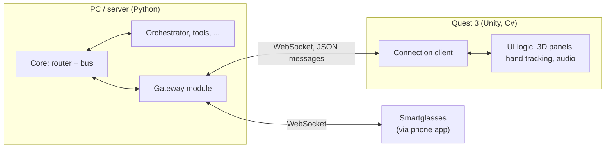

# Remote clients

Devices that connect to the app over the network. Back to the [overview](README.md).

Devices such as the Quest 3 and smartglasses are separate applications (e.g. a Unity app for the Quest) that connect to the core over the network. They own their own UI logic and local state; the core owns AI, tools, and data.

- **Gateway module:** relays commands, events, and results between the core and connected clients. It's an ordinary, removable module; the core never knows clients exist.
- **Protocol:** a versioned message envelope (`kind: command | event | result`, `name`, `correlationId`, `payload`) using the same message types and result statuses as in-process communication. Defined as a language-neutral schema in the API reference so Python and C# share one definition.
- **Content, not layout:** the core sends content and events ("here's the response", "task finished"). Clients decide how to present them.
- **Client capabilities:** on connect, a client can advertise tools (e.g. "place a 3D object in the room"). The gateway exposes them as an `ToolProvider`, so the orchestrator invokes them through `InvokeTool` like any other tool.
- **Connectivity:** direct on the local network; a private VPN (e.g. Tailscale) when away from home, so nothing is exposed to the internet.
- **Audio:** starts as chunks over the WebSocket; WebRTC later only if latency demands it.
- **Repo:** client apps live in this repo under `clients/` (e.g. `clients/quest/`) so the protocol and both sides change together.
