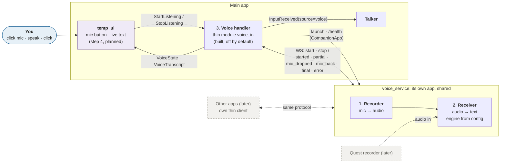
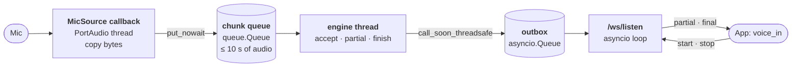
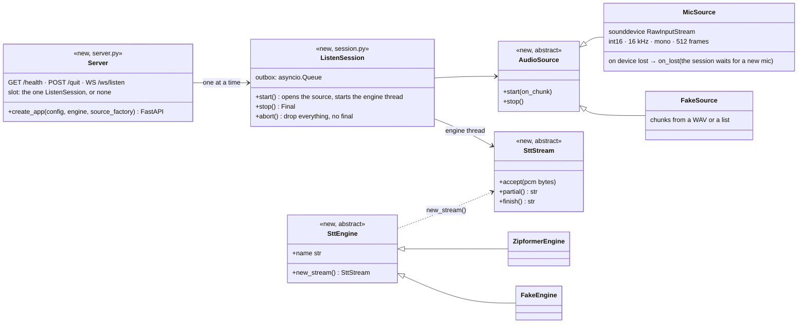

# Voice

Speech to text, so you can talk to the assistant instead of typing. It's **Voice in** in the [overview](README.md). Voice out (the Talker speaking back) is a separate, later part.

> **Status: being built (designed 2026-10-28; code design added and approved 2026-11-02).** Phase 1 below is built in steps, listed in the next-steps list. The code-level design is under [Code design (phase 1)](#code-design-phase-1).
>
> **Built: step 1, the contracts** (2026-11-03, [change note](../next-steps/voice-contracts.md)): `StartListening`, `StopListening`, `ListeningState`, `VoiceState`, `VoiceTranscript` in `contracts/voice.py`, and the protocol's messages in `voice_service/protocol.py`, which `voice_in` will import ([API](../api/messaging.md#voice)). `voice_in` is next.
>
> **Built: step 2, the voice service** (2026-11-03, [change note](../next-steps/voice-service.md)): `src/voice_service/` as designed below, run alone with `python -m voice_service` (or `voice-service`); `python -m voice_service download zipformer` fetched the model (310 MB) into `%LOCALAPPDATA%\AI_Assistant\voice_models`, outside the repo. Tested with the fake engine and fake sources ([API](../api/messaging.md#the-voice-services-parts)). On the model's own test recordings, fed at the speed of speech through the whole service, int8 matched both reference texts word for word, with the final 46 to 78 ms after `stop`. The first partial came about 1.1 s after `start`; that includes the recording's lead-in, so the real check is your own mic (step 6). The full-precision files gave the same text (only *dishonored* for *dishonoured*) and were slower (62 to 93 ms), so int8 stays the default.
>
> **Built: step 3, the `voice_in` module** (2026-11-03, [change note](../next-steps/voice-in-module.md)): `src/assistant/modules/voice_in/`, off by default, as designed in [the voice_in module](#the-voice_in-module), plus two additions you asked for. **A dropped mic is waited for:** the service keeps the session and tries to reopen the mic for `mic_recovery_seconds` (15 s), sending `mic_dropped` and then `mic_back`. If the mic doesn't come back, the session ends and its text is dropped. **A quick `/health` check** runs before reusing a service that's already running. Tested against the real service app with its fake engine and fake mic on a local port. Your own mic is step 6.

## Rules

- **English only.** Local, with no cloud APIs and no internet needed.
- **Real time:** you see partial text while you speak. Targets: first partial under 500 ms; final under 500 ms after you stop. Neither engine has run on this PC yet, so the targets are checked in the first build, not assumed.
- **A button first:** click to turn the mic on, click again to turn it off. Hands-free comes later.
- **One message to the Talker when the mic turns off.** Everything said while the mic was on goes out as one message, so the Talker never answers half a thought and each message is one paid turn.
- **Swappable engine:** the engine is a config value. Nothing outside the engine knows which model runs.

## The voice handler: three parts

Voice input is one **voice handler**, like the [log handler](core.md#logging) and the [permissions handler](permissions.md). Its three parts talk only through messages, so each can be swapped on its own.



**Built (2026-11-03):** the service (recorder and receiver) and `voice_in`. **Purple:** planned next (the temp UI's mic button, step 4). **Dashed:** later. Until step 4, nothing in the app sends `StartListening`, and `voice_in` is off by default.

| Part | Where it runs | Owns | Receives | Sends |
|------|---------------|------|----------|-------|
| **1. Recorder** | `voice_service`, its own app | The microphone | `start` / `stop` from a client | Audio to the receiver: PCM16, 16 kHz mono, chunks of about 32 ms (about 32 KB/s) |
| **2. Receiver** | `voice_service` | The speech engine (sherpa-onnx, chosen in config) | Audio from the recorder, or later from a remote recorder | Partial text while you speak; final text when the mic stops |
| **3. Voice handler** | Main app: the thin module `voice_in` | Launching the service, the mic permission, what reaches this app | `StartListening` / `StopListening`; text from the service | Live text to the UI; the final message as [`InputReceived`](../api/messaging.md#inputreceived)`(source="voice")` to the Talker |

**Why this split:**
- **The service never knows the assistant.** It runs alone (`python -m voice_service`) and doesn't import the assistant, like the [HTML viewer](html-viewer.md). This follows the decided rule that a part useful on its own becomes its own app, launched by a thin module ([decisions](decisions.md#decided)).
- **Clients never know the engine.** The protocol names no models, so the engine can be swapped, given a second pass, or moved off the PC without changing any client.
- **The rest of this app sees only messages.** The Talker gets `InputReceived`, the same event typed text uses. The Talker, the Agent Hub, and the logs don't change.

## A shared service

Voice to text is wanted in several apps, so `voice_service` is shared. Any app connects over the same WebSocket protocol and decides what to do with the text. This app sends the final message to the Talker; another might type it into a box.

- **Each app keeps only a thin client.** Everything specific to an app (here: the Talker, the UI events, the permission check) stays in that client, never in the service.
- **One listener at a time** at first: a second `start` gets `busy`.
- **Localhost only** at first, with no access control between apps.

## The protocol

Written down so other apps can use it. It names no models and nothing about the assistant.

**`/ws/listen`** (apps):

| Direction | Message | Meaning |
|-----------|---------|---------|
| app → service | `{"type": "start"}` | Open the mic and start transcribing |
| app → service | `{"type": "stop"}` | Close the mic; the final text follows. A `stop` with nothing listening gets an empty `final` |
| service → app | `{"type": "started"}` | The mic is open (added 2026-11-02, so the app knows `start` worked) |
| service → app | `{"type": "partial", "text"}` | The text so far; replaces the previous partial |
| service → app | `{"type": "mic_dropped", "detail", "wait_seconds"}` | The mic went away mid-session. The session stays open with its text, and the service tries to reopen the mic for `wait_seconds` (added 2026-11-03; never sent with `mic_recovery_seconds = 0`) |
| service → app | `{"type": "mic_back"}` | A mic opened again; listening carries on with the same text (added 2026-11-03) |
| service → app | `{"type": "final", "text", "latency_ms", "complete", "ended_by"}` | The finished text after `stop`; empty if nothing was heard. `complete` is false when the session ended early (the mic was lost and didn't come back, or you stopped while it was dropped). `ended_by` is `"stop"` (the app sent `stop`) or `"silence"` (the service stopped itself after a long silence, see [config](#the-voice-service-config)); a silence stop needs no `stop` from the app |
| service → app | `{"type": "error", "reason", "detail"}` | `reason` is a fixed code (below); `detail` is a sentence for the log |

**Error codes:** `busy` (another app is listening), `mic_unavailable` (no mic, or it couldn't be opened), `mic_lost` (the mic went away mid-session and didn't come back within `mic_recovery_seconds`), `engine_failed` (the model didn't load), `bad_message` (unknown or malformed message). After any error except `bad_message` the session is over and the service is idle again.

**`/ws/audio`** (remote recorders, later): `start` (format `pcm16`, rate `16000`, mono), binary audio frames, `stop`; the replies are the same as above.

## The app side

- **Contracts** (built, Messaging group; fields in [the voice_in module](#the-voice_in-module)): commands `StartListening` and `StopListening`, handled by `voice_in`; events `VoiceState` (`idle`, `starting`, `listening`, `dropped`, `failed` with a reason) for the button, and `VoiceTranscript` (the live text). Any UI can send the commands: the temp UI today, the real [UI handler](decisions.md#open-decisions) or the Quest later.
- **The Event Bus is the stream** (decided 2026-11-02): no `Streamable` class. `VoiceTranscript` is the public output; any module that wants voice text calls `ctx.subscribe(VoiceTranscript, ...)`. `InputReceived` is only the Talker's way in.
- **`send_as_input: bool = True`** on `StartListening` (decided 2026-11-02): with `False` (dictating into a text box, say), the text goes only to `VoiceTranscript` subscribers, never to the Talker.
- **Where you see the text:** while you speak, a grey line above the input box in the temp UI shows the partials. When the mic turns off, the final text appears in the chat as your own message, exactly like typed text. If nothing was heard, nothing is sent.
- **Config:** `[modules.voice_in]` (`host`, `port`, `start_timeout`, `service_config`, `reply_timeout`), off by default; the service has its own config file for the engine and model path, read with the shared [`app_kit.load_layered`](../api/app_kit.md#load_layered) ([details](#the-voice-service-config)).
- **Dependencies** (FastAPI, Uvicorn, sherpa-onnx, sounddevice) go in an optional `voice` extra, so the app installs without them. Model files download once.

## The mic permission

The **voice handler** asks, once, when you click the mic and before it sends `start`. The service never asks; it only needs Windows' mic access (*Settings → Privacy → Microphone → Let desktop apps access your microphone*).

- From day one, `voice_in` declares `microphone` as an optional permission in its manifest and asks `ctx.permissions` at that point (revised 2026-11-02).
- Until the [permissions handler](permissions.md) is built, the `ctx.permissions` stand-in applies its decided rule: allow and log a warning. Your click is the consent, each start is logged, and nothing listens in the background. When the handler arrives, `voice_in` doesn't change.
- Other apps do their own check in their own clients. On the Quest, the headset's mic permission applies too.

## Code design (phase 1)

> Added and approved 2026-11-02. Everything here fits the decisions above; the few small additions, and what you decided on each, are under [For you to check](#for-you-to-check).

### The voice service: threads and audio flow

**One asyncio loop for the network, two plain threads for audio and the engine.** The engine's decoding is CPU work that releases the GIL, so it gets its own thread instead of blocking the loop; the mic callback must never block, so it only copies and queues.

| Thread | Runs | Rule |
|--------|------|------|
| **Main** | Uvicorn's asyncio loop: `/health`, `/quit`, `/ws/listen`, the one-listener slot | Never decodes or touches the mic directly |
| **Mic callback** (PortAudio's own thread) | `MicSource`'s sounddevice callback, every 32 ms | Copies the chunk's bytes and `put_nowait`s them on the session's chunk queue. Nothing else: no locks, no logging, no engine calls |
| **Engine** (one per session, `voice-engine`) | `ListenSession._run`: takes chunks, `accept`s them, reads `partial()` | Hands results to the loop with `loop.call_soon_threadsafe`, never awaits anything |
| **Model load** (once, at service start) | `SttEngine.load` on a daemon thread, `voice-model-load` (built so instead of `asyncio.to_thread`, so a shutdown never waits on a load) | Sets the `ready` event, or records the load error |



- **The chunk queue** is a bounded `queue.Queue` holding `audio.queue_seconds` of audio (10 s, about 312 chunks). If the engine falls that far behind, new chunks are dropped and counted, and the final's log line says how many milliseconds were lost. It should never happen with Zipformer; it's a guard, not a feature.
- **Partials** are sent only when the text changed, and at most every `engine.partial_interval_ms` (100 ms). The final is always sent.
- **Silence stop:** the engine thread notes when the recognized text last changed (the clock starts at `started`). If it hasn't changed for `audio.silence_stop_seconds` (120 s), no speech was detected in that stretch, so the session stops itself exactly like a `stop` and the final carries `ended_by: "silence"`. While you keep talking the text keeps changing, so the session stays on with no time limit. Using the engine's own text means no separate voice-activity detector, and background noise that isn't words doesn't keep the mic on.
- **Stop:** the loop gets `stop`, records the time, and calls `source.stop()` (sounddevice waits for its last callback). It puts an end marker on the queue; the engine thread drains what's left, calls `finish()` (which pads the tail and flushes the model), and posts the `final`. `latency_ms` is the time from `stop` received to final ready, which is the "final under 500 ms" target.
- **The model loads once**, in the background when the service starts; streams are per session. A `start` that comes while it's still loading opens the mic at once and buffers in the chunk queue, so nothing you say is lost; the engine catches up when the model is ready.
- **Later, `/ws/audio`** plugs in as a second `AudioSource` (`RemoteSource`) that fills the same queue from WebSocket frames. `ListenSession` doesn't change.

### The voice service: files and classes

```
src/voice_service/          # never imports assistant
├── __init__.py
├── __main__.py             # CLI: `python -m voice_service [--config F] [--host H] [--port P]`
│                           #      `python -m voice_service download <engine>`
├── config.py               # ServiceConfig from app_kit.load_layered(path, local), plus overrides
├── protocol.py             # message models (pydantic) and the error codes
├── server.py               # create_app(config, engine, source_factory) → FastAPI
├── session.py              # ListenSession: one mic session, its queue and engine thread
├── audio.py                # AudioSource, MicSource (sounddevice), FakeSource (tests)
├── download.py             # fetch model files once into models_dir
└── engines/
    ├── __init__.py         # SttEngine, SttStream, load_engine(name, config)
    ├── zipformer.py        # ZipformerEngine (sherpa-onnx OnlineRecognizer)
    └── fake.py             # FakeEngine (tests): reveals a set text word by word
```



- **The engine interface's four calls** are split across two objects: `SttEngine.new_stream()` (the model, loaded once) gives an `SttStream` with `accept(pcm)`, `partial()`, and `finish()` (one per session). Engines take PCM16 bytes; converting to floats is each engine's job.
- **Tests** build the app with `create_app(config, FakeEngine(...), lambda: FakeSource(...))` and drive `/ws/listen` with FastAPI's test client. No mic, no model.
- **`/health`** answers `{"app": "voice_service", "engine": "zipformer", "ready": true|false, "error": null|"..."}`. `voice_in` uses it as its ping, like the viewer's `/api/ping`.
- **`/quit`** (POST, JSON body like the viewer's) ends the current session and shuts the server down.

### The voice service: config

Its own TOML file, read with the shared [`app_kit.load_layered`](../api/app_kit.md#load_layered) (revised 2026-11-02; no loader of its own, and still no `assistant` import): `config/voice_service.toml` in the repo, overridden by `config/voice_service.local.toml` (not committed), then by command-line flags. `--config` points at another file.

```toml
[server]
host = "127.0.0.1"
port = 8767                 # temp_ui is 8765, the HTML viewer 8766

[audio]
device = ""                 # "" = Windows' default mic; or a device name or index
chunk_ms = 32               # 512 frames at 16 kHz. Rate and format are fixed: 16 kHz mono PCM16
queue_seconds = 10          # how far the engine may fall behind before audio is dropped
silence_stop_seconds = 120  # no speech detected for this long: the session stops itself, like a stop (a forgotten mic). No limit while you talk
mic_recovery_seconds = 15   # the mic drops mid-session: keep the session and try to reopen it this long (mic_dropped, then mic_back). 0 = end at once (mic_lost)

[engine]
name = "zipformer"          # "zipformer" or "fake"
models_dir = ""             # "" = %LOCALAPPDATA%\AI_Assistant\voice_models; env VOICE_SERVICE_MODELS overrides
partial_interval_ms = 100

[engine.zipformer]
model = "sherpa-onnx-streaming-zipformer-en-2023-06-26"   # folder under models_dir
num_threads = 2
decoding = "greedy_search"
int8 = true                 # false = the full-precision model files (slower on a CPU, slightly more accurate)

[engine.fake]
text = "hello from the fake engine"

[logging]
level = "INFO"
file = ""                   # "" = stderr only
```

- **Models are never downloaded while running** (local, no internet). `python -m voice_service download zipformer` fetches them once. A missing model is `engine_failed`, and its detail names that command.

### The voice service: errors

| Case | What the service does | What you see |
|------|-----------------------|--------------|
| **No mic, or it can't be opened** (sounddevice raises on open; also Windows' mic privacy switch off) | `error mic_unavailable` with the device and the reason; session over, idle | The button shows *failed: no microphone* (or *mic blocked in Windows settings*). Nothing sent |
| **Mic busy** | Windows shares the mic in normal mode, so this is rare; if the open fails it's the same `mic_unavailable` | Same as above |
| **Mic lost mid-session** (unplugged: the stream's finished callback fires, or the callback reports an error) | Keeps the session and its text (revised 2026-11-03). It sends the last partial, then `mic_dropped`, and tries a fresh source from the factory about once a second (the silence timer is paused). If one opens: `mic_back`, and listening carries on. If none opens within `mic_recovery_seconds`, or the app sends `stop` meanwhile: `final` with `complete: false`, then `error mic_lost`. With `mic_recovery_seconds = 0`, it ends at once as before | *dropped*: the drop symbol and a countdown while it waits. If the mic doesn't come back: *failed: mic disconnected*, and the text heard so far is **dropped** (cleared from the live line, kept only as its length in the log, never sent to the Talker) |
| **Model didn't load** (missing files, bad model, sherpa-onnx missing) | The service still starts; `/health` shows `ready: false` and the error; every `start` gets `error engine_failed` | *failed: speech model not installed* (detail in the log) |
| **Client disconnects mid-session** | `abort()`: close the mic, stop the engine thread, drop the audio, free the slot. No final. Logged | — |
| **Stop with no speech**, or a stop with nothing listening | `final` with `text: ""` | The live line clears; nothing is sent |
| **Long silence** (no speech detected for `silence_stop_seconds`) | Stops itself like a `stop`: `final` with `ended_by: "silence"`, then idle | The text heard so far is sent to the Talker as usual (if any); the button goes idle with *mic turned off after 2 minutes of silence* |
| **Stop right after start** (before `started`) | Messages are handled in order: the mic opens, then stops; a normal (likely empty) final | Same as above |
| **A second app sends start** | `error busy` to that app; the first session carries on | — |
| **Engine thread crashes** (an exception in `accept` or `finish`) | `error engine_failed` with the exception; session over. The model stays loaded for the next try | *failed: speech engine error* |

### The voice_in module

**Manifest:**

```python
class VoiceInModule(Module):
    manifest = Manifest(id="voice_in", optional_permissions=("microphone",))
    # provides, requires, optional: none
```

- **Provides nothing, requires nothing, uses nothing optional.** It talks only through commands and events: it handles `StartListening` and `StopListening`, publishes `VoiceState`, `VoiceTranscript`, and `InputReceived`. The Talker already subscribes to `InputReceived`, so it needs no contract from it. Not an `IToolProvider`: agents don't turn on your mic.
- **Permissions, from day one:** `microphone`, declared **optional** (the module starts and shows its button without it), and asked in the moment with `ctx.permissions.request("microphone", reason="You clicked the mic")` on each `StartListening`. A denial returns `Status.FAILED` with "microphone not allowed" and `VoiceState(failed)`. Until the [permissions handler](permissions.md) is built, the `ctx.permissions` stand-in allows and logs the warning; `voice_in` logs none of its own.

**Commands** (Messaging group, `src/assistant/contracts/voice.py`):

| Command | Fields | Result |
|---------|--------|--------|
| `StartListening` | `send_as_input: bool = True` (with `False`, no `InputReceived`; the text goes only to `VoiceTranscript` subscribers) | `ok` once the service says `started` (value `{"session_id"}`). Already listening: `ok` with the same session. `not_available` (retryable) if the service couldn't start or answered `mic_unavailable` / `engine_failed`; `failed` for `busy` or a denied permission. Timeout: `core.command_timeouts.StartListening = 30`, since a first start may launch the service and load the model |
| `StopListening` | none | `ok` after the final arrives, value `{"text", "latency_ms"}`. Nothing listening: `ok` with `None`. `failed` if the mic was lost (the text is dropped), the service stopped, or no final came within `reply_timeout` |

**Events:**

| Event | Fields | When |
|-------|--------|------|
| `VoiceState` | `state: ListeningState` (a `StrEnum`: `idle`, `starting`, `listening`, `dropped` (added 2026-11-03), `failed`; decided 2026-11-03), `reason: str \| None` (the service's error code; the app's own `not_allowed`, `service_unavailable`, `service_stopped`, `timed_out`; `"mic_dropped"` on `dropped`; or `"silence"` on an idle after a silence stop), `detail: str \| None` (a short sentence for the button) | Every change. `starting` from the click until `started` (the service may be launching). `dropped` from `mic_dropped` until `mic_back` (then `listening`) or the end (`failed`, `mic_lost`) |
| `VoiceTranscript` | `session_id: str`, `text: str`, `final: bool` | Each partial (`final=False`), then once with the final text (`final=True`; empty clears the line) |
| `InputReceived` (existing) | `text`, `source="voice"` | Once per session, when the final is non-empty and `complete`, and `send_as_input` is true |

All three carry `correlation_id = session_id` (the `StartListening` command's id), so a UI can drop a stale session's updates.

**Config** (`[modules.voice_in]`, the module off by default):

```toml
[modules.voice_in]
# Voice input: launches the voice service (its own app) on the first mic click.
host = "127.0.0.1"
port = 8767
start_timeout = 20.0      # seconds for the service to answer /health after launch
service_config = ""       # optional path passed as --config to the service
reply_timeout = 10.0      # seconds to wait for `started` after start, and for the final after stop (added 2026-11-03)
```

The wait for a dropped mic is the service's setting (`[audio] mic_recovery_seconds`), since only the service can reopen the mic; `voice_in` gets it in `mic_dropped`'s `wait_seconds`.

**How it launches and watches the service** (the [companion app](reusable-parts.md#companion-app-checklist) pattern, through the shared [`CompanionApp`](../api/app_kit.md#companionapp), revised 2026-11-02; no launch code of its own):

- **`CompanionApp.ensure_running`**, on each `StartListening`, under a lock: ping `/health`. If it answers, use it (a service you started yourself is used and left running). Otherwise launch `sys.executable -m voice_service --host --port [--config]` with no console, and poll `/health` every 100 ms until `start_timeout`, failing early if the process exits. `ready: false` with an error is `engine_failed`, not a timeout.
- **A quick health check when reusing a running service** (added 2026-11-03): when `ensure_running` didn't launch it just now, `GET /health` (2 s). `ready: false` with an error fails at once with `engine_failed`, without opening a WebSocket. Still loading: carry on, because the service buffers the audio. No answer: `ensure_running` again, which relaunches it. A fresh launch skips the check, since `CompanionApp` has just pinged it.
- **One WebSocket per mic session**, with the `websockets` client: connect, send `start`, and a reader task maps every message. `started` → `VoiceState(listening)`; `partial` → `VoiceTranscript`; `mic_dropped` → `VoiceState(dropped)`; `mic_back` → `VoiceState(listening)`; a `final` with `complete: false` → the text is dropped: `VoiceTranscript(final=True, text="")` clears the line, then `VoiceState(failed, "mic_lost")`; `final` → `VoiceTranscript(final=True)`, then `InputReceived` if non-empty, complete, and `send_as_input`, then `VoiceState(idle)` (with `reason="silence"` and a short `detail` when `ended_by` is `"silence"`), then close. A silence stop needs no `StopListening`; a later `StopListening` finds nothing listening; `error` → `VoiceState(failed)` and close.
- **Watching:** there's no separate watchdog in phase 1. A crash mid-session shows up as the socket closing without a final: `VoiceState(failed, "service_stopped")`, nothing sent. The next click runs `ensure_running` again, which relaunches it; that's the lazy launch, not the left-out auto-restart.
- **Logging:** each session logs its start (the stand-in logs the permission warning), the final's length, `latency_ms`, and how it ended; the service's `detail` on every error. The service's own log has the audio length and the text (the protocol doesn't carry the audio length, so `voice_in` doesn't log it).
- **`stop()`** (app shutdown or deactivation): abort an open session (close the socket, no `InputReceived`), then `CompanionApp.stop()`: only if this module launched the service, `POST /quit`, wait 5 s, then kill.
- **The `websockets` client** is in the optional `voice` extra and imported in `init`; without it the module fails to start with "install the voice extra: pip install -e .[voice]", and the rest of the app runs.

```mermaid
sequenceDiagram
    actor You
    participant U as temp_ui
    participant V as voice_in
    participant S as voice_service
    participant T as talker
    You->>U: click mic (temp_ui: step 4, planned)
    U->>V: StartListening
    Note over V: one session at a time (a lock);<br/>already listening → ok, same session
    V-->>U: VoiceState(starting)
    V->>V: ctx.permissions.request("microphone")<br/>denied → failed, not_allowed
    alt service not running
        V->>S: CompanionApp: launch python -m voice_service, poll /health
    else already running (reused)
        V->>S: GET /health (2 s): ready:false + error → failed, engine_failed
    end
    V->>S: WS /ws/listen: start
    S-->>V: started (or error → failed with its code)
    V-->>U: VoiceState(listening)
    loop while you speak
        S-->>V: partial
        V-->>U: VoiceTranscript(final=False)
    end
    opt the mic drops
        S-->>V: mic_dropped {wait_seconds}
        V-->>U: VoiceState(dropped): drop symbol, countdown
        alt a mic reopens within mic_recovery_seconds
            S-->>V: mic_back
            V-->>U: VoiceState(listening), the text carries on
        else it doesn't (or you stop meanwhile)
            S-->>V: final {complete: false}, error mic_lost
            V-->>U: VoiceTranscript(final=True, text="") clears the line
            V-->>U: VoiceState(failed, mic_lost): the text is dropped
        end
    end
    You->>U: click mic
    U->>V: StopListening
    V->>S: stop
    S-->>V: final {text, latency_ms, complete}
    V-->>U: VoiceTranscript(final=True)
    V->>T: InputReceived(source="voice") if text and send_as_input
    V-->>U: VoiceState(idle)
```

**The tests** (`tests/test_voice_in.py`) run this flow against the real service app with `FakeEngine` and `FakeSource`, under Uvicorn on a free local port in a thread (no mic, no model). They cover every row of [the errors](#the-voice_in-module-how-errors-reach-the-button) and the mic drop. A small stub of `CompanionApp` checks which calls the health check makes.

#### The voice_in module: how errors reach the button

Every failure ends the session: `VoiceState(failed, reason, detail)`, the socket closed, the module ready for the next click, and nothing sent to the Talker.

| Case | `reason` | `detail` (the button) | `StartListening` result |
|------|----------|----------------------|-------------------------|
| Permission denied | `not_allowed` | microphone not allowed | `failed` |
| The service can't launch (the process exits) | `service_unavailable` | voice service didn't start | `not_available`, retryable |
| The service never answers `/health` within `start_timeout` | `service_unavailable` | voice service didn't answer | `not_available`, retryable |
| The WebSocket won't connect | `service_unavailable` | voice service didn't answer | `not_available`, retryable |
| No `started` within `reply_timeout` | `timed_out` | voice service didn't answer | `not_available`, retryable |
| `/health` on a reused service: `ready: false` with an error, or `error engine_failed` at start | `engine_failed` | speech model not installed | `not_available`, retryable |
| `error busy` | `busy` | another app is using the mic | `failed` |
| `error mic_unavailable` | `mic_unavailable` | no microphone (or blocked in Windows settings) | `not_available`, retryable |
| `error engine_failed` mid-session | `engine_failed` | speech engine error | (already `ok`) |
| The mic didn't come back (`final complete: false`) | `mic_lost` | mic disconnected; what you said was dropped | (already `ok`); a waiting `StopListening` → `failed` |
| The socket closes with no final | `service_stopped` | voice service stopped | a waiting `StopListening` → `failed`, retryable |
| No final within `reply_timeout` after stop | `timed_out` | voice service didn't answer | `StopListening` → `failed` |
| `error bad_message`, or a frame that won't parse | no change: logged, the session carries on | | |
| `stop()` (app shutdown) with a session open | `idle`, `service_stopped` | voice input stopped | |

### For you to check

Small additions to the agreed design, each needed by the error handling. **Decided by you, 2026-11-02:**

1. **A `started` reply** in the protocol, so the app knows the mic actually opened. **Approved.**
2. **A `starting` state** in `VoiceState`, for the seconds the first click may take to launch the service and load the model. **Approved** (with item 1).
3. **`detail` on errors and `complete` on the final.** On a lost mic, the text heard so far is shown and logged but not sent to the Talker. **Approved. Revised 2026-11-03:** a lost mic is waited for (`mic_dropped`, `mic_back`, `mic_recovery_seconds`); if it doesn't come back, the text is dropped.
4. **A silence stop** instead of the proposed flat two-minute cap: a session stops itself only after a long silence (`silence_stop_seconds`, default 120 s with no speech detected), and stays on with no limit while you talk. The final says `ended_by: "silence"` and the text is sent as usual. **Changed as you asked**: a flat cap would cut you off mid-sentence.
5. **Port 8767** for the service, and models in `%LOCALAPPDATA%\AI_Assistant\voice_models`, fetched once by a `download` command. **Approved.**

## Engines

Every engine runs through **sherpa-onnx**. It's mature and actively maintained, supports Python, Windows, and Android, and has official mic and streaming-server examples.

1. **Streaming Zipformer EN first.** It's small and fast, and proves the pipeline end to end. It's the same model family the standalone Quest would use.
2. **Nemotron Speech Streaming EN 0.6B INT8 second.** It's compared with Zipformer on the same recordings for latency, accuracy (word error rate), and CPU use.

**Postponed:** Parakeet Unified and other experimental conversions (no proven Python runtime). **Fallback:** Vosk. **Not used:** Whisper and whisper.cpp, which work on windows of audio and give no continuous partials. Parakeet TDT is out too: it's a batch model and loses accuracy when streamed in chunks.

## Roadmap

1. **Phase 1, PC prototype:** service and app client both on the PC, the button, live and final text, Zipformer, then Nemotron and the comparison.
2. **Phase 2, Quest 3 → PC:** a Unity client sends audio to `/ws/audio`; the PC does the inference.
3. **Phase 3, standalone Quest 3:** sherpa-onnx with Streaming Zipformer 20M INT8 on the headset.

**Later:** hands-free. The mic stays on, Silero VAD (included in sherpa-onnx) cuts at pauses, and each piece is sent as it comes. A `mode` setting (`toggle`, `hands_free`) on `voice_in` selects it. Also later: a wake word, not transcribing the assistant's own voice once voice out exists, and a floating mic widget that types into whatever window is focused.

## Open

- **Phase 2 and the gateway:** the Quest is meant to connect through the [gateway](remote-clients.md), but streaming audio straight to the service goes around it. The lean is: audio straight to the service, text through the gateway. Decide when phase 2 starts.
- **Several apps at once:** sharing one mic between listeners is left for when a second app exists.

## Decided (2026-10-28)

1. English only, local, real time.
2. A toggle button first; hands-free later.
3. One message to the Talker when the mic turns off, not one per pause.
4. One voice handler in three parts. The recorder and receiver live in `voice_service`, its own shared app. Each app keeps a thin client; in this app that's `voice_in`.
5. Engines through sherpa-onnx: Streaming Zipformer first, then Nemotron Speech Streaming EN 0.6B INT8. Parakeet Unified postponed, Vosk as the fallback, no Whisper.
