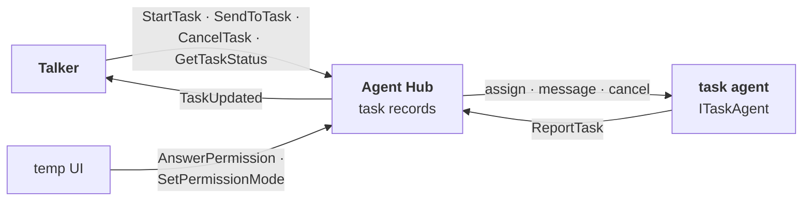

# agent_hub: who is doing what

## Purpose

Holds the authoritative task state and routes work between the Talker and the task agents. Not an AI; launches nothing. On by default. Design: [agents](../architecture/agents.md).

## Wrapper

| Field | Value |
|-------|-------|
| id | `agent_hub` |
| provides / requires | nothing |
| optional | [`ITaskAgent`](../api/agents.md#itaskagent) (every task agent; it never imports one) |
| permissions | none |

## Interface

| | |
|---|---|
| Tools | none |
| Handles | [`ListAgents`](../api/agents.md#listagents), [`StartTask`](../api/agents.md#starttask), [`GetTaskStatus`](../api/agents.md#gettaskstatus), [`SendToTask`](../api/agents.md#sendtotask), [`CancelTask`](../api/agents.md#canceltask), [`ReportTask`](../api/agents.md#reporttask), [`AnswerPermission`](../api/agents.md#answerpermission), [`SetPermissionMode`](../api/agents.md#setpermissionmode) |
| Calls | the agents' `ITaskAgent` methods |
| Publishes | [`TaskUpdated`](../api/agents.md#taskupdated) |
| Listens to | [`AgentActivity`](../api/agents.md#agentactivity) (kept per task as a view, not state) |

## Owns and launches

- **Task records**: id, agent, text, [`TaskState`](../api/agents.md#taskstate), recent activity. State changes only from commands, so dropped events can't corrupt it.

## Inner workings

Flows: [task assignment](../architecture/agents.md#task-assignment), [progress request](../architecture/agents.md#progress-request), [clarification](../architecture/agents.md#clarification).

## Config

None.

## Code and tests

- `src/assistant/modules/agent_hub/module.py`
- `tests/test_agents.py`

## Planned

`SetPermissionMode` routing moves to the [permissions handler](../architecture/permissions.md) when it is built. Its manifest gains a description and `handles` (module-shape refactor).
