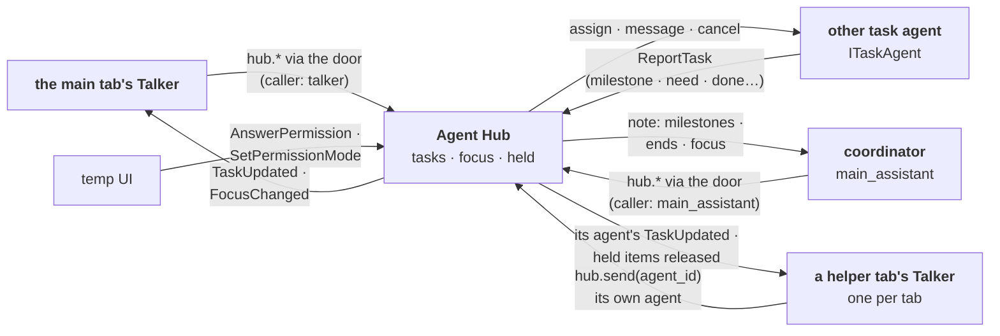

# agent_hub: who is doing what

## Purpose

Holds the authoritative task state and routes work between the Talker and the task agents, and keeps the **focus** (the agent you're talking to). Not an AI; launches nothing. On by default. Design: [agents](../architecture/agents.md), [working together](../architecture/agents.md#working-together).

## Wrapper

| Field | Value |
|-------|-------|
| id | `agent_hub` |
| provides / requires | provides [`IModuleDoor`](../api/tools.md#imoduledoor), the agents' one MCP door to the module menus, and [`IAgentNames`](../api/agents.md#iagentnames), the agent ids in use; requires nothing |
| optional | [`ITaskAgent`](../api/agents.md#itaskagent) (every task agent; it never imports one) |
| permissions | none |

## Interface

| | |
|---|---|
| Tools | [the Hub's menu](../api/agents.md#the-hubs-menu): `hub.agents`, `hub.status`, `hub.start`, `hub.send`, `hub.cancel`, `hub.focus`, `hub.answer`, `hub.mode` (the Talker only; `hub.mode` is Manual only), `hub.suggest_focus` (the coordinator only) |
| Handles | [`ListAgents`](../api/agents.md#listagents), [`StartTask`](../api/agents.md#starttask), [`GetTaskStatus`](../api/agents.md#gettaskstatus), [`SendToTask`](../api/agents.md#sendtotask), [`CancelTask`](../api/agents.md#canceltask), [`ReportTask`](../api/agents.md#reporttask), [`AnswerPermission`](../api/agents.md#answerpermission), [`SetPermissionMode`](../api/agents.md#setpermissionmode), [`SetFocus`](../api/agents.md#setfocus), [`DeliverMessage`](../api/agents.md#delivermessage) |
| Calls | the agents' `ITaskAgent` methods, including `note` (words for the coordinator's next turn); `ctx.permissions.granted` / `ask` (the message gate's cards) |
| Publishes | [`TaskUpdated`](../api/agents.md#taskupdated), [`FocusChanged`](../api/agents.md#focuschanged), [`FocusSuggested`](../api/agents.md#focussuggested) |
| Listens to | [`AgentActivity`](../api/agents.md#agentactivity) (kept per task as a view, not state), [`AgentNotice`](../api/agents.md#agentnotice) (passed to that agent's `note`), [`AgentStateChanged`](../api/agents.md#agentstatechanged) and [`ModuleStateChanged`](../api/control.md#modulestatechanged) (the focus check, then waiting messages try again) |

## Owns and launches

- **The module door** (built 2026-11-05): a [`DoorServer`](../api/infra.md#mcp_door), a local HTTP endpoint (`door_host`, `door_port`, default a free port; `door = false` turns it off) behind the stdio relay each `claude` session starts. Each session gets its own token from `mcp_config(caller)`; the door passes the caller that token proves as `InvokeTool.caller`, so a session can't call as someone else. A reload hands the port and tokens to the new copy, so running sessions keep their door.
- **Task records**: id, agent, text, parent task, [`TaskState`](../api/agents.md#taskstate) (`active` or `idle`, then the ends), the held flag, the open question with its kind and context key, recent activity. State changes only from commands, so dropped events can't corrupt it. An ended record lets go of its agent object (`holder`), and only the last 20 finished records stay (`KEEP_FINISHED`); a held one and an open task's parent always stay. They live in memory only: an app restart starts empty.
- **Questions** (built 2026-11-10): a `need` makes its task `idle` with the question and its key (`TaskRecord.asked`); the agent dropped it and is free. Your answer re-assigns the same task id ("Answer to your question in task <id> …"); while the agent is in a turn on other work, the answer waits (`Delivery.later`, and `hub.send` says "delivered: when its agent is free"). Cancelling a question needs no agent. The open questions are handed over on a Hub reload (`export_state` `"questions"`, `TaskBoard.export_questions` / `restore`) and don't hold the reload up. Design: [questions are messages](../architecture/agents.md#questions-are-messages).
- **Delivery** (`delivery.py`, built 2026-11-10): the [`DeliverMessage`](../api/agents.md#delivermessage) handler. A message never goes into a turn: into the agent's open task, or a new task if it has none; it waits while the agent is in a turn or not running, and goes when an `AgentStateChanged` or `ModuleStateChanged` lets it (`flush`). Messages to one agent keep their order. What waits is handed over on a reload (`"waiting"`). Used by `cv` (the result at Submit) and the gate.
- **The message gate** (`gate.py`, `MessageGate`, built 2026-11-10): `hub.send` with `agent_id` from an agent other than the Talker goes straight into the receiver's open task when that's the caller's child (it interrupts, as before); otherwise through the gate. If the sender's kind has no `message:<receiver>` grant, a card asks you ("X wants to message Y": Allow once · Always allow · Deny), and the message and later ones from X to Y wait behind it ("waiting on the user's card"). Allow: delivered through `Delivery`. Deny or no answer: a `[messages]` note to the sender. "Always" is saved under `agent_hub` for the sender's kind, one per direction. A reload waits while messages are on a card. Design: [messages between agents](../architecture/permissions.md#messages-between-agents).
- **The focus** (built 2026-11-05): the coordinator at launch, kept across a Hub reload, back to the coordinator when the focused agent stops. The Hub checks on every `AgentStateChanged` and `ModuleStateChanged`, and says the move with `FocusChanged` (`previous` is the gone agent), so the page leaves the dead tab at once (2026-11-06). A `need` or `permission` from an agent out of focus is **held** (stored once, on its task) until you focus that agent; `SetFocus` releases it in `FocusChanged`.
- **The cap and the folder check**: besides the coordinator (not counted), at most `max_extra_agents` agents (3 by default) have an active task at once; a task is refused when its agent's `write_folders` overlap those of an agent with an active task. A task holding a question counts for neither. An active agent is refused (`not_available`); an idle one stopped on a task drops it (done, "stopped: a new task replaced it").
- **The coordinator's feed**: every other agent's `milestone`, `done` and `failed`, and each focus move, go to the coordinator's `note`, read at the end of its next message. Never an interrupt, never a wake.
- **Agent names** (built 2026-11-05): the claimed ids and the module holding each ([`IAgentNames`](../api/agents.md#iagentnames), checked with [`check_agent_id`](../api/infra.md#agent_names)). Every `ProfileAgent` claims its id on start and releases it on stop; a taken id is refused with a free one named. The claims are kept across a Hub reload (handed over as `claims`, shown in `export_state`). Safety net: two agents with one id (one skipped the claim) are seen once, the first one, in `hub.agents`, `ListAgents` and routing, and the clash is logged once. Design: [agent names](../architecture/agents.md#agent-names).

## Inner workings

**Agent talkers** (built 2026-11-05): each tab has its own Talker; the Hub keeps the focus and every **!**. While you're in another tab, an agent's questions, replies (`TaskInfo.reply`) and ends (`done`, `failed`) are held (`TaskUpdated.held`) and released in `FocusChanged.released` when you open its tab, finished tasks included. `hub.send` takes an `agent_id`, so a helper tab's Talker sends to its own agent; other agents use it to message any agent, through the gate.

Flows: [task assignment](../architecture/agents.md#task-assignment), [progress request](../architecture/agents.md#progress-request), [clarification](../architecture/agents.md#clarification), [working together](../architecture/agents.md#working-together).

## Config

`[modules.agent_hub]`: `coordinator` (default `main_assistant`), `max_extra_agents` (default 3: big agents besides the coordinator with an active task at once), `named_only` (agents a free-agent pick, `hub.start` with no `agent_id`, never lands on; anyone may still name them; `default.toml`: `["cv_agent"]`, whose jobs come from `cv.task`), `start_only_by` (agent id → the only callers whose `hub.start` may start it; the Talker always may, and a free-agent pick skips these agents too; empty by default), `door`, `door_host`, `door_port`.

## Code and tests

- `src/assistant/modules/agent_hub/module.py`: `AgentHubModule`, the small coordinator (commands, events, the menu, the door, the running-agent lookup and the coordinator's feed)
- `tasks.py`: `TaskBoard` and `TaskRecord` (the task records and their state machine, the cap, the folder check; a record keeps the agent object that took it, and when a reload provides a new agent under that id the board closes the old record as failed, "reloaded", so it never counts as open, never blocks the Hub's reload, and never catches the tab's messages; an agent's tab messages go to its newest open task; a send or cancel the agent refuses as "not my task" closes the record too. Built 2026-11-09 after task 20c1d08e stayed open across two `cv` reloads; tests in `agent_hub/tests/test_stale_task.py`, live after the next app restart); `focus.py`: `Focus` (the focus and releasing what was held); `names.py`: `AgentNames` and `RESERVED_AGENT_IDS` (split 2026-11-08); `delivery.py`: `Delivery` and `Waiting`; `gate.py`: `MessageGate` (2026-11-10)
- `tests/test_agents.py`, `tests/test_multi_agent.py`, `tests/test_mcp_door.py`, `tests/test_agent_names.py`, `tests/test_agent_hub_parts.py`, `tests/test_questions_as_messages.py`; `agent_hub/tests/test_delivery.py`, `test_gate.py`, `test_stale_task.py`

## Planned

`SetPermissionMode` routing moves to the [permissions handler](../architecture/permissions.md) when it is built. The big agents beside the Main Assistant are built ([`task_agents`](task_agents.md)); the Talker's open-task table, the Main Assistant's delegating, the UI's agent tabs with the **!** and the job agent are chunks 4 onward of the multi-agent change note.
