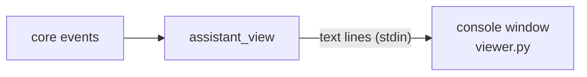

# assistant_view: terminal 2

## Purpose

A view-only console window showing what the agents are doing. Off by default (the temp UI's left pane shows the same); turn it on with `ActivateModule`. Windows only for now.

## Wrapper

| Field | Value |
|-------|-------|
| id | `assistant_view` |
| provides / requires / optional | nothing |
| permissions | none |

## Interface

| | |
|---|---|
| Tools · Handles · Calls · Publishes | none |
| Listens to | [`AgentActivity`](../api/agents.md#agentactivity), [`AgentStateChanged`](../api/agents.md#agentstatechanged), [`TaskUpdated`](../api/agents.md#taskupdated) |

## Owns and launches

- **A new console window** running `viewer.py`, fed text lines on its stdin. Closing the window only stops the view; deactivating the module closes it.

## Inner workings

## Config

None.

## Code and tests

- `src/assistant/modules/assistant_view/` (`module.py`, `viewer.py`)

## Planned

Nothing specific.
