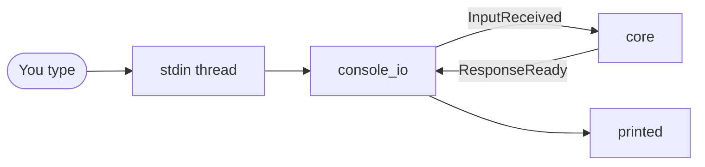

# console_io: terminal 1

## Purpose

Terminal input and output: each line you type becomes an `InputReceived`, and the replies are printed. `exit` or `quit` shuts the app down. On by default.

## Wrapper

| Field | Value |
|-------|-------|
| id | `console_io` |
| provides / requires / optional | nothing |
| permissions | none |

## Interface

| | |
|---|---|
| Tools · Handles · Calls | none |
| Publishes | [`InputReceived`](../api/messaging.md#inputreceived), [`ShutdownRequested`](../api/messaging.md#shutdownrequested) (`reason="console exit"`) |
| Listens to | [`ResponseReady`](../api/messaging.md#responseready): replies to its inputs, and uncorrelated ones |

## Owns and launches

- **One stdin reader thread per process.** A blocking `input()` can't be cancelled, so the thread outlives a deactivated module and is reused when it's activated again; lines typed while it's off are dropped.

## Inner workings

## Config

`[modules.console_io]`: `prompt`.

## Code and tests

- `src/assistant/modules/console_io/module.py`
- `tests/test_app.py`

## Planned

Nothing specific. A central module: part of the main app, so its docs stay here.
