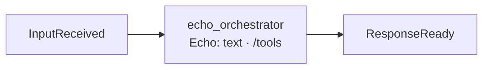

# echo_orchestrator: stand-in orchestrator

## Purpose

Replies with the input text; `/tools` lists the available tools. It exists to prove the plumbing without an AI. Off by default; enable it instead of the Talker in `modules.enabled`.

## Wrapper

| Field | Value |
|-------|-------|
| id | `echo_orchestrator` |
| provides / requires | nothing |
| optional | [`IToolProvider`](../api/tools.md#itoolprovider) (to list tools) |
| menu | a [`Menu`](../api/modules.md#menu) with one item, `echo.say` |
| permissions | none |

## Interface

| | |
|---|---|
| Menu | `echo.say(text)`: `ok("Echo: <text>")`, the smallest example of a menu |
| Handles · Calls | none |
| Publishes | [`ResponseReady`](../api/messaging.md#responseready) |
| Listens to | [`InputReceived`](../api/messaging.md#inputreceived) |

## Owns and launches

Nothing.

## Inner workings

## Config

None.

## Code and tests

- `src/assistant/modules/echo_orchestrator/module.py`
- `tests/test_app.py`, `tests/test_menu.py`

## Planned

Nothing specific.
