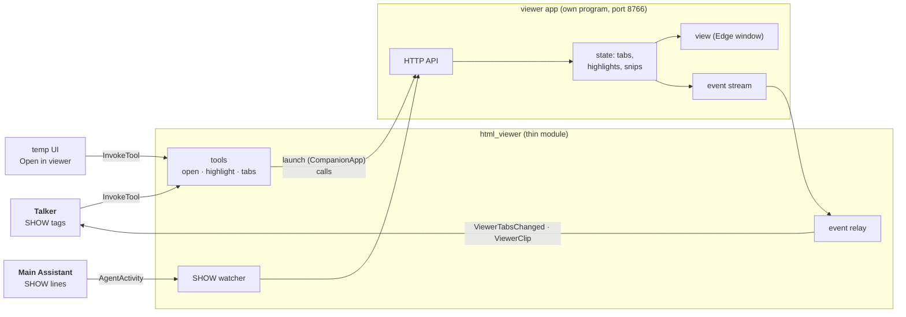

# html_viewer: the HTML viewer and its app

## Purpose

View, edit, highlight and snip HTML files in tabs. `html_viewer` is the thin module; the **viewer app** (`src/html_viewer`) is its own program that doesn't import the assistant. On by default. Full design: [HTML viewer](../architecture/html-viewer.md).

## Wrapper

| Field | Value |
|-------|-------|
| id | `html_viewer` |
| provides / requires / optional | none |
| menu | a [`Menu`](../api/modules.md#menu): `viewer.open`, `viewer.highlight`, `viewer.tabs` |
| permissions | none declared |

## Interface

| | |
|---|---|
| Menu | `viewer.open` (open a file in a tab), `viewer.highlight` (open it and highlight a quoted part), `viewer.tabs` (open files and highlights): [tools offered today](../api/tools.md#tools-offered-today). The core links it and routes [`InvokeTool`](../api/tools.md#invoketool) to it, checking the arguments first |
| Handles | nothing |
| Calls | nothing |
| Publishes | [`ViewerTabsChanged`](../api/messaging.md#viewertabschanged), [`ViewerClip`](../api/messaging.md#viewerclip) (a snip, image copied into the launch's log folder) |
| Listens to | [`AgentActivity`](../api/agents.md#agentactivity): the Main Assistant's `<<SHOW: ...>>` lines, which it opens or highlights |
| To the app | the viewer's local HTTP API (module → app) and its event stream (app → module) |

## Owns and launches

- **Launches the viewer app** on the first show request, through [`CompanionApp`](../api/app_kit.md#companionapp) (`python -m html_viewer`, port 8766), and quits it when the module stops. A viewer you started yourself is left running. **On a reload** the running viewer is handed to the new copy (its window and tabs stay), unless the viewer's own code changed: then it's quit, even one you started, and the next page shown launches the new code.
- **The app owns** the tabs, highlights, snips, editing and saving, including writing text edits back to a generated page's Markdown source (`generated` folders).

## Inner workings

The app is built as state, commands and a view ([architecture](../architecture/html-viewer.md#architecture-state-commands-view)); the module only translates between the core's messages and the app's API.

## Config

`[modules.html_viewer]`: `host`, `port` (8766), `window`, `generated` (folders built from Markdown), `start_timeout`.

## Code and tests

- Module: `src/assistant/modules/html_viewer/module.py`
- App: `src/html_viewer/`
- Tests: `tests/test_html_viewer.py`

## Planned

From the module-shape refactor: its menu is found through the **directory** by both assistants, so the Talker's hardcoded SHOW tags and the SHOW watcher go away.
