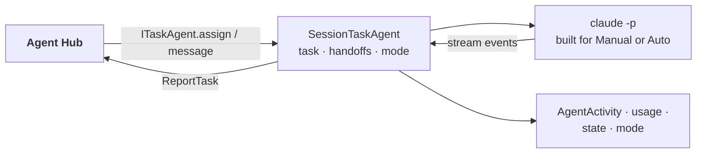

# main_assistant: the worker agent

## Purpose

A `claude` session with file tools that does the work handed to it by the Agent Hub. On by default. Design: [agents](../architecture/agents.md), [the Main Assistant on its own](../agents/runtime.md#the-main-assistant-on-its-own).

## Wrapper

| Field | Value |
|-------|-------|
| id | `main_assistant` |
| provides | [`ITaskAgent`](../api/agents.md#itaskagent) (only the Hub calls it) |
| requires / optional | none |
| permissions | none declared; its file and shell access are its `claude` rules (config below) |

## Interface

| | |
|---|---|
| Tools | none |
| Handles | nothing: it is called through `ITaskAgent` (`assign`, `message`, `cancel`, `answer_permission`, `set_permission_mode`) |
| Calls | [`ReportTask`](../api/agents.md#reporttask) (`progress`, `reply`, `need`, `permission`, `done`, `failed`) |
| Publishes | [`AgentActivity`](../api/agents.md#agentactivity), [`AgentStateChanged`](../api/agents.md#agentstatechanged), [`SessionUsage`](../api/agents.md#sessionusage), [`PermissionModeChanged`](../api/agents.md#permissionmodechanged) |
| Listens to | [`ResetRequested`](../api/agents.md#resetrequested) |

## Owns and launches

- **A `claude -p` process** per task (`fresh_sessions`), through the shared [`SessionTaskAgent`](../api/infra.md#sessiontaskagent) and [`ClaudeSession`](../api/infra.md#claudesession). It starts with the module and stops with it.
- **Its transcript** in the launch's log folder.

## Inner workings

Each session's command line and prompt are built for the permission mode at that moment: Manual at every launch, Auto only from the UI button. A `HANDOFF:` line starts a fresh session from a note ([fresh sessions and handoffs](../agents/runtime.md#fresh-sessions-and-handoffs)).

## Config

`[modules.main_assistant]`: `workspace`, `tools`, `permission_mode`, `read_dirs`, `write_dirs`, `allowed_commands`, `fresh_sessions`, `max_handoffs`, `context_reminder`, `edit_note`, `permission_prompts`, `permission_timeout`, `transcript`, `model`.

## Code and tests

- `src/assistant/modules/main_assistant/module.py`; the agent itself is `src/assistant/infra/session_agent.py`
- `tests/test_agents.py`, `test_permission_mode.py`, `test_edit_note.py`

## Planned

From the module-shape refactor: it calls module tools through the **directory and menu** (today it can't call tools; the viewer watches its SHOW lines), and module control becomes core tools it can use with your approval.
