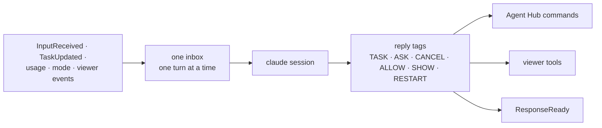

# talker: the agent that talks with you

## Purpose

A fast `claude` session that talks with you and hands work to the Agent Hub. Tags in its replies become Hub commands and viewer tools. On by default. Design: [agents](../architecture/agents.md), [the Talker on its own](../agents/runtime.md#the-talker-on-its-own).

## Wrapper

| Field | Value |
|-------|-------|
| id | `talker` |
| provides / requires / optional | nothing (it reaches the Hub by commands) |
| permissions | none declared |

## Interface

| | |
|---|---|
| Tools | none |
| Handles | nothing |
| Calls | [`StartTask`](../api/agents.md#starttask), [`GetTaskStatus`](../api/agents.md#gettaskstatus), [`SendToTask`](../api/agents.md#sendtotask), [`CancelTask`](../api/agents.md#canceltask), [`AnswerPermission`](../api/agents.md#answerpermission), [`SetPermissionMode`](../api/agents.md#setpermissionmode) (Manual only), [`InvokeTool`](../api/tools.md#invoketool) `viewer.open` / `viewer.highlight` |
| Publishes | [`ResponseReady`](../api/messaging.md#responseready), [`SessionUsage`](../api/agents.md#sessionusage), [`SessionTheme`](../api/messaging.md#sessiontheme), [`ResetRequested`](../api/agents.md#resetrequested), [`ShutdownRequested`](../api/messaging.md#shutdownrequested) (`restart=True`) |
| Listens to | [`InputReceived`](../api/messaging.md#inputreceived), [`TaskUpdated`](../api/agents.md#taskupdated), [`SessionUsage`](../api/agents.md#sessionusage), [`ResetRequested`](../api/agents.md#resetrequested), [`PermissionModeChanged`](../api/agents.md#permissionmodechanged), [`ViewerTabsChanged`](../api/messaging.md#viewertabschanged), [`ViewerClip`](../api/messaging.md#viewerclip), [`ViewerClipDropped`](../api/messaging.md#viewerclipdropped) |

## Owns and launches

- **One `claude -p` process** ([`ClaudeSession`](../api/infra.md#claudesession)), restarted on a `ResetRequested` for `talker`.
- **Its transcript** in the launch's log folder, and the **restart note** kept across a `<<RESTART>>`.

## Inner workings

Everything that should make it speak goes into one inbox, so it never talks over itself and event handlers return at once.

## Config

`[modules.talker]`: `model`, `turn_timeout`, `context_exchanges`, `context_warning`, `transcript`, `restart_note`, `restart_timeout`.

## Code and tests

- `src/assistant/modules/talker/module.py`
- `tests/test_agents.py`, `test_agent_tags.py`, `test_restart.py`

## Planned

From the module-shape refactor: it finds modules through the **directory and menu** instead of hardcoded viewer tags, and can ask the core to turn modules on and off.
