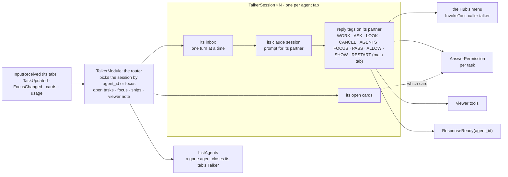

# talker: the agents' Talkers, one per agent tab

## Purpose

Fast `claude` sessions that talk with you and hand work to the Agent Hub, **one per agent tab** (built 2026-11-05): each tab is a pair, its Talker and its agent (its partner), with its own chat. Tags in its replies become Hub commands and viewer tools. On by default. Design: [agents](../architecture/agents.md), [the Talker on its own](../agents/runtime.md#the-talker-on-its-own).

## Wrapper

| Field | Value |
|-------|-------|
| id | `talker` |
| provides / requires / optional | optional `IModuleDoor` (the module door, from the Agent Hub) |
| permissions | none declared |

## Interface

| | |
|---|---|
| Tools | none |
| Handles | nothing |
| Calls | [`InvokeTool`](../api/tools.md#invoketool): the [Hub's menu](../api/agents.md#the-hubs-menu) (`hub.start`, `hub.send`, `hub.status`, `hub.cancel`, `hub.agents`, `hub.focus`, `hub.answer` (a task's permission card), `hub.mode` (Manual only); the core fills in the caller `talker`) and `viewer.open` / `viewer.highlight`; [`AnswerPermissionRequest`](../api/messaging.md#answerpermissionrequest) (an access card, whole), [`ListAgents`](../api/agents.md#listagents) (which tabs still have their agent) |
| Publishes | [`ResponseReady`](../api/messaging.md#responseready) (with its tab, `agent_id`), [`SessionUsage`](../api/agents.md#sessionusage), [`SessionTheme`](../api/messaging.md#sessiontheme), [`ResetRequested`](../api/agents.md#resetrequested), [`ShutdownRequested`](../api/messaging.md#shutdownrequested) (`restart=True`) |
| Listens to | [`InputReceived`](../api/messaging.md#inputreceived), [`TaskUpdated`](../api/agents.md#taskupdated), [`SessionUsage`](../api/agents.md#sessionusage), [`ResetRequested`](../api/agents.md#resetrequested), [`PermissionModeChanged`](../api/agents.md#permissionmodechanged), [`ViewerTabsChanged`](../api/messaging.md#viewertabschanged), [`ViewerClip`](../api/messaging.md#viewerclip), [`ViewerClipDropped`](../api/messaging.md#viewerclipdropped), [`FocusChanged`](../api/agents.md#focuschanged), [`FocusSuggested`](../api/agents.md#focussuggested), [`PermissionRequested`](../api/messaging.md#permissionrequested), [`PermissionChanged`](../api/messaging.md#permissionchanged), [`AgentStateChanged`](../api/agents.md#agentstatechanged), [`ModuleStateChanged`](../api/control.md#modulestatechanged) |

## Owns and launches

- **One `claude -p` process per open tab** ([`ClaudeSession`](../api/infra.md#claudesession)), each restarted on a `ResetRequested` for its id (`talker` for the main tab, `talker:<agent>` for a helper's). The main tab's starts with the module and is kept warm; a helper's starts on its first turn (its tab opened with something to say, a message for it) and closes when its agent leaves `ListAgents` (the tab's ×, `agents.close`, its module turned off). No idle timeout.
- **A transcript per tab** in the launch's log folder (`talker.jsonl`, `talker-<agent>.jsonl`), and the **restart note** kept across a `<<RESTART>>`.
- **The module door** (built 2026-11-05): each session's command line is read at its start, with `IModuleDoor.mcp_config()` from the Agent Hub as `--mcp-config` and all three door tools (`list_modules`, `show_menu`, `use_item`) allowed, since it has no permission cards. The core's risky items still ask the permissions first. Its prompt says to use them for quick things and to hand real work to its agent. SHOW tags stay a shorthand for `viewer.open` / `viewer.highlight`. `door = false` in its config turns it off.

## Inner workings

`TalkerModule` (`module.py`) is the router and keeps what the tabs share; each tab's conversation is a `TalkerSession` (`session.py`) with its prompt from `talker_prompt` (`prompt.py`). Everything that should make a tab's Talker speak goes into that session's inbox, so it never talks over itself and event handlers return at once.

- **Routing:** your input goes to the session of `InputReceived.agent_id` (the temp UI's chat box sets it), else the focused tab's (voice, terminal 1). A `TaskUpdated` goes to its agent's session, and its updates there carry no name (`[Task update: reply]`). Access cards, suggestions and snips go to the focused tab. Every reply carries its tab (`ResponseReady.agent_id`).
- **One road to the Hub:** its tags are a shorthand (like SHOW for `viewer.open`); every Hub tag runs through the Hub's menu with `InvokeTool`, with no MCP round-trip. They act on the session's partner: WORK starts a task on it (the main tab's partner is the coordinator); ASK / PAUSE send to its task; LOOK and CANCEL take an agent (its partner by default); AGENTS lists names and marks; FOCUS: agent moves the focus; PASS sends your own words to its partner word for word (`hub.send(agent_id=partner)`); MODE sets its partner's mode.
- **Only the main tab:** `<<RESTART>>`, the session theme, the reset of the worker by name. A RESTART in a helper's tab is refused with "ask in the Main Assistant's tab".
- **Open cards per tab:** ALLOW / DENY [agent] picks a card from the session's own cards, so a bare yes answers that tab's card; with more than one open there, it's refused with a question asking which.
- **Access cards:** a `PermissionRequested` from the core's permissions handler becomes an `[Access card]` in the focused tab's inbox, in words from `access_card_text(event)`: who asks and why, the items, the warnings, and "not reviewed" when the review didn't run. It's kept among that tab's open cards (key `access:<request_id>`), so `<<ALLOW>>` / `<<DENY>>` answer it whole with `AnswerPermissionRequest`; to untick single items you use the card in the app. The matching `PermissionChanged` closes it.
- **Snips:** each `ViewerClip` waits in the router's list (up to 3, oldest dropped beyond) until your next message in any tab, which takes them as images with a `[Viewer] snip` note each (`[Pasted] image` for one pasted into the temp UI's chat box, `file="(pasted)"`); `ViewerClipDropped` (the × in the temp UI) removes one. A snip sent alone comes as the text `(snip)`. Each step is logged at info level: received, dropped (by × or the limit), and per message how many were attached (0 included). The viewer note and mode notes are told once per tab with your next message there.
- **Who speaks:** the Hub holds an out-of-focus agent's questions, replies and ends behind its tab's **!**; milestones are never said. Opening a tab releases them (`FocusChanged.released`) into that tab's session as `[Focus] the user opened this tab.` plus the lines; nothing is said when nothing was released. A `FocusSuggested` becomes a yes / no question to you in the tab you're in.
- **Usage and context:** each session publishes its own `SessionUsage` (`talker`, or `talker:<agent>` with `parent=<agent>`, so the usage dropdown nests it under its agent). The `[Usage]` line before your message shows that tab's worker and that tab's Talker. Each session is warned once when its own context or its partner's passes `context_warning`.
- **Reload:** `export_state` hands every tab's history, the focus and the open tasks to the new copy, which reopens the tabs; a closed tab's history is kept and comes back if its agent does.

## Config

`[modules.talker]`: `model` (every tab's), `turn_timeout`, `context_exchanges`, `context_warning`, `transcript` (the main tab's name; a helper's gets `-<agent>`), `restart_note`, `restart_timeout`, `door`.

## Code and tests

- `src/assistant/modules/talker/module.py` (the router), `session.py` (`TalkerSession`), `prompt.py` (`talker_prompt`)
- `tests/test_agents.py`, `test_agent_tags.py`, `test_restart.py`, `test_talker_agents.py`, and the snip tests in `test_html_viewer.py`

## Planned

From the module-shape refactor: it finds modules through the **directory and menu** (the door, built) beside its tag shorthands, and can ask the core to turn modules on and off.
