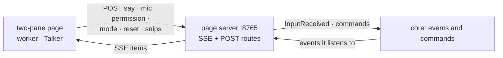

# temp_ui: the temporary two-pane page

## Purpose

A local web page with the worker's activity on the left and the Talker conversation on the right, with the mic button, usage meters, permission cards and the Manual | Auto toggle. A throwaway stand-in until the UI handler is designed. On by default. Design: [temp UI](../agents/runtime.md#temp-ui).

## Wrapper

| Field | Value |
|-------|-------|
| id | `temp_ui` |
| provides / requires / optional | nothing |
| permissions | none declared |

## Interface

| | |
|---|---|
| Tools | none |
| Handles | nothing |
| Calls | [`ListModules`](../api/control.md#listmodules), [`StartListening`](../api/messaging.md#startlistening), [`StopListening`](../api/messaging.md#stoplistening), [`AnswerPermission`](../api/agents.md#answerpermission), [`SetPermissionMode`](../api/agents.md#setpermissionmode), [`InvokeTool`](../api/tools.md#invoketool) `viewer.open` |
| Publishes | [`InputReceived`](../api/messaging.md#inputreceived), [`ResetRequested`](../api/agents.md#resetrequested), [`ViewerClipDropped`](../api/messaging.md#viewerclipdropped) |
| Listens to | [`InputReceived`](../api/messaging.md#inputreceived), [`ResponseReady`](../api/messaging.md#responseready), [`TaskUpdated`](../api/agents.md#taskupdated), [`AgentActivity`](../api/agents.md#agentactivity), [`AgentStateChanged`](../api/agents.md#agentstatechanged), [`PermissionModeChanged`](../api/agents.md#permissionmodechanged), [`SessionUsage`](../api/agents.md#sessionusage), [`ViewerClip`](../api/messaging.md#viewerclip), [`VoiceState`](../api/messaging.md#voicestate), [`VoiceTranscript`](../api/messaging.md#voicetranscript), [`ModuleStateChanged`](../api/control.md#modulestatechanged) |

## Owns and launches

- **A page server** on `127.0.0.1:8765` (standard library): `GET /events` (Server-Sent Events), and `POST` `/say`, `/permission`, `/permission-mode`, `/reset`, `/mic`, `/drop-snip`, `/open-in-viewer`, `/open-logs`.
- **An Edge app window** for the page (`window = "app"`).

## Inner workings

The mic follows only sessions the page started (by the `StartListening` id), like [voice_notes](voice_notes.md).

## Config

`[modules.temp_ui]`: `port` (8765), `window`.

## Code and tests

- `src/assistant/modules/temp_ui/` (`module.py`, `page.html`)
- `tests/test_temp_ui.py`

## Planned

Replaced by the UI handler and the chat window ([decisions](../architecture/decisions.md#open-decisions)); not designed yet.
