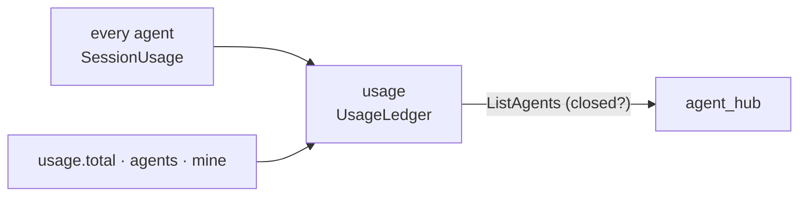

# usage: every agent's tokens since launch

## Purpose

Keeps the usage tally of the whole app: every agent's tokens since the app started (tokens only: the `claude` tool's dollar estimate is at pay-as-you-go API prices, not what a subscription bills, so it isn't kept), with each agent's sub-agents and wrapped tools nested under it, and the Talker as its own row. It listens to [`SessionUsage`](../api/agents.md#sessionusage) from every sender and keeps one [`UsageLedger`](../api/infra.md#usageledger). Kept in memory only: nothing is written to disk, and the tally ends with the app. No time buckets, no history, no spend alerts. On at launch.

## Wrapper

| Field | Value |
|-------|-------|
| id | `usage` |
| provides | nothing |
| requires / optional | none |
| permissions | none |

## Interface

| | |
|---|---|
| Tools | `usage.total` (every agent together: tokens by kind, `used_tokens`, how many agents), `usage.agents` (one row per agent, its sub-agents and tools in `children`, each with its own numbers, a `total` with its children, and `closed`), `usage.mine(agent_id?)` (the caller's own row with its children; the door knows the caller, so an agent asks with no arguments) |
| Handles | nothing |
| Calls | [`ListAgents`](../api/agents.md#listagents) (which agents are still there) |
| Publishes | nothing |
| Listens to | [`SessionUsage`](../api/agents.md#sessionusage); [`AgentStateChanged`](../api/agents.md#agentstatechanged) and [`ModuleStateChanged`](../api/control.md#modulestatechanged), to note the agents it has seen |

## Shown

The temp UI's header shows the selected tab's worker and Talker contexts and the tokens that pair used, plus the total; a dropdown lists each agent, its sub-agents nested under it, and the Talker as its own row (a throwaway stand-in; see [temp_ui](temp_ui.md)). A closed agent's rows are greyed and read "· closed"; the temp UI asks for the tally again when an agent leaves its tabs. The Talker's `[Usage]` line uses `usage.total`.

## Inner workings

- Each `SessionUsage` is a running total, so the ledger keeps each agent's latest numbers: a lost event costs nothing. Each event carries its `session` id, new for each fresh `ClaudeSession`: when the id changes (a reload, a new session), what the agent had is kept and the new numbers add to it, even if the new session's first numbers are already bigger. Without an id, falling numbers mean the same.
- A sub-agent comes from its parent's `claude` stream: the tool_result of an Agent call names it (`agentId`, `agentType`). Its tokens come from each turn's `result`: the turn's model usage (sub-agents included) less the parent's own calls, so every call the sub-agent made counts, not just its last one. Several sub-agents in one turn share it by their last-call sizes; with none named, it goes under `unnamed`. [`ClaudeSession`](../api/infra.md#claudesession) keeps this per sub-agent, and [`subagent_usage`](../api/infra.md#session_usage) publishes it with `parent` set and `kind = "subagent"`.
- A sub-agent's tokens are not in the parent's own numbers, so the parent's `total` adds them once.
- A reload hands the ledger to the new copy (`export_state`, with the agents seen), so the tally survives it.
- **A closed agent stays in the totals.** An agent `ListAgents` listed before and doesn't now (its tab's ×, `agents.close`, its module turned off) is *closed*: in `usage.agents` its row and every row nested under it (its tab's Talker `talker:<agent>`, its sub-agents) get `"closed": true`. The numbers don't change, since the tokens were used. If the name comes back, the mark clears and its numbers carry on. The mark is worked out on each ask, in this module; `UsageLedger` stays plain.

## Config

None.

## Code and tests

- `src/assistant/modules/usage/module.py`
- `tests/test_usage.py`: the menu, `ClaudeSession`'s sub-agent tally, `UsageLedger`, closed agents (with `agent_hub`), the temp UI's total and the Talker's `[Usage]` line

## Planned

Nothing specific. A central module: part of the main app and its window, so its docs stay here.
