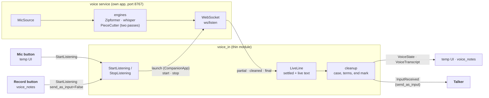

# voice_in: voice input and the voice service

## Purpose

Speech to text for the whole app. `voice_in` is the thin module; the **voice service** (`src/voice_service`) is its own app that owns the mic and the speech engines. On by default. Full design: [voice](../architecture/voice.md).

## Wrapper

| Field | Value |
|-------|-------|
| id | `voice_in` |
| provides | [`IVoice`](../api/messaging.md#ivoice), the voice contract (a `_Voice` part using the same sessions as the commands) |
| requires / optional | none |
| permissions | optional: `microphone` |

## Interface

| | |
|---|---|
| Tools | none (its menu is empty) |
| Handles | [`StartListening`](../api/messaging.md#startlistening) (`send_as_input`), [`StopListening`](../api/messaging.md#stoplistening) (`discard`); the result has the final text |
| Calls | nothing |
| Publishes | [`VoiceState`](../api/messaging.md#voicestate), [`VoiceTranscript`](../api/messaging.md#voicetranscript) (live and final, with `settled_chars`), [`InputReceived`](../api/messaging.md#inputreceived) (`source="voice"`, only with `send_as_input`) |
| Listens to | nothing |
| To the service | the [`/ws/listen` protocol](../api/messaging.md#the-voice-service-protocol), from `voice_service.protocol` (the only import from the service) |

## Owns and launches

- **Launches the voice service** on the first mic click, through [`CompanionApp`](../api/app_kit.md#companionapp) (`python -m voice_service`, port 8767), and quits it when the module stops. A service you started yourself is left running. **On a reload** the running service is handed to the new copy (no model reload), unless the service's own code changed: then it's quit, and the next mic click launches the new code.
- **One mic session at a time**, one WebSocket each. The second press wins: a new `StartListening` ends the open one with `VoiceState(idle, reason="taken_over")` and an empty final.
- **The service owns** the mic (`MicSource`, or `FileSource` / `FakeSource`), the engines (Zipformer for live text, whisper for the sent text, or two passes cleaned piece by piece by `PieceCutter`), and mic-drop recovery. Its config is `config/voice_service.toml`.

## Inner workings

A session: `StartListening` launches the service if needed and opens a socket; the service streams live text, which `LiveLine` keeps as a settled (cleaned) start and a live rest; `StopListening` asks for the final, which is cleaned and published, and sent to the Talker only if the session asked for it. Details: [the voice_in module](../architecture/voice.md#the-voice_in-module), [threads and audio flow](../architecture/voice.md#the-voice-service-threads-and-audio-flow).

## Config

`[modules.voice_in]`: `host`, `port` (8767), `start_timeout`, `service_config`, `reply_timeout`, `live_text`, `final_timeout_on_send`, `cleanup`, `terms`. The service: `config/voice_service.toml` (engine choice, mic-drop wait). Command timeouts: `[core.command_timeouts]` `StartListening`, `StopListening`.

## Code and tests

- Module: `src/assistant/modules/voice_in/` (`module.py`, `line.py`, `cleanup.py`)
- Service: `src/voice_service/`
- Tests: `tests/test_voice_in.py`, `test_voice_line.py`, `test_voice_text_cleanup.py`, `test_voice_service.py`, `test_voice_pieces.py`, `test_voice_contracts.py`

## Planned

Built 2026-11-05: `voice_in` provides the voice contract `IVoice`, sessions each owned by their caller with a destination. Still later: the service taking several listeners at once, so two sessions could run together.
