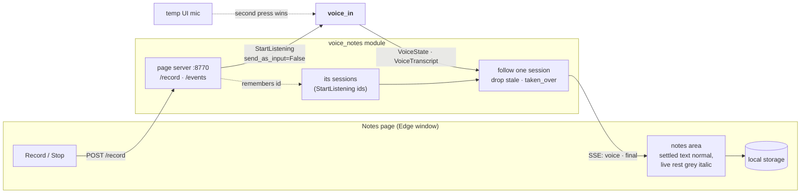
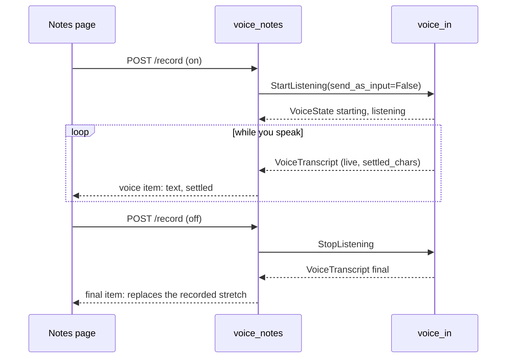

# voice_notes: speak into a page of notes

## Purpose

A small page in its own window: Record / Stop, a notes area you can edit, a status line, and Copy. What you say goes only to this page, never to the Talker. v1, built 2026-11-04; on by default.
## Wrapper

| Field | Value |
|-------|-------|
| id | `voice_notes` |
| provides | nothing |
| requires / optional | requires [`IVoice`](../api/messaging.md#ivoice): turning voice notes on turns `voice_in` on first. Record calls `listen(id, caller)`, Stop `finish(id)`, looked up at each call; if no provider is there for a moment (mid-reload), Record says "voice input is off" |
| permissions | none of its own (the mic is `voice_in`'s) |

## Interface

| | |
|---|---|
| Tools | none |
| Handles | nothing |
| Calls | [`StartListening`](../api/messaging.md#startlistening) with `send_as_input=False`, [`StopListening`](../api/messaging.md#stoplistening) (`discard=True` when the module stops mid-recording) |
| Publishes | nothing |
| Listens to | [`VoiceState`](../api/messaging.md#voicestate), [`VoiceTranscript`](../api/messaging.md#voicetranscript): only sessions it started |
| Its page | `GET /` the page, `GET /events` (Server-Sent Events: a `voice` item with state, detail, live text and `settled`; a `final` item with each recording's text), `POST /record` `{"on": true \| false}` |

## Owns and launches

- **A page server** on `127.0.0.1:8770` (standard library; cut down from the temp UI's).
- **An Edge app window** for the page (`window = "app"`), closed when the module stops.
- **The notes themselves** live in the page's local storage, not in the app.
- It launches nothing else; `voice_in` launches the voice service.

## Inner workings

- **Only its own sessions.** It remembers the id of each `StartListening` it sends (before sending, since the first state arrives while the command is handled) and ignores every other session, such as the temp UI's mic.
- **The second press wins.** If the temp UI's mic takes over, `voice_in` ends this session with `VoiceState(idle, reason="taken_over")`; the page says cancelled, drops those words, and sends no stop.
- **The final replaces the stretch.** An empty final (cancelled or cleared) removes it.

## Config

`[modules.voice_notes]`: `port` (8770), `window` (`app`, `browser`, `none`), `host`, `window_profile`.

## Code and tests

- `src/assistant/modules/voice_notes/` (`module.py`, `page.html`)
- `tests/test_voice_notes.py`

## Planned

Built 2026-11-05: requires the voice contract and opens its own session through it. Still later: the page server becomes a shared one.
