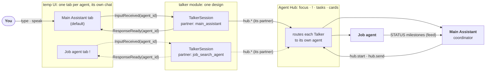

# Agent talkers: every tab a pair, its own Talker and its own worker

> **Status: built (waiting on you), 2026-11-05.** Both chunks are built and the docs show the design as built. Left: one app restart (the contract fields), then the hand checks under "At the end". The open questions are answered (below; answer 4 changed: no idle timeout).

**Asked:** "We need the separate talkers for agents." Every agent tab becomes a pair, its own Talker plus its own worker, with its own chat history, so you never scroll through other agents' chats. Approved design: (1) one Talker design with a session per agent, built once; (2) the Agent Hub stays the central control: focus (which tab you're in), the **!** for finished work and questions, task state, permissions, usage; (3) the Main Assistant stays the default tab and the coordinator that starts helpers and that helpers ask; helpers stop reporting into the main Talker's chat, and the **!** replaces those messages; (4) agents still talk to each other through the Hub's menu, never through a shared chat; (5) the full pair, with a smaller first step offered if the work is staged.

**Why:** today one Talker sits in front of every agent. The job agent's and the helpers' updates, questions and cards all land in the one chat (named, `[Task update: reply from job_search_agent]`), and while a helper has the focus the same Talker passes your words to it. With several agents working, one chat mixes all their conversations, and the one Talker session carries all of them in its context.

**Touches:** `talker` (most of the work), `agent_hub` (held ends, `hub.send` to a named agent), `temp_ui` (a chat per tab), `usage` (a row per Talker), two contract fields; docs: [agents](../architecture/agents.md), [agents: code layout](../architecture/agents-code.md), [runtime](../agents/runtime.md), the module pages [talker](../modules/talker.md), [agent_hub](../modules/agent_hub.md), [temp_ui](../modules/temp_ui.md), the [overview](../architecture/README.md) and the API pages for the changed types.

## The design

Solid: the tab you're in. Dotted: another tab's pair, which takes no turns while you're away; its finished work and questions wait behind its **!**.

### The Talker

- **One design, many sessions.** A new class, `TalkerSession` (in `modules/talker/session.py`), holds what the module holds today per conversation: its `ClaudeSession`, inbox and turn loop, history, open cards, snips, notes, context watch entry and transcript. Each has a **partner**, the agent it talks for. `TalkerModule` becomes the router: it keeps one `TalkerSession` per agent tab and passes each event to the right one. Reused as they are: [`ClaudeSession`](../api/infra.md#claudesession), [`claude_command`](../api/infra.md#claude_command), [`ContextWatch`](../api/infra.md#contextwatch) (already keyed by id), [`agent_tags`](../api/infra.md#agent_tags), [`session_usage`](../api/infra.md#session_usage), the door ([`IModuleDoor`](../api/tools.md#imoduledoor)). No new reusable part: only the talker module uses `TalkerSession`.
- **Every tag addresses its partner.** WORK starts a task on the partner (the main tab's partner is the coordinator, as today); ASK / PAUSE / CANCEL / LOOK / ALLOW / DENY / MODE act on the partner's task, card or mode. So a bare "yes" picks that tab's card, and the "more than one card open" question mostly goes away. PASS stays, for words to go on unchanged.
- **One prompt.** The same Talker prompt, with the partner's name and role filled in. Only the main tab's session has the app-wide jobs: `<<RESTART>>`, the session theme, the reset of the worker by name.
- **What each session hears:** `TaskUpdated` for its partner only; a `FocusChanged` that opens its tab, with the held items it released; `FocusSuggested` and snips while its tab is in focus; access cards whose `subject` is its partner (others go to the focused tab).
- **What goes away:** the named helper updates in the main chat, "a helper out of focus never speaks", and the `[Focus] the user is talking to … directly (pass their words on)` line on every message.

### The Hub's routing

- **The focus stays the Hub's**, and so does every **!**. New: an end (`done`, `failed`) or a `reply` from an agent out of focus is **held** like a question is today (`TaskUpdated.held`), so its tab shows **!** and nothing reaches another tab's chat. `FocusChanged.released` carries the held ends as well as the questions; the tab's Talker says them when you open it.
- **`hub.send` gets `agent_id`**: a helper's Talker sends to its own agent, not "the focused one". Without it, it still means the focused agent (the Talker's old path).
- **Unchanged:** the coordinator's feed (milestones, ends, focus moves to its `note`), the cap, the folder check, the names, the door, the menu's callers (every session calls as `talker`, so `hub.focus` stays the Talkers' item).

### The temp UI

- **A chat per tab.** Every chat item carries its agent (from the new `agent_id` fields and the cards' agent), and the page shows only the selected tab's chat, as the worker pane already does. The chat box sends with the tab you're in (`InputReceived.agent_id`).
- **Replay per tab:** the last 300 chat items of each tab, so a chatty tab doesn't push out another's history.
- **Across a relaunch:** not saved (as today). The Talker sessions are fresh after a relaunch anyway, and the transcripts are in the logs. Keeping chats belongs to the UI handler's design (open question 2).
- Voice and terminal 1 have no tab: they go to the focused tab.
- **What you see:** clicking an agent's tab switches both panes at once: the worker pane shows that agent's work, and the chat pane shows only that tab's Talker chat. The chat pane's header names the pair ("Talker · job_search_agent") in the tab's colour, so the tab, its Talker and its worker read as one unit. The **!** stays the red badge on the tab (as today), now also for finished work, and it clears when you open the tab.

### Logs, usage, context warnings

- **One transcript per Talker:** `talker.jsonl` for the main tab, `talker-<agent>.jsonl` for each other tab, in the launch's log folder; log lines name the session's partner.
- **Usage:** each session publishes `SessionUsage(agent_id="talker:<partner>", parent=<partner>, kind="talker")`; the main tab's stays `talker`, its own row. The `usage` dropdown shows each helper's Talker nested under its agent ([`UsageLedger`](../api/infra.md#usageledger) keys rows by id and nests by `parent` already). The `[Usage]` line before your message shows that tab's worker and that tab's Talker.
- **Context warnings:** each session watches its own context and its partner's (the shared `ContextWatch`, by id), at the same `context_warning` (150k). Today only the worker's are watched.

### How a tab's Talker starts and ends

- **The main tab's** starts with the module and is kept warm, as today.
- **A helper's starts on first use:** the first time its tab is opened, gets a message, or has held items released. Opening a tab costs nothing until then.
- **It closes** when its agent is gone (the tab's ×, `agents.close`, its module turned off; the module re-reads `ListAgents` on `AgentStateChanged` and `ModuleStateChanged`). There is no idle timeout: a Talker stays while its agent's tab is open, until you close that tab (decided 2026-11-05). A reset (the context warning's handoff) starts it fresh with its last exchanges, as today.
- **A reload of `talker`** hands each session's history to the new copy, which reopens them on use.

### Cost of an extra Talker

- **Tokens:** a fresh Talker session's first turn writes its whole start context to the cache (the main Talker's meter shows that size at launch); after that each turn re-reads it from the cache. So each extra tab you actually use costs one start-up plus its own turns. The main Talker's context then grows only with your main conversation, so the total is about the same tokens, split per tab, plus one start-up per used tab. Read the real numbers from the usage dropdown after a day of use.
- **Memory:** each live session is one more `claude` process (with its MCP relay). At most one per open tab (1 + `max_extra_agents` busy agents, plus idle helpers' tabs you keep open), fewer with the lazy start. Closing a tab you're done with frees its process.

### What needs a restart

The two contract fields (`InputReceived.agent_id`, `ResponseReady.agent_id`, both optional, so other senders and listeners don't change) are in `assistant.contracts`, so **one app restart** at the end. `talker`, `agent_hub`, `temp_ui` and `usage` changes alone would reload, but they ship with the contracts.

### Build plan (two chunks, one restart)

1. **Chunk 1, a chat per tab:** the contract fields; the Hub's held ends and `hub.send(agent_id)`; the temp UI's chat per tab; the Talker routes input and updates by agent, still with one session. This is the smaller first step: on its own you already get separate chats, but one Talker context still carries all of them.
2. **Chunk 2, the pairs:** `TalkerSession`, one per tab, with transcripts, usage rows, context warnings, the lazy start and the close with its tab; the prompt per partner; the chat pane's pair header. Then the docs flip from planned to built, the tests, ruff, and the restart.

Tests: `test_talker_agents.py`, `test_agents.py`, `test_multi_agent.py`, `test_temp_ui.py`, `test_agent_tabs.py` change; new ones for routing by tab, held ends, a session's start and close, and the usage rows.

### Risks

- **The talker module's size:** splitting it into `module.py` (router), `session.py` and `prompt.py` is part of chunk 2, so it doesn't grow into one big file.
- **A tab switch while you type or speak:** the page stamps the tab on what you type; voice goes to the focus at the moment the text arrives, which may be a tab you just left. Low risk; the chat shows where it went.
- **The restart flow** stays the main tab's; a `<<RESTART>>` asked in a helper's tab is refused with "ask in the Main Assistant's tab".
- **Lost updates:** a helper's end now waits behind the **!** instead of being said. If the Hub dropped a hold you'd miss it; the held items live on the task records (authoritative state), not in events, so they survive a dropped event.
- **More processes** on the PC (see cost).

## Open questions (answered 2026-11-05)

Answers 1–3, 5 and 6 as recommended; answer 4 changed by the user.

1. **How does a helper's Talker treat your words?** Recommended: like the main Talker treats the Main Assistant's (it converses, answers quick things, hands work on with WORK / ASK), with PASS for words that should go on unchanged.
2. **Keep each tab's chat across a relaunch?** Recommended: not now; it lasts the app's run, the transcripts are in the logs, and saving chats goes into the UI handler's design.
3. **A finished helper in a tab you're not in:** recommended: held behind the **!** with no Talker turn until you open the tab (cheapest; nothing is said in the wrong tab). The other way: its Talker writes the summary in the background, so it's ready when you look.
4. **When does a helper's Talker close?** Decided: never while its agent's tab is open; it stays until you close that tab. No idle timeout (the 15 minutes first recommended was dropped).
5. **One model for every Talker?** Recommended: yes, `[modules.talker] model` (sonnet).
6. **Can the main Talker still look at a helper?** Recommended: yes, LOOK on any agent stays (a status read, no interrupt), but it never gets their updates.

## Docs updated as planned (2026-11-05)

Every picture that showed one Talker in front of all agents now shows the pairs, marked **planned** (purple, dashed), with a callout that the text describes what's built until then: the [overview](../architecture/README.md) diagram; on [agents](../architecture/agents.md) "The idea", the switchboard, the two modes and below-the-Hub pictures, and planned notes in the Mode A/B and workflow text; [agents: code layout](../architecture/agents-code.md) with its layers picture (`TalkerSession ×N`) and the three code graphs; the module pages [talker](../modules/talker.md), [agent_hub](../modules/agent_hub.md), [temp_ui](../modules/temp_ui.md); and [runtime](../agents/runtime.md) (what runs, messaging, classes, the Talker on its own). When the build is done, these flip from planned to built.

The handoff's plan for these updates (done)

1. `docs/next-steps/README.md`: a Pending changes row.
2. Update every diagram showing one Talker in front of all agents, each marked **planned (agent-talkers)** (purple, `classDef planned fill:#efeaf7,stroke:#6b4fa0,stroke-dasharray:5 4`), with a one-line callout that the text describes what's built until then:
   - `docs/architecture/README.md` bird's-eye: inside the Hub subgraph, a "Main tab" pair (Talker + Main Assistant) and a planned "Helper tab" pair (its own Talker + helper); `Main -. hub.start · hub.send .-> Helper`, `Helper -. STATUS .-> Main`; inputs go "to the tab you're in"; one sentence in "Built today".
   - `docs/architecture/agents.md`: status callout; "The idea" mermaid redrawn with pairs; "Big agents and their modules" text (Mode A/B, workflow steps 1–7, "The Talker's part" and "In the temp UI" bullets) with planned phrasing; a note that the sequence diagrams' `T` is the tab's Talker.
   - `img/agents-switchboard.svg`: replace the single Talker box (y 96–152) with three Talker boxes above the agent columns (x 110/470/830, width 260); You → main Talker solid, others dashed "click a tab"; each Talker ↔ Hub line at x 240/600/960; tool path from x 1090 (`M1090,124 H1150 V300 H1197`); Tabs column "Talker + agent each · own chat"; Held column "questions and finished work wait until you open that tab"; Focus "which tab you're in"; a "Planned design" label top-left.
   - `img/agents-modes.svg`: per half, two Talkers on top (main tab, job tab), the Hub as a middle band, agents below; A: main pair blue, job agent's NEED/done held (!), job Talker idle; B: job pair blue, held items load into the job Talker, the MA's questions → ! on its tab; STATUS line kept.
   - `img/agents-below-hub.svg`: top box "Every agent (Main Assistant, job agent, …) and their Talkers (planned: one per tab)".
   - `docs/architecture/agents-code.md`: callout; `img/agents-code-layout.svg` talker region gets a planned dashed purple `TalkerSession ×N` box (one per tab), its owns-line to ClaudeSession from it, talker port text "hears InputReceived (tab), TaskUpdated, FocusChanged, FocusSuggested", TempUIModule "chat per tab (planned)"; the three mermaid graphs: graph 1 splits TK into router (`_on_input` by `InputReceived.agent_id` else focus, `_on_focus`, `_on_task_updated` by agent) and a planned `TalkerSession ×N` subgraph (`_handle`, `_take_turn`, `_run_tag`, `_hub`), `hub.send` "its own agent (agent_id)", `_report_task` holds ends too; graph 2 `_on_task_updated` "to its agent's session"; graph 3 `ProfileAgent · TalkerSession._command`.
   - Module pages `docs/modules/talker.md`, `agent_hub.md`, `temp_ui.md`: their Inner workings mermaids with the planned parts, and a Planned bullet linking this note.
   - `docs/agents/runtime.md`: callout under the status; "What runs" (a planned Talker session per tab), "Messaging" (talker + a ClaudeSession per tab), "Classes" (planned `TalkerSession`), and a planned paragraph in "The Talker on its own"; the two sequence diagrams stay, noted as the main tab's.
3. Rebuild: `.\.venv\Scripts\python scripts\build_docs.py`, then show `<<SHOW: C:\Chang\Git_projects\AI_Assistant\docs\html-next-steps\agent-talkers.html>>` and stop for the user's check.

Facts checked in the code: `hub.send` has no `agent_id` today (`send_item(text, task_id, pause, caller)`, no task_id = the focused agent, Talker only); `UsageLedger.add` keys rows by `agent_id` and keeps `parent`; `InputReceived` / `ResponseReady` have no agent field; the Talker holds one `ClaudeSession`, `_history`, `_open`, `_focus`, `_cards`, `_snips`, `_usage`, `ContextWatch` in `TalkerModule.init`.

## Build handoff (2026-11-05)

**The user said go** (Auto mode): build both chunks as in the build plan above, with the approved answers (answer 4: a Talker stays while its tab is open, no idle timeout). One chunk per session.

**Each session:** follow the `batching` and `architecture-first` skills; check `docs/api/reusable.md` before any helper and add new reusable parts with their Used by line; run the tests (`.\.venv\Scripts\python -m pytest`) and `.\.venv\Scripts\ruff check`; run the `architecture-check` skill after the chunk; rebuild the docs after any docs edit (`docs-html`). Write what's done and what's next here, then end with `HANDOFF: docs/next-steps/agent-talkers.md`.

**Chunk 1 (next):** the contract fields `InputReceived.agent_id` and `ResponseReady.agent_id` (optional, default `None`) in `assistant.contracts`; `agent_hub`: hold `done` / `failed` / `reply` from an out-of-focus agent like `need` (`TaskUpdated.held`, released in `FocusChanged.released`), `hub.send(agent_id)`; `temp_ui`: every chat item carries its agent, the chat pane shows the selected tab's chat, replay the last 300 per tab, the chat box sends `agent_id`, the pair header ("Talker · <agent>") in the tab's colour; `talker`: routes input by `InputReceived.agent_id` (else the focus) and updates by agent, still one session, and stamps `ResponseReady.agent_id`. Update the API pages for the changed types. Tests: the ones listed in the build plan.

**Chunk 1 progress (2026-11-05, session reset mid-chunk):** the code is written, ruff passes, and 6 tests still fail (489 pass).
- **Done:** contracts: `InputReceived.agent_id`, `ResponseReady.agent_id`, and a new `TaskInfo.reply` (a reply held behind the **!**; a third contract field, still covered by the same restart). `agent_hub`: `_TaskRecord.reply`; an out-of-focus `reply` is held (`record.reply`); `done` / `failed` are held through `_finish(..., hold=True)`; `_set_focus` releases from every task, finished ones too, and clears `reply`; a send or a permission answer keeps `held` while a reply waits; `hub.agents` `held` counts finished tasks; `hub.send(agent_id)`. `talker`: `_Item.agent`, `self._tab`, `_status(text, agent)`, input's tab (`agent_id` or the focus), updates to their agent's tab, cards, suggestions and focus releases to the focused tab, released replies and ends said, the `[Focus]` line by the item's tab, `_usage_line(agent)`, PASS → `hub.send(agent_id=item.agent)`, a bare ALLOW / DENY takes the tab's only card, `ResponseReady.agent_id`. The old "helper out of focus never speaks" filter is removed: the Hub's hold replaces it. `temp_ui`: `CHAT_HISTORY = 300` per tab (`self._chats`), worker lines stay in `_history`, every Talker item gets `agent` (default the focus), `_card_tabs` puts an access card's close in its card's tab, `/say` takes `{"text", "agent"}`, and replay sends the worker history, then each tab's chat. `page.html`: `shown()` filters both panes by the focused tab, the `#talker-pair` header chip (`.pair`, `.helper`), and `/say` and the risky card send the tab.
- **Failing, fix next:** (1) `test_temp_ui.py::test_page_input_and_events` and `::test_permission_card_on_talker_side`, plus `test_html_viewer.py::test_temp_ui_shows_snips_until_you_send` (line 608): they read the replay order; the replay now sends worker items before the chats, so the expected lists need reordering, or read items per pane. (2) `test_permission_mode.py::test_temp_ui_button_mode_and_risky_card` (line 186) times out; likely the same order or the `agent` on the risky card's `/say`. (3) `test_talker_agents.py::test_a_bare_yes_with_two_cards_open_asks_which` times out: with two cards in different tabs, a bare yes now picks the tab's card. Update the test to two cards in the same tab, and add one test where the tab's card is picked. (4) `test_module_docs.py::test_main_docs_never_link_into_next_steps`: `docs/architecture/agents-code.md` links `../next-steps/agent-talkers.md` (added with the planned diagrams). Drop the link and name the note in plain text, then check the other planned callouts the same way (the test lists them).
- **Then:** new tests for held ends and replies released on focus, `hub.send(agent_id)`, the Talker's tab routing and the temp UI's chat per tab. Update the API pages (`messaging.md` for `InputReceived` / `ResponseReady`; `agents.md` for `TaskInfo.reply`, `TaskUpdated.held`, `FocusChanged`, `hub.send`) and the module pages' text for chunk 1. Run the architecture-check skill, rebuild the docs, write progress here, and end with `HANDOFF`.

**Chunk 1 done (2026-11-05, second session):** the 6 failures fixed (tests only; no app code changed): replay order (worker first, then each tab's chat), chat items read from `ui._chats`, the two-cards test now has both cards in one tab. New tests: `test_a_bare_yes_answers_the_card_of_the_tab_it_was_said_in`, `test_input_for_a_tab_is_that_tabs_and_its_reply_goes_there` (talker), `test_a_reply_and_an_end_out_of_focus_are_held_until_you_focus_that_agent`, `test_hub_send_names_the_agent_it_is_for` (multi_agent), `test_chats_are_kept_per_tab_and_say_names_its_tab` (temp_ui). 500 pass; ruff clean (`test_html_viewer.py::test_refuses_what_it_cant_do` is flaky on Windows, a connection abort, and passes alone). The main docs no longer link into next-steps (plain-text "the `agent-talkers` change note"). API pages updated: `InputReceived.agent_id`, `ResponseReady.agent_id` (messaging), `TaskInfo.reply`, `held`, `TaskUpdated`, the focus text, `FocusChanged.released`, `hub.send(agent_id)`, `hub.agents` held (agents). Module pages mark chunk 1 built. Architecture check: no cross-module imports, no new reusable part, the contract fields optional; the diagrams stay planned until chunk 2. Not restarted.

**Chunk 2 (next):** as in the build plan, then flip the docs from planned to built (every "Planned (agent talkers)" callout and purple-dashed part listed under "Docs updated as planned"), and move this note to done.

**Chunk 2 progress (2026-11-05, third session, reset at the start of the code):** chunk 1 checked: 500 pass. Written: `src/assistant/modules/talker/prompt.py`, which nothing imports yet. It has `talker_prompt(partner, main, about, door)`, `TALKER_PROMPT` (the main tab's) and `DOOR_NOTE`. The main tab gets the old prompt with a new "Other agents" block: helpers' updates never come here, and FOCUS opens a helper's tab. A helper tab gets its own head, with `about` taken from `AgentInfo.description`, plus tags on its agent, with no RESTART or THEME. Both prompts explain the `[Focus]` line ("the user just opened this tab"). The plan for the rest, all checked against the code:
- **`session.py`, `TalkerSession(talker, partner, history=())`:** moves the per-conversation parts out of `module.py` (`_Item` without `agent`, `split_tags`, `access_card_text`, `_describe*`, `_k` / `_tokens`; re-export `split_tags` and `access_card_text` from `module.py`, since tests import them).
  - `id`: `talker` for the main tab, `talker:<partner>` otherwise. Its own `ClaudeSession`, with the transcript `talker.jsonl` or `talker-<partner>.jsonl` (from config `transcript`). It also holds the inbox and its `_run` loop, `history` (deque), `cards`, `_answered`, `_carry_over` (true when handed a history) and `_turn`.
  - Methods: `start(warm)` (only the main tab is warm; the rest start on the first turn), `close()`, `put(...)`, `status(text)`, `busy`, `_handle`, `_take_turn`, `_command` (`talker_prompt` with the door, `mcp_config("talker")`), `_say` (`ResponseReady.agent_id=partner`), `_usage_line` ("worker" or the partner's id; "you" is its own session) and `publish_usage`. A helper's usage is copied with `model_copy(update={"parent": partner, "kind": "talker"})`.
  - Tags act on the partner: WORK `hub.start(agent_id=partner)`, ASK / PAUSE / LOOK / CANCEL on the partner's task, PASS `hub.send(agent_id=partner)`, MODE `SetPermissionMode(partner)`, RESET talker → `ResetRequested(self.id)` and worker → the partner. RESTART in a helper tab gets a status: "ask in the Main Assistant's tab". ALLOW / DENY answer from its own cards (a bare one with two open still asks which).
  - Updates are unnamed when they come from the partner (`" from X"` otherwise). The prefix order of a message stays: usage, mode, viewer, snips, text.
- **`module.py`, the router:**
  - **State:** `_sessions`, `_focus`, `_open`, `_usage`, `ContextWatch`, the snips deque, `_viewer_note` with a sequence number (each session tells the latest one once), and `_mode_notes[agent]`. Shared helpers for the sessions: `hub()`, `task_of()`, `name()`, `notes_for(session, item)` (mode, viewer, snips and images; logs the snips as today), `send_theme`, `check_size(key, tokens, session)` and `description(agent)`.
  - **Routing:** input goes to the session of `agent_id`, else the focus. `TaskUpdated` goes to its agent's session; the restart check stays in the router. Access cards, suggestions and focus releases go to the focused session. A release is said as `[Focus] the user opened this tab.` plus its lines; nothing is said when nothing was released (the old focus note goes). `_on_usage` skips talker rows and warns the agent's own session if it has one ("The worker's" text kept for the main tab). `_on_reset` maps `talker` to the main tab and `talker:<x>` to that tab.
  - **Restart and close:** the restart flow stays here and uses the main session's status and history. On `AgentStateChanged` / `ModuleStateChanged` it reads `ListAgents`, keeps the descriptions, and closes the sessions whose agent is gone. It never closes the main tab's, and does nothing if `ListAgents` fails.
  - **Reload and the rest:** `export_state` gives `{"histories", "focus", "open", "theme_sent"}`, which `init` reads from `ctx.handover`. `busy` is true if any session is in a turn. Keep a module `_command()` that passes through to the main tab (`test_mcp_door` uses it). Add `ListAgents` to `sends` and `AgentStateChanged` / `ModuleStateChanged` to `listens`.
- **Tests to update:** in `test_talker_agents.py`, line 54 (the released text, now `[Focus] the user opened this tab.\n[Task update: need] Which city?`, agent `helper`), 59 / 116 (no `[Focus]` on input; check `agent_id`), 65 (unnamed in its own tab), 84 (no focus note) and 97 (`_sessions["main_assistant"].cards`). New tests: a helper session starts only on use and writes `talker-helper.jsonl`; its usage row is `talker:helper` with parent `helper`; it closes when the agent leaves `ListAgents`; a reload keeps the histories; RESTART in a helper tab is refused.
- **Then:** update the docs (module page `talker.md`, `agents.md`, `agents-code.md`, `runtime.md`, the overview; flip planned to built), add `TalkerSession` under the talker module in the API pages (not reusable), run the architecture check, rebuild the docs, and write the final report with the hand checks listed under "At the end".

**Chunk 2 progress (2026-11-05, fourth session, reset after the code):** the code is written; the tests and ruff have **not been run yet**.
- **Written:** `talker/session.py` (`TalkerSession`, `Item`, `split_tags`, `access_card_text`, `describe_*`, `k_text` / `tokens_text`, `TALKER_ID`, `ACCESS_CARD`, `MANY_CARDS`), with `start()` (the loop, sync) and `warm()` (the process; only the main tab). `talker/module.py` rewritten as the router, as planned above. Two departures from the plan: a helper's usage row is `talker:<agent>` with `parent=<agent>` but **`kind` stays "claude"** (the `SessionUsage.kind` Literal has no "talker"; no contract change), and the `[Usage]` line subtracts the tab's own Talker row from its agent's `usage.mine` total so it isn't counted twice. A closed tab's history is kept in `_histories` and comes back if the agent returns. `describe_agents` now says "has something waiting (!)".
- **Tests updated:** `test_talker_agents.py` (released text `[Focus] the user opened this tab.`, no `[Focus]` on input, unnamed updates in their own tab, `_sessions["main_assistant"].cards`). Check line ~116 got the `"[Focus]" not in said.text` replacement.
- **Next:** (1) run `.\.venv\Scripts\python -m pytest` and `.\.venv\Scripts\ruff check`; fix failures (hand loops to the `debugger` subagent; likely spots: `test_agents.py`, `test_restart.py`, `test_usage.py`, `test_html_viewer.py` snips/viewer notes, `test_permission_mode.py` mode note, `test_mcp_door.py` `_command()`). (2) Add to `test_talker_agents.py`: a helper session exists only after use (`_sessions`, `session.running`, id `talker:helper`); its `SessionUsage` row `talker:helper` with parent `helper`; `DeactivateModule("helper")` closes its session; `export_state()["histories"]` holds the helper's lines; `<<RESTART>>` in the helper tab gives the "Main Assistant's tab" status with `agent_id == "helper"`. (3) The temp UI's pair header is already built in chunk 1. (4) Docs: flip planned → built (list under "Docs updated as planned"), `TalkerSession` in the API pages (not reusable), architecture-check, rebuild docs, move this note to done, final report with the hand checks below.

**Chunk 2 progress (2026-11-05, fifth session, reset mid-docs):** the code is checked: 499 of 500 tests passed; the one failure is `test_module_docs.py::test_the_library_table_is_generated...` (the module library is stale because the talker's manifest changed; the docs rebuild fixes it). Ruff passes. New tests in `test_talker_agents.py`, all passing (7 in the file): `test_a_helper_tabs_talker_starts_on_use_has_its_own_usage_row_and_closes_with_its_agent` and `test_restart_in_a_helper_tab_is_refused`.
- **Docs flipped to built:** `docs/modules/talker.md` (rewritten), `agent_hub.md`, `temp_ui.md`, `docs/agents/runtime.md`, `docs/architecture/agents-code.md` (callout, graph 1 and its text, graph 3), and the overview `docs/architecture/README.md` (Helper tab, its classes, "Agent tabs" in Built today).
- **Left to do:** (1) `docs/architecture/agents.md`: line 7 callout; lines 26 and 54 (`Helper tab (planned)`, `class HTalker,Helper planned`); lines 57, 67, 79–81, 103, 309 and 311: turn "Planned" into built text (helpers' updates unnamed in their own tab, held ends, a chat per tab). (2) The SVGs: `img/agents-switchboard.svg` (the "Planned design" label near line 37), `img/agents-below-hub.svg` line 9 (`(planned: one per tab)`), and `img/agents-code-layout.svg` (the aria-label "Planned: …", and the `TalkerSession ×N` box at line 148: solid stroke, fill `#dbe9f4`, "turns (planned)" → "turns"). Also check that box's owns-line and the "chat per tab (planned)" text. (3) `TalkerSession` in the API pages, under the talker module and not reusable. Check where module classes are listed (`docs/api/core.md` or the module page) and keep it short. (4) `docs/next-steps/README.md` row → done, and this note's status line → done. (5) Rebuild the docs (`scripts\build_docs.py`), then run the full pytest and ruff, then the architecture-check skill (no cross-module imports; `TalkerSession` is talker-internal; the contracts are unchanged since chunk 1). (6) The final report with the hand checks below. Don't restart.

**Chunk 2 done (2026-11-05, sixth session):** `agents.md` and the four agent SVGs flipped to built (callouts, the planned label, the dashed purple boxes). `TalkerSession` is documented on the talker module page only: module classes aren't listed in the API pages, and it isn't reusable. Docs rebuilt, tests and ruff run, architecture check done (see the final report).

**At the end (after chunk 2):** don't restart the app; the final report lists the hand checks for the user: open a helper tab and see its own chat and pair header; a helper finishing while you're in the main tab shows only the **!**; opening the tab says the held items; a bare "yes" in a tab answers that tab's card; the usage dropdown shows a Talker row under the helper; closing the tab ends its Talker. The contract fields need **one app restart**, which the Talker does once the report says done.

## Recommendation

Build the full pair, as the two chunks above, with one restart at the end. Chunk 1 is a natural stopping point if you want to try separate chats sooner, but it needs the same restart, so stopping there doesn't save one.
