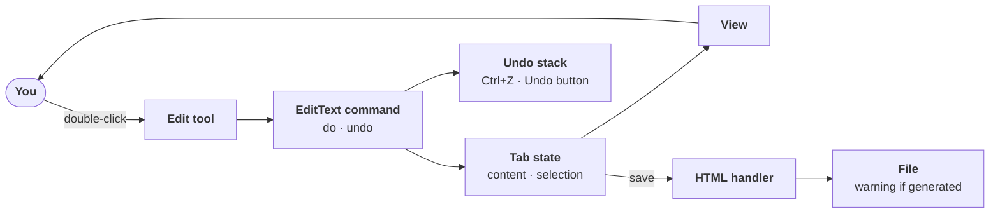

# Base HTML viewer

> **Status: done (2026-10-27).** The user approved the note, answered the open question (yes, move the window code to `assistant.infra`), and added: HTML files opened through the chat open in the viewer. Built as scoped; `ruff` and `pytest` pass. Not yet tried by hand in the real window. What was built and where it differs from the plan: [As built (v1)](../../../src/assistant/modules/html_viewer/docs/viewer-app.md#as-built-v1).

**Asked:** "create a base html viewer that can view the html and make edits to the html." Earlier: double-click to edit and save, undo with Ctrl+Z *and* an Undo button on top, and these answers (session `2026-10-26_03-49-08_html-viewer-according-to-docs`): open files from **any folder**; an **interactive button** in the chat, not a plain link; clicking a file that's already open **switches to its tab, and reloads it if edits were made**; highlight-to-ask is wanted, **after the architecture is settled**; the viewer should be **its own separate window/program with hooks to the AI**, which the assistant treats like a module (starts it, shuts it down when the app shuts down).

**Why:** the first, smallest piece of the [HTML viewer](../../../src/assistant/modules/html_viewer/docs/viewer-app.md) that's useful on its own: see a page, fix it in place, save, undo. Everything later (highlight-to-ask, point, snip, Markdown) plugs into the same state, commands, and view.

**Touches:**
- New module `src/assistant/modules/html_viewer/`: `module.py` (starts and stops the viewer, relays its events), the viewer program (stdlib HTTP server), `page.html` (tabs, toolbar, the edit tool, the undo stack), with config `[modules.html_viewer]`.
- `talker` (a `<<SHOW: path>>` tag) and `temp_ui/page.html` (the "Open in viewer" button in chat).
- The Edge app-window helper, moved from `temp_ui` to `assistant.infra`.
- New event `ViewerTabsChanged` in `src/assistant/contracts/`.
- Tests against the viewer's HTTP API (open, save, the temporary copy, the warning for generated folders).
- Docs: [HTML viewer](../../../src/assistant/modules/html_viewer/docs/viewer-app.md) (answers recorded, status), [runtime](../../agents/runtime.md), the [API](../../api/README.md), and the module list in the [overview](../../architecture/README.md#parts).

## Scope

| In this change | Later |
|---|---|
| Open an HTML file in a tab; switch, close; clicking an open file focuses its tab and reloads it if it changed on disk | Highlight-to-ask (after the architecture is settled) |
| Double-click text to edit it in place | Point at a section, snip |
| Save back to the file, anywhere; a warning when it's in `docs/html` or `docs/html-next-steps` | Markdown handler |
| Undo with Ctrl+Z and an Undo button on the toolbar (in memory, one stack per tab; works after a save too) | Redo: cheap, it uses the same stack |
| One temporary copy of the original per open tab, deleted when the tab closes | **Write-back to Markdown for built pages:** the build script tags each block of text in a page it builds from Markdown (paragraph, heading, list item, table cell) with its source Markdown file and line range. When you edit plain text in such a page and save, the viewer also writes the new text into those lines of the Markdown, so the next rebuild keeps the edit; undo reverses both files together. Text only: Mermaid diagrams, bold and links, and adding or deleting blocks are not covered and keep the overwrite warning. Needs a one-time change to `scripts/build_docs.py`. Converting a whole HTML page back to Markdown is rejected because it rewrites the whole file and loses detail |
| The Talker offers an "Open in viewer" button; it knows which tabs are open | |

## Approach

Built on the [state, commands, view](../../../src/assistant/modules/html_viewer/docs/viewer-app.md#architecture-state-commands-view) design, cut down to what the base needs:

- **Document state:** each tab holds its file's content and the current selection.
- **View:** the tab's frame draws the state; it never changes it directly.
- **Commands:** the edit tool turns a double-click edit into an `EditText` command (anchor, old text, new text). `do` applies it, `undo` puts the old text back.
- **Undo history:** a stack of commands per tab, in memory only. Ctrl+Z and the Undo button both pop it. Nothing permanent is kept.
- **Document handler (HTML):** declares `render`, `anchor`, `edit`, `save`. Saving serializes the state and writes the file through the viewer's one write endpoint. A file in `docs/html` or `docs/html-next-steps` gets a warning first: the next rebuild overwrites the edit.
- **Safety net:** when a tab opens, the viewer keeps one temporary copy of the file as it was; closing the tab deletes it.
- **Tools:** one base `Tool`; the edit tool is the first one. The toolbar shows only tools the open file's handler supports.

## HTML opened through the chat goes to the viewer (added 2026-10-27)

**Asked:** "make it so that we now open all htmls with this instead of my default browser if opened via this chat."

- **The Talker** can't open files. When an HTML file matters, it writes the file's path in its reply, and the chat shows an **Open in viewer** button for it (`temp_ui` sends `InvokeTool viewer.open`). Its prompt says so, and says never to offer or ask for opening an HTML file in the default browser.
- **The Main Assistant** can't call app tools. To show you an HTML file it writes `<<SHOW: path>>` on its own line, instead of `Start-Process` or `start` on the file. The `html_viewer` module sees the tag in its activity (`AgentActivity`) and opens the file, starting the viewer first if it isn't running. Its prompt says so. A helper script calling the viewer's API was the other option, but it couldn't start the viewer through the module, and every run would be a shell command you'd have to allow.

## Decided (2026-10-27)

1. **Its own program and window**, with a local HTTP API as its hooks. A thin `html_viewer` module in the main app starts it on the first show request, relays its open-tab updates (`ViewerTabsChanged`) to the Talker, and stops it when the app shuts down. If you started the viewer yourself, the app connects to it and leaves it running.
2. **Any file, anywhere:** the viewer reads and saves any file, with no per-folder restriction. Saving is your own action in the viewer.
3. **Generated pages** (`docs/html`, `docs/html-next-steps`) are editable; saving there shows a warning that a rebuild will overwrite the edit.
4. **Undo in memory only**, one stack per tab. No permanent backups; one temporary copy of the original per open tab, deleted when the tab closes. Redo later.

5. **Shared window code:** the code that opens a page in its own Edge window moves from `temp_ui` to `assistant.infra`, so both use one copy.
6. **HTML through the chat opens in the viewer** (see above).

## To try it after relaunch

You relaunch the app yourself, from a PowerShell window, with the relaunch command in the [app-update skill](../../../.claude/skills/app-update/SKILL.md). The app's own agents can't relaunch the app they run in.

1. Ask the Talker about an HTML file, for example `docs/html/architecture/html-viewer.html`, and click the **Open in viewer** button in its reply. The viewer window should open with the file in a tab.
2. Double-click a paragraph, change the text, and press Enter. Then try Ctrl+Z and the Undo button.
3. Click Save. A page in `docs/html` should first show the warning that a rebuild will overwrite the edit.
4. Click the button for the same file again. It should switch to the open tab instead of opening a second one.
