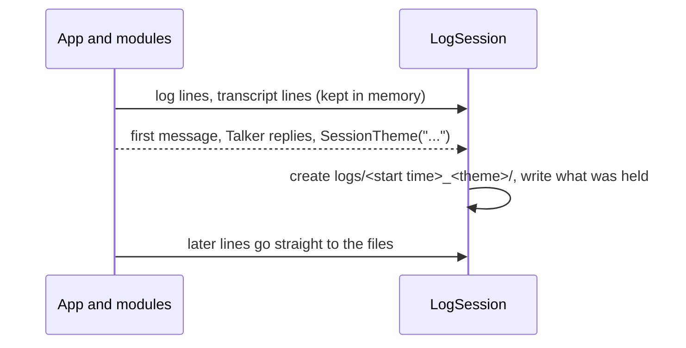

# No logs until the first message

> **Status: done (2026-10-26).** Built as proposed, with the recommended `logs/no-chat.log`. `pytest`: 87 passed, 1 deselected; `ruff`: all checks passed. Not yet tried in the real app (needs a relaunch).

**Asked:** "Nothing about the chat is logged until the first message comes through and the 5-word max summary is created. I don't want empty sessions getting summary folders."

**Why:** today `LogSession` makes `logs/<start time>/` at startup and the transcripts open right away, so every launch leaves a folder, even if you never typed anything. Relaunches make this worse: `relaunch.ps1` force-kills the app, so `finish()` never runs and those folders also never get their theme.

**Touches:** `src/assistant/infra/log.py` (`LogSession`), `src/assistant/infra/claude_session.py` (transcript), `src/assistant/__main__.py`, `src/assistant/modules/talker/module.py`, `temp_ui`'s Logs button, tests, the [logging docs](../../architecture/core.md#logging) and [`LogSession` API](../../api/infra.md#logsession).

**Approach:** create the folder when the theme arrives, already named, and hold everything in memory until then.

- `LogSession` makes no folder at startup. It hands out one **log sink** per file (`assistant.log`, `talker.jsonl`, `main_assistant.jsonl`) that buffers lines until `set_theme`, then creates `logs/<start time>_<theme>/`, writes the buffer, and writes directly from then on.
- The app log goes through a logging handler that writes to its sink; `ClaudeSession` writes its transcript to its sink instead of opening a file. `__main__` passes the sinks in through config, as it passes paths today.
- **No rename at shutdown:** the folder has its final name from the start, so a force-kill (relaunch) or crash still leaves a correctly named folder. `finish()` only closes files.
- **The theme always comes once there's a message:** if the Talker's first turn fails, it still publishes `SessionTheme` with the first message itself (today a failed first turn means no theme).
- **Logs button:** opens the session folder once it exists, else `logs/` (today it would create the folder).

**Open questions:**

- **`assistant.log` for an empty session.** It only holds startup lines, unless something went wrong (a module failed, `claude` missing). *Recommend:* discard it when it holds only normal lines; if it holds a warning or error, append it to one shared `logs/no-chat.log` (like `relaunch.log`, no folder). Lost if the app is force-killed before any message, which is fine.
- **Startup failures** (`Startup failed: ...`) happen before any message, so they'd follow the same rule: into `logs/no-chat.log`. *Recommend:* yes.
