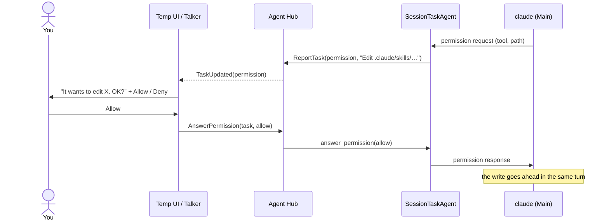

# Permission requests in the app

> **Status: done (2026-10-26).** Approved as proposed (buttons and Talker, allow-once, deny after 10 minutes). Verified end to end with a real `claude`: a write to `.claude/skills/` asked, was allowed, and went through.

**Spike finding:** `claude -p` sends permission requests to its host only with `--permission-prompt-tool stdio`. It then writes `{"type": "control_request", "request_id", "request": {"subtype": "can_use_tool", "tool_name", "input", ...}}` and waits; the reply is `{"type": "control_response", "response": {"subtype": "success", "request_id", "response": {"behavior": "allow", "updatedInput": <input>}}}` (or `{"behavior": "deny", "message"}`). Allowing works for `.claude/` too. Without the flag, everything outside the rules is refused at once. The `.claude/skills` standing write rule was removed: it never worked (sensitive path), and the request covers it.

**Asked:** "I thought I asked you to make it so that you can ask me for permission in-app to fix this." The Main Assistant should ask you when it needs access it doesn't have, and you approve or refuse right there.

**Why:**
- Today anything outside the [standing rules](../../agents/README.md#permissions) is refused at once, and saying "yes" in chat changes nothing.
- Some paths can't be opened by standing rules at all: `claude` treats `.claude/` as sensitive, so the worker's write to `.claude/skills/app-update/SKILL.md` was refused even though `.claude/skills` is in its write rules.
- This is steps 2 and 3 of the [self-improvement plan](../../agents/self-improvement.md#steps) (the in-the-moment asks).

**Touches:** `ClaudeSession`, `SessionTaskAgent`, the agents contracts (`ReportKind`, a new command), `agent_hub`, `talker` (a tag and prompt), `temp_ui` (buttons), and the docs for each.

**Approach:**

1. **Spike first** (small, like the interrupt spike): how `claude -p` sends a permission request on stdout and what reply it expects (the help says prompts go to "the host" by default; the exact message shape is unconfirmed, and it may need an extra flag). Also check whether a "yes" gets past the `.claude/` sensitive-path check.
2. **`ClaudeSession`** passes the request on as an event and gains `answer_permission(request_id, allow)`.
3. **`SessionTaskAgent`** reports it as a new `ReportKind.PERMISSION` and waits; the turn stays open, so nothing else is interrupted.
4. **Hub** gets an `AnswerPermission(task_id, allow)` command and passes it to the agent (a new `ITaskAgent` method).
5. **Talker** says what's being asked in one sentence; your answer becomes an `<<ALLOW>>` or `<<DENY>>` tag.
6. **Temp UI** shows Allow / Deny buttons on the request in the Main Assistant pane. Moved to the Talker pane on 2026-10-26: [Permission requests on the Talker side](permission-on-talker-side.md).

**Open questions** (recommendation first):
- **Where you answer:** both the UI buttons and by talking to the Talker (recommended), or the buttons only.
- **"Always allow":** v1 has allow-once only (recommended); "always" would save a standing rule to `config/local.toml`, and that can come later.
- **No answer:** deny after 10 minutes so a task never hangs forever (recommended), or wait indefinitely.
- **The `.claude/skills` write rule** stays in config for now; remove it if the spike shows `.claude/` always needs a prompt.
