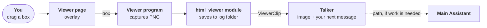

# Snip for viewer

> **Status: done (2026-10-27).** Approved with the recommended answers: Edge's own screenshot (DevTools), up to 3 snips per message, a thumbnail in the chat before sending. Built as planned; `pytest` and `ruff` pass. Checked in a real Edge window (button, drag, screenshot, nearest heading) and with a real `claude` session, which described the snipped image correctly. The heading skips sidebars and sticky bars. As built: [HTML viewer](../../architecture/html-viewer.md#as-built-v1).

**Asked:** "snip for viewer": select a rectangular region of the page shown in the HTML viewer, and the image goes to the Talker, so you can just say "what is this?" and it answers about the image. It's the **Snip** item under Later in the [HTML viewer](../../architecture/html-viewer.md#scope) scope.

**Why:** pointing at a diagram or a part of a page in words is slow. A snip shows the Talker exactly what you mean.

**Touches:**
- `html_viewer`: a Snip button and the drag-a-box overlay in `page.html`; the capture and a `POST /api/snip` in `viewer.py`; `module.py` relays it.
- A new event `ViewerClip` in `src/assistant/contracts/` (already named in the viewer design).
- `infra/claude_session.py`: `send` can carry images as well as text (stream-json supports image content blocks).
- `talker`: attaches the snip to your next message; its prompt says what a snip is.
- Docs: [HTML viewer](../../architecture/html-viewer.md), the [Messaging API](../../api/messaging.md), [runtime](../../agents/runtime.md).

## Approach

**Making the snip in the viewer:**
- A **Snip** button on the toolbar (and Ctrl+Shift+S). The active tab dims, the cursor becomes a crosshair, and you drag a box. Esc cancels.
- The viewer captures exactly that box as a PNG (see open question 1), including Mermaid diagrams.
- A short "Snip sent to the assistant" note confirms it.

**How the image reaches the Talker:**
1. The page sends the box to the viewer program, which captures it and tells the `html_viewer` module.
2. The module saves the PNG in the launch's [log folder](../../architecture/core.md#logging) (`snips/`) and publishes `ViewerClip(file, heading, image_path)`: the page's file, the nearest heading above the box, and the image.
3. The Talker holds the latest snip and **attaches it to your next message**, as an image block plus a line like `[Viewer] snip from architecture/index.html, near "Bird's-eye view"`. That way "what is this?" arrives together with the picture. The Talker has no tools, so it must get the image itself, not a path.

**What the Talker can do with it:** see and describe it, answer questions about it, and compare it with what it knows of the page. For real work on it ("fix this diagram") it hands the task to the Main Assistant along with the image's path; the Main Assistant can read images and has the file.

## Open questions

1. **How to capture:** (a) inside the page with a library such as html2canvas or modern-screenshot (MIT, no setup, but weak on some SVG, which our Mermaid diagrams are), or (b) Edge's own screenshot through its DevTools protocol on the viewer's window (pixel-exact, what you see is what's sent; the viewer's Edge starts with a local debugging port on its own profile). **Recommend (b)**, because the diagrams are the main thing you'll snip. It needs the viewer's own app window, not `window = "browser"`.
2. **One snip per message, or several?** **Recommend:** each snip waits for your next message; a second snip before you speak is added too (up to 3), and they're used once.
3. **Show it in the chat?** **Recommend** a small thumbnail above your next message in the temp UI, with an × to drop it before sending.
