# Code review: the code against our principles, and a cleanup plan

> **Status: built (waiting on you) (2026-11-08): chunks 1–4 built; waiting on the batched restart (see below) and your decision on chunks 5–8.** Your decisions: `Menu` stays in contracts (no move); the code map becomes a permanent page. Chunks 5–8 wait for your decision after 1–4 land; 9–14 come one at a time later. Progress and what waits for the batched restart: [Build progress](#build-progress-chunks-14).

## Checks before the review

- **Full test suite:** 642 passed, 2 deselected, 0 failed (6 warnings, all leftover subprocess pipes at the end of three tests).
- **Ruff:** clean.

## The code as it is now

Every package and the main classes, with who calls whom. **Red** marks a hotspot from the findings below. Plain arrows are calls; dashed arrows are events or processes.

```mermaid
flowchart LR
    You(["<b>You</b>"])

    subgraph Apps["Independent apps: own process, never import assistant"]
        VS["<b>voice_service</b><br/>server → ListenSession<br/>SttEngine · AudioSource · PieceCutter"]
        HV["<b>html_viewer</b><br/>ViewerServer → Tab · HtmlDocument<br/>highlight · snip · MarkdownSource"]
    end

    subgraph Kit["app_kit: standard library only"]
        CA["CompanionApp"]
        KitOther["window · load_layered · merge · module_docs"]
    end

    subgraph Core["Core: the host"]
        App["<b>App</b><br/>wires everything"]
        Life["LifecycleManager<br/>+ loader · registry"]
        Router["CommandRouter"]
        Bus["EventBus"]
        DI["Container"]
        Dir["CoreMenu · directory<br/>MenuTools · dispatch_tool"]
        Perm["<b>PermissionsHandler</b><br/>GrantStore · rules · port · menu"]
        Logs["SessionLogs"]
        App --> Life & Router & Bus & DI & Dir & Perm & Logs
        Life -- "ScopedContext per module" --> DI
    end

    subgraph Contracts["Contracts: interfaces · commands · events"]
        CMod["ModuleProtocol · ModuleContext · Manifest · Menu"]
        CAg["ITaskAgent · IAgentNames · IModuleDoor"]
        CVo["IVoice · voice events"]
        CMsg["messages · control · permissions · tools"]
    end

    subgraph Infra["Infra: shared helpers for modules"]
        PA["ProfileAgent<br/>AgentProfile · agent_access"]
        STA["<b>SessionTaskAgent</b> (757 lines)"]
        CS["<b>ClaudeSession</b><br/>process + usage counting"]
        Door["mcp_door · DoorServer"]
        InfraOther["MilestoneFeed · ContextWatch · agent_tags<br/>agent_names · UsageLedger · LogSession · config"]
        PA --> STA --> CS
    end

    subgraph Mods["Modules: each a wrapper with a menu"]
        Hub["<b>agent_hub</b><br/>tasks · focus · names · door host"]
        Talker["<b>talker</b><br/>module + session + prompt"]
        MA["main_assistant"]
        TA["task_agents"]
        Job["job_search"]
        CV["cv (rezi · build · compare)"]
        TUI["<b>temp_ui</b><br/>module + page.html"]
        VIn["voice_in"]
        VN["voice_notes"]
        HVm["html_viewer (thin)"]
        Use["usage"]
        Misc["console_io · assistant_view · echo"]
    end

    Agents(["claude -p processes"])

    You -- type · click --> TUI
    You -- speak --> VS
    TUI -- "InputReceived" --> Talker
    Talker -- "hub.* · viewer.* · usage.*" --> Hub
    Hub -- "StartTask → ITaskAgent" --> MA & TA & Job & CV
    MA & TA & Job & CV --> PA
    CS -. "stream-json" .-> Agents
    Talker --> CS
    Agents -. "MCP: list · menu · use" .-> Door
    Hub -- hosts --> Door
    Door -- "ListModules · GetMenu · InvokeTool" --> Router
    Router --> Dir
    VIn -- CompanionApp --> VS
    HVm -- CompanionApp --> HV
    VN -- "requires IVoice" --> VIn
    Perm -- "StartTask (review) · cards" --> Hub
    Perm -. "PermissionRequested" .-> TUI
    Mods -. "events" .-> Bus
    Use -. "SessionUsage" .-> Bus

    classDef hot fill:#fbe3e0,stroke:#b0413e,color:#1d1d1b
    classDef port fill:#ffffff,stroke:#6b4fa0,color:#1d1d1b
    classDef module fill:#dbe9f4,stroke:#2f6f9f,color:#1d1d1b
    classDef person fill:#e6f0f7,stroke:#2f6f9f,color:#1d1d1b
    class STA,CS,TUI,Hub,Talker,Perm hot
    class Life,Router,Bus,DI,Dir,Logs,App port
    class MA,TA,Job,CV,VIn,VN,HVm,Use,Misc module
    class You person
```

**The good news first, in one line each:** no module imports another module's code; the core imports no module; `app_kit`, `html_viewer` and `voice_service` never import `assistant`; every `Contract` has the `I` prefix and nothing else does; the core really is small (each core file does one job, except the permissions handler).

## Findings: against our principles

| # | Principle | Gap | Where |
|---|-----------|-----|-------|
| P1 | 4 Minimal core, 3 Loose coupling | The core's permissions handler names modules: the reviewer defaults to `"main_assistant"` and "you" to `("temp_ui",)`; it also drives the Agent Hub's commands (`StartTask`, `GetTaskStatus`, `CancelTask`) for the review | `core/permissions/handler.py:55,117,119,150,429,507,511`; card text "your CV" in `core/permissions/rules.py:76` |
| P2 | 4, 15 Directory then menu | Shared helpers name module tools and ids: `viewer.open` / `viewer.highlight` hard-coded, `hub.*` / `agents.*` in the coordinator prompt, reserved ids, `docs/next-steps/` paths, "agent id = module id" | `infra/session_agent.py:53,61,474,476,575`; `infra/agent_profile.py:25,50-79`; `infra/agent_names.py:13` |
| P3 | 13 Build it once | The SHOW → viewer code is written twice | `infra/session_agent.py:463-482`, `modules/talker/session.py:299-315` |
| P4 | 13 | The four agent modules copy the same pieces: the reset handler, the grant handler, the start sequence, and the prompt bullets ("Your access is listed…") | `main_assistant/module.py:43-47,107`; `job_search/module.py:63-65,94-104,140`; `task_agents/module.py:77-79,276,302`; `cv/module.py:178-216`, `cv/worker.py:79-81` |
| P5 | 13 | Both thin companion modules copy the reload handover (`_handed_over`, `export_state`, `stop(adopted=…)`) line for line; the window-profile path is built four times | `html_viewer/module.py:56-92`, `voice_in/module.py:130-183`; `temp_ui/module.py:203`, `voice_notes/module.py:69`, `html_viewer/viewer.py:60` |
| P6 | 13 | The in-app page server (HTTP, SSE, Edge window) is in `temp_ui` and copied into `voice_notes` (its docstring says so). The reusable-parts page says SSE writing has "only one user"; it now has two | `temp_ui/module.py:198-286,608-768`, `voice_notes/module.py:66-218` |
| P7 | 3, 9 Plain data across boundaries | Facts travel as text prefixes that other modules parse: `"Permission: …"`, `"permission allowed (Auto)"`, `NEED: Risky:`, the `"→"` activity prefix, the `talker:<agent>` session id | written in `agent_hub/module.py:407`, `infra/session_agent.py:460`, `infra/agent_profile.py:92`; parsed in `talker/module.py:79,304,346`, `temp_ui/module.py:158,176-185,498,540,588`, `temp_ui/page.html:499-502` |
| P8 | 3, 16 Chain, don't glue | Modules know other modules' ids, tools and values: `temp_ui` names `voice_in`, `usage`, `talker`, `main_assistant`, `task_agents`; the Talker formats the usage module's rows and checks `source == "voice"` and `"(pasted)"` | `temp_ui/module.py:161,172,216,380`, `temp_ui/agent_tabs.py:29`; `talker/session.py:183,256-279`, `talker/module.py:112` |
| P9 | 15 One road | The Talker sends `SetPermissionMode` and `AnswerPermission` straight to the Hub as commands, so they skip the Hub menu's caller checks the manifest comment promises | `talker/session.py:321,364` vs `talker/module.py:122` |
| P10 | 17 Declared dependencies | Hidden dependencies: `task_agents` uses `IAgentNames` without declaring it; every ProfileAgent module listens to `ModuleStateChanged` and uses `IModuleDoor` without declaring it; `task_agents` publishes `AgentStateChanged(busy=False)` to mean "a helper appeared or closed" | `task_agents/module.py:160,177,211,253`; `infra/profile_agent.py:144`; `main_assistant/module.py:92-99` |
| P11 | 12 No implementation in interfaces | Contracts with code: `Menu` is a full implementation in `contracts`; `ITaskAgent` and `IToolProvider` have default method bodies; two abstract siblings are plain `raise NotImplementedError` | `contracts/menu.py:57-159`, `contracts/agents.py:134-149`, `contracts/tools.py:50`, `contracts/module.py:90,165` |
| P12 | Companion checklist | The viewer has no `load_layered` config (flags only); neither app refuses a non-local `--host`; **the voice service checks no Origin on `/ws/listen` and takes any POST on `/quit`, so a web page you visit could open the mic or quit the service.** The viewer already guards both | `html_viewer/viewer.py:555-564`; `voice_service/__main__.py:22`, `voice_service/server.py:136,143` |
| P13 | Docs drift | The reusable-parts page still calls `ctx.permissions` "planned"; principle 14 says most modules have no menu items (most do now); the README diagram shows the permissions handler as planned and leaves out `usage`, `cv`, `job_search`, `task_agents` and the independent apps; `Manifest.permissions` is declared but nothing enforces it | `docs/architecture/reusable-parts.md:5`, `principles.md:26`, `README.md` diagram, `core/permissions/port.py:29-35` |

## Findings: good practice

**Big files doing several jobs** (the "small orchestrator, handlers for each job" test):

| File | Size | The jobs mixed in it |
|------|------|----------------------|
| `infra/session_agent.py` `SessionTaskAgent` | ~680 lines, one class | task state machine, permission cards and timers, the Auto policy and `git push` block, SHOW to the viewer, `RELOAD` / `ADD_MODULE`, handoffs, context reminders, edit counting, usage and state publishing; `_finish_turn` is a 7-branch chain of last-line tags |
| `modules/temp_ui/module.py` + `page.html` | 706 + 797 lines | HTTP routes (`_serve` is an 18-branch if-chain, ~108 lines), SSE, snips, usage polling, the mic, cards, tabs, grants, the window; the page's one script is ~575 lines, Allow/Deny button code copied 3 times |
| `modules/agent_hub/module.py` | ~570 lines | task state machine, focus and held questions, the door host, the name registry, the coordinator feed |
| `core/permissions/handler.py` | ~475 lines | card lifecycle, grant arithmetic, the review run as a Hub task, turning modules on and off, cancelling tasks, menu rows, user text; `_apply` branches on the string `card.action`; `PermissionChanged` built by hand 6 times |
| `modules/talker/module.py` + `session.py` | 451 + 380 lines | the restart flow (~110 lines) inside the module; `_run_tag` a 13-tag if-chain (~86 lines); `TalkerSession` holds and changes the whole module (two-way dependency) |
| `infra/claude_session.py` | ~400 lines | process I/O plus ~120 lines of token counting |
| `html_viewer/viewer.py` | ~515 lines | tab store, edit and undo, Markdown write-back, snip files, SSE, window, an if-chain router |
| `voice_service/session.py`, `server.py` | 471, 189 lines | `Piece` and the cleaner live in the session file; `_listen` mixes five watchdogs in nested loops; the WebSocket handler and config watcher are closures that can't be tested alone |
| `modules/cv/module.py` | ~480 lines | ~75 lines of schema constants, two menu families, its own config merge (re-doing the core's, its comment admits) |

**Repeated concepts that should be one named thing** (a type or constant with one owner): the token-field maps (3 copies: `claude_session.py:22`, `usage_ledger.py:10`, `session_agent.py:779-809`), `TAKEN_OVER` (3: `voice_in:64`, `temp_ui:171`, `voice_notes:52`), `MAX_SNIPS` and `"(pasted)"` (talker and temp_ui), the "Main Assistant" display name (6 places), the access-card wording (talker and page), token formatting (3), path normalising (`rules.py:42`, `agent_hub:567`), folder resolving and `AccessItem` building (`permissions/menu.py`, `infra/agent_access.py`), single-provider checks (3 in the core), init-and-start in `lifecycle.py` twice, agent defaults (`"acceptEdits"`, tool lists, timeout 600) in 2–3 files each, the sample rate (`audio.py:19`, `zipformer.py:17`, `session.py:84` writes 32000).

**Repeated actions as if-chains instead of a table** (adding one means editing the chain): the agent's last-line tags, the Talker's tags, the temp UI's routes, the viewer's routes, the permission card actions, the door's three tools, `load_engine`, the voice frame reader in `voice_in`.

**Seams:** `ProfileAgent` builds its `ClaudeSession` and `SessionTaskAgent` inside itself, so neither can be swapped or faked without patching.

**Smaller fixes:** `main_assistant` imports three names it doesn't use and writes `"main_assistant"` instead of its manifest id; the viewer module doesn't cast `port` to int and `tabs()` doesn't catch `OSError`; `viewer.py:201` shadows `copy`; `voice_in` pings `/health` twice in a row; `getattr` shims on its own contract fields in `voice_in` and `temp_ui`.

## Proposed additions to the principles

`principles.md` covers loose coupling, composition, build-it-once and the minimal core, but not these. Proposed wording, as new principles 18 to 22:

> **18. One job per class; a small orchestrator with handlers.** A module's main class (and any big class) wires parts together and decides; each separate job (a state machine, a server, a card flow, a protocol) is its own class in its own file, composed in. A file over about 400 lines or a function over about 40 is a signal to split, not a rule. Extends 12.
>
> **19. Name a concept once.** A concept used in two places (a kind of question, a display name, an id scheme, a default, a limit) is one type, enum or constant with one owner, imported by the rest. Facts cross boundaries as typed fields, never as text prefixes another part has to parse. Refines 9 and 13.
>
> **20. Dispatch by table.** Where code picks one of several handlers (tags, routes, card actions, engines, tools), it looks the handler up in a table it registers into, so adding a case is adding an entry, not editing a chain.
>
> **21. Shared code names no module.** The core, the contracts and the shared helpers never name a module, its id or its tools; those come in as config or parameters. A module names only what it declares in its manifest, and its manifest declares everything it uses. Refines 4, 15 and 17.
>
> **22. Inject what you'd swap.** A part that talks to a process, a network or another part takes it as a constructor argument instead of building it inside, so tests and replacements plug in without patching. Not a reason for new interfaces (principle 10): pass the concrete object.

Also proposed:
- **Companion app checklist** (`reusable-parts.md`), item 2 becomes: *"Listens on `127.0.0.1` only, refuses another host, and refuses browser requests from another origin (WebSocket `Origin`, JSON-only POSTs)."*
- **Principle 12** gets one line: *"Contracts hold interfaces and plain data; a contract's code is limited to trivial defaults. Working parts (like `Menu`) are listed as reusable parts, not contracts."* (Or we decide `Menu` stays where it is and say so; your call.)
- Fix the drift in P13: the reusable-parts status line and principle 14's "Today" line.

## Proposed updates to the architecture diagrams

1. **Overview (`architecture/README.md`):** keep it bird's-eye, but show the permissions handler as built and inside the core (it's purple "planned" today); add one **Independent apps** block (voice service, HTML viewer) reached through `CompanionApp`; add `usage`, `cv`, `job_search` and `task_agents` as one line in the Features box; show Talker → Hub as the menu (`hub.*`), not a direct arrow.
2. **New permanent page `architecture/code-map.md`:** the flowchart above (without the red hotspots), linked from the Pages list, updated by the architecture-check skill after each build.
3. **`architecture/agents-code.md`:** redraw the worker layer after chunk 5 below (`SessionTaskAgent` and its parts).

## Cleanup plan, ranked

Small chunks, each with its own tests, ruff, and the architecture check. Ranked by value for the risk. "Restart" means the app restart (core, contracts, infra or app_kit changed); "reload" means a module reload is enough. Nothing gets reloaded or restarted during the build; every chunk is recorded as waiting for the batched restart.

| # | Chunk | What it changes | Risk | Needs |
|---|-------|-----------------|------|-------|
| 1 | **Voice service safety** | Check `Origin` on `/ws/listen`, JSON-only `/quit`, refuse a non-local host (both apps) | Low; fixes a real hole (P12) | Restart of the voice service (a `voice_in` reload does it, or the batched restart) |
| 2 | **Principles and docs** | Add principles 18–22, the checklist line, the drift fixes, the overview diagram, the new code-map page | None to the code | Nothing |
| 3 | **Small fixes** | The list under "Smaller fixes"; `Piece.seconds` from `SAMPLE_RATE` | Very low | Reload `main_assistant`, `html_viewer`, `voice_in` |
| 4 | **One SHOW helper** | One `show_pages` part in infra used by the worker and the Talker; the viewer's tool names in one place (P3) | Low | Restart |
| 5 | **Split `SessionTaskAgent`** | `SessionTaskAgent` keeps the task state machine and orchestrates; new parts: `PermissionGate` (cards, Auto, `git push`), a last-line tag table (`NEED` / `RELOAD` / `ADD_MODULE` / `HANDOFF`), `HandoffKeeper`; `ProfileAgent` takes its session as an argument | Medium (the busiest shared code; its 60+ tests stay) | Restart |
| 6 | **`UsageMeter` out of `ClaudeSession`** | The token counting becomes its own class; one token-field map for it, `UsageLedger` and the worker | Low | Restart |
| 7 | **Agent module kit** | One composed part in infra for the four agent modules: reset handler, grant handler, start sequence; the shared prompt bullets move into `AgentProfile`'s prompt block (P4) | Low–medium | Restart |
| 8 | **Companion handover in `app_kit`** | `CompanionApp.export()` / `adopt()` replace the two copies; one window-profile path helper; the viewer gets a `load_layered` config (P5, P12) | Low | Restart |
| 9 | **Module names out of shared code** | The permissions reviewer and "you" come from `[permissions]` config (a `config/default.toml` edit, which I'll ask about); reserved ids and tool names passed in as parameters (P1, P2) | Low–medium | Restart |
| 10 | **Typed questions instead of prefixes** | `TaskUpdated` / `TaskInfo` get a `question_kind` field (permission, risky, need); the Hub fills it; the Talker, temp UI and page read it instead of parsing (P7) | Medium (a contract change across 4 parts) | Restart |
| 11 | **Honest manifests** | Declare the hidden dependencies; a `HelpersChanged` event instead of overloading `AgentStateChanged`; a check in `ScopedContext` that logs a subscription or `get_one` the manifest doesn't declare (P10) | Medium | Restart |
| 12 | **Core tidy** | One init-and-start path and one single-provider check in the core; card actions as an enum with a handler table; one `PermissionChanged` builder | Low–medium | Restart |
| 13 | **Agent Hub split** | `agent_hub/module.py` wires `tasks.py` (state machine), `focus.py` (focus, held questions), `names.py`; the Talker goes through the Hub's menu for mode and answers (P9) | Medium | Reload `agent_hub`, `talker` (batched restart) |
| 14 | **Talker split** | The restart flow becomes its own class; `_run_tag` becomes a table; the session stops reaching into the module | Medium | Reload `talker` |
| — | **Deferred: temp UI and in-app pages** | Splitting `temp_ui` and sharing a page server with `voice_notes` (P6). The temp UI is a stand-in until the UI handler is designed, so I'd only move its shared constants (`TAKEN_OVER`, `MAX_SNIPS`, `"(pasted)"`) into contracts now (part of chunk 10) and leave the rest for the UI handler design | — | — |

**My recommendation:** approve chunks 1–4 now (safety, the principles, the small fixes, the SHOW helper), then 5–8 as the main cleanup. Chunks 9–14 change contracts or spread across several modules; they're worth doing, but one at a time after you've seen 1–8 land, and 10 and 13 should each get a short design talk first.

## Build progress (chunks 1–4)

Rules for the build: keep the code behaving the same apart from chunk 1; nothing is reloaded or restarted, and the user is not asked about a reload or restart until everything is finished.

### Done: the code of chunks 1, 3 and 4 (session 1)

Full suite after these: **647 passed**, 2 deselected (642 before, plus 5 new tests); ruff clean.

**Chunk 1, voice service safety (built).**
- New reusable part `app_kit/local_guard.py`: `LOOPBACK_HOSTS`, `require_loopback(host)` (a `ValueError` for any non-local host), `local_request(host, origin)` (the `Host` header must name this machine; a browser's `Origin` must be the same app's own host and port; `null` or another site refused; no `Origin` = a program, allowed). Exported from `app_kit`.
- `voice_service/server.py`: a `LocalOnly` ASGI guard on every request and WebSocket (403, or WebSocket close 1008); `POST /quit` is JSON only (415 otherwise). `voice_service/__main__.py` refuses a non-local `--host` (exit 2, "bad config").
- `html_viewer/viewer.py`: its own host set replaced by `local_request` (now also refuses another origin, the viewer's own page still works); `ViewerServer` refuses a non-local host through `require_loopback`.
- Tests: `tests/voice_client.py` (`LocalClient`, a TestClient that calls as `127.0.0.1`, since TestClient's `testserver` host is now refused), used by `test_voice_service.py` and `test_voice_pieces.py`; new tests in `test_app_kit.py`, `test_voice_service.py` (refusals, `main` refusing `0.0.0.0`), `test_html_viewer.py` (origin refusals, non-local host).

**Chunk 3, small fixes (built).**
- `main_assistant`: the three re-exported names (`AUTO_BLOCKED`, `command_rules`, `hook_env`) dropped; tests import them from `assistant.infra.agent_profile`; `_profile` uses `MainAssistantModule.manifest.id`.
- `html_viewer` module: `port` cast to `int`; `viewer.tabs` catches `OSError` / `TimeoutError` (a failed result instead of an exception).
- `html_viewer/viewer.py`: the local `copy` no longer shadows the `copy` module (`opened`).
- `voice_in`: the `getattr` shims on `StopListening`, `Started` and `Final` fields removed. `temp_ui`: the `getattr` on `VoiceTranscript.settled_chars` removed.
- `voice_service/session.py`: `Piece.seconds` uses `SAMPLE_RATE` from `audio.py` instead of 32000.
- **Not done, moved to chunk 8:** `voice_in` pinging `/health` twice in a row. `CompanionApp.ensure_running` only returns a bool, so dropping the second call needs an `app_kit` change (`ensure_running` handing back the ping's answer); that belongs with the companion handover work in chunk 8.

**Chunk 4, one SHOW helper (built).**
- New reusable part `assistant/infra/show_pages.py`: `show_page(ctx, argument) -> ShowOutcome(show, result)` (with `quote_missing`), `show_command(show)`, and the viewer's tool names `VIEWER_OPEN` / `VIEWER_HIGHLIGHT` in this one place. Exported from `assistant.infra`.
- `SessionTaskAgent._show` and the Talker's `SHOW` tag both use it and word their own messages as before. Test: `tests/test_show_pages.py`.

### Done: chunk 2 and the docs for 1, 3, 4 (session 2)

- **Chunk 2, principles and docs (built).** `principles.md`: principles 18–22 as worded above; principle 12 says `Menu` stays in contracts (decided 2026-11-08); principle 14's "Today" line fixed; principle 15 points to `show_page`. `reusable-parts.md`: `ctx.permissions` no longer "planned"; `local_guard` in the `app_kit` row; the SSE line now names `voice_notes`'s copy and why it waits; checklist item 2 as worded above. The overview diagram: the permissions handler inside the core as built, an Independent apps block (green) reached through `CompanionApp`, the Features box as built (`usage`, `cv`, `job_search`, `task_agents`), Talker → Main labelled as the `hub.*` menu; `code-map` in the Pages list. New permanent page `architecture/code-map.md` (the flowchart, with `local_guard` and `show_pages`, no hotspots). `agents-code.md`: one line on `show_page`; the full redraw waits for chunk 5.
- **Docs for chunks 1 and 4.** `api/app_kit.md` (`local_guard`), `api/infra.md` (`show_page`; the `SessionTaskAgent` SHOW line points to it), `api/reusable.md` (both rows; `CompanionApp`'s JSON-only `/quit`), `api/README.md`, `architecture/voice.md` and `html-viewer.md` (refuse other hosts and other origins).
- **Architecture check (chunks 1–4):** modularity OK (`local_guard` is standard library only, in `app_kit`; the apps still import no `assistant`); reuse OK (both new parts listed with Used by lines, the viewer's own host check replaced); fit OK (no contract changed). **Open:** `show_pages` names the viewer's tools in shared code, against principle 21; it's now one place instead of two, and passing the names in is chunk 9's job.

### Was next (session 2), now done

1. Chunk 2 as approved above: principles 18–22 (wording above), principle 12 gets one line saying `Menu` stays in contracts (decided, with the reason: it is the module's menu contract and every module and the core share it), principle 14's "Today" line fixed; `reusable-parts.md`: the `ctx.permissions` "planned" status fixed, the SSE "only one user" line (now two: `temp_ui`, `voice_notes`), checklist item 2 as worded above; the overview diagram in `architecture/README.md` as proposed (permissions handler built and inside the core, an Independent apps block through `CompanionApp`, `usage` / `cv` / `job_search` / `task_agents` in Features, Talker → Hub through `hub.*`) and `code-map` in its Pages list; the new permanent page `architecture/code-map.md` with the flowchart above (no red hotspots; include `local_guard` in app_kit and `show_pages` in infra); `agents-code.md`: add `show_pages` beside the worker and the Talker (the full redraw waits for chunk 5).
2. Docs for chunks 1 and 4: `docs/api/app_kit.md` (a `local_guard` section), `docs/api/infra.md` (a `show_page` section; `SessionTaskAgent`'s SHOW line points to it), `docs/api/reusable.md` (rows for `local_guard` with Used by `voice_service` (`server.py`, `__main__.py`), `html_viewer` (`viewer.py`); `show_page` with Used by `SessionTaskAgent`, `talker`; `CompanionApp`'s row: the service's JSON-only `/quit`), `docs/api/README.md` (both in the reusable list and the App kit / Infrastructure tables), `docs/architecture/voice.md` and `html-viewer.md` (one line each: refuses other hosts and other origins).
3. The architecture check (skill) over chunks 1–4, then `.\.venv\Scripts\python scripts\build_docs.py` (docs-html skill) and the next-steps HTML (next-steps-html skill).
4. The full test suite and ruff once more; the final report.

### What's waiting for the batched restart

- **Chunk 1:** only a voice service restart (it runs on its own; the batched app restart, or a `voice_in` reload, restarts it because its code changed). The viewer's guard loads when the viewer next restarts (it restarts with new code on its next launch).
- **Chunk 3:** reloads only: `main_assistant`, `html_viewer`, `voice_in`, `temp_ui`; the `Piece.seconds` fix with the voice service restart.
- **Chunk 4:** the app restart (`assistant.infra` changed; the Talker's change rides with it).
- **Chunk 2:** nothing (docs only).

Hand checks after the restart: click the mic once and speak (the voice service still answers the app); open a page with SHOW from a task and from the Talker, with and without a quote.

The earlier queue items (the live Auto/Manual switch, the restart note, the text box resize) are each recorded in their own notes.

## Build progress: the "against our principles" fixes (task 7)

The user asked (2026-11-08) to fix the findings under "Findings: against our principles". They approved chunks 5 to 14 in ranked order as small chunks, with behaviour kept the same, tests for each new class, the full suite and ruff after each chunk, and nothing reloaded or restarted (and no question about it) until all are done. **Ask first, don't build:** chunk 9's `config/default.toml` edit, chunk 10 (typed question kinds: a contract change) and chunk 13 (splitting the Agent Hub). Put each as a full question with a recommendation in one NEED **after** the other chunks, and keep going with the others meanwhile. Also in scope: the chunk 4 gap (`show_pages` names the viewer's tools in shared code, against principle 21) and the `voice_in` double `/health` ping (in chunk 8).

### Done (session 3): code of chunks 5 and 6, tests and ruff green

Full suite: **660** (657 + the 3 `test_usage.py` tests now pointing at the meter); ruff clean.

**Chunk 5, `SessionTaskAgent` split (built, waits on the app restart).**
- New `infra/permission_gate.py`: `PermissionGate` (the one open question: tool requests, approvals, timer, Auto policy and the `git push` block, approval outcomes delivered after the turn); `describe_request`, `is_git_push`, `summarize`; texts `CODE_LOADED`, `APPROVAL_PENDING`, `GIT_PUSH_BLOCKED`, `NO_TASK`, `TIMED_OUT`.
- New `infra/handoff_keeper.py`: `HandoffKeeper` (count against `max_handoffs`, `take`, `progress`, `too_many`, `reset_request`, `reminder`); texts `HANDED_OFF`, `RESET_NOW`, `CONTEXT_REMINDER`, `TOO_MANY_HANDOFFS`.
- `infra/agent_tags.py`: `LastLineTags`, a table of last-line prefixes → handlers (principle 20); the Talker can reuse it in chunk 14 for any last-line tags.
- `infra/session_agent.py`: keeps the state machine and orchestrates; `_finish_turn` dispatches through the table (`NEED`, `RELOAD`, `ADD_MODULE`, `HANDOFF`); new module functions `reload_request`, `add_module_request`.
- `infra/profile_agent.py`: `session_factory=ClaudeSession` argument (principle 22).
- `infra/__init__.py` exports `PermissionGate`, `HandoffKeeper`, `LastLineTags`. Tests: `tests/test_worker_parts.py`.

**Chunk 6, `UsageMeter` (built, waits on the app restart).**
- New `infra/usage_meter.py`: `UsageMeter` (all the token counting, `line(event)`, `restarted()`), `TokenKind` / `TOKEN_KINDS` (the one token-field map: API usage, per-model, event names), `USAGE_FIELDS`, `EVENT_FIELDS`, `event_fields(used)`.
- `ClaudeSession` has `meter`; `context_tokens`, `used`, `subagents` read it. `UsageLedger.TOKEN_FIELDS = EVENT_FIELDS`; `session_usage` / `subagent_usage` use `event_fields`. Tests: `tests/test_usage_meter.py`; `tests/test_usage.py` calls `session.meter.line`.

### Done (session 4): chunk 7, tests and ruff green

Full suite: **664** passed (660 + 4 in `tests/test_agent_kit.py`); ruff clean.

**Chunk 7, agent module kit (built, waits on the app restart).**
- New `infra/agent_kit.py`: `AgentKit(ctx)`: `add` (provide as `ITaskAgent`, keep it), `get`, `agents`, `open` (the start sequence: `request_access` → `ProfileAgent` → provide → start; a failed start is taken back and re-raised), `take_back` (stop + withdraw), `follow_grant(agent_id, config)` (the grant handler: `granted_config` → `set_access`, `AccessDenied` logged), `busy`, `stop`, and the reset handler (subscribes `ResetRequested` itself). Exported from `assistant.infra`.
- `infra/agent_profile.py`: `BASICS_BLOCK` (the three bullets every agent was told: access at the end, a line before each step, a summary at the end) now starts `prompt_block`, for helpers and the coordinator alike; the bullets left `WORKER_PROMPT` (Main Assistant), `JOB_PROMPT`, `HELPER_PROMPT` and the cv worker's prompt. The words are the same; they now sit after each agent's own rules.
- `main_assistant`, `job_search`, `cv`, `task_agents` use the kit: their own reset handlers, grant handlers (all but `task_agents`'s per-kind one) and provide/start/take-back code are gone.

### Done (sessions 4–5): chunk 8, tests and ruff green

Full suite: **669** passed; ruff clean. (`test_html_viewer.py::test_refuses_what_it_cant_do` once failed with a Windows `ConnectionAbortedError` on a refused request and passed on rerun: a flaky socket abort, not this chunk.)

**Chunk 8, companion handover in `app_kit` (built, waits on the app restart):**
- `app_kit/window.py`: `window_profile(name)` (`%LOCALAPPDATA%\AI_Assistant\<name>_window`); used by `temp_ui`, `voice_notes`, the `html_viewer` module's `DEFAULT_PROFILE`.
- `app_kit/companion.py`: `CompanionApp.last_answer` (the last ping's answer, `{}` if none); new `CompanionHandover(handover, module, host, port, *, args, label, log, **app_kwargs)` with `app`, `key`, `export()`, `stop()`. It's a separate class, not methods on `CompanionApp`, because the handed-over/restart flags belong to each module copy while the `CompanionApp` object moves between copies. Exported from `app_kit`.
- `html_viewer/module.py` and `voice_in/module.py` use `CompanionHandover` (`self._companion`, with `self._app = self._companion.app`); their copied handover code is gone. `tests/test_companion_reload.py` reads `second._companion._restart`.
- `voice_in._ensure_service` reads `self._app.last_answer` instead of a second `/health` call (the double ping is fixed).

- `html_viewer/viewer.py`: `DEFAULT_PROFILE = window_profile("html_viewer")`; its own config (P12): `load_viewer_config(path=None)` (the defaults `CONFIG_DEFAULTS`, then `config/html_viewer.toml` and its `.local` through `load_layered`, only if the file exists; no file was created) and `viewer_settings(argv)` (`--config`; the flags win over the config). `main` uses them.
- Tests: `test_voice_in.py` (the one ping decides: `ensure_running` only, no second `/health`), `test_app_kit.py` (`last_answer`, `CompanionHandover` kept / not kept / quit when the code changed, `window_profile`), `test_html_viewer.py` (config, `.local`, flags over it, a missing given file).

### Done (session 5): chunk 9 without the config edit, tests and ruff green

Full suite: **669** passed; ruff clean.

**Chunk 9, module names out of shared code, first half (built, waits on the app restart):**
- `infra/agent_names.py`: `check_agent_id(..., reserved=())`; the reserved ids left shared code. `RESERVED_AGENT_IDS` (`core`, `hub`, `talker`) now lives in `agent_hub`, which adds its coordinator and passes them to `_Names` (same refusals as before when the Hub is on). `task_agents` passes `TRUSTED_CALLERS` (`talker` and `YOU`), the callers its menu trusts, for its own early checks (the Hub-off fallback and `instances`); `hub` / `core` there are now refused at the claim, not at config load.
- `infra/agent_profile.py`: `COORDINATOR_BLOCK` (the `hub.*` / `agents.*` text) moved to `main_assistant/module.py`. `AgentProfile.coordinator: bool` became `role_block: str = HELPER_BLOCK`; `from_config(..., role_block)`, `prompt_block(role_block=HELPER_BLOCK)`; `ProfileAgent(role_block=...)`. `main_assistant` passes its block; the prompt text is unchanged.
- Tests updated: `test_agent_names.py` (shared rules reserve nothing; the Hub's set), `test_multi_agent.py`, `test_task_agents.py`.
- **Left, on purpose:** the examples "`viewer.open`" in `DOOR_PROMPT` and the door's `use_item` description (help text, not a dependency); the `docs/next-steps/` paths in `HandoffKeeper` (a project convention, not a module). **Waits on the question below:** the `show_page` tool names, and the permissions reviewer / "you".

### Done (session 6): chunk 11, and the first half of chunk 12; tests and ruff green

Full suite: **678** passed (669 + 9 in `tests/test_honest_manifests.py`); ruff clean. The module library table was regenerated (`build_docs.py`, needed by `test_module_docs.py`).

**Chunk 11, honest manifests (built, waits on the app restart).**
- `Manifest.uses` (contracts): contracts looked up at each call that may be missing, **with no start order**. It's needed because `optional` adds a start-order edge, and agent modules ↔ the Hub would form a cycle (the Hub lists `ITaskAgent` as optional). `registry.py` and `lifecycle.py` check `uses` entries are contracts; `build_docs.py` shows `uses` in the library's Contracts column.
- `AgentStateChanged.change: "state" | "opened" | "closed"` (default `"state"`), **in place of a new `HelpersChanged` event**: there are five listeners (Hub, Talker, usage, temp UI, assistant view), and all of them treat an open or close the way they treat a state change, so a second event would have meant a second subscription in each one for the same handling. `task_agents` sets `opened` / `closed`. The change is additive with a default, and no listener changed.
- `ScopedContext`: a `subscribe` not in `listens`, or a `get_one` / `get_all` not in provides / requires / optional / uses, still works but is **logged once** as a warning. Across the suite only test fakes trip it.
- `infra/agent_kit.py`: `AGENT_USES` (`IModuleDoor`, `IAgentNames`), `AGENT_SENDS`, `AGENT_PUBLISHES`, `AGENT_LISTENS` (`ResetRequested`, `ModuleStateChanged`), each named once and exported from `assistant.infra`. `main_assistant`, `job_search`, `cv` and `task_agents` declare from them. `task_agents` adds `ITaskAgent` to `uses`, plus `StartTask` / `GetTaskStatus` and `PermissionChanged`.

**Chunk 12, core tidy: first half (built, waits on the app restart).**
- `core/permissions/handler.py`: `CardAction` (a `StrEnum` inside the core, not a contract; `PermissionRequested.action` gets `.value`), an `_appliers` table (`_apply_access`, `_apply_grant`, `_apply_revoke`; grant and revoke share `_close_agent_card`), and one `_changed(...)` builder for every `PermissionChanged`. `REVIEWER` and `YOU` are now named once at the top (they still name modules; they move to config when chunk 9's question is answered). No behaviour change: the existing permissions tests pass unchanged. No new class needs its own test (`CardAction` is covered by the card tests).
- **Left for the next session:** `lifecycle.py` gets one init path (`_init_one(cls, handover)`: context, instance, `init`, `link_menu`, close on failure), used by both `start()` and `_activate()`. Check how tests build `LifecycleManager` / `make_context` first: `start()` calls `make_context(manifest)` with one argument and `_activate` with two. Also one single-provider rule `allows_another(contract, current_ids)` in `container.py`, used by `Container.provide`, `registry.resolve_modules` and `lifecycle._activate`. Keep every error message as it is, then add a small test for `allows_another`.

### Done (session 7): the rest of chunk 12, chunk 14, the docs and the architecture check

Full suite: **684** passed (681 after chunk 12, plus 3 in `tests/test_talker_parts.py`); ruff clean.

**Chunk 12, second half (built, waits on the app restart).** `core/container.py`: `allows_another(contract, current)`, the one single-provider rule, used by `Container.provide`, `resolve_modules` and `LifecycleManager._activate`. Every error message is unchanged. `lifecycle.py`: `_init_one(cls, handover)` is the one init path (context, instance, `init`, menu linked; the context is closed on failure), used by `start()` and `_activate()`. Test: `tests/test_core_tidy.py` (the rule, and the `CardAction` values).

**Chunk 14, Talker split (built, waits on the batched restart; a `talker` reload would also do).**
- New `talker/restart.py`: `RestartFlow` (`first_input`, `used`, `close`, `ask`, `on_worker_update`, `restart`, `app_state`, `history_text`) and the restart texts. The module re-exports the texts, and keeps `restart` as its attribute.
- `talker/session.py`: `_run_tag` is a table (`_tags`, one `_tag_*` handler per tag). The session no longer changes the module's fields: it uses `task_started`, `usage_of` and `restart.ask` / `restart.used`.
- `talker/module.py`: `focus` / `main` properties and `task_started` / `usage_of`, with the restart code moved out.
- `tests/test_restart.py` calls `restart.app_state()`. New `tests/test_talker_parts.py`.
- **Not done here (needs chunk 13):** the Talker's `SetPermissionMode` / `AnswerPermission` still go straight to the Hub as commands (P9).

**Docs (one pass):** `api/infra.md`, `api/app_kit.md`, `api/core.md`, `api/modules.md`, `api/agents.md`, `api/reusable.md`, `api/README.md`, `architecture/principles.md` (17), `architecture/code-map.md` (the infra block and the cleanup status), `architecture/agents-code.md` (the worker's and the Talker's parts, picture 2). Rebuilt with `build_docs.py`.

**Architecture check (chunks 5–14):**
- **Modularity:** OK. The apps still import no `assistant` (the test passes), `CompanionHandover` and `window_profile` are standard library only, in `app_kit`, and no module imports another's internals.
- **Reuse:** OK. Every new part is in the index with its Used by line, and the copies these chunks found (the token maps, the handover code, the profile path, the agent module code, the SHOW code) are now one each.
- **Fit:** OK. The contract changes are additive with defaults (`Manifest.uses`, `AgentStateChanged.change`), and no listener changed.
- **Open, against principle 21:** `show_page`'s viewer tool names and the permissions handler's `REVIEWER` / `YOU` (question A below), and the Hub's text prefixes (question B).

### Waiting on the user: the three questions (asked 2026-11-08)

A. **Chunk 9, second half: config edit.** Add to `config/default.toml` `[core.permissions] reviewer = "main_assistant"` and `you = ["temp_ui"]` (the handler already reads both keys), and `[modules.html_viewer] open_tool = "viewer.open"`, `highlight_tool = "viewer.highlight"` for `show_page`, read by the worker and the Talker. The code defaults then become empty or neutral. *Recommended:* yes for the two permissions keys. For the viewer's tool names, rather than config: have `show_page` find the tools by a menu tag in the directory (still config-free), or leave them as they are (one place, documented).
B. **Chunk 10: typed question kinds.** `TaskUpdated` and `TaskInfo` get `question_kind` (`permission`, `risky`, `need`, with `""` as the default). The Hub fills it, and the Talker, temp UI and page read it instead of parsing `"Permission: "` and `NEED: Risky:`; `MAX_SNIPS` and `"(pasted)"` move into contracts. It's a contract change across four parts, behaviour the same. *Recommended:* yes, as an additive field with a default.
C. **Chunk 13: Agent Hub split.** `agent_hub/module.py` wires `tasks.py` (the task state machine), `focus.py` (the focus and held questions) and `names.py`. The Talker's mode switch and card answers move onto the Hub's menu (`hub.mode`, `hub.answer`) so they get its caller checks (P9). *Recommended:* yes, after B (B changes the same code), as two small steps: the split first, then the two menu items.

**Answers (2026-11-08):** A yes (with the recommendation: the viewer's tool names stay where they are, in one place), B yes, C **not approved yet** (explained to the user; not built).

### Done (session 8, task 8): A and B, tests and ruff green

Full suite: **689** passed (684 + 5 in the new `tests/test_question_kinds.py`); ruff clean.

**A. Chunk 9, second half (built, waits on the app restart).** `config/default.toml` `[core.permissions]` now sets `reviewer = "main_assistant"` and `you = ["temp_ui"]`; `core/permissions/handler.py` defaults are `REVIEWER = ""`, `YOU = ()`, so the core names no module. Tests that build an app from a bare config now pass `you = ["temp_ui"]` as the config does (`test_permissions_handler.py`, `test_access_cards.py`). `show_page`'s viewer tool names stay as they are (the user's choice).

**B. Chunk 10, typed question kinds (built, waits on the app restart).**
- Contracts: `QuestionKind` (`none` `""`, `need`, `risky`, `permission`) with `QuestionKind.of(kind, text)`, the one place `RISKY_PREFIX` (`"Risky:"`) is read; `TaskInfo.question_kind` and `TaskUpdated.question_kind`, both defaulting to `none`; `TaskInfo.question_line` (`Permission: <text>` for a permission request, for display). `MAX_SNIPS` and `PASTED_FILE` moved into `contracts/messages.py`.
- `agent_hub`: `_TaskRecord.ask(kind, text)` and `answered()`; the question is stored as the agent wrote it (no `Permission: ` added) and its kind goes on every `TaskUpdated` and `TaskInfo`.
- `talker`: reads `task.question_kind` on a focus change (no `PERMISSION_PREFIX`); its task lines and restart note use `question_line`, so they read as before. `MAX_SNIPS` / `PASTED_FILE` from the contracts.
- `temp_ui`: the risky card and the released permission / risky cards are picked by `question_kind` (no `PERMISSION` / `RISKY` constants); the page needed only a comment change (it already got typed item kinds).
- **Same behaviour:** every card, line and text the user sees is unchanged. One small difference for agents: `hub.status` now gives the bare question plus `question_kind` instead of `Permission: …`.
- **Still text, left for later:** the temp UI's `"permission allowed / denied"` check on an answered update, and `"Risky:"` inside the NEED text the Talker reads (the agent writes it; the Talker's prompt explains it).

**Architecture check (A, B):** modularity OK (the core and shared code name no module for the permissions; contracts import nothing new); reuse OK (`QuestionKind`, `MAX_SNIPS`, `PASTED_FILE` in the index with Used by; the two copies of each limit are now one); fit OK (both new fields are additive with defaults, old senders and tests unchanged).

Files edited more than once this session: `contracts/agents.py`, `contracts/__init__.py`, `agent_hub/module.py`, `talker/module.py`, `talker/restart.py`, `temp_ui/module.py` (targeted Edits in one batch each), `tests/test_agents.py`, and the doc pages `api/agents.md`, `api/messaging.md`, `architecture/core.md`, `permissions.md`, `principles.md` (two targeted Edits each).

**C approved (2026-11-08).**

### Done (session 9, task 9): C, chunk 13, the Agent Hub split

Full suite: **696** passed (689 + 7 in the new `tests/test_agent_hub_parts.py`); ruff clean.

**Chunk 13 (built, waits on the batched restart; reloading `agent_hub` and `talker` would also do).**
- `agent_hub/module.py` (~250 lines, was ~590) is a small coordinator: the commands, events, menu and door, plus the running-agent lookup (`_agents`, `_agent`) and the coordinator's feed (`_feed`), handed to the parts.
- New `agent_hub/tasks.py`: `TaskRecord` (was `_TaskRecord`) and `TaskBoard` (start, status, send, cancel, report, answer, set_mode, `release`, `holds`, `may_steer(anyone=)`, the cap, the folder check). The board never names the Talker: the module passes `anyone=caller == "talker"`.
- New `agent_hub/focus.py`: `Focus` (`focused()` with the fallback to the coordinator, `set`, `check`, `stored` for the handover).
- New `agent_hub/names.py`: `AgentNames` (was `_Names`) and `RESERVED_AGENT_IDS` (still importable from `module.py`).
- **P9 fixed:** two new menu items, both `callers=("talker",)`: `hub.answer(task_id, allow)` and `hub.mode(agent_id, mode)` (Auto refused with `not_available`). The Talker's `<<ALLOW>>` / `<<DENY>>` (task cards) and `<<MODE: manual>>` use them; its manifest no longer sends `AnswerPermission` / `SetPermissionMode`. The temp UI's buttons still send the commands (your own clicks). Access cards still go to the core as `AnswerPermissionRequest`.
- **Same behaviour:** every command, event, text and refusal is unchanged; the existing end-to-end Talker tests for ALLOW and MODE pass through the menu now. `tests/test_agent_tabs.py` reads the focus as `hub._focus.focused()`.
- **Docs:** principles 15 (one road) and 18 (the Hub as the example), code map, agent code page (the Hub's parts, pictures 1 and 2), `api/agents.md` (the menu table, `AnswerPermission`, `SetPermissionMode`, `IAgentNames`), `api/reusable.md`, `api/infra.md`, `api/README.md`, `api/tools.md`, `modules/agent_hub.md`, `modules/talker.md`, `agents/runtime.md`. Rebuilt with `build_docs.py`.

**Architecture check (chunk 13):** modularity OK (the parts import only contracts and infra; no module imports another's internals; the board and focus name no module); reuse OK (no new shared helper: `TaskBoard`, `Focus`, `AgentNames` are the Hub's own, so not in the reusable index; `IAgentNames` and the Hub's menu rows updated); fit OK (no contract change; the menu gained two items, the Talker lost two direct commands, so the menu's caller checks now cover every Talker → Hub call).

Files edited more than once this session: `talker/session.py` and `talker/module.py` (imports and calls, one batch each), and the doc pages `principles.md`, `agents-code.md`, `api/agents.md`, `api/reusable.md`, `modules/agent_hub.md`, `agents/runtime.md` (targeted Edits in one batch each).

### Then

1. Every queued chunk is built. Ask the user about the one batched restart (now asked).

The earlier docs list, now done: `api/infra.md` (`PermissionGate`, `HandoffKeeper`, `LastLineTags`, `UsageMeter`, `ProfileAgent.session_factory`, `AgentKit` and the `AGENT_*` declarations, `CompanionHandover` / `window_profile` / `last_answer` in `api/app_kit.md`, `check_agent_id(reserved=)`, `AgentProfile.role_block`), `api/modules.md` (`Manifest.uses`, the `ScopedContext` warning), `api/agents.md` (`AgentStateChanged.change`), `api/core.md` (`CardAction`, the appliers table), `principles.md` 17 (`uses`, the warning), `api/reusable.md` rows with Used by (`PermissionGate`, `HandoffKeeper`: `SessionTaskAgent`; `LastLineTags`: `SessionTaskAgent`; `UsageMeter`, `TOKEN_KINDS`: `ClaudeSession`, `UsageLedger`, `session_usage`; `AgentKit`, `AGENT_*`: the four agent modules; `CompanionHandover`: `html_viewer`, `voice_in`; `window_profile`: `temp_ui`, `voice_notes`, `html_viewer`), `api/README.md`, `architecture/agents-code.md` (redraw the worker layer: `SessionTaskAgent` with its gate, keeper, tag table, feed), `architecture/code-map.md`, then the architecture check, `build_docs.py`, and the next-steps HTML.

**Waiting for the batched restart:** chunks 1 and 3–14 (contracts, core, shared infra and `app_kit` changed, so an app restart is needed; it also restarts the voice service and the viewer with their new code). Nothing reloaded, nothing asked. **Hand checks after it:**
- Click the mic once and speak.
- SHOW a page from a task and from the Talker, with and without a quote.
- Open and close a helper with the + button (its tab comes and goes).
- Answer an access card in the app and by telling the Talker.
- Ask the Talker to restart the app (the note is saved and read back).
- Reload `html_viewer` once (the viewer is handed over, or restarted if its code changed).
- A permission request and a risky-step card still appear (B); tell the Talker "allow" / "deny" on a task's card and "switch to Manual" (both now go through `hub.answer` / `hub.mode`, C).

**The helpers before the restart (checked 2026-11-08).** The user restarts the app themselves.
- `hub.agents`: only `main_assistant` (this task) and `job_search_agent` are running. `cv_agent` is gone and has no task.
- `job_search_agent`, task `26423c52`: **busy, not safe to restart yet.** It's in the middle of a live 7-day job search in Chrome: the script sweep is done (346 rows, 21 boards failed on rate limits, to retry), Google's careers site and Tesla were checked (the user asked to redo both by hand in Chrome), and it was running the core Meta terms with Newest sort. Still to do: the rest of Meta, Google search, LinkedIn keyword searches and suggested jobs, Indeed, JobRadar, screening, queue entries and the report. It says its run notes live under `C:\Jobs\CV\Recruiters\docs\job_ui\search_runs\scratch_20261108\`.
- Its task has no parent (the user started it), so `hub.send` from `main_assistant` is refused ("isn't one of main_assistant child tasks"). The user is already in its tab: they tell it there to stop at a safe point and write its handoff note, and give its path.
- **After the restart:** `hub.start` with `agent_id="job_search_agent"` and a text like "Continue the 7-day job search from your handoff note at <path>", or start it from its tab.
- **Its handoff note:** `C:\Jobs\CV\Recruiters\docs\job_ui\search_runs\scratch_20261108\handoff.md`. The restart stopped the agent before it wrote the note, so the note was missing after the restart. The user chose (2026-11-08) to restart the task and have the agent rebuild the note first, from `C:\Jobs\CV\Recruiters\docs\job_ui\search_progress.json` (the live checklist) and the `# FAILED (21)` line of `docs\job_ui\search_runs\sweep_20261108_0318.log`.

Files edited twice in session 6: `core/context.py` (the field setup, then the lookup checks), `infra/__init__.py` (the import, then `__all__`), and `main_assistant` / `job_search` / `cv` `module.py` (the manifest, then the import). `task_agents/module.py` took four Edits in one batch, and `registry.py` / `lifecycle.py` one each; both get one more in the rest of chunk 12.

Files edited twice so far in this task: `agent_tags.py` (import and table, same step), `profile_agent.py` (argument, then factory call and import), `infra/__init__.py` (imports, then `__all__`), `session_agent.py` (chunk 5 Write, then chunk 6's `event_fields`), `tests/test_worker_parts.py` (two test fixes after the first run).
