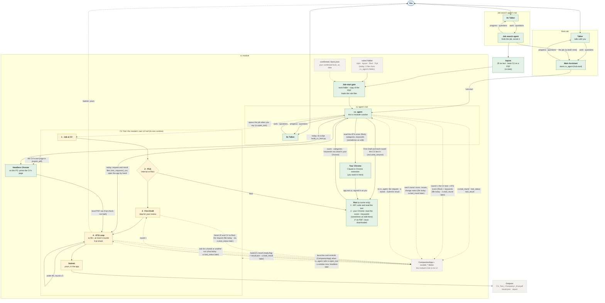
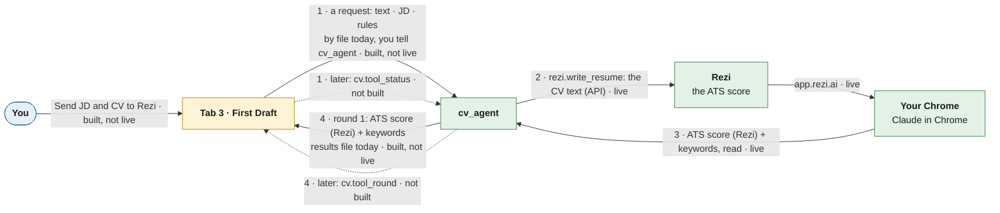
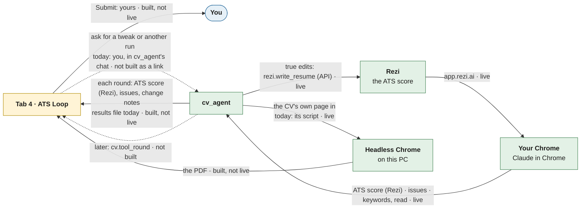
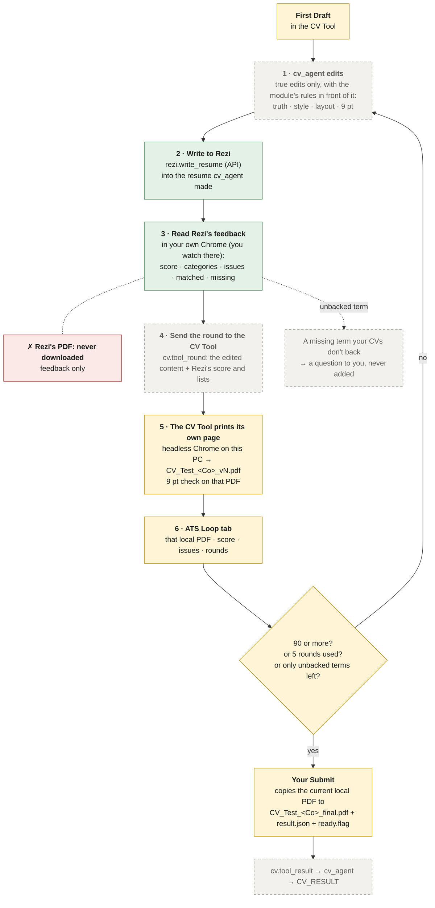

# The cv module at a glance

> **Status: built (waiting on you) (2026-11-09).** Merged into the cv module's overview (`src/assistant/modules/cv/docs/README.md`, "Design: the CV Tool flow" and "Build state"). Kept here until you say it can go. A picture of today, checked in the code and the running app. The build of [cv-uses-cv-tool.md](cv-uses-cv-tool.md) is paused partway through ([handoff](handoff-cv-tool-build.md)).

The CV Tool is the cv module's own UI half. The module owns it: it launches the app, feeds it jobs and stops it. It isn't part of the Main Assistant or the core. The app's code sits in `src/cv_tool/`, not in the module's folder: `CompanionApp` starts it with `python -m <package>`, and from inside `cv/` that would import the module's code into the app.

**Green: built and live. Yellow: built, not live. Grey, dashed: not built.** Dotted arrows are links that aren't built yet.

**Rezi's PDF is never downloaded.** This is your rule (2026-11-08 03:01, memory note `rezi-pdf-download-auto.md`), and the CV Tool ignores a Rezi PDF if one is sent. Rezi only scores the text; the PDF is always the CV's own page. In the Hooli run, Rezi's PDF was downloaded in rounds 2–4, before the rule.

**The ATS score comes from Rezi,** read in your Chrome. The CV Tool only shows it. With the Internal pick, the CV Tool's own estimate is used instead.

## The First Draft and ATS Loop tabs, close up

These are the same boxes as above, with the arrows between the tabs, cv_agent and Rezi. Each label ends with its state. Dotted arrows aren't built.

**First Draft (Rezi picked)**

**One ATS Loop round**

## How cv_agent reaches Rezi today

There are two ways, and both are live:
- **Rezi's MCP API, through the cv module.** The `rezi.*` items (`mcp.py`) call `https://api.rezi.ai/mcp` with your OAuth sign-in token. That covers `rezi.write_resume` (make or update a resume this module made), `rezi.read_resume`, `rezi.generate_keywords`, and `rezi.list_resumes`. No browser is involved.
- **Chrome, through the Claude in Chrome extension** (`chrome = true` in `module.toml`). The prompt allows it only on app.rezi.ai, signed in as you. cv_agent uses it to read the **Rezi Score**, its categories, and the matched and missing keywords (prompt step 4), and for AI Keyword Targeting.

The CV Tool app never talks to Rezi itself (memory note `cv-tool-rezi-request.md`).

**You watch Rezi in your own Chrome.** cv_agent drives Rezi through the Claude in Chrome extension, in your normal Chrome, where you're signed in to Rezi. You look at that Chrome window to see what it's doing. The CV Tool shows no live view of Rezi.
- **Your words (2026-11-07, `logs\2026-11-06_04-28-55_open-two-extra-helpers-one\talker-cv_agent.jsonl`):**
  - L418, 21:21: tab 2 was first to have "A live view in chrome of the CV rezi is editying".
  - L874, 22:47: "Why not just embed a chrome window into the UI?"
  - L886, 22:47: "When it needs to, I can just sign in onto the chrome window on the app when you need me."
  - L910, 23:03: "Then the Rezy UX, I'll just look at the chrome broswer. It's cleaner anyway."
- **Agreed:** the Talker (L917, 23:03: "You'll watch Rezi in your own Chrome"), and cv_agent (L923, 23:07), which dropped "Arrange windows". It's written in `cv_tool\README.md` L120 and memory note `cv-tool-scope.md`. The embedded view in `cv_tool_ui_plan.md` (its own Chrome over DevTools) is out of date.
- **When Rezi opens in Chrome:** no log, note or README says. **Proposed:** with the Rezi pick, cv_agent opens the job's Rezi resume in a tab of your Chrome at First Draft and keeps that tab through the ATS Loop. When it writes through the API, it reloads the tab, so you see the same text it scores.

## The ATS loop, round by round

**Where the PDF comes from:** at every round, and for the final PDF, it's the CV Tool's own page. The app's code (`export_pdf` in `cvlib.py`) prints it with headless Chrome on this PC. Submit copies that local PDF to `_final.pdf`. Rezi only scores the text. Its PDF is never downloaded (the rule in memory note `rezi-pdf-download-auto.md`, 2026-11-08), and the app ignores a Rezi PDF if one is sent (`apply_result`).

**What each colour means here:**
- **Green:** writing to Rezi and reading its feedback are live today.
- **Yellow:** the First Draft, the printing of the app's own page, the ATS Loop tab and Submit work in the old standalone app, driven by hand through result files.
- **Grey, not built:** sending a round with `cv.tool_round`, `cv.tool_result`, the 9 pt check, the rules in front of cv_agent each round (the `rules/` folder), and the prompt that runs this loop.

**Today's live prompt is different.** It still runs the old steps: edit in Rezi, score in Chrome, and build the final PDF with LibreOffice (`cv.build`). It then imports that PDF into Rezi as a check, and has no Submit.

## Each box today

| Box | State | What the code shows |
|---|---|---|
| Main tab: Talker and Main Assistant | Built, live | `talker` and `main_assistant` are on; `hub.agents` lists `main_assistant`. It starts cv_agent with `hub.start`, using the text `cv.task` returns |
| Each agent's own Talker (job search agent, cv agent) | Built, live | Every agent tab is a pair, its own Talker and its own worker (`talker`: "one Talker per agent tab"). A tab's Talker starts the first time you use the tab |
| Job search agent | Built, live | `job_search` is on; `hub.agents` lists `job_search_agent`. Its `save_jd.py` names the base CV as a `.pdf` |
| Inputs (cv.task) | Built, live | `cv.task` takes the JD as text and a `CV_Test_*.pdf`; `cv` is on |
| Job-start gate | Built, live | `job_start.py` makes the work folder, copies the PDF, loads `job_skills` |
| rules/ folder | Not built | No `cv/rules/` yet. `job_skills` loads two files from cv_agent's folder and memory |
| confirmed_facts.json | Not built (the link) | The file exists in `C:\Chang\Jobs\rezi\cv_tool\data\`, but nothing in the module loads it |
| cv_agent | Built, live, old flow | Its prompt (`worker.py`) still runs the old 8 steps straight in Rezi, with no CV Tool |
| Rezi | Built, live | The `rezi.*` items |
| CV Tool, four tabs, the pick, First Draft, ATS Loop, Submit | Built, not live | They work in the old standalone app (`C:\Chang\Jobs\rezi\cv_tool`), opened by hand. The module doesn't launch it or feed it. The copy in `src/cv_tool/` has its main code and pages, but no server yet |
| Links: open the job, `cv.tool_*` items | Not built | No `CompanionApp` and no `cv.open_tool` / `cv.tool_*` items in `module.py` |
| 9 pt check | Not built in the module | Only the new copy of the app can measure sizes (`font_sizes`); nothing calls it |
| Outputs: final PDF, result.json, report | Not built (the link) | Submit writes them in the old app, but nothing returns them to the module. Today's path is the old one: `cv.build` (LibreOffice) and `cv.report` |
